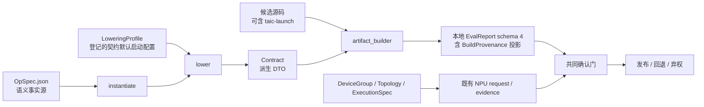
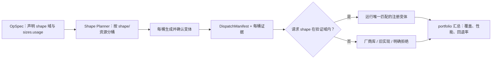

# 构建、执行与证据语义升级计划

状态：设计计划，2026-10-28 修订。HEAD `3fb9ac85bfc7` 上**尚未实施**；R0 已冻结基线并给出采用/丢弃
结论（`docs/架构/构建执行与证据语义升级-R0/README.md`），R0 未提交任何改动，R1 尚未开始。工作树另有
一批未提交、未验收的构建路径改动，其采用/丢弃结论见 §2.1。

## 0. 一页说明

**问题。** 一份候选“算什么、怎么启动、用什么构建、测量是否来自同一构建与评测上下文”今天散在多处：
task 手写 `Contract` 与 grid/threads，`flops`/`min_bytes` 有两份，生产代码有绕过 builder 的编译入口，
本地报告不记录构建身份，确认门在缺证据时不区分“没比较”和“比较一致”，也没有独立绑定 baseline/
oracle/库版本的评测身份。

**做法。** 算子语义只写在 OpSpec；契约默认启动几何只由登记的 LoweringProfile 派生，候选自己的
`taic-launch` 由候选摘要覆盖；生产构建只经 `backend.artifact_builder()`；本地报告只读写 schema 4 并
带构建投影与评测身份；本地与远端确认都三方核对搜索报告、确认报告和当前预期，缺证据记 unknown、
不一致记 mismatch，两者都不发布。旧 run、旧报告、旧测试向量不迁移。

**验收。** 按阶段推进，每阶段完整验收见 §9 与各节“硬验收”：

| 阶段 | 做什么 | 怎样算完成 |
| --- | --- | --- |
| R0 | 冻结代码与文档快照，登记删除/保留清单 | 每项删除有结构负例、每项保留有回归；工作树未提交改动有采用/丢弃结论 |
| R1 | RMSNorm 的 OpSpec、`instantiate`、Metal `lower` | 四个组合的 Contract、题面、记账与 R0 快照逐字节一致；canonical 身份与派生结果指纹可复算 |
| R2 | 全部 task 派生化 | 静态全集逐项等价，动态族按域验收，`tasks/**` 不再构造 Contract |
| R3 | 唯一构建入口 | AST/调用图证明生产树没有第二条 source→pipeline 路径；成功与 compile failure 都保留投影所需来源 |
| R4 | 本地 schema 4 与测试重置 | 旧报告与 R4 前的 run 被拒绝；status/build 字段闭集与评测身份正负例通过 |
| R5 | 统一确认门 | build/evaluation 的 mismatch/unknown 与模拟都不能发布；所有确认批次和最终发布共用一个判定 |
| R6 | 下游重建 | observe/brief/catalog 与直接读报告的模块只把 schema 4 当当前证据 |
| R7 | 真实后端验收 | 真实 Mac 另行授权；NPU 另获授权 |
| R5b（后续） | shape 域与分发 | 不阻塞 R6/R7，见 §10 |

**禁则。**

- 不保留旧 run、旧报告、旧测试契约的兼容；不双版本读取、不回填、不重签、不做双版本回放。
- 不为本计划改六 RPC 的名称与 field number、BlobChannel、VendorDriver、AttemptSupervisor、
  HMAC/digest 算法和设备生命周期；唯一的 contract 取值变化是报告 descriptor 升到 v4（§6.1）。
- 模拟结果、fake backend 与 Metal 的真实证据都不能证明 NPU 可用或提速，也不进入确认或发布。
- 不统一厂商 ABI、graph 格式、launch 参数、容差或设备执行模型；不发明 `GraphTask`；OpSpec 不是
  kernel DSL，也不要求所有后端共享 tiling/launch/容差。
- 不宣称新 schema 让已发布数字更准确；`docs/架构/backend-phase0-baseline.json` 不改写、不重算。

配套文档：[附录 A：OpSpec 示例与负例](构建执行与证据语义升级-plan-附录A-OpSpec与specialize.md)；
[决策与对比记录](构建执行与证据语义升级-决策与对比记录.md)。三者冲突时以本文为准。

## 1. 已定方向

- **OpSpec 用独立 JSON 文件 + JSON Schema**，只承载算子语义；不做 TOML 旁路，不把 `Task.meta`
  dict 当第二份合同。
- **启动配置、构建工具链与设备事实分三层**，不新建“大一统 BackendProfile”：

  | 层 | 是什么 | 何时确定 |
  | --- | --- | --- |
  | LoweringProfile（新增） | 后端 lowering 与契约默认启动策略：grid/threads、常量目标类型、启动形式、variant 参数、影响生成代码的构建期 tiling、Contract 展示的目标名 | 登记、静态，构建前已知 |
  | BuildProfile / BuildProvenance（既有） | builder、工具链/SDK、build_host、`compile_profile` | 构建时探测；原样就是线上的 BuildProvenance |
  | DeviceGroup / topology / resource generation / ExecutionSpec（既有） | 设备身份、分配与执行 | 远端既有协议 |

  启动策略不能塞进既有 `BuildProfile`：Metal 的 profile 在子进程打开设备后由
  `MetalSourceBuilder._profile_for` 生成，含 MSL 版本、设备名与 math；它原样成为线上
  BuildProvenance，`compile_profile` 最多 16 个键且值只能是字符串、布尔、整数或 null
  （`tcenv/remote/contracts.py::_npu_diagnostics`），装不下 grid/threads 三元组或多段 launch；
  `ArtifactBuilderRegistry` 按 profile 名登记并要求 `compile_profile` 与登记值相等，GEMM variant
  若放进去就得逐个登记构建器。
- **两阶段派生**：`instantiate(opspec, dtype, size)` 唯一产生语义实例与 `spec_params`；
  `lower(instance, lowering_profile)` 只派生后端 `Contract` 与 `backend_params`。`Contract` 是派生
  DTO，不再是权威；ExecutionSpec 不另维护一套启动几何。
- **生产构建只有** `backend.artifact_builder()`。删除 `Backend.compile`/`compile_all` 及绕过 builder
  的直接编译调用；`MetalContext.compile` 只作 builder 内部 primitive。
- **复用现有中立构建模型**：`BuildProfile`、`BuildOutcome`、`ArtifactBundle`、`NativeExecutable`、
  `BuildEvidence` 直接复用，不另造构建证据词汇。LoweringProfile 是 lowering 配置，不是构建证据，
  也不上线。
- **本地报告只写/读 schema 4**；旧本地报告、旧 run、旧 outbox 不迁移、不续跑。
- **本地与远端候选都必须过构建与评测身份确认门**。远端已有 request digest、outbox、签名 result
  envelope、BuildEvidence 与 evaluator epoch，直接复用；baseline/oracle/库版本归独立 evaluation
  fingerprint，缺证据是 unknown，不是一致。
- **测试用 NPU contract、fake fixtures、golden vectors 可整体重置/升版并删除旧向量**；新旧不得同时合法。

## 2. 当前实际情况：不是从零开始

| 对象 | 当前事实（HEAD） | 对本计划的影响 |
| --- | --- | --- |
| 通用通信与执行面 | 六 RPC、job/attempt、outbox、HMAC、BlobChannel、容器执行面有真实代码与协议实现 | 保留承载结构，只改其承载的任务/构建语义 |
| NPU 专用 contract 与 fake | source/blob/bundle/build 契约、fake driver、FakeTsm 与测试组合根存在，均为 `simulated=true, publication_allowed=false` | 可以整体重建，不是 NPU 已实现证据 |
| 中立构建模型 | `BuildProfile`、`BuildOutcome`、`ArtifactBundle`、`BuildEvidence` 已实现；`MetalSourceBuilder` 已有 `probe`/`build`；NPU build contract `document_version=5` 已存在 | 复用；不重新发明 builder |
| 生产编译调用 | `tcenv/evaluate.py::_evaluate_in_process` 仍调 `backend.compile`/`compile_all`；`tcenv/xcworker.py::main`、`tcenv/backends/metal/profile.py::measure_peak_bandwidth`、`tcenv/backends/metal/probes.py::time_msl` 直接调 `ctx.compile`；`MetalSourceBuilder.build` 自己也经 `backend.compile` 委托；`Backend` 协议上还没有 `artifact_builder` | R3 要把它们接到 builder 并删除旁路 |
| 启动几何 | 契约默认 grid/threads 由 task 手写在 `Contract` 里；候选可用 `taic-launch` 块自定 math、核名、每段 grid/threads 与 workspace（`tcenv/backends/metal/launch.py::LaunchSpec`），evaluate 把 `spec.math` 传进编译 | 启动事实有两个合法来源：LoweringProfile 派生的契约默认值，以及候选声明并经校验、由候选摘要覆盖的 launch |
| `Contract` / `Task` | `Contract` 还带写死的 `gpu="Apple M4 Max (Apple9 GPU family)"`，出现在 `describe()` 里；`Task` 携带 reference、cases、容差、`flops`/`min_bytes`、`meta`，以及进入提示词但不在 `task_fingerprint` 里的 `description` | 语义收敛到 OpSpec；启动与目标名归 LoweringProfile；`description` 归 track |
| 目标名的第二来源 | `tcenv/contract.py::Contract.gpu` 有默认值，`taic/orchestrator.py::Orchestrator.__init__` 与 `tcenv/cli.py::cmd_show` 又用 `replace(... gpu=target.display_name)` 覆盖 | R2 删除两处覆盖；目标名只能由登记的 LoweringProfile 产生。R1/R2 只覆盖 `apple-m4-max`；非默认 target 需另立 `target_id → LoweringProfile` 选择，否则拒绝，不复用 default profile |
| MetalSourceBuilder | 真实 Mac 的 MSL 编译、pipeline、错误分类与小规模正确性证据 | Metal 是真实实现；NPU 不得借 Metal 的证据宣称已适配 |
| 真实 NPU backend / SDK / 驱动 / 设备 | 未实现、未验收 | R7 之前只做离线/模拟设计 |

### 2.1 R0 基线包与删除/保留清单

撰写时观察（不是基线声明）：最初基线 HEAD 为 `f325181`，R0 冻结时的 HEAD 为 `3fb9ac85bfc7`。工作树有
未提交的构建路径草稿：`tcenv/backends/base.py`、
`tcenv/backends/metal/{backend,probes,profile,source_builder}.py`、`tcenv/evaluate.py`、
`tcenv/xcworker.py`、`tcenv/remote/artifact_builder.py`、`tests/backends/metal/test_source_builder.py`、
`tests/support/npu_sim/fake_backend.py`，并新增未跟踪的 `tests/shared/test_single_build_path.py`。它们删掉了
`Backend.compile`/`compile_all`，让 evaluate/xcworker 经 `artifact_builder()` 构建；同时新增了 R3 要删的
`MetalSourceBuilder.compile_source`，结构测试用的是正则文本搜索，而该未跟踪测试在 `tests/shared/` 里
import `tcenv.backends.metal.*`，违反 `tests/shared/README.md` 的分层规则。同一工作树里
`tcenv/remote/{artifact_bundle,blob_channel}.py` 与对应测试的改动属于并发的安全加固工作，不是本计划的
构建路径草稿，R0 按文件归属排除。工作树还有 `tests/shared/test_read_probe.py`、
`tests/shared/test_session_kpi.py` 等未跟踪文件；R0 的 `git status --short` 清单必须逐项列出并决定
纳入/排除，不能只记一个。

R0 结论（逐文件清单、哈希与证据见基线包的 manifest 与采用/丢弃决定表）：草稿**部分采用**为 R3 起点——
保留 `artifact_builder()` 工厂、`MetalSourceBuilder._compile_assembled`、`MetalKernelSet`、
evaluate/xcworker 的单一构建路径，以及 `BuildError.report_detail` 与 live-handle 不变量；**丢弃**
`MetalSourceBuilder.compile_source`、`probes.py::_compile_probe_source`、
`profile.py::measure_peak_bandwidth` 的改道，以及当前形态的 `tests/shared/test_single_build_path.py`
（R3 换成 AST/调用图检查，GPU 用例移入 `tests/backends/metal/`）。本轮不 `git commit`/`git stage`：
“采用”只是把这些文件登记为 R3 的起点，提交仍是单独的人工决定。基线包至少记录：完整 HEAD、
`git status --short`、staged/unstaged diff、未跟踪文件清单、每个纳入快照文件的 SHA-256，以及并发修改的
归属和采用/排除决定。基于带修改的工作树实施时，快照的 patch 与文件清单一并冻结；纳入快照的未跟踪文件
内容进入可重放 patch 或只读归档，并与清单/SHA-256 对照。后续引用代码位置一律用**文件 + 符号名**，不用
行号。

R0 为下表逐项登记“当前位置/符号、删除或保留、替代路径、结构检查、所属阶段”。表中的“删除”是后续
实施任务，不表示已删：

| 对象 | 终态与阶段 | R0 必须钉住的验收 |
| --- | --- | --- |
| `tasks/**` 中手写 `Contract(...)`、`grid`/`threads` 启动事实 | R2 删除，统一由 `lower` 派生 | AST/调用图证明 task 装配不构造 Contract；注释或文档字符串不算调用 |
| `Orchestrator.__init__` 与 `tcenv/cli.py::cmd_show` 的 `contract.gpu=target.display_name` 覆盖 | R2 删除两处；目标名归登记 LoweringProfile | 同一 target 的 Contract/`task_fingerprint` 不随调用方变化；非默认 target 由登记 profile 提供 |
| `Backend.compile` / `compile_all`、`MetalBackend.compile` 及委托兼容壳 | R3 删除（HEAD 仍在；工作树已删，待 R0 定） | 协议、实现和调用方均无第二入口；唯一生产入口是 `backend.artifact_builder()` |
| builder 的 `build` 之外直接 `MetalContext.compile`、`MetalSourceBuilder.compile_source`（工作树新增）或等价便捷入口 | R3 删除 | 生产调用只经 `ArtifactBuilder.build` 取得 BuildOutcome；`evaluate.py`、`xcworker.py`、`probes.py`、`profile.py` 与内部 fill kernel 均覆盖 |
| `tests/shared/test_single_build_path.py` 的正则结构检查（工作树新增） | R3 换成 AST/调用图 | 别名、委托与 `getattr` 调用也能被发现；现文件在 `tests/shared/` import backend 且含 `gpu` 用例，R3 必须把结构检查与 GPU 用例分置到符合 `tests/README.md` 的层 |
| `tcenv/task.py::task_fingerprint` 的“Metal 指纹逐字节不变”承诺、`tests/shared/test_backend_neutral.py` 的字面 golden、`run_config.json` 的 `hash_scope` 文本 | R1 有意重置 | 新指纹改为版本化 canonical document，纳入完整派生结果、`opspec_digest` 与 `description`；三处同批更新，不保留旧哈希 |
| 本地 EvalReport 0–3 的 migrate/read/resume/replay 与 schema 3 本地 golden | R4 删除 | 旧版本和未知键 fail closed；只保留 schema 4 读写与新向量，不改写旧 run |
| 测试用 NPU 旧 contract、fake fixtures、golden vectors | R4 按新语义整体重置/升版 | 新旧向量不得同时合法；本地 schema 4 与 NPU `document_version` 不绑定同步 |
| 报告顶层 `simulated` 键及据此跳过 `EvalReport.from_json` 的旁路 | R4 删除（读写点见 §6.1） | 生产树对报告无 `simulated` 读写；模拟报告同样过严格 `from_json` |
| `native_digest` 仅 Metal、远端免构建身份比较、缺证据当一致 | R4–R5 删除 | 按 build host/handle 可见性表达；本地与远端都比较各自证据，unknown/mismatch 分开 |
| 第二套构建结果/证据 DTO | R1–R4 不引入并清除残余旁路 | schema 4 `build` 只投影既有 `BuildProvenance`、`ArtifactBundle`、`NativeExecutable`、`BuildEvidence` |
| `flops` / `min_bytes` 双份手写定义 | R1–R2 删除 | 只有一个语义推导器或唯一显式字段；旧值只作迁移对照；规则版本进入 `opspec_digest` |
| `tcenv/evaluate.py::_callable_identity` 的任意闭包 `repr` 与未版本化 evaluation fingerprint | R1–R2 登记实现身份，R4 删除生产旧路径并重置 | 可执行身份改为登记实现 ID/版本 + canonical params + task-pack digest；AST/class/闭包对象不直接序列化，`Task.baselines` registry 与实际库版本进入评测身份，缓存不保留旧键 |
| guard 优先级猜测、静默 fallback 记功、单点最好值代表全域 | R5b 禁止引入 | 见 §10 |

明确保留：通用六 RPC 与既有 field number、BlobChannel、VendorDriver、AttemptSupervisor、设备生命周期、
HMAC/digest 与 evaluator epoch；现有 `BuildProfile`/`BuildOutcome` 中立模型；既有
`tcenv/remote/task_pack.py` manifest/digest，以及 `tcenv/schema.py`/`tcenv/remote/protocol.py` 的
`PROTOCOL_VERSION`；参考实现、独立 golden、fresh case、权限边界与 search best/confirmation 分离。
`docs/架构/backend-phase0-baseline.json` 是历史记录，不是 R0 的新实现基线。

R0 的退出条件：每项后续删除都映射到一个结构负例，每项保留面都有回归或 drift check，且没有以“保持
兼容”为由新增双路径、双版本读取或第二套证据词汇。R0 只做静态核查，不运行模型、GPU/NPU 或付费实验。

## 3. 身份模型：分层而不混算

| 身份 | 唯一覆盖内容 | 明确不覆盖 |
| --- | --- | --- |
| `opspec_digest` | 完整校验后 OpSpec、语义校验/实例化规则版本、work-accounting 规则版本；包括 shape 域、dtype 覆盖、layout/stride、attrs、acc/rounding、物化容差与用例域 | grid/threads、CANN、设备拓扑、构建参数、track 文本；不挑选“重要”字段哈希 |
| `lowering_profile_digest` | 完全解析的 canonical LoweringProfile、`lowerer_id/version`、variant factory 身份与版本；包括契约默认启动、常量目标类型、构建期 tiling 与 Contract 目标名 | 工具链/SDK、设备探测结果、候选的 `taic-launch`、源码/artifact 字节 |
| BuildProvenance（既有，不另设 digest） | builder/toolchain/SDK、build_host、`compile_profile`（Metal 含 math、device、gpu_family）、`source_sha256`、`artifact_set_digest` | lowering 配置、DeviceGroup、placement；远端按完整字段比较，不新增 RPC 字段 |
| `device_group.profile_digest` | vendor/device/runtime/driver/firmware/adapter 与设备组能力 | 语义合同或候选源码 |
| `topology_digest` + resource generation | 物理/逻辑拓扑、分配、reset 与拓扑变化代际 | builder 源码或编译选项 |
| `candidate_sha256` | Agent 提交的源码字节，含其 `taic-launch` 块 | assembled header、构建环境 |
| `assembled_sha256` | 契约头 + 候选正文 | 不替代 `candidate_sha256` |
| `artifact_set_digest` | ArtifactBundle manifest 与字节 | DeviceGroup、placement、cache policy、BuildProvenance |
| `native_digest` | backend-native executable 的 handle-free canonical descriptor；fresh BuildOutcome 另要求同一 live handle | 不序列化 handle；portable/不可见时为 `null` + 原因 |
| `task_fingerprint` | 版本化 canonical 任务身份：完整 SemanticInstance、Specialization（含 Contract 全字段）、题面、`description` 与后端 reference source | 不再以 `Contract.describe()` 代替 Contract 全字段；不新增 RPC 字段 |
| `task_pack_digest` | 测量一侧的 task pack 身份：远端是 `tcenv/remote/task_pack.py::load_task_pack` 对已部署 pack 全部实际文件的 manifest digest；本地是同一 manifest 文档形状对该 task 登记 pack 文件集的摘要（§7.2） | 不覆盖外部 baseline 库版本、设备或 candidate；两侧文件集不同，摘要不要求跨本地/远端相等，只在同一测量上下文内比较 |
| `baseline_implementation_digest` | 版本化 `Task.baselines` registry 的**实现**部分：完整登记集合中每个 measured runner 的登记实现与 canonical params；不随 fast-bench 选择子集变化。`compiler_baseline`/triton-msl 是后端从缓存估计出的诊断列，不是 `Task.baselines` 的 runner，另登记其 estimator/缓存身份或明确不纳入发布身份（§7.2） | 可用性与库版本（环境事实）；host 可由 task pack 登记重算 |
| `baseline_environment_digest` | `Task.baselines` registry 的**环境**部分：每个登记 baseline 的可用性与实际库版本，由测量进程声明 | 实现代码身份；已安装但版本不可识别时整体为 `null` |
| `evaluation_fingerprint` | `task_fingerprint`、task-pack、输入生成/reference/error scale 的登记实现与 canonical params、`baseline_implementation_digest`、`baseline_environment_digest` | 不放进 `build`；不序列化任意闭包，不替代 protocol、target/device 与 timing evidence 检查 |
| `request_digest` | 每个请求自己的 canonical 全集：CandidateDigest、`task_fingerprint`、ExecutionSpec、BuildProvenance、device group/topology、placement/timing、cache policy 等 | 只把一份结果绑到它自己的请求；搜索与确认的请求本来不同，不用于跨期比较 |

**48 核 → 40 核只是分类说明，不是要专门实现的迁移。** 核数/UB 改变构建期 tiling 或生成代码时
LoweringProfile 变化；只改编译选项时 BuildProvenance 变化；改变设备组分配/拓扑时由 device
group/topology/resource generation 使旧测量失效。负例只要求三类变化分别被识别，不能用一个 digest 混掉。

### 3.1 Canonical 文档、规则版本与派生结果

所有新增 JSON 身份都按 `SHA256(RFC8785(canonical_document))` 计算，结果是 64 个字符的小写十六进制；
键顺序与空白不影响摘要。字符串按原码点哈希，**不做 Unicode 归一化**：同一可见文本的 NFC/NFD 两种
写法是不同身份，源文档必须固定写法。源 JSON 必须用拒绝重复键的解析器读取，重复键、非 ASCII 键与
未知键都是结构非法，不能靠“最后一个值”静默决定身份。不得用对象地址、字典插入顺序、主机路径或源码
文本的临时拼接代替 canonical document。

**canonical 值编码（本节与 §7.2 的所有身份文档共用）。** 仓库既有的
`tcenv/remote/contracts.py::canonical_digest_document` 只接受 null、bool、整数、字符串、数组与对象，键必须
是非空 ASCII，且**拒绝浮点数**（ `_validate_json` 对 float 落到不支持类型）。因此身份文档在送入该函数前先
做一层规范化，规则只有这几条：

- 对象键必须是非空 ASCII 字符串（OpSpec、LoweringProfile 与各登记文档的 JSON Schema 同步加此约束）；
- 整数在 IEEE-754 安全范围内直接用整数，超出则拒绝；
- 非整数数值（float）编码为**字符串**：有限值用 Python 最短往返 `repr`（如 `1e-06`、`0.002`、`-0.0`），
  并保证 `float(s) == value` 且 `repr(float(s)) == s`；`0.0` 与 `-0.0` 因此是不同 canonical 值，源文档
  不得把二者当作同一语义互换；NaN/±Inf 拒绝。host 与 evaluator 都是 Python，这条在两侧一致；这些字符串
  只是 canonical 文档里的值，不改变 OpSpec 等源文档本身的 JSON 写法；
- 每个身份 `number` 字段在实例化时必须物化为**唯一 JSON 类型**（int 或 float），由 schema 与登记规则
  版本固定；同一**逻辑字段**不能既 int 又 float。`contract.args[i].value` 的类型由该参数的 dtype/角色
  固定，`contract.constants[i].value` 由 `msl_type`/登记决定；不同参数可以不同，但同一参数不能在两次
  实例化中漂移。`work_accounting.flops`/`min_bytes` 由
  R1 的记账规则统一物化为 float（或统一 int），并登记在 `work_accounting_version`；因此 canonical 文档
  里它们是相应的字符串或整数，不随任务变化。`tolerances.*`/`resolved_attrs.*`/`case_domain.inputs.*`
  的具体类型也由 OpSpec schema/registry 固定（容差为 float；attrs 按 `attrs.*.dtype`；case input 按该
  case 域声明）；同一逻辑字段不能在两次实例化中漂移。
- bool/null/字符串原样。规范化递归作用于整份文档，包括 OpSpec 里的 EPS default、物化容差这类浮点。

也就是说 §3.1 与 §7.2 文档形状里写 `number` 且实例化为 float 的字段，在 canonical 文档中是上述十进制
字符串；实例化为 int 的字段仍是整数。`1` 与 `1.0` 是不同 canonical 值；字段的语义类型必须由 schema/
规则版本固定，不能靠 canonicalizer 猜。实现不得另写一个支持 float 的 RFC 8785 序列化器。若将来需要
跨语言重算这些指纹，先给数字序列化补跨实现测试向量再换规则。

`opspec_digest` 的 canonical document 形状固定为：

```json
{
  "fingerprint_kind": "opspec",
  "fingerprint_version": 1,
  "semantic_rules_version": "registered-semantic-rules-version",
  "work_accounting_version": "registered-work-accounting-version",
  "document": {"...": "完整、已通过 JSON Schema 与语义校验的 OpSpec"}
}
```

- `document` 是**整份** OpSpec，包括 `spec_version`、公式、注释性字段、显式 default、`sizes.usage` 等；
  不由实现者猜测哪些字段值得哈希。track 文本不在这份 JSON 中，所以仍不进入该摘要。
- `semantic_rules_version` 标识 default 解析、dtype/shape 接受域、容差与 SemanticInstance 物化规则；
  `work_accounting_version` 标识 `flops`/`min_bytes` 的推导或显式表达式校验规则。两者来自登记注册表，
  不能由请求或模型临时填写。相应接受域或物化结果可能改变时必须升版本；纯诊断文字或不改变行为的
  重构不需要。即使当前实例逐字段相同，版本变化也会有意识地使旧身份与缓存失效。
- R1 无论选择语义推导器还是唯一显式记账表达式，都必须登记上述记账规则版本；不能等 R2 再补。

`lowering_profile_digest` 的 canonical document 形状固定为：

```json
{
  "fingerprint_kind": "lowering_profile",
  "fingerprint_version": 1,
  "lowerer": {"id": "registered-lowerer", "version": "registered-lowerer-version"},
  "variant_factory": null,
  "profile": {"...": "完全解析并校验后的 LoweringProfile"}
}
```

`profile` 含自己的 schema 版本、登记名、backend/target 类别和完全物化的配置；default 与具体 variant
必须先解析，不能哈希未解析 alias。variant 任务把 `variant_factory` 置为 `{id, version}`，非 variant 任务
只能为 `null`。同一 profile 可能产生不同 Contract/`backend_params` 时升 `lowerer.version`；variant 文法、
默认 alias 或接受域变化时升 factory 版本。R0/R1 登记 RMSNorm 的 profile 字段闭集与注册位置，R2 为每个
family 登记其字段闭集；不要求所有 family 共用一个万能 profile schema。

仅有声明摘要还不够。R1 为两个派生对象定义只含 JSON 值的 `fingerprint_document()`，字段形状固定为：

```text
SemanticInstance = {
  opspec_digest, dtype, size,
  shapes: {symbols: {name: integer}, tensors: {name: [integer, ...]}},
  resolved_attrs: {name: JSON value}, spec_params: {name: string},
  tolerances: {rtol: number, atol_rel: number, exact: boolean},
  case_domain: {cases: [string, ...], inputs: {case: {name: JSON value}}},
  work_accounting: {flops: number, min_bytes: number}
}

Specialization = {
  opspec_digest, lowering_profile_digest,
  spec_params: {name: string}, backend_params: {name: string},
  contract: {
    kernel_name, grid: [integer, integer, integer],
    threads: [integer, integer, integer], gpu,
    args: [{name, index, role, dtype, shape: [integer, ...], value, doc}, ...],
    constants: [{name, msl_type, value}, ...]
  }
}
```

两个投影都是闭集；args/constants 保持 Contract 顺序，buffer 的 `value=null`、scalar 的空 shape 与
实际 scalar value 不得省略。`case_domain.cases` 保持 OpSpec 声明顺序，`inputs` 是**逐 case** 的输入域
参数（来自 OpSpec 的 case 域声明，如 `ieee_*`/`domain_case` 的物化值；没有声明的 case 不出现，不写空
对象占位）。Specialization 的 `opspec_digest`/`spec_params` 必须与 SemanticInstance 相同，构造时不一致
即拒绝，不能靠 lower 回写对齐。

版本纪律不是唯一防线：即使有人忘了升 `semantic_rules_version` 或 `lowerer.version`，完整的
SemanticInstance/Specialization 派生文档也进了 `task_fingerprint`，物化结果变了任务与评测身份就会变，
缓存和确认仍抓得住；只有单独比较 `opspec_digest`/`lowering_profile_digest` 的地方抓不住。

`task_fingerprint` 从 R1 起改为下述 canonical document 的 RFC 8785/SHA-256：

```text
{
  fingerprint_kind: "task", fingerprint_version: 2,
  task, dtype, size, backend_id,
  semantic_instance: SemanticInstance.fingerprint_document(),
  specialization: Specialization.fingerprint_document(),
  triton_source, description,
  reference_source: task.reference_for(backend_id)
}
```

`Contract.describe()` 仍是题面与 R1 对照输出，但不再代表 Contract 全字段；reference/oracle、输入生成器
和 baselines 的可执行身份另归 §7.2 的评测身份。

## 4. OpSpec 与两阶段派生



### 4.1 OpSpec 只放语义，字段各有唯一归属

OpSpec 使用 `tasks/<op>/opspec.json` + 已登记 JSON Schema，字段只围绕：算子身份与公式、符号维及其
shape 约束、dtype 覆盖、tensors/layout/stride/memory space、numerics、attrs、语义用例域、`sizes` 及其
`usage`，以及推导记账所需的语义信息。RMSNorm 示例与 track 绑定示例见附录 A。

| 对象 | 唯一负责 | 明确不负责 |
| --- | --- | --- |
| OpSpec | 算什么、合法语义域、dtype 覆盖、layout/stride、精度与物化容差、golden/benchmark 用途 | grid/threads、目标 ABI、工具链、track 文本、设备与执行策略 |
| SemanticInstance | 某个 `(opspec,dtype,size)` 的具体 dtype 与 shape、已解析 attrs、容差/记账结果、`spec_params` | 后端启动几何、设备分配、候选源码 |
| LoweringProfile | 契约默认启动策略、常量目标类型、variant 参数、构建期 tiling、Contract 的目标名 | 算子语义、工具链探测结果、设备组、候选声明的 launch |
| BuildProfile / BuildProvenance | 构建时探测的 builder/toolchain/SDK/build_host 与 `compile_profile` | 算子语义、lowering 配置、逻辑设备组 |
| 候选 `taic-launch` | 候选自选的 math、核名、每段 grid/threads 与 workspace，受设备上限与 workspace 预算约束；`require_contract_launch` 可禁止 | 契约默认值、语义；由 `candidate_sha256` 覆盖 |
| ExecutionSpec | 既有 task family、artifact/launch kind、逻辑资源、同步与计时请求 | 第二份 grid/threads/ABI；只能引用/派生自 Specialization |
| track / task-pack 装配 | `spec_text` 模板、`description`、dtype 拼写表、reference/oracle、输入生成器、known-good source、baseline registry 及其版本 | 不进入 OpSpec 或 `opspec_digest`；由 task/spec/evaluation fingerprint 与 task-pack digest 绑定 |
| DeviceGroup / Topology / resource generation | 设备组事实、拓扑、分配与代际 | 语义、启动策略或候选源码 |

`description` 归 track 而不归 OpSpec：语义恢复题（`sem_relu_gelu_comment` 等）的题面文字故意与语义
不一致，它是给模型看的文本，不是语义事实。更换 Triton/MSL/AscendC 表示不改变同一语义身份，但会改变
相应 track/task-pack 或 lowering 身份。参考实现的代码与版本也不能靠 OpSpec 里的一个链接冒充已绑定。

**对 AI 友好的含义**不是“模型只看得懂 JSON”，而是可直接进入：

```text
JSON Schema 校验 → RFC 8785 canonical document → SHA-256
→ task pack / golden / evidence → 字段级诊断与 repair owner
```

约束：

- canonical 字段、明确类型与枚举、所有层级未知字段拒绝、shape 域与 acc dtype 显式、digest 可复算。
- dtype 覆盖在 OpSpec 中显式列出，张量 dtype 引用这个类型变量，不得写成“由 task 决定”。
- 容差按 dtype 物化为数值写进 OpSpec，不引用代码函数名；否则改 `default_tolerances` 不会改变
  `opspec_digest`。
- 公式需要的 attr 由显式 `uses` 列表声明，引用完整性按这个列表检查，不解析自由文本公式。
- attr 的 `domain` 用登记的结构化约束（如 `{"gt": 0}`），不写自由文本表达式；`formula` 可自由书写，
  `domain` 不行。
- 显式声明的 attr default 是语义数据；实例化后必须物化 resolved 值。`uses` 里的 attr 既无实例值也无
  显式 default 时拒绝，不得由框架、target 或模型补值。
- JSON Schema 只验证结构；`uses` 完整性、attr `domain`、shape 约束与 `sizes.usage` 由语义校验器检查。

### 4.2 两阶段派生

```text
instantiate(opspec, dtype, size) -> SemanticInstance(
  dtype, shapes, resolved_attrs, spec_params, opspec_digest,
  tolerances, work_accounting
)

lower(instance, lowering_profile) -> Specialization(
  contract,
  spec_params=instance.spec_params,
  backend_params=derived_backend_params,
  opspec_digest=instance.opspec_digest,
  lowering_profile_digest=digest_lowering_profile(
    lowering_profile, registered_lowerer, registered_variant_factory
  )
)
```

- `instantiate` 校验 schema、dtype 覆盖、已声明 size/shape 域与 `sizes.usage`，应用 OpSpec 中显式
  default，并唯一生成语义 `spec_params` 与 `opspec_digest`。RMSNorm 的替换 map 必须仍是
  `{"M": str(M), "H": str(H)}`；EPS 等已解析 attr 由实例持有，不另从 task 常量读取。
- `instantiate` 从同一语义实例产生容差与 `flops`/`min_bytes` 记账值；不允许再与 `task.py` 的手写值
  二选一。它必须把 `flops`/`min_bytes` 等 `number` 字段物化为登记的唯一 JSON 类型（R1 统一为 float
  或统一为 int），不能同一字段随任务返回 int 或 float；类型/数值规则变化升 `work_accounting_version`。
  oracle 浮点精度与候选的 `acc_dtype` 是不同事实，不得互相覆盖。
- `lower` 不重新计算或修改 `spec_params`、shape、容差和记账值。它只依据 LoweringProfile 把语义实例
  映射为现有 `Contract`：决定契约默认 grid/threads、ABI、常量目标类型、启动形式与 `Contract.gpu`，并复用
  `render_header` / `assemble` / `describe` / `abi_stub`。R1 的 `gpu` 取值等于现在的默认值
  `Apple M4 Max (Apple9 GPU family)`，逐 target 改正另立变更。`lower` 不读构建期探测结果，它在构建前
  运行。R2 同时删除 `taic/orchestrator.py::Orchestrator.__init__` 与 `tcenv/cli.py::cmd_show` 对
  `contract.gpu` 的
  `replace(... gpu=target.display_name)`；目标名只能由登记 LoweringProfile 产生。否则 `gpu` 有第二来源，
  同一 task 的 Contract 与 `task_fingerprint` 会随调用方不同。R1/R2 只覆盖 `apple-m4-max` 的登记 profile；
  `get_task`/`lower` 不从 target 动态选 profile。非默认 target 必须先新增 `target_id → LoweringProfile`
  的登记选择（另立变更）；在此之前 `Orchestrator` 对没有登记 profile 的 target 必须拒绝，不能用一个
  default profile 冒充。
  track 模板需要的 BM/BN/NW 等后端替换值由 `backend_params` 返回；RMSNorm 的该 map 为空。
- `lowering_profile_digest` 严格按 §3.1 的 canonical envelope 计算，包含 lowerer 与 variant factory 版本，
  不含 source/artifact digest 或 BuildProvenance 探测字段。LoweringProfile 不上线：远端 evaluator 用同版本
  OpSpec 与 LoweringProfile 登记自行派生 Specialization（部署前提：host 与 evaluator 同版），一致性由
  既有 `task_fingerprint`（含完整派生投影与 `opspec_digest`）覆盖，不新增 RPC 字段。
- 候选的 `taic-launch` 可以在契约之外声明 math、核名、每段 grid/threads 与 workspace。这部分属于候选，
  由 `candidate_sha256` 覆盖，不改变 `lowering_profile_digest`；它选的 math 照旧写入 BuildProvenance 的
  `compile_profile`。
- ExecutionSpec 如需启动几何，只能从同一 Specialization 投影；调用方不得再传入另一套 grid/threads。
  DeviceGroup/Topology/ExecutionSpec 的构造继续走既有协议，不塞回 `lower`。
- 不支持的 memory space、layout、dtype、capability 必须在构建前 typed reject 或标记 `inconclusive`，
  不得静默换 target、改语义或走未声明 fallback。

### 4.3 R1 只证明 RMSNorm 的等价单例

R1 只实现 RMSNorm + 当前 Metal track 的 OpSpec、`instantiate`、登记 LoweringProfile 与 `lower`；其他
task 和其他后端留到对应阶段。R1 不实现通用 NPU lower、动态 dispatcher 或 shape portfolio，也不把附录
里的 `tail_odd` 示例扩成新的 benchmark 或发布域。

硬验收除 §9 外还包括：

1. 对现有 `fp16`/`bf16` × `paper`/`small` 四个组合，以 R0 冻结快照中的 `tasks/rmsnorm/task.py::build`
   与 `tasks/_common.py::load_text` 为独立对照：派生 Contract 的全部字段（含 `gpu`）、`describe()`、
   `render_header()`、`abi_stub()` 与同一候选经 `assemble()` 的字节完全一致；`spec_params` 与旧替换
   map 一致；渲染后的 `triton_source`、`naive_msl` 与 `description` 逐字节一致。
2. 同一对照下 reference/cases/容差/exact、known-good source、baseline 绑定与 `flops`/`min_bytes` 的
   数值不变（类型按 R1 的 work-accounting 规则统一并登记）。
   RMSNorm 的 gen/reference/baseline 登记 `{implementation_id, implementation_version, params}` 不改变执行行为，
   相关实现、模板与依赖均进入 track 绑定的 pack 文件集（本地 pack manifest 的计算见 §7.2）；缺登记或漏文件使 R1 失败。新 `task_fingerprint`
   按 §3.1 绑定完整 SemanticInstance/Specialization、`opspec_digest` 与 `description`，
   Metal 指纹因此有意改变：`tests/shared/test_backend_neutral.py` 的 golden、
   `tcenv/task.py::task_fingerprint` 的“Metal 指纹不变”承诺与 `run_config.json` 的 `hash_scope` 文本
   同批更新；不得为保持旧哈希漏掉语义域，也不得把旧哈希不变当成等价证明。
3. schema/canonical/digest 正例可复算；同一文档仅改键顺序或空白时 digest 不变，NFC/NFD 两种写法是
   不同身份（不归一化），重复键被严格解析器拒绝。未知字段、
   未声明 dtype/size、越域 shape、`uses` 里有 EPS 却无值也无显式 default、重复的语义/启动字段均
   fail closed。只改 shape 域即使当前实例相同也改变 `opspec_digest`；只改语义或记账规则版本也改变它。
   只改 LoweringProfile 的 threads 不改变 `opspec_digest`，必须改变 `lowering_profile_digest` 与下游
   `task_fingerprint`；同一 profile 改 lowerer 版本同样使下游身份失效。候选 `taic-launch` 改 threads
   不改变前两者或任务/评测指纹，只改变候选及其下游构建/缓存身份。
4. R1 的结构检查证明 RMSNorm 不再手写 Contract；其他 task 尚未迁移是明确的过渡清单，不得被误报为
   R2 已完成。

### 4.4 R2 全 task 派生化与覆盖清单

R2 的“全部”以 R0 冻结的 `tasks/__init__.py::get_task` 接受域为准，不以默认 `list_tasks()` 为限，也不
假装动态族是有限全集。覆盖清单必须区分：

- **静态全集**：`TASK_NAMES`、`PHASE2_TASK_NAMES`、`SEMANTIC_NAMES` 与 `gen_*` 清单中的全部任务，
  以及各 task 实际支持的 dtype/size（含声明了 `plan` 的 size），逐行列出；
- **动态语义族**：`sem_int_<seed>` 的种子域、生成器版本与约束；
- **动态启动族**：GEMM/FlashAttention `parse_variant` 的文法、默认 variant、显式默认 alias、约束和 R0
  已使用的 variant。variant 不是新 OpSpec；合法 variant 只能由登记的 variant factory 结合语义实例生成
  具体 LoweringProfile（GEMM 的 tile 必须整除 M/N/K），非法/未知文法拒绝，不能由请求注入任意配置。
  LoweringProfile 不进入 `ArtifactBuilderRegistry`，variant 不需要逐个登记构建器。

`sem_int_<seed>` 的语义 dtype 固定为 `i32`。现有 `tasks/semantic.py::_build_int` 忽略请求 dtype，调用方
（`experiments/semantic_tests.py`、`tests/backends/metal/test_tcenv.py`）以 `fp16`/`bf16` 请求并得到 i32 题。
R2 保留 `{fp16, bf16, i32}` 到 i32 的映射，并在覆盖清单里登记为显式别名；其他 dtype 改为拒绝。这是
有意的接受域收窄，记入 R2 变更，不算“保持等价”。

静态行登记 OpSpec JSON、track/task-pack 绑定、family lower、LoweringProfile、旧对照和验收用例；动态族
另登记 factory、域级规则和差分语料。允许共享 `_elementwise`、GEMM、attention 等 family lower，但不要求
不同算子共用一个“万能 lower”。lower 位于后端/lowering 层；`tasks/**` 只保留语义 JSON 与表示/oracle
装配，不再构造 Contract 或拥有启动事实。任何未分类静态入口或动态族都会使 R2 失败。静态全集不得抽样；
动态族必须做下述域级验收，有限样例不得冒充穷举证明。

迁移时必须保持以下区别：

| 情形 | 正确归属与身份 |
| --- | --- |
| `gemm@...` / `flash_attention@...` 仅改 tile/threads | 同一 `opspec_digest`；由登记 factory 按既有文法产生具体 LoweringProfile/Contract；最终 `task_fingerprint` 仍绑定实际 Contract 与题面 |
| `sem_gemm_neg` 与 GEMM、`sem_attention_odd_scale` 与标准 attention | 即使 Contract 相同，公式/reference 不同，必须是不同 OpSpec 与 `opspec_digest` |
| 名字/注释误导的 `sem_relu_*` / `sem_gelu_*` | OpSpec 记录实际执行的语义；名字、注释与 `description` 只是 track 文本 |
| `sem_int_<seed>` / `gen_*` 生成任务 | 登记生成器可确定性地物化独立 JSON，但 task 装配只读 OpSpec；`semantic.py::IntProgram` 的完整语句/数值规则、`generated/elementwise.py::OPS` 的完整表达式/数值规则都进入 JSON 与 digest；seed、TOML 或 Python dict 不得成为第二份语义合同 |
| `Task.meta` 现有键 | `ieee_*`/`domain_case` 等输入域迁到 OpSpec；`triton_baseline_variant` 归 track 绑定；source/generator 版本归 task-pack provenance；诊断元数据不得反成第二合同 |

`tasks/generated/elementwise.toml` 这类语义 TOML 在 R2 退出。`sem_gemm_neg` 这类构建后修改
`triton_source`/`naive_msl`/Task 名称的路径改为显式语义与 track 装配，不允许共享 Contract 就共享语义。

题面渲染使用三个不混权的来源，track binding 必须为每个占位符声明其中之一：

| 来源 | 例子 | 由谁产生、受什么约束 |
| --- | --- | --- |
| 语义 `spec_params` | `{{M}}`、`{{H}}` | `instantiate`；进入语义实例 |
| dtype 拼写表 | `{{T}}`（后端源码类型）、`{{TL}}`（Triton 类型）、`{{TORCH}}`（torch 类型） | track binding 按实例 dtype 查表，版本化并进入 task-pack digest；与今天 `tasks/_common.py::load_text` 的隐式替换逐字节一致 |
| `backend_params` | `{{BLOCK_M}}`、`{{NUM_WARPS}}` | `lower`，由 LoweringProfile + SemanticInstance 派生并受 `lowering_profile_digest` 约束 |

键冲突、未解析占位符、未声明来源一律拒绝。最终 `triton_source` 和 Contract 进入既有任务身份。不得在
lower 里回写 `spec_params`，也不得把 launch 参数塞进 ExecutionSpec 再渲染一次。

现有模板里还有写死的启动与语义字面量，例如 `tasks/rmsnorm/kernel_triton.py` 的 `num_warps = 8`（对应
threads=256）与 `eps = 1e-6`。R1/R2 为逐字节等价保留它们，但 R2 覆盖清单要逐模板登记：某题的
LoweringProfile 将来改 threads 前，先把 `num_warps` 改成 `backend_params` 占位符；OpSpec 的 EPS、
default 或容差改变前，先把 `eps` 等语义字面量改成 `spec_params` 占位符。否则题面与契约/语义实例
不一致，不能只改其中一边。

R2 硬验收：

1. **静态全集逐项等价**：对每个静态 `(task,dtype,size)` 和显式 variant 对照，与 R0 独立快照比较
   Contract 全字段及 describe/header/ABI/assemble、最终题面与 `description`、known-good source、baseline
   绑定、cases/容差/exact/`error_scale` 和 `flops`/`min_bytes` 的数值（类型由 work-accounting 规则统一）。对每个 `(case,seed)`，旧路径生成的输入
   dtype/shape/字节与分布语义必须一致，`ieee_*`/`domain_case` 等输入域不得丢失。
2. **动态族按域验收**：保留 `parse_variant` 的现有接受域，`sem_int_<seed>` 按上面的 dtype 别名规则；
   用 R0 旧 generator/parser 作只读 oracle，对默认/显式默认 alias、合法/非法边界、固定种子语料和确定性
   property/fuzz 语料比较接受/拒绝、物化语义或 LoweringProfile、Contract 与输出字节。另由不变量检查
   覆盖整个声明文法；只完成有限样例而不能建立域级等价时，必须明确记为接受域变更，不得宣称逐组合完全
   等价或借此偷偷缩域。
3. **独立输入与 oracle 对照**：冻结输入及 fresh CPU 输入/预期均由 R0 归档的旧
   `gen_inputs`/`reference`/`error_scale` 路径产生；新 OpSpec、新生成器或新 oracle 不得生成自己的预期。
   比较输入与参考输出、容差/exact 判决和 error scale；任何有意语义变化都使 R2 失败并另立变更。
4. AST/调用图与 JSON 字段审查证明 `tasks/**` 无 Contract 构造、无语义 TOML/Python dict 旁路、无独立
   grid/threads 权威；`taic/orchestrator.py::Orchestrator.__init__` 与 `tcenv/cli.py::cmd_show` 不再覆盖
   `contract.gpu`；非默认 `target_id` 没有登记 `target_id → LoweringProfile` 时在评测前拒绝，不 fallback
   default profile；launch 占位符
   只能追溯到 `backend_params`，dtype 占位符只能追溯到 dtype 拼写表。
   全部 gen/reference/error_scale/baseline 都有登记实现与 canonical params，生产指纹不调用旧任意闭包
   `repr`，task-pack manifest 覆盖对应实现与依赖。全量 JSON Schema/语义校验、canonical digest 复算和 R1
   回归通过；同语义 launch variants 保持 OpSpec 不变，同 Contract 的不同语义不得共享 OpSpec 身份。
5. 旧手写装配路径删除后才算完成；保留“默认仍走旧 build”的开关、动态 post-build 语义修补或第二套
   `flops`/`min_bytes` 都不算通过。R2 不承诺真实 NPU lower、跨厂商 ABI 统一或 shape portfolio。

## 5. 单一构建路径

```text
tcenv/evaluate.py / xcworker.py / probes.py / profile.py / 内部执行辅助
  → backend.artifact_builder(登记配置)
  → ArtifactBuilder.build(
      SourceBundle, task_contract=..., deadline_monotonic=...
    )
  → MetalSourceBuilder / 其他登记 builder
  → builder 内部 _compile_assembled
  → MetalContext.compile / compile_all（runtime primitive）
  → BuildOutcome(ArtifactBundle + BuildProvenance + BuildEvidence [+ NativeExecutable])
```

### 5.1 调用边界

- `Backend` 协议用 `artifact_builder()` 取代 `compile`/`compile_all`。本地生产路径必须先经
  `backend.artifact_builder` 取得 builder，不能直接实例化 `MetalSourceBuilder` 后调 `build`。
- 工厂只接收三类输入：Specialization（Contract 与 LoweringProfile 登记名，与 R1 `lower` 用的是同一个）；
  候选 `taic-launch` 校验后得到的 math 与核名；或 diagnostic 调用方的登记 diagnostic profile 名。工厂不
  另算 lowering 配置，不接受任意 shell、路径、构建命令或调用方临时制造的工具链。`build` 只接收
  `SourceBundle`、派生 `task_contract` 与 deadline（本地一律 `None`，见 §5.3 第 3 条）。远端
  `ArtifactBuilderRegistry` 只按已接受 BuildProvenance 选择同一 builder，不是第二条构建协议。
- 为让 R4 的失败投影不解析异常文本、不在 `except` 中补探测，R3 扩展内部 `BuildError` 附件：Metal 的
  `error_class=compile` 必须携带已持有的 typed `BuildProvenance`（`artifact_set_digest=null`）；
  `assembled_sha256` 按实际装配结果携带，装配前失败为 `null`，进入编译阶段后必须非空。Specialization
  身份来自工厂配置，candidate 摘要来自 SourceBundle。装配前 `null` 只可能发生在 builder API 直接收到
  非 UTF-8 字节等情形；评测路径的源码由 `str` 编码而来不会触发。当前 Metal `build` 先解码 UTF-8、后
  probe，因此 R3 必须把 typed profile 的取得提到任何候选级 `compile` 判定之前（或把非 UTF-8 在
  builder 入口改判为编译前 `rejected`）；拿不到 provenance 的失败只能是 `toolchain_profile`/
  基础设施失败或 `rejected`，不得生成 partial。缺少 provenance 附件是构建实现/基础设施错误，不能
  伪造 `partial` 或归责候选。附件不进入 RPC，也不是第二套 BuildOutcome。
- 凡是能产生候选报告的登记 builder（包括 `tests/support/` 的 FakeNpu 等模拟 builder），其 `compile`
  错误都必须带齐上述附件，R3/R4 加一条 builder conformance 检查逐个验证；`source_only` 从不编译，
  豁免。带不齐的 builder 不能进入候选评测路径。
- 除 §5.2 单列的固定 library-only 版本探测外，所有 source→可执行 pipeline/module 的生产路径都必须经
  上述工厂调用 `ArtifactBuilder.build` 并取得完整 BuildOutcome；只返回裸 handle、绕过
  provenance/evidence 的“便捷编译”也算旁路。调用方只能经 `BuildOutcome.executable_handles()` 使用本地
  live handle。
- `candidate_sha256` 仍来自候选原始源码；`assembled_sha256` 只描述合并后文本。多阶段 `taic-launch` 在
  同一个 build 中形成一个 outcome/handle set，不得逐阶段退回隐式编译。
- backend-native handle 不序列化进 BlobChannel；`NativeExecutable` 的 digest 只描述 canonical
  descriptor，handle 是否本地可见由 `build_host` 决定。placement 只改变构建位置，不改变
  ArtifactBundle/BuildProvenance/BuildEvidence 的共同语义。
- 厂商库 baseline 或 MLX 标定的内部编译不属于候选 source builder 路径，不为“唯一入口”强行包装厂商
  SDK；它们也没有候选 BuildOutcome，不能借这个例外冒充候选构建证据。

### 5.2 R3 必须关闭的现有残余

| 当前位置/符号 | R3 终态 |
| --- | --- |
| `tcenv/evaluate.py::_evaluate_in_process`、`tcenv/xcworker.py::main`（HEAD 直接调 `backend.compile`/`ctx.compile`） | 经 backend 工厂取得 builder 调 `build`；只用 `BuildOutcome.executable_handles()` 取 handle |
| `MetalSourceBuilder.compile_source`（工作树新增）；`probes.py::_compile_probe_source`（工作树新增）与 HEAD 的 `probes.py::time_msl` 直接编译 | 删除便捷入口；typed probe 的 source/核名来自已校验 request，不是固定文本。经 backend 工厂使用独立登记的 diagnostic profile 与最小 task contract 调 `build`；该 profile 声明 raw-source/no-task-header assemble，保证输入字节与诊断行号不被契约头改变 |
| `profile.py::measure_peak_bandwidth` 的固定 `_COPY_SRC` | 经 backend 工厂使用独立登记的 raw-source diagnostic contract/profile 调 `build`，保留 BuildOutcome；不与 `measure_peak_flops` 的 MLX 路径混为一谈 |
| `MetalContext._fill_kernel` 直接 `self.compile` | 内部 fill 也由 backend 工厂取得的 builder 构建并注入执行面；使用固定 raw-source 内部 contract/profile，runtime 深处不保留无 BuildOutcome 的 pipeline 来源。`MetalContext` 不反向依赖 backend 工厂：由取得 builder 的组合根/调用方（evaluate、xcworker 等）在创建或首次使用 context 前构建并注入，context 只缓存该注入 handle，`_fill_kernel` 不再惰性 `self.compile`；注入前失败是 tool/内部执行失败 |
| `MetalContext.language_version` 的固定两行 MSL library probe | 可保留为**工具链能力探测例外**：源文本固定、不接受调用方 source、只创建临时 MTLLibrary、不创建 pipeline；临时 library 不返回/不保留为 NativeExecutable、不启动 kernel、不产生候选构建证据。结构白名单精确到该方法 |
| `MetalSourceBuilder._compile_assembled`（工作树新增；HEAD 的 `build` 经 `self.backend.compile` 委托，正是要删的那条入口） | 成为 Metal 候选/内部 native build 唯一拥有 `MetalContext.compile/compile_all` 调用的实现点；runtime 中 primitive 的定义及 `compile_all` 对其自身 primitive 的实现调用不算外部调用方 |

typed/固定 diagnostic probe 与内部执行辅助都不是任务，不为它们发明任务 OpSpec；其 diagnostic contract
只提供核名、ABI 检查所需事实和 raw-source assemble 规则，不与任务 LoweringProfile 混用。BuildOutcome 只
证明本次 native build，不自动成为受信 `tool_probe` 执行证据、候选 schema 4 报告或发布许可。
`measure_peak_flops` 等 MLX/厂商库标定不走 Metal builder，也不要求 BuildOutcome。

### 5.3 R3 硬验收

1. AST/调用图覆盖直接调用、别名、委托与 `getattr`：生产树没有 `Backend.compile/compile_all`、
   `MetalBackend.compile/compile_all`、`MetalSourceBuilder.compile_source` 或等价别名；除
   `MetalSourceBuilder._compile_assembled`、runtime primitive 自身实现和精确列名的
   `MetalContext.language_version` 外，无 source→可执行 pipeline/module 或临时 library 的旁路。只用文本
   搜索（包括工作树 `tests/shared/test_single_build_path.py` 现在的正则检查）不算通过。
2. 对 evaluate、xcworker、typed probe、bandwidth calibration、内部 fill 分别 spy 到
   **`backend.artifact_builder` 取得 builder，再调用其 `build`**；直接 new builder 也算失败。候选工厂收到的
   LoweringProfile 登记名与 R1 `lower` 使用值一致，math 与核名来自同一次 `taic-launch` 校验；outcome
   provenance 绑定同一 SourceBundle 和 Contract/assembled source；diagnostic 使用各自独立登记 profile。
   bundle/provenance/evidence/native 属于同一 outcome，多阶段只构建一次。R0 归档的旧 primitive 只能在
   测试对照中使用，不能留生产回退。
3. deadline：本地调用方（候选 worker、xcworker、typed probe、带宽标定、内部 fill）一律传
   `deadline_monotonic=None`。Metal 编译是同步调用，进程内 deadline 只能在编译前后检查，挡不住卡死；
   本地编译超时仍只由父进程 `supervise` 在 `tcenv/evaluate.py::COMPILE_DEADLINE_S` 处 SIGKILL，结果是
   既有的 timeout。现在 `_evaluate_in_process` 对非 `compile` 的 `BuildError` 直接重新抛出，
   `tcenv/worker.py::main` 又把一切异常写成 crash；若以后要给本地传 deadline，必须先在
   `_evaluate_in_process` 把 `BuildError(deadline)` 显式改判 timeout（`build=null`）并加负例。远端
   evaluator 沿用既有 attempt deadline；其 worker 内若抛出 `BuildError(deadline)`，同样必须落成
   timeout，不得经异常处理落成 crash。
4. 错误类别与报告归属分开：只有候选评测、且带齐 §5.1 来源附件的 `BuildError(compile)` 映射为候选
   `compile_error`；`toolchain_profile` 是基础设施失败（经 worker 异常处理成为 crash，`build=null`），
   不归责候选。typed probe、固定 bandwidth/fill 的 compile/deadline 只归 tool/内部执行失败。设备丢失、
   runtime crash 不得 catch-all 成候选编译失败。
5. 另行授权的真实 Mac 验收覆盖有效/无效 MSL、单核/多核 pipeline、诊断行号、
   `candidate_sha256`/`assembled_sha256`/`native_digest` 与 live handle 绑定；固定版本 probe 仍只有临时
   library、无 pipeline。不可用 Metal 必须标 blocked。FakeNpu 只做接口/结构负例，所有 NPU 模拟仍不可
   发布，六 RPC、BlobChannel、VendorDriver、HMAC/digest 不因 R3 改语义。

## 6. 本地报告 schema 4 与版本权威

### 6.1 R4 改哪几个版本号

| 改什么 | R4 后 |
| --- | --- |
| `tcenv/schema.py::REPORT_SCHEMA_VERSION` | 4；删除 `migrate_report` 的 0–3 迁移 |
| `tcenv/remote/contracts.py::REPORT_SCHEMA_ID` | `tcenv.eval-report.v4`，所有 dialect 共用，evaluator 与 host 同版部署 |
| `tcenv/evaluate.py::EVAL_CACHE_SCHEMA` | 3；缓存值就是 EvalReport |
| `run_config.json` | 新增 `report_schema_epoch: 4`（§6.4） |
| EvalReport 顶层 `evaluation_fingerprint` / `baseline_implementation_digest` / `baseline_environment_digest` | 新增必填键，值为 64 位小写 hex 或 `null`；不属于 `build`，生成与比较规则见 §7.2 |
| 报告顶层 `simulated` 键 | 删除；模拟性只由 provenance 表达 |

不变：`REQUEST_SCHEMA_VERSION`（4）、`PROTOCOL_VERSION`（`"3"`）、outbox 行版本（通用 1、NPU 2）、
`tcenv/remote/job_store.py::SCHEMA_VERSION`（4）、`taic/artifacts.py::RUN_CONFIG_SCHEMA_VERSION`（2）、
NPU `document_version`（按各自字段闭集判断）。数字相同不代表同一合同：

| 标识 | 管辖对象 | 本计划处理 |
| --- | --- | --- |
| `REPORT_SCHEMA_VERSION`（EvalReport `schema_version`） | 本地 worker/候选报告 JSON，也是远端 report payload 的结构 | 升为 4；只写/读 4，旧报告不迁移 |
| `REQUEST_SCHEMA_VERSION`（当前恰为 4） | 本地 worker 请求字段闭集 | 只有请求字段实际变化才升版。R1–R4 不新增请求字段（worker 自行派生 Specialization），保持 4 |
| `tcenv/schema.py::PROTOCOL_VERSION`（当前 `"3"`） | 计时、确认与测量协议 | 不改；与 `tcenv/remote/protocol.py` 中同名常量是不同对象 |
| `EVAL_CACHE_SCHEMA`（当前 2） | 本地评测缓存键/值 | 升为 3，旧缓存值不再被读成命中；键规则见 §7.1 |
| `taic/evaluation_outbox.py` 行 `schema_version`（通用 1，NPU 2） | host durable sidecar 行 | 与 EvalReport、NPU document_version 独立；它区分不出 R4 前后，run 是否属于 R4 只看 `report_schema_epoch` |
| `job_store.py::SCHEMA_VERSION`（当前恰为 4） | evaluator 侧 SQLite 状态 | 只在表结构变化时升版；库中以旧 descriptor 存下的结果不重放，host 取回时按 descriptor 拒绝 |
| NPU contract `document_version`（仅测试/模拟） | source/blob/bundle/build 的 NPU 契约文档 | 按实际语义独立重置/升版并重建，旧测试文档删除或拒绝；不与本地版本机械同步 |
| `REPORT_SCHEMA_ID`（当前 `tcenv.eval-report.v3`） | RPC 中 report payload descriptor，签进 result envelope | R4 一次改为 `tcenv.eval-report.v4`；凡贴此 descriptor 的 payload 都必须通过严格 schema 4 `EvalReport.from_json`；v3 一律拒绝 |

descriptor 的变化是证据真实性所必需的 contract 变化，不是返工六 RPC：RPC 名称、field number、
BlobChannel、VendorDriver、HMAC/digest 算法不变。含 v3 的签名向量与 golden
（`tests/support/golden/remote/` 下通用与 NPU 测试向量）以及 Go conformance
（`tests/support/remotecontract/main.go`）中硬编码的 descriptor 同批删除并重建；各 dialect 的
`document_version` 是否升版只看自身字段闭集。descriptor 不协商、不新增 capability 字段：混版时
`tcenv/remote/contracts.py::result_signature_document`（签名与验签两端都调用）和
`tcenv/remote/grpc_client.py::GrpcEvaluator._result_from_snapshot` 的 descriptor 检查以 `result_invalid`
拒绝。descriptor 与 payload 的一致性在两端各查一次：evaluator 侧 `JobStore._validate_report` 在签名前用
严格 `from_json` 校验，host 侧 `taic/orchestrator.py::Orchestrator._evaluate_report` 再次严格解析，失败为
`result_invalid`。

**模拟报告不再旁路。** 现有依赖报告顶层 `simulated` 键的读写点：
`tcenv/remote/job_engine.py::JobEngine._timeout_report` 在模拟 identity 下给 timeout 报告补写该键；
`tcenv/remote/job_store.py::JobStore._validate_report` 见到它就跳过 `EvalReport.from_json`，
`JobStore.validate_worker_result` 用它与 provenance 的 `measurement_kind` 互证；
`Orchestrator._evaluate_report` 用它判 `simulated_result`；`taic/selfcheck_bridge.py::main` 见到它就跳过
`from_json`，`SelfCheckServer._record_usage` 用它派生 self-check 行。`tests/support/` 下的模拟 worker 因此能
在 v3 descriptor 下回传非 EvalReport 结构。R4 删除该键及上述全部读写与旁路：模拟 evaluator 的报告同样是
合法 schema 4，用 `build.build_kind`（§6.2）表达构建类型，模拟性只由
`EvaluationResult.provenance.measurement_kind` 与 `publication_allowed=false` 承载。
`validate_worker_result` 的互证改为 `build_kind` 与 `measurement_kind` 的一致性，**只在 `build` 非空时
检查**：`build` 为 partial/full 且 `build_kind != native` 却声称 `measurement_kind=measured` 是结构矛盾，
evaluator 侧按 `invalid_argument` 拒签，host 侧按 `result_invalid` 拒绝。`build=null` 不参与该互证，只按
§6.2 的 status 闭集、结果 provenance，以及适用时签名 BuildEvidence 为 `not_run` 的对应关系校验，所以
measured evaluator 上由 `_timeout_report` 合成的 timeout 仍合法。self-check 行不是 EvalReport；它若保留
模拟标记，只能从 provenance 计算。`taic/harness.py::trusted_premise_record` 读的是 self-check 行与编排器另拼的
`trusted_report` 摘要，不读完整报告；该摘要必须带 provenance 派生的 `measurement_kind`/`build_kind`，
`trusted_premise_record` 对 simulated 或非 native 摘要拒绝。它不是 EvalReport，不在“删除 `simulated` 键”
的同一范围内，但不能缺少这个拒绝位。

### 6.2 `build` 的闭集形状与来源

schema 4 的顶层 `build` **必填**，只能是 `null`，或含 `shape ∈ {partial, full}` 的闭集对象。非空对象投影
既有 `BuildProvenance` + `ArtifactBundle` + `BuildEvidence` + 可选 `NativeExecutable`，并带派生身份；
不是另一套 DTO。`BuildOutcome` 是成功构建的中立来源，`BuildError` 是失败附件来源，不能互相伪造。投影只在
持有来源对象的那个进程内进行（本地 worker、远端 evaluator worker，或 prebuilt 的控制机）；读报告的进程
只校验和重算，不补写、不改写 `build`。`build=null` 时没有另一份 build 身份对象。

非空 `build` 的字段全集如下。“必填”指键必须存在；条件键不在条件满足时必须**缺席**，不能用 `null`
占位绕过。表外字段一律由 `from_json` 拒绝：

| 字段 | `partial` | `full` | 来源与闭集规则 |
| --- | --- | --- | --- |
| `shape` | 必填 `"partial"` | 必填 `"full"` | 投影 discriminant |
| `build_kind` | 必填 | 必填 | `native/simulator/source_only`；由 builder 登记的 `builder_id` 机械带出 |
| `candidate_sha256` | 必填 | 必填 | SourceBundle 原始候选字节的 SHA-256；received prebuilt 时取 producer 的 `BuildProvenance.source_sha256`，不得从 bundle 的任意 entry 猜 |
| `assembled_sha256` | 必填，hex 或 `null` | 必填，hex 或 `null` | 有独立 assembled bytes 时哈希其实际字节；没有该表示时为 `null`，不得复制 candidate 冒充。本地 Metal 的 full 与已进入编译阶段的 partial 必须非空；仅装配前失败的 partial（见 §5.1）与 received prebuilt full 可为 `null` |
| `opspec_digest` / `lowering_profile_digest` | 必填 hex | 必填 hex | 同一 Specialization 的 §3.1 身份；diagnostic/taskless builder 不得伪造任务报告 |
| `provenance` | 必填对象 | 必填对象 | 既有 `BuildProvenance.to_dict()`；partial 的 `artifact_set_digest=null`，full 必须非空并与 artifacts 一致 |
| `error_class` | 必填且只能 `"compile"` | 禁止 | 来自已捕获的 typed BuildError |
| `duration_ms` | 必填非负整数 | 禁止 | 来自 BuildError；bool 不是整数 |
| `log` | 必填，`null` 或 `{sha256,size_bytes}` | 禁止 | 与 BuildEvidence 日志摘要同形；正文只在既有诊断通道，不进入此对象 |
| `placement` | 禁止 | 必填 | `control_host/evaluator/received`，投影自 `BuildEvidence.placement`；不是新增 wire 字段 |
| `artifacts` | 禁止 | 必填对象 | `BuildEvidence.artifacts_document()` 的输出：`schema_id/entries/artifact_set_digest`；与 evidence 内同名字段逐字段相同。不要用 `ArtifactBundle.to_dict()`（带 native 时它直接拒绝，且 entries 形状不同） |
| `evidence` | 禁止 | 必填对象 | 既有 `BuildEvidence.to_dict()`；其中重复投影的 provenance/artifacts 必须与顶层对应字段相同，status 只能 `ok/reused` |
| `native` | 禁止 | 条件对象 | 有 NativeExecutable 时填 `NativeExecutable.document()`；没有时该键缺席。received prebuilt 禁止出现 |
| `native_digest` | 禁止 | 必填，hex 或 `null` | 有 native 时等于其重算 digest；无 native 时为 `null` |
| `native_absent_reason` | 禁止 | 条件枚举 | 只在无 native 时存在：native build 为 `portable_artifact_set`，simulator/source_only 为 `not_native_build`；有 native 时禁止出现 |

`partial` 因此只允许公共字段加 `error_class/duration_ms/log`，不得出现 artifacts、evidence、native 或其
伴生字段。`full` 不允许 partial 字段。`evidence` 与顶层 provenance/artifacts 的重复是为了直接投影并交叉
核对既有文档，不授权写入两个不同值；R5 仍只比较 §7.2 列出的身份字段，不比较编译耗时或日志摘要。

| 形状 | 合法来源与字段规则 |
| --- | --- |
| `null` | 未调用 builder 的编译前 rejected、unchanged/duplicate；父进程 timeout/crash；worker 框架异常（`tcenv/worker.py::main` 写的 crash，即使发生在构建成功之后也为 null，本计划不为 crash 保留构建证据）；`BuildError` 为 `toolchain_profile`/`deadline` 时同样为 null。父进程不能替子进程补 build |
| `partial` | 候选报告中只来自已捕获、`error_class=compile` 的 `BuildError`：只投影其 error class、duration、log 摘要（`{sha256,size_bytes}`，与 `BuildEvidence.log` 同形）和构建前已持有的身份（candidate、`opspec_digest`、`lowering_profile_digest`、`artifact_set_digest=null` 的 BuildProvenance）；诊断文本只在 `compile.errors`。`except` 中禁止再 probe/编译。不得声称 artifact set、成功 BuildEvidence 或 NativeExecutable |
| `full` | 只有两种来源：① 同一次成功 BuildOutcome（BuildEvidence `status=ok`，placement 为 `control_host` 或 `evaluator`），provenance、manifest/artifact digest、BuildEvidence、身份和 handle-free native 投影全部齐备；② evaluator 侧已校验并加载的 prebuilt artifact set（BuildEvidence `status=reused`、placement `received`，带 producer link 与 load 记录），本进程没有 BuildOutcome，也不得声称 NativeExecutable。构建后 ABI/correctness/runtime 失败也保留 full，但不能因此变成候选 ok |

`build_kind ∈ {native, simulator, source_only}` 描述构建/证据类型，不表示构建一定成功。它由登记 builder
声明（一个 `builder_id` 只对应一种 kind），投影时按 provenance 中的 builder 机械带出；worker、请求或模型
都不能自由填写，也不进入 wire BuildProvenance。`builder_id → build_kind` 的权威映射只在投影进程
（本地 worker/evaluator/prebuilt 控制机）使用；host/读盘进程没有 evaluator 的 builder 注册表时只做
结构一致性检查（kind 闭集、native/reason、status/shape），不从 builder_id 重新推导；未知 builder_id
不猜 kind，按结构非法/unknown 处理。`source_only` 指登记的直通 builder：artifact set 就是提交
的源码、不调用任何编译器，只供测试/模拟 evaluator 使用。不存在“未经任何登记 builder 的 ok”：现有不经
builder 就报 ok 的模拟 worker 必须重置为走 simulator/source_only builder，否则不能报 ok。native `partial`
是合法 compile_error 形态，但只有 **full + native + measured** 才能进入 R5 确认；simulator/source_only 即使
full 也不得确认。`measurement_kind` 属于 EvaluationResult provenance/远端证据，不塞进本地 build。
`source_only` 从不编译，因此 `build_kind=source_only` 必须 `native_digest=null`、
`native_absent_reason=not_native_build`，禁止出现 native document；simulator 可以有假 handle（现有 FakeNpu），
但仍不可确认。

状态与形状是闭集对应，表外组合由 `from_json` 拒绝。status 集合与
`tcenv/remote/job_types.py::CANDIDATE_STATUSES` 相同，`from_json` 复用这一集合，不另写一份：

| `status` | 允许的 `build` |
| --- | --- |
| `ok` | 只能 full；本地 Metal evaluator 必须是 native，模拟 evaluator 如实写 simulator/source_only |
| `compile_error` | 只能 partial（`error_class=compile`），不得有 artifact/native 成功声明 |
| `abi_error` / `unsafe` / `incorrect` / `runtime_error` | 只能 full（这些检查都在构建成功之后） |
| `rejected` | 编译前拒绝为 null；构建成功后、launch 前拒绝（如 workspace 分配失败）为 full |
| `timeout` / `crash` / `refused_hang` / `unchanged` / `duplicate` / `external_duplicate` | null |
| `pending`（`EvalReport` 构造默认值）或缺 `status` | 不是持久状态；`from_json` 拒绝，不再补默认值 |

父进程只能在表内改判：如 shader validation 把 worker 的 `ok`/`incorrect`/`runtime_error` 改判 `unsafe`
时，原样保留 worker 的 full；不得因改判而补写、删除或降级 `build`。

**远端报告与签名 BuildEvidence 的对应。** `build_contract` dialect（当前只有测试用 `NPU_BUILD_DIALECT`）
的签名 evidence 已含 BuildEvidence，`tcenv/remote/contracts.py` 现有规则已把 `compile_failed` 绑到
`compile_error` 报告。报告 `build` 是同一 outcome 的另一投影，二者必须一致：

| 签名 BuildEvidence `status` | 报告 `build` |
| --- | --- |
| `ok`（evaluator 新构建）/ `reused`（received prebuilt） | full；provenance、artifact manifest/digest 与 evidence 逐字段相同 |
| `compile_failed`（`error_class=compile`） | partial |
| `not_run`（含 `JobEngine` 合成的 timeout） | null |

不一致时 evaluator 侧 `JobStore.validate_worker_result` 拒签（`invalid_argument`），host 侧按
`result_invalid` 拒绝。没有签名 BuildEvidence 的 dialect（通用与 NPU source/blob/bundle 测试 dialect）里，
报告 `build` 是唯一构建记录：它随报告字节受 descriptor 与签名覆盖，host 不得推断或补齐缺失的
BuildEvidence；与搜索期身份的比较归 R5（§7.2）。这些 dialect 若还要报告 `ok`，必须由 evaluator 进程内
登记的 builder 产生 full（测试用 simulator/source_only；received prebuilt 的 full 只属于 build
contract）；R4 重建测试契约时必须删除或改造所有“不经过 builder 的 ok”路径，不能把空 `build` 当作
合法 ok。合法 partial/full 是报告结构问题，能否发布是 R5 另一道门。

既有 `EvalReport.compile` 字典保留为诊断（`compile_s`、`pipeline_s`、`language_version`、`math_mode`、
`launch` 与编译错误文本），不承载任何构建身份；构建身份只在 `build` 中出现一次，评测身份只在顶层
evaluation 字段中出现。`cache_hit=true` 的报告原样保留生成时的 `build`，它不是 fresh outcome，不重新做
live handle 检查，不能作为确认期 fresh 报告；作为搜索期比较左端的规则见 §7.2。

### 6.3 native、live handle 与身份交叉校验

`build_kind=native` 说明“用真实工具链为真实设备构建”；outcome 是否带 `NativeExecutable` 说明“构建进程内
有一个 live 可执行物”。后者只由**持有该 outcome 的那个进程**在投影时判定，读报告的父进程或 host 不再
判定，也不需要 handle。

- 带 `NativeExecutable` 的 fresh outcome（本地 Metal，`build_host=control_host`；以及 evaluator 进程内
  自建并持有的情形，如通用 dialect 的 `tcenv/remote/production.py::ProductionBackend` 在 evaluator 进程内走
  同一 `tcenv.evaluate` 与 MetalSourceBuilder）沿用 `tcenv/remote/artifact_builder.py::BuildOutcome` 现有
  不变量：evidence 与 bundle 的 native 指向同一个非空 live handle，缺失或错配时 outcome 构造即失败，不可能
  投影成 full。**live handle 本身永不进入 JSON、digest 或 BlobChannel**，所以“JSON 没有 handle 字段”不等于
  证据缺失。
- 该进程在 full 中写 `NativeExecutable.document()` 与 `native_digest`，二者必须可重算一致。本地 Metal 的
  fresh full 缺 native document/digest 是结构错误；R5 另要求与搜索期一致。`NativeExecutable.document()`
  必须只含 `canonical_digest_document` 接受的 JSON 值（当前 `NativeExecutable.digest` 直接调用该函数，
  **拒绝 float**）；浮点诊断留在 `BuildEvidence.log`/`compile`，不得放进 descriptor。若将来要让 float 进入
  descriptor，必须先让 `NativeExecutable.digest` 与 §3.1 的值编码共用同一 helper 并补测试向量，不能两套
  编码。
- 不带 `NativeExecutable` 是正常情形，此时 `native_digest=null`，并带闭集 `native_absent_reason`。原因由
  投影从来源机械派生：`build_kind=native` 时为 `portable_artifact_set`（可传输 artifact set，或 evaluator
  收到并加载的 prebuilt，`placement=received`）；`build_kind` 为 simulator/source_only 时为
  `not_native_build`。带 native document 时该字段必须缺省，二者互斥；`from_json` 拒绝原因与 `build_kind`
  不符的组合。
- 模拟 builder 也可能持有假 live handle 并写 native document（现有 FakeNpu 测试 builder 即如此，placement
  为 `control_host`）。live handle 不变量同样适用，但 `build_kind≠native` 仍使它不可确认，任何读者都不得把
  非 null `native_digest` 当作真实 native 证据。
- full 至少交叉核对：`candidate_sha256 == provenance.source_sha256`；artifact set 含 `SOURCE` entry 时
  该 entry 的 sha256 也必须等于它（本地 Metal 恒有 SOURCE；received prebuilt 不得假设存在 SOURCE
  entry，也不得从任意 entry 猜 candidate 摘要）；`artifact_set_digest` 从 canonical manifest 重算一致；
  BuildEvidence 与 outcome provenance/artifacts 一致；`opspec_digest` 和 `lowering_profile_digest` 与本次
  Specialization 一致；适用时 `assembled_sha256` 与 native descriptor 一致。缺 schema 4 必填字段由
  `from_json` 拒绝；合同允许缺失/为 `null` 而导致无法比较的证据由 R5 分类 unknown，两种情况都不是“相等”。

### 6.4 读取、续跑与测试重置

- `EvalReport.from_json` 只接受整数 4；缺失版本、0–3、5+、bool/浮点版本、未知顶层键（含旧的顶层
  `simulated`）、`build` 内的表外键、重复键、缺 `build`、§6.2 表外的 status/shape 组合一律拒绝。`tcenv/schema.py::migrate_report` 的
  0–3 迁移与“只有 eligible 就补 ok”逻辑删除。`eligible` 若保留为派生展示字段，必须等于
  `status == "ok"`，不得当独立证据或静默迁移入口。
- R4 登记 `EvalReport.from_json` 的全部调用方并逐一给出结构检查，不允许任何一处另写宽松解析：worker
  回读与缓存读（`tcenv/evaluate.py`）、`Orchestrator._evaluate_report`、`JobStore._validate_report`、
  `taic/selfcheck_bridge.py::main`（删除其模拟旁路）、`taic/resume.py::_read_candidates`、
  `taic/hwfeedback.py` 与 `experiments/hw_feedback_ab.py`。这些读盘点必须先用拒绝重复键的 JSON loader
  （例如 `object_pairs_hook`）解析，再把对象交给 `from_json`；`from_json` 收到的 dict 已无法发现重复键。
  缓存读把 `SchemaError` 当未命中、worker 回读遇
  `SchemaError` 改判 `crash`（`build=null`）是现有行为，保留。不经 `from_json`、直接读原始 JSON 的模块
  见 §8。
- `taic resume` 遇 R4 前旧本地 run 直接拒绝，不改写文件、不尝试升级。判定靠 **run 级报告 epoch 标记**，
  不靠候选报告是否存在：`Orchestrator._write_run_config` 在 run 开始写 `run_config.json`（早于任何评测与
  outbox 行）时写入 `report_schema_epoch`，取值为当时的 `REPORT_SCHEMA_VERSION`（R4 起为整数 4）。
  `run_config.json` 没有字段闭集：`taic/artifacts.py::read_versioned` 只拒绝比 `RUN_CONFIG_SCHEMA_VERSION`
  （2）更高的版本，所以新增这个字段不升 run_config 版本。检查放进既有的
  `taic/resume.py::_check_run_config_version`——它是 `_load_flame_chase` 的第一步，早于读取任何候选：
  缺失、非整数或不等于 4 一律抛 `NeedsInspection`。真实续跑调用链是 `taic/cli.py::prepare_resume` 先调用
  `load_snapshot`，成功后才构造 `Orchestrator`；outbox 唯一的构造点在 `Orchestrator.__init__`（非本地
  evaluator 时创建 `EvaluationOutbox`），`Orchestrator.restore()` 不创建 outbox。因此该检查先于
  `Orchestrator.__init__` / `EvaluationOutbox.__init__`，也先于任何 `begin`、replay 或 `formal_resume`；不得
  推迟到 `restore()` 或 outbox 内部。零候选、候选尚无 `report.json` 或只剩 pending outbox 的旧 run 都在这里
  被拒。outbox 行 `schema_version` 管 outbox 行，run_config 版本管文件格式，两者都不兼任报告 epoch。
  `_read_candidates` 遇 `SchemaError` 抛 `NeedsInspection` 的现有行为作为第二道检查保留：整 run 拒绝，不得
  改成逐条跳过或把读不了的候选当未评测重跑。旧 outbox 不重放；epoch 为 4 的 run 内，outbox 行仍按自己
  的 contract 版本验证，其中的结果照常重放，但重放出的报告同样走严格 schema 4 `from_json`。
  `_read_candidates` 只挂载 `evaluation_context.json` 投影；需要 HMAC/outbox 的
  `load_completed_context` 在 `Orchestrator.__init__` 之后由 `Orchestrator.restore` 调用，不得为它在
  `_read_candidates` 再构造一个 outbox。
- Agent 工作区的种子报告：`taic/kernel_agent.py` 把可信 SessionBrief 里的种子报告写成工作区
  `report.json`，`tcenv/cli.py --seed-report` 直接读原始 JSON。schema 4 后它带 `build`；当前 Metal 的投影
  只有摘要、设备描述与日志摘要（`{sha256,size_bytes}`），没有主机路径、凭据或日志正文。
  `BuildProvenance.compile_profile` 是 builder 提供的字符串值，登记 builder 必须保证其中不含主机路径或
  凭据；R4 对照 `docs/security.md` 复核。默认原样保留；若某个 builder 不能结构性保证，写入工作区时删除
  `build`，不改可信副本。
- 数据与测试契约重置：`runs/` 不迁移，R4 也不删除用户磁盘上的旧 run——旧 run 由续跑与下游读者拒绝
  （§8），需要结论就用当前代码重跑。本地 golden fixtures 从 schema 3 重建为 4，旧向量删除，不保留双份。
  测试用 NPU contract、fake fixtures 和 Go/Python golden 按新语义整体重置/升版；旧向量删除或明确拒绝，新旧
  不得同时合法。所有含 v3 descriptor 的签名向量删除并重建，不借此机械虚增 NPU `document_version`。旧 NPU
  测试证据不重签、不迁移、不做双版本回放；确需保留历史事实时只作不可变档案。schema 4 对照另建基线，不
  宣称 `backend-phase0-baseline.json` 被替代。
- R4 只用 FakeNpu/模拟验证结构与拒绝面：模拟报告为合法 schema 4 且 `build_kind≠native`，结果 provenance
  为 `measurement_kind=simulated`、`publication_allowed=false`；不把模拟写成真实 NPU 支持。
- R4 结构负例至少覆盖：顶层 `simulated` 键；`pending` 或缺 status；缺 `build`、缺公共 build 字段、
  build 表外键、重复键、partial 携带 full 字段、full 携带 partial 字段；source_only 带 native；缺
  `evaluation_fingerprint`/`baseline_implementation_digest`/`baseline_environment_digest` 键或值不是 hex/null；
  §6.2 表外 status/shape 组合；
  `native_absent_reason` 与 `build_kind` 不符或与 native document 并存；native outcome 缺失或错配 live handle
  （构造即失败）；received prebuilt 声称 NativeExecutable；`build_kind≠native` 配 `measurement_kind=measured`
  （仅 `build` 非空时）；报告 `build` 与签名 BuildEvidence 的 status/provenance 不一致；v3 descriptor，以及
  v4 descriptor 配非 schema 4 payload（evaluator 签名前与 host 解析各一例）；`run_config.json` 缺
  `report_schema_epoch` 或其值不是 4 的 run，包括没有候选报告、只带合法 v1/v2 outbox 行（含 pending）的
  pre-R4 run，必须被拒绝续跑。该负例用远端 evaluator 配置经 `prepare_resume` 驱动，并 spy
  `Orchestrator.__init__` 与 `EvaluationOutbox.__init__`，证明拒绝时二者都未被调用、run 目录未被改写；只证明
  单独调用 `load_snapshot` 抛错不算通过。正例至少覆盖：本地 native full 与 compile_error partial、构建后失败
  的 full、received prebuilt full（`portable_artifact_set`）、模拟 full（含 FakeNpu 假 handle 的 native
  document）；measured evaluator 上 `timeout` + `build=null`（`build_contract` dialect 中签名 BuildEvidence 为
  `not_run`）被两端接受；epoch 为 4 的 run 内合法同版 outbox 行仍可重放，重放出的结果通过严格 schema 4 解析。

## 7. 缓存与确认门

### 7.1 缓存

`EVAL_CACHE_SCHEMA` 随 R4 升到 3。`tcenv/evaluate.py::_eval_cache_key` 在父进程 `evaluate()` 里、启动 worker
之前计算。父进程不打开 Metal，拿不到 Metal BuildProfile 的探测字段（MSL 版本、设备名、gpu_family），候选
math 也要解析 `taic-launch` 才知道。所以键只含父进程在构建前已知的身份：`candidate_sha256`（已覆盖
`taic-launch`）、`opspec_digest`、`lowering_profile_digest`、target/backend id 与 version、宿主 SDK 版本
（Metal 为 `platform.mac_ver()`，与 BuildProfile 的 `sdk_version` 同源）、协议、`task_fingerprint`、
`evaluation_fingerprint`、`baseline_implementation_digest`、`baseline_environment_digest` 及评测参数。
评测身份由同一个规范函数（§7.2，`tcenv/evaluate.py` 现有 `_evaluation_fingerprint` 的替代实现）在父进程与
worker 里各算一次：父进程算键与 expected，worker 算报告字段，两边必须同值。父进程取库版本只用
`importlib.metadata.version()` 与 `importlib.util.find_spec()`，不真正 import 框架，更不打开设备。
BuildProvenance 的其余探测字段、`artifact_set_digest`、`native_digest` 只在缓存值的 `build` 中。任一评测
身份无法生成时，本次评测禁用缓存，不得把 `null` 或字符串 `"unknown"` 哈希成可复用键。

命中后若值不是合法 schema 4，或其 `build` 中的 `opspec_digest`/`lowering_profile_digest`/`candidate_sha256`/
`sdk_version` 与键不符，或报告顶层的 `evaluation_fingerprint`/`baseline_implementation_digest`/
`baseline_environment_digest` 与键不符，按未命中处理并重编重测。本地 Metal evaluator 还要求命中值的
`build.build_kind=native` 且 `native_digest` 非空；`cache_hit=true` 的 simulator/source_only 值按未命中
处理，不能作为本地测量进入搜索或确认。不在键里的探测字段（例如同一 macOS 版本
下 MSL 版本变了）可能让搜索期读到旧工具链的缓存值；这只影响搜索排序：确认期固定 `eval_cache=False`
（`taic/orchestrator.py::Orchestrator._confirm`）重新构建，§7.2 会把这种漂移判成 mismatch，不会发布。旧键
不读、不迁移，冷启动重编重测；`reuse` / `refresh` / `disabled` 语义不变；`_cache_write` 仍只写 ok 报告。

### 7.2 所有候选共用确认逻辑

确认要回答两个不同问题：**构建身份是否一致**，以及**发布这个测量所依赖的评测身份是否一致**。
BuildEvidence 只回答前者，不能证明 baseline、oracle 或计时上下文没有变化。

#### 评测身份：复用 evaluation fingerprint，不塞进 build

R4 在 worker/evaluator 生成报告时计算三个顶层身份；它们不是 BuildProvenance 字段，也不进入
`artifact_set_digest`。baseline 注册表拆成**实现**与**环境**两半，因为两者能由谁重算完全不同：

```text
baseline_implementation_digest = SHA256(RFC8785({
  fingerprint_kind: "baseline_implementation", fingerprint_version: 1,
  registry_version, backend_id,
  baselines: [{
    name, framework, kind: "task" | "compiler",
    implementation: canonical_callable_identity
  }, ...]              # 按 (name, framework, kind) 排序
}))

baseline_environment_digest = SHA256(RFC8785({
  fingerprint_kind: "baseline_environment", fingerprint_version: 1,
  backend_id, target_id,
  baselines: [{
    name, framework, kind: "task" | "compiler",
    available, library: {name, version} | null
  }, ...]              # 按 (name, framework, kind) 排序；未安装时 available=false、library=null
}))

evaluation_fingerprint = SHA256(RFC8785({
  fingerprint_kind: "evaluation", fingerprint_version: 1,
  task_fingerprint, task_pack_digest,
  gen_inputs: canonical_callable_identity,
  reference: canonical_callable_identity,
  error_scale: canonical_callable_identity | null,
  baseline_implementation_digest, baseline_environment_digest
}))
```

- baseline 列表来自该 task/target 的**完整 `Task.baselines` 注册表**，不因为搜索期 `fast_bench` 只选择
  一个 baseline 就变成另一份 registry。`compiler_baseline`/triton-msl 是后端从缓存估计出的诊断列，不是
  `Task.baselines` 的 runner；只有它的 estimator 与缓存身份能由 host 从 task pack 重算时才进入这两份
  摘要，否则只能作为测量侧诊断单独记录，不得混进实现摘要或替代 `speedup`。可用性只进环境文档，不进
  实现文档。当前两份文档的 `kind` 只能取 `task`；`compiler_baseline` 没有 `BaselineImpl` 登记，不得
  伪造 `kind="compiler"` 行。将来另立 compiler baseline 注册且 host 能重算时，再新增
  `kind="compiler"` 并升 `fingerprint_version`。
- `canonical_callable_identity` 的闭集形状是 `{implementation_id, implementation_version, params}`。
  R1/R2 在 track/task-pack 装配时为 gen_inputs、reference、error_scale 和 baseline runner 登记实现及版本，
  `params` 只含已解析 JSON 值（数值按 §3.1 的 canonical 值编码）。现有
  `tcenv/evaluate.py::_evaluation_fingerprint` 保持计算入口（父进程与 worker 共用同一函数），但生产身份
  不再递归 `repr` 任意闭包、AST、局部 class 或对象地址。例如 generated expression 用
  OpSpec/canonical expression 参数表示，Mamba 的局部 ops class 由登记实现与 pack 文件覆盖。缺登记、
  params 不可 canonical 化、pack 文件集漏文件或实现与登记不符是 task 装配/部署错误，不是可发布的 unknown。
- `task_pack_digest` 是**测量一侧**的 pack 身份，两侧算法同源、文件集不同：远端用既有
  `tcenv/remote/task_pack.py::load_task_pack` 对已部署 pack 全部实际文件的 manifest digest；本地没有部署
  pack 目录，用同一 manifest 文档形状（`{schema_version, files:[{path,size,sha256}]}`，`schema_version`
  取 `task_pack.SCHEMA_VERSION`，经 `canonical_digest_document` 哈希，helper 放在
  `tcenv/remote/task_pack.py`）对该 task 在 track 绑定中登记的 pack 文件集（OpSpec、track 绑定、
  LoweringProfile/lowerer/variant factory 登记、模板、登记实现与依赖文件）计算，并用它填上
  `tcenv/evaluation.py::local_provenance` 里
  `EvaluatorProvenance.task_pack_digest`（不是 BuildProvenance 字段）。本地文件集在 track 绑定中登记为
  pack 根相对的 POSIX 路径，按路径排序，拒绝绝对路径、重复/大小写冲突路径与符号链接；缺失或未登记
  文件使装配失败，不得跳过。manifest 文件集必须落在 `canonical_digest_document` 的 depth/value/byte
  预算内（既有 `_validate_json` 的 value 预算为 10,000，`load_task_pack` 的 `MAX_FILES` 是 4096，二者不完全
  对齐）；超出时部署/装配 fail closed，不能截断文件集或换哈希算法，R4/R6 的 pack 构建检查这条上限。
  填上非空摘要会改变 `local_provenance` 的 evaluator epoch（`_epoch` 已包含
  该字段），这是 R4 的有意重置：旧 run 由 `report_schema_epoch` 拒绝，不得为保持旧 epoch 留空。两侧
  摘要不要求相等，永远只在同一测量上下文内比较（远端 expected 的 pack 分量取自已校验的 evaluator
  provenance，见下）。
- 环境文档由测量进程声明：可用性用 `importlib.util.find_spec()`，库版本用
  `importlib.metadata.version()`（发行名由 framework 登记，如 `mlx`/`torch`），不真正 import 框架。明确未
  安装（available=false）与“已安装但版本不可识别”是不同状态：后者使 `baseline_environment_digest` 与
  `evaluation_fingerprint` 为 `null`，本次不可缓存、不可确认；不得把字符串 `"unknown"` 当成相等证据。
- 三个报告字段都是必填键、值可为 hex/`null`。`null` 不妨碍一份报告描述普通 ok/失败结果，但申请确认时
  是 `evaluation_identity_unknown`。本地由 worker 计算，父进程用同一函数算缓存键与 expected；远端由
  evaluator 计算并受 report descriptor 与签名覆盖。
- **远端 expected 的组装**（host 永远不用自己的库版本）：task/implementation 分量
  （`task_fingerprint`、gen/reference/error scale、完整 `Task.baselines` 实现身份）由 host 按 task pack
  登记重算；`task_pack_digest` 分量取搜索时已校验的 evaluator provenance（且须与部署期望的
  `expected_task_pack_digest` 一致，既有检查）；环境分量**冻结**搜索时已接受报告的
  `baseline_environment_digest`（随 §7.2 的远端上下文一并保存）。host 用这些分量重算 expected 的
  `evaluation_fingerprint`。evaluator 在搜索与确认之间升级库，环境分量就会与冻结值不同，判 mismatch；
  host 机器装没装 MLX 与此无关。

完整评测身份还包括报告已有的 `protocol_version`、target/backend id 与 version、设备身份，以及适用的
TimingEvidence。`evaluation_fingerprint` 不复制这些字段，也不把 seed/reps/mode/fast_bench/eval_cache
混入跨期身份。计时完整性不是“身份相等”：本地继续用 `timing_is_uncertain`（批次状态见下文
`timing_uncertain`），远端继续验证签名 TimingEvidence 的 completeness（走既有
`evaluation_unavailable`），不伪装成 build mismatch。

#### 比较函数与输入来源

R5 在 `taic.policy` 增加无文件 I/O、无模型、无 GPU 的确定性函数：

```text
compare_confirmation_identity(
  candidate,                 # 当前 source hash，或远端已接受的 CandidateDigest
  expected,                  # 当前 Specialization/task/evaluation/protocol/target 身份
  scope,                     # "local" | "remote"；调用方显式传入，不由 None 猜
  search_report,
  confirmation_report,
  search_context=None,       # 远端：(evaluation_context.json 投影, outbox 行, validated result)
  confirmation_context=None, # 本地两边都为 None
) -> {
  kind: "match" | "mismatch" | "unknown",
  differences: [{domain, field, kind, side?}, ...]
}
```

`scope` 由调用方显式传入：`local` 要求两个 context 都是 `None`；`remote` 时缺 projection/row/result
是 unknown（F-10），不能用 `None` 冒充本地、也不能把远端缺上下文当成“本地正常”。

`expected` 至少含当前 `opspec_digest`、`lowering_profile_digest`、`task_fingerprint`、
`evaluation_fingerprint`、`baseline_implementation_digest`、`baseline_environment_digest`（远端取搜索期
冻结值，本地取当前测量进程值）、protocol 与 target/backend 身份；远端还含当前的
`device_group.profile_digest`、`topology_digest`、resource generation 与 evaluator epoch（来自已校验
capability/execution manifest，不可取得时是 unknown）；以及可重算这些摘要的 canonical 输入文档（不含
主机路径或凭据）。比较是三方核对：搜索报告与确认报告既要彼此一致，也必须等于当前预期；否则续跑后两次
旧结果可能彼此相同却躲过代码、oracle、baseline 或设备变化的事实。远端 host 因部署缺文件/缺登记而无法
生成 expected 是部署错误，不是可发布的 unknown；只有合同允许的、已记录为 `null` 的分量使 expected
不完整时才是 unknown。二者都不得退化成只比较两份 evaluator 自报值。

- `search_report` 就是该 `Candidate.report`，可为本地缓存命中报告；不得另选一份同 source 的“最好报告”。
  `confirmation_report` 是本次 `eval_cache=False` 的 fresh report，每一批分别传入。
- R5 的内部求值路径在返回报告之外保留本次上下文，不再像当前
  `Orchestrator._evaluate_report` 一样只返回报告后丢弃远端结果：搜索路径把上下文挂到 `Candidate` 后再
  `_save`，确认路径直接把本批上下文传给比较函数。本地上下文恒为 `None`。
- 远端上下文分两层。候选目录里的 `evaluation_context.json`（仅远端评测时由 `_save` 写入）存投影：
  `{schema_version: 1, request_id, request_digest, candidate, evaluator_epoch, device_group,
  build_provenance, baseline_environment_digest}`。`request_digest` 与 outbox 行相同（NPU 下即 wire
  digest）；`candidate` 在 NPU 下是行里的 `candidate_digest` 文档 `{algorithm, value}`，通用 dialect 下是
  `candidate_sha256` 字符串；`device_group` 只在 NPU 下存在；`build_provenance` 只在 build dialect 下
  非空；`baseline_environment_digest` 取自已接受报告（NPU dialect 另有签名；通用 dialect 不假定一定有
  HMAC，仍由 result envelope/描述符约束）。投影不携带 `task_fingerprint`：expected 的
  当前 task 指纹由 host 按当前注册重算，搜索期的 task 指纹已由报告里的 `evaluation_fingerprint`
  绑定，行里也没有这个字段。
- outbox 行本身按随机 `request_id` 的哈希命名（`taic/evaluation_outbox.py::_key`）。行里有
  `request_id`/`request_digest`、`candidate_digest`、`evaluator_epoch`、`device_group`（NPU）、
  `build_provenance`（build dialect）、attempt/签名键状态与 `report_path`，但**不存完整请求**；所以不能
  靠 digest 反推请求，也不能从行里读出 task 指纹。R5 为 outbox 增加只读
  `load_completed_context(request_id, request_digest, *, source_bytes=None)`：按 `request_id` 打开行，
  校验行 schema/contract id/request_id/request_digest/candidate_digest/device_group/build_provenance 与
  状态 completed，按 `report_path` 读回 result（沿用 `begin()` 的路径解析与“不得逃出 outbox 根”的检查），
  再用行/投影的持久化字段构造只读校验视图，**不构造完整 `EvaluationRequest`**；R5 把
  `_check_binding`/`_check_npu_row`/`_expected_candidate`/`validate_receipt`/`_wire_receipt`/evidence
  校验拆成接受该视图的只读 helper；视图覆盖 request_id/request_digest/candidate_sha256/
  wire_candidate_digest/wire_candidate_algorithm/wire_build_provenance 等字段，避免依赖 mode/seed/
  execution spec 等未持久化字段。做**能从持久化行/result 做的**行级校验：result provenance 的
  request_digest/epoch、receipt 的
  id/request_id/request_digest/candidate_digest/device_group、evidence schema/candidate/device_group/build、
  报告 schema 4/status、host HMAC 签名、receipt index 与外部 key 状态；inline dialect 的 source hash 只在
  调用方传入 `source_bytes` 时复核（不传时该项标为未复核，不能把该检查当作已通过；其余持久化身份仍按
  本节字段清单比较）。它不重建 mode/seed/reps/execution spec 等请求参数，因此不做 request 级 replay，
  也不再声称与 `begin()` 完全等价；outbox result
  不保存 wire descriptor，descriptor 是首次收结果时 gRPC 层校验的，续跑只由 host HMAC 绑定已存的
  report/evidence/receipt。它不把行的历史 epoch 与当前 evaluator epoch 比较：历史 epoch 是本次上下文，
  与当前 epoch 的比较属于 R5 的 identity mismatch/unknown，不是 outbox 损坏。返回的是（行文档，
  validated result），不是请求对象。
- 投影与行/result 对账：`evaluation_context.json` 按固定 schema 读取，未知键/缺失键/类型非法是损坏，
  不是 unknown；`request_id`/`request_digest`/`candidate`/`evaluator_epoch`/`device_group`/
  `build_provenance` 必须与行中已有字段及 result receipt/provenance/evidence 逐项一致；
  `baseline_environment_digest` 必须等于已接受报告顶层的同名字段。行或 result 不携带
  `task_fingerprint`/`baseline_environment_digest`/`task_pack_digest` 中的某些字段，不能用它们反向
  “补写”投影；对不上是损坏而不是 unknown。completed 行缺 result 文件/路径逃逸同样是损坏。
- 续跑时 `taic/resume.py::_read_candidates` 只解析/挂载 `evaluation_context.json` 投影（固定 schema），
  并用 outbox 暴露的只读 path helper（`run_dir/evaluation_outbox/<sha256(request_id)>.json`，不构造
  outbox）检查行文件是否存在/是否为 completed：本地候选没有这个文件是正常情况；缺
  Candidate.report、缺远端指针文件或 completed 行，是 unknown；投影/行文件损坏是 `NeedsInspection`。
  `Candidate` 新增 `evaluation_context` 字段（投影或 validated 行/result；没有则 None）。
  此时还没有 outbox/HMAC key（`prepare_resume` 在 `load_snapshot` 之后才加载远端配置，outbox 只在
  `Orchestrator.__init__` 创建），所以**不在 `_read_candidates` 做签名/result 校验**。
  `Orchestrator.restore`（在 `Orchestrator.__init__` 之后、`_confirm` 之前）对有投影的候选调用
  `self._outbox.load_completed_context`，把校验过的行/result 挂到 `Candidate.evaluation_context`；
  行缺失/pending 是 unknown，损坏/不一致抛 `NeedsInspection`/`result_invalid`。若候选有投影而
  `self._outbox is None`（远端 run 被当成本地续跑），不得静默跳过：按 `NeedsInspection`/配置错误拒绝，
  至少把上下文标 unknown 并禁止确认。`_confirm` 必须像 `SchemaError` 一样重抛 `NeedsInspection`；
  fresh confirmation 的 `EvaluationUnavailable` 与 outbox replay 的基类 `EvaluationError`/`ContractError`/
  `SchemaError` 统一包成 `EvaluationUnavailable("result_invalid")`，由 `_confirm` 自己写
  `entry["status"]="evaluation_unavailable"`、`stop=True`、`kernel_error=False`、不 append，不写
  `error: ...` 自由文本，不混成 identity unknown；`run()` 的 confirmation 收尾面只负责
  `NeedsInspection`/未分类异常（记 `needs_inspection`/`confirm_error`，写 result 不写 confirm_report）。
  `Orchestrator.restore`/`load_completed_context` 在自身边界把**所有结构失败**——
  `tcenv.evaluation.EvaluationError`（`validate_receipt` 抛的基类）、`EvaluationUnavailable`、
  `tcenv.schema.SchemaError`（`EvalReport.from_json`）、`tcenv.remote.contracts.ContractError`（都是
  `ValueError` 子类）——统一归一为 `NeedsInspection`（或先 `EvaluationUnavailable("result_invalid")`
  再由 restore 转）；`prepare_resume` 对 `orch.restore` 与 `load_snapshot` 一样捕获 `NeedsInspection` 并转
  `ResumeRefused`，不得让任何一类损坏直接 traceback，也不得让它落进 `cmd_resume` 的通用
  `except ValueError`。`_confirm` 的 `NeedsInspection` 不写普通批次 `error`：由 `run()` 的 confirmation
  收尾面记为 `needs_inspection`/`confirm_error`，`_finish` 写 result 但不写 `confirm_report.json`；
  `cmd_resume` 返回非成功码（6），不是 traceback。`run_prepared` 在 `snapshot_results` 之后还会
  调用 `restore(dry_run=False)`；R5 必须让 `prepare_resume` 的 dry-run `restore` 完成上下文校验，第二次
  复用已验证上下文，或在移动旧结果前完成校验并把 `NeedsInspection` 纳入回滚，不能在移动文件后才抛
  未回滚的损坏。`EvaluationOutbox.__init__` 对损坏 `receipts.json` 现在抛普通 `ValueError`，且发生在
  `Orchestrator.__init__`、早于 `restore`；R5 必须在组合根把它转成 `NeedsInspection`/`RunStartError`
  （`cmd_resume` 捕获）或明确列为 corruption case，不能以裸 `ValueError` 落进通用 handler。不得把
  损坏证据降级成正常 unknown 后继续。
- `request_digest` 只用于各自 request/result 绑定与上述查找，**不做跨期比较**：搜索与确认的 mode、seed、
  reps、fast_bench、eval_cache 本来就不同。

`differences` 只含 `domain=build|evaluation`、点分字段路径、`kind=mismatch|unknown`，以及可选的缺失侧
`side=search|confirmation|expected`；按 domain/field/kind/side 排序。不得记录 handle、主机路径、凭据、
日志正文或任意异常 `repr`。比较规则为：

1. 两边都有合法值且不同，或任一侧与当前 `expected` 不同，是 mismatch；候选摘要与当前 source/
   CandidateDigest 不同也属于这一类。
2. 合同允许缺失/为 `null` 的上下文或身份导致无法比较，是 unknown；一边有一边没有也是 unknown，不能当作
   相等或明确不一致。当前 `expected` 自身不完整同样是 unknown。
3. schema、descriptor、签名或字段类型非法是既有的 `SchemaError`/`result_invalid`/contract failure，
   不通过放宽 schema 来制造 unknown。比较器作为纯函数收到缺失输入时仍返回 unknown；生产路径若已在更早
   边界判定结构非法，以更早判定为准。
4. 任一 mismatch 使总结果为 mismatch；否则任一 unknown 使总结果为 unknown；只有全部必需比较完成且相等
   才是 match。主状态按“mismatch 先于 unknown、build 先于 evaluation、字段路径字典序”确定，完整
   differences 仍全部保留。

#### 每个确认批次的字段与出口

在 `Orchestrator._confirm` 的 `rep.status == "ok" and rep.speedup` 之后、**每一次** `values.append` 之前
先做资格检查，再调用比较函数。确认报告必须是 schema 4 `full`、`build_kind=native`、
`measurement_kind=measured`、`cache_hit=false`，评测身份非空且 timing evidence 可用。`build=null/partial`
走 `build_identity_unknown`；评测身份为 null 走 `evaluation_identity_unknown`；模拟/source-only/
cache_hit 记 `confirmation_ineligible`（原因闭集 `build_kind`/`measurement_kind`/`cache_hit`），走失败出口、
`kernel_error=False`、`stop=True`，都不混入 mismatch/unknown。fresh confirmation 的
`EvaluationUnavailable`/outbox replay 的结构损坏也 `stop=True`，`entry["status"]="evaluation_unavailable"`、
`kernel_error=False`，不 append。`null/partial`、
模拟、source-only、cache_hit 不得 append；搜索期缓存报告可以作为比较左端，但确认期不能复用缓存。
本地报告没有 `measurement_kind` 字段，按 `LocalEvaluator` 的 measured 语义；远端从 result provenance
读取。通过的批次也写 `entry["identity"]`（`kind=match`，含 `build_kind`/`measurement_kind`/`cache_hit`
与比较到的字段摘要）；否则读盘谓词无法区分“全部 match”和“某批记录缺失”。

| 域 | 本地比较 | 远端比较 |
| --- | --- | --- |
| build | 当前 candidate、`assembled_sha256`、`opspec_digest`、`lowering_profile_digest`、BuildProvenance 全字段、`artifact_set_digest`、`native_digest` | 当前 CandidateDigest（NPU）或 source hash（generic）与行/result 的对应字段；`build.candidate_sha256` 与 `build.provenance.source_sha256`；当前 expected 的 `opspec_digest`/`lowering_profile_digest` 与 `report.build` 的对应字段（`task_fingerprint` 只在 `evaluation_fingerprint` 内比较）、BuildProvenance 全字段、dialect 要求的 artifact 身份、`device_group.profile_digest`、`topology_digest`、resource generation、evaluator epoch |
| evaluation | 当前预期与两边的 `task_fingerprint`（经 evaluation fingerprint）、`evaluation_fingerprint`、`baseline_implementation_digest`、`baseline_environment_digest`、protocol、target/backend/version；`device_name`/`gpu_family` 按搜索/确认报告与 target 注册静态匹配 | 当前预期（实现分量 host 重算、pack 分量取已校验 provenance、环境分量取冻结值）与两边的 evaluation/baseline 指纹、protocol、target/backend/version；设备组与拓扑按上行既有证据 |

dialect 要求 `artifact_set_digest` 时，两边都必须有且相等；明确不使用该身份的 dialect 不得虚构字段。
`opspec_digest` 必须一致：不同域即使实例化成同一 Contract，也不得复用。编译时长、日志摘要、seed、reps
和统计中位数不是身份字段，不要求跨期相等。本地 `device_name`/`gpu_family` 只比较搜索报告、确认报告与
target 注册的 `match_name_contains`/`match_family`（静态），不要求父进程打开 Metal；两边报告不同或与
target 不匹配是 mismatch。

计时证据不合格单独定状态，不混进 identity 四态：本地确认报告 `timing_is_uncertain` 为真时，该批
`entry["status"]` 写 `"timing_uncertain"`，同样走失败出口、`kernel_error=False`、`stop=True`，候选不进入
`confirmed`。这是对当前行为的有意收紧（此前计时吵闹仍可得到 `confirmed_status="ok"`，只在发布层标
不确定）；发布谓词仍保留计时检查作读盘防线。远端 TimingEvidence 缺失/不完整继续走既有
`evaluation_unavailable` 路径，不在这里新造状态。

身份不满足时走现有失败出口（`_failure_record`、`rechecks/`、`failed_batches`、`stop=True`），但：

- `entry["status"]` 写主状态 `build_identity_mismatch`、`build_identity_unknown`、
  `evaluation_identity_mismatch` 或 `evaluation_identity_unknown`，并把该批完整 differences 连同报告/
  result 投影出的 `build_kind`、`measurement_kind`、`cache_hit` 与 timing completeness 写入
  `entry["identity"]` 与 recheck 记录；不能照搬此时仍为 `"ok"` 的 `rep.status`。
- `_failure_record(..., kernel_error=False)`：身份不一致是环境或证据问题，不归责候选；不改 `rep.status`，
  不计 `hangs`。任一候选任一批失败，该候选不进入 `confirmed`，已经通过的先前批次也不能抵消。
- 远端的 `measurement_kind != measured`、site/epoch 不允许等继续走 `evaluation_unavailable` / 发布拒绝，
  不映射成候选 ok。

`stop=True` 停止该候选的剩余批次与后续候选；在失败之前已完整确认的候选仍留在 `confirmed`，可以成为
winner；失败候选不进入，最终 winner 的全部批次仍由下面的唯一谓词检查。

#### 唯一最终发布谓词

R5 在 `taic.policy` 另设纯函数 `confirmation_publication(...)`，集中现有
`experiments.common._published_verdict/_conclusion_verdict` 的源码/标签/数值/中位数/protocol/target/
cache/timing/batch 检查，以及本节新增的“所有批次 identity match、无 `confirmation_ineligible`/
`timing_uncertain`、full native measured、evaluation 身份完整”检查。输出闭集 `{allowed, status, reason}`，
`status`/`reason` 复用现有对外结论与原因码闭集（不新增自由文本），不读文件、不自行修补字段。入参除已
解析的 result 投影、confirm report、每批 identity 记录与冻结 expected 外，还有一个由**调用方**算好的
绑定组 `{confirmation_source_sha256, confirm_report_status, best_source_sha256, winner_source_sha256}`——
现有两个 verdict 函数靠读文件得到的哈希，谓词自己不读，必须逐项传入：

- 实时路径（`Orchestrator._confirm`）：在选出胜者后构造将要发布的 result/report 投影再调用谓词。
  `confirmation_source_sha256` 与 `winner_source_sha256` 都是胜者源码的哈希（胜者随即成为 `self.best`，
  `_finish` 将据此写 `best.metal`），`best_source_sha256` 是当时 best 源码的哈希，
  `confirm_report_status` 取投影报告的 status。只有 `allowed=true` 才能写
  `res.confirmed_status="ok"` 与 `confirm_report.json`；`_finish` 里
  `confirmation_source_sha256` 仍只在 `confirmed_status == "ok"` 时派生（现有逻辑不变）。
- 读盘路径（`experiments.common`）：由该模块用现有 `_confirmation_files` 等逻辑从磁盘算出绑定组
  （`best.metal`、胜者候选文件、confirm 报告状态与 result 里的 `confirmation_source_sha256`）再调用
  同一谓词；`_archive_if_confirmed` 只接受其 `allowed=true`。

若所有批次都 match 但谓词返回 `allowed=false`（如 `batches_disagree`、cache/timing/protocol/target），
`res.confirmed_status` 写谓词返回的 `status`（`uncertain`/`not_confirmed`），不写 `"ok"`、不写
`confirm_report.json`；`_finish` 不派生 `confirmation_source_sha256`。

`confirm_report.benchmark.confirmation` 记录最终 decision、当时的 expected（上述身份及其可重算输入文档的
handle-free canonical 投影）和逐批 identity/测量资格摘要，`result.confirmations` 必须有相同批次记录；
因此读盘谓词也能检查所有批次的 native/measured/fresh/timing 条件，而不只检查被中位数选中的那一份报告。

确认时的 expected 来自当前任务、registry 与执行器；**读盘时只使用 confirm_report 冻结的 expected**，
不用当前机器重新探测的库版本或设备事实 retroactively 改写历史结论。protocol/target 的比较对象也是
冻结 expected，而不是当前 `PROTOCOL_VERSION`/当前 target 注册表；当前常量只用于实时确认、缓存键与
`_read_candidates` 的旧协议拒绝。冻结 expected 缺失、与报告/批次记录不一致时不发布，也不以当前环境
补值。不得再各写一套 `confirmed_status == "ok"` 就算发布的旁路。谓词任一输入缺失、批次记录不全或两处
记录不一致都不发布。

阶段过渡：R4 与 R5 之间产生的 run 是 schema 4/`report_schema_epoch` 4，但其 confirm 记录里没有 identity
记录与冻结 expected，R5 读盘谓词会判不可发布——按本计划不兼容的总原则接受，不为它们回填。
`report_schema_epoch` 不因此升版：EvalReport 的字段形状没变，缺的是 R5 的确认记录；这类 run 若被 resume，
确认会在 R5 代码下重跑并生成新记录。

## 8. 受影响的下游

| 模块 | 要求 | 阶段 |
| --- | --- | --- |
| `taic/experience.py` | 扫 `runs/` 挖经验时只读 schema 4 报告；非 4 报告跳过并记一条说明，不把旧 run 写进给 Agent 的经验 | R4 |
| `experiments/common.py` | 读 `confirm_report.json` 要求版本恰为 4，并用拒绝重复键的 loader；`read_versioned` 只拒绝更高版本，不够；R5 删除独立发布判定，用冻结 expected 调用 `taic.policy.confirmation_publication`，不重探当前环境；`resume_run` 的 `orch.restore` 也走同一 `NeedsInspection`/`ResumeRefused`/`RunStartError` 边界，不能只 catch `rs.ResumeError` | R4、R5 |
| `taic/resume.py` / `taic/evaluation_outbox.py` | `_read_candidates` 只解析/挂载 `evaluation_context.json` 投影并按公开 path helper 检查 completed 行存在（不构造 outbox）；`Orchestrator.restore` 在 outbox 可用后调用只读 `load_completed_context(request_id, request_digest, source_bytes=None)` 做行/result/HMAC/receipt 校验（不做 request 级 replay，不重查 wire descriptor）；缺行/pending 是 unknown，损坏（含 `EvaluationError`/`SchemaError`/`ContractError`）是 NeedsInspection，不重放或改写；`_confirm` 重抛 NeedsInspection，`run()` 记 `needs_inspection`/`confirm_error` 并返回非成功码 | R5 |
| `observe/index.py` | 接受本地 schema 4；索引 `build.shape` 与身份摘要；旧 run 目录不猜字段、不伪装成 4 | R6 |
| `observe/detail.py` / `observe/query.py` | 能展示 build/evaluation 摘要、identity differences 与不可判原因；无 build 或评测身份时不当作一致 | R6 |
| `observe/publications.py`、`observe/analysis.py`、`observe/feedback.py`、`taic/evidence.py`、`taic/review.py`、`taic/hwfeatures.py` | 直接读 `report.json`/`confirm_report.json` 原始字典；非 4 报告标为“旧格式、不可判”，不参与确认、发布或经验结论 | R6 |
| `taic/brief.py` | `ok`/失败分类照旧；缺 build 或 unknown 不影响摘要，但不得产生确认结论 | R6 |
| `taic/kernel_catalog.py` | 只依赖文件与共同发布谓词的允许结论；schema 断言同步到 4，不另设确认旁路 | R5、R6 |
| observe 索引版本 | 若新增 build 列/过滤，升 `observe/index.py::INDEX_SCHEMA_VERSION`（当前 12）并全量重建；只展示 JSON 不强行升版 | R6 |
| `taic/kernel_agent.py` / `tcenv/cli.py --seed-report` | 种子报告规则见 §6.4 | R4 |
| NPU contract / Go conformance | 按新契约与重建向量通过；旧向量不再用于兼容 | R4、R6 |

## 9. 阶段与硬验收

| 阶段 | 工作内容 | 必须通过的验收 |
| --- | --- | --- |
| **R0：冻结基线与删除清单** | 对工作树未提交改动下采用/丢弃结论；固定代码/文档快照、OpSpec/LoweringProfile/BuildProvenance/ExecutionSpec 字段归属、§3.1 canonical envelope 与规则版本、§6.2 build 字段闭集、评测身份字段；登记删除、保留及替代路径 | 基线包含完整 HEAD、文件哈希、diff 与并发归属；§2.1 每项都有阶段、结构负例和保留面回归；每个 digest 有独立可复算向量；不把设计文档或并发修改当已验收事实 |
| **R1：语义实例化与单例派生** | 语义 OpSpec、JSON Schema、`instantiate` 与规则版本；仅为 RMSNorm 提供 Metal LoweringProfile/lower、两个 `fingerprint_document()` 与 gen/reference/baseline 登记身份；迁移该 task 的语义与记账，不扩大 shape/performance 域 | §4.3 四个组合全部等价（含 `gpu`、`description`）；canonical/版本/派生字段负例通过；登记 params 可 canonical 化且行为不变；指纹 golden、注释承诺与 `hash_scope` 同批重置 |
| **R2：全部 task 派生化** | 按 §4.4 覆盖静态全集与 sem_int/variant 动态族；语义 JSON、track 绑定和 family lower 分流，登记 lowerer/variant factory 与全部 gen/reference/error_scale/baseline 实现身份，删除手写、任意闭包 `repr` 与生成器旁路 | 静态逐项、动态族域级规则与差分验收通过；`sem_int` dtype 别名与收窄已登记；三类占位符来源可追溯；完整派生投影与登记 params 和 R0 对照一致；输入/参考/error_scale 由 R0 旧路径独立对照；R1 保持绿 |
| **R3：唯一构建路径** | 统一 backend 工厂→build；删除 `compile_source`、内部 fill 与残余旁路；实际建 Metal pipeline 的 typed/bandwidth/fill 都返回 BuildOutcome；compile BuildError 携带 §5.1 投影附件，MLX 不包装 | §5.3 全调用面 AST/spy、LoweringProfile 同源、本地 deadline 为 None、错误归属与同一 outcome 通过；全部登记 builder 的 compile 附件 conformance、except 不 probe；真实 Mac 另行授权；FakeNpu 只作结构测试 |
| **R4：本地 schema 4 与测试重置** | §6.2 精确闭集 build 投影、build_kind、版本/descriptor 权威、本地 pack 文件集 manifest 与远端既有 pack digest 的 canonical evaluation/baseline 指纹、读取拒绝、删除 `simulated` 键与旁路、`EVAL_CACHE_SCHEMA=3`、`report_schema_epoch`、经验挖掘只读 4、夹具与 NPU 测试契约重建 | §6.4 与字段闭集正负例全部通过；本地 `EvaluatorProvenance.task_pack_digest` 非空，评测身份可复算、版本不可识别时不缓存；`prepare_resume` 经 `_check_run_config_version` 拒绝 pre-R4 run 且 `Orchestrator.__init__`/`EvaluationOutbox.__init__` 未被调用；生产树无 `simulated` 读写；descriptor 与 payload 两端一致，模拟不可发布 |
| **R5：统一确认门** | 本地与远端按 §7.2 比较 build/evaluation 身份；保留远端 request/result 上下文；实现纯比较函数和唯一 `confirmation_publication` 谓词 | mismatch、unknown、模拟、baseline/oracle/库版本变化、安装代次漂移、48→40 核三类变化、OpSpec 域不同均不能发布；任一候选的任一批身份/资格失败则该候选整体失败，已完整确认的其他候选仍可成为 winner，`stop=True` 不再测量后续候选，最终 winner 的所有批次必须 match；首个候选 mismatch 时 `confirmed_status` 不是 `"ok"`、不写 `confirm_report.json`、`kernel_error=False`；Orchestrator 与读盘发布共用谓词，读盘只用冻结 expected；`confirmation_ineligible`/`timing_uncertain` 批次使该候选不发布 |
| **R6：下游重建** | §8 中 R6 各模块与索引切到本地 schema 4 | 旧本地报告明确拒绝或标为不可判；索引重建通过；NPU contract/Go conformance 按新向量通过 |
| **R7：真实后端验收** | Metal 真实 Mac；NPU 另获授权后做真实工具链验收 | 不用 fake backend 宣称真实 NPU 能力；所有结果带 target/provenance |
| **R5b（后续，不阻塞 R6/R7）** | 见 §10 | 另立计划时定 |

**R1–R7 中涉及路径替换的阶段，都必须同时通过“新路径可用”和“旧路径已删除”两类检查；R0 只验收删除
映射与禁则，不提前删除代码。纯新增阶段验收新路径及禁入的旧语义。**

关键负例至少覆盖：不同域同一实例；只改 LoweringProfile 的 threads；同 profile 改 lowerer/variant factory
版本；同 OpSpec 改语义或记账规则版本；canonical 键顺序/空白不变性（NFC/NFD 不归一化、重复键拒绝）；
候选 `taic-launch` 改 threads；`uses` 里的 EPS 缺默认；H=3 tail；未知 capability；build 缺公共字段/表外键
与 partial/full 字段互串；native 缺 live handle；simulator/source_only；本地缓存命中值
`build_kind≠native`；远端缺 BuildProvenance 或 completed context；48→40 核的三类变化；安装代次漂移；
旧本地报告与旧 NPU 向量；Agent 修改 oracle/generated 路径；`flops/min_bytes` 双源不一致；baseline
runner/库版本或 oracle 变化但 build 不变；远端 evaluator 升级库后环境分量与冻结值不同、host 本地未装
该库却误用自身库版本生成 expected；含 AST/局部 class 的闭包不得直接 `repr` 成身份；指纹文档含 EPS/容差
等浮点时 canonical 编码可复算且同一数值两种 JSON 写法的摘要一致；评测身份为 null；远端指针文件
`request_id` 与 outbox 行不一致、或投影与行/result/report 不一致；第二个确认批次 mismatch；确认批次
计时不确定；确认报告 full 但 `build_kind=simulator/source_only` 或 `cache_hit=true` 记
`confirmation_ineligible` 而不发布；损坏 schema/契约（`SchemaError`/`ContractError`/`EvaluationError`）
不得伪装成 unknown；completed outbox 行的非 schema 4/契约非法报告使 `prepare_resume` 返回 `ResumeRefused`，
且 `snapshot_results` 未被调用（或第二次 restore 失败时 `rs.restore_snapshot` 被调用）、run 目录未被改写；确认失败被记成
`confirmed_status="ok"`；读盘发布绕过共同谓词或用当前环境重探代替冻结 expected；本地
`BuildError(deadline)` 落成 crash；非 UTF-8 源在 builder 未持有 provenance 时不得生成 partial。

## 10. 后续：R5b Shape Domain & Dispatcher

R5b 不在 R0–R7 的关键路径上，R6/R7 不等它；开始前另立计划。R1–R5 解决的是“多个 shape 变体各自有正确
构建与确认证据”；要形成 KDA/CAKE 那样的 shape portfolio，还需要域规划、变体注册、精确 dispatch、域外
fallback 和未见分片验证。下面只记录已定的语义要求。



`DispatchManifest` 的示意如下。它不是现有 API，键名未冻结：

```json
{
  "op_name": "rmsnorm",
  "opspec_digest": "semantic-domain-hash",
  "variants": [
    {
      "guard": "H >= 1 && H <= 128",
      "lowering_profile_digest": "profile-small-h",
      "candidate_sha256": "candidate-small-h",
      "artifact_set_digest": "artifact-small-h"
    },
    {
      "guard": "H > 128 && H <= 4096",
      "lowering_profile_digest": "profile-large-h",
      "candidate_sha256": "candidate-large-h",
      "artifact_set_digest": "artifact-large-h"
    }
  ],
  "fallback": "vendor_rmsnorm",
  "validation": {
    "hidden_shards": true,
    "tail_cases": [1, 3, 7, 129, 1025],
    "fallback_tested": true
  }
}
```

| 组成 | 必须满足的语义 |
| --- | --- |
| Shape planner | 按 shape、layout、资源和算法结构分桶；不得为了提速临时改变声明域 |
| Variant registry | 每桶绑定 LoweringProfile、candidate、artifact 和独立确认证据 |
| Dispatch resolver | 域内每个请求只能解析到一个合法变体；重叠 guard 必须确定性排序，缺失/多匹配/未知都不得猜 |
| Fallback | 域外、资源不足或变体不可用时走厂商库/旧实现或明确拒绝；fallback 自身必须经过测试 |
| Domain validation | 用 hidden/fresh shape shards、tail 和资源边界验证整个声明域，而非只测调优点 |
| Portfolio confirmation | 分 shape 报告确认性能、覆盖、失败、回退率与不可判项；不能用单点最好值代表全域 |

`golden` 只负责正确性；只有显式 `benchmark` 的 shape 才能进入性能比较。未覆盖 shape 不得被当作生成
kernel 通过，也不得由静默 fallback 替生成 kernel 记功。引入后，observe 索引 shape 桶、guard、变体身份、
证据与回退状态，不把 dispatcher 未匹配当候选成功。
