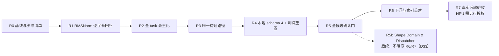

# 构建执行与证据语义升级：决策与对比记录

日期：2026-10-28

> **用途**：记录本次重构中选择过的方案、放弃的方案、依据与验收方式，便于后续追溯。本文不是实施证据，也不替代主 plan。
>
> **当前事实边界**：Metal/MSL 有真实实现与真实 Mac 构建证据；真实 NPU backend、SDK、驱动、设备、评测与发布仍未实现。NPU contract、fake driver 与 fixtures 只用于测试/模拟，`simulated=true`、`publication_allowed=false`。
>
> **追溯规则**：后续改变决策时新增 ADR，写明 `supersedes` 与新证据，不静默改写历史结论。

## 0. 文档地图

| 文档 | 作用 |
| --- | --- |
| [`构建执行与证据语义升级-plan.md`](构建执行与证据语义升级-plan.md) | 当前主计划：OpSpec 与两阶段派生、单一构建路径、schema 4、缓存与确认门；规则冲突时以它为准 |
| [`构建执行与证据语义升级-plan-附录A-OpSpec与specialize.md`](构建执行与证据语义升级-plan-附录A-OpSpec与specialize.md) | RMSNorm 的 OpSpec 与 track 绑定示例、不属于 OpSpec 的内容、关键负例 |
| 本文 | 决策备选、理由、对比对象、证据与后续验证 |

## 1. 核心架构决策

| ID | 决策 | 比较过的方案 | 选择与理由 | 后续验证 |
| --- | --- | --- | --- | --- |
| **D01** | 采用大重构，不保留本地旧 run/报告兼容 | 兼容读取、双版本迁移 vs 唯一新语义 | 历史数据只是本地测试数据；双版本会永久增加分支与误读面 | 本地只读 schema 4；旧报告明确拒绝 |
| **D02** | 通用通信与设备执行面不因无关原因重写 | 改六 RPC/blob/driver vs 保留承载结构 | 现有六 RPC、BlobChannel、VendorDriver、HMAC/outbox 已能承载新证据；无需返工 | 通用协议 drift/conformance 不退化 |
| **D03** | 测试用 NPU contract、fake fixtures、golden vectors 可整体重置 | 保留 `document_version` 1–5 vs 重置并删除旧向量 | 它们只是模拟资产，没有真实 NPU 生产兼容负担 | 旧向量删除；只保留一套新契约与向量 |
| **D04** | OpSpec 使用独立 JSON 文件 + JSON Schema | TOML、Python dict 旁路、OpSpec.json | JSON 可直接进入 JSON Schema → RFC 8785 → SHA-256 → task pack/evidence；与 CAKE2 和本仓现有数据一致 | JSON 示例可解析；非法字段/未知键拒绝；digest 可复算 |
| **D05** | OpSpec 只放语义，启动/设备策略分属既有模型 | 大一统 OpSpec/BackendProfile vs 分层 | 防止把 Metal `threads=256` 错放进中立语义，也避免把 DeviceGroup/topology 折叠进构建身份 | 字段归属审查无重复；Metal 与 NPU 可分别 lower |
| **D06** | 采用 `instantiate + lower` 两阶段派生 | 单一 `specialize(spec,dtype,size)` | 后者缺 target 维度；两阶段让语义实例与后端启动派生分离 | 同一 OpSpec 可由不同 BuildProfile 派生不同 Contract |
| **D07** | `Contract` 只作派生 DTO，不再作权威 | task 手写 Contract vs 全部 `lower` 生成 | 避免 OpSpec 与手写 Contract 双真相 | `tasks/**` 无手写 `Contract(`、无隐藏 `threads=` |
| **D08** | 构建只有 `backend.artifact_builder()` | 保留 compile/compile_all 或委托包装 vs 唯一 builder | 双路径会让 provenance/evidence 无法保证来自同一次构建 | 结构检查无 compile 旁路；真实 Mac 行为与旧路径一致 |
| **D09** | 复用现有 BuildProfile/BuildOutcome/ArtifactBundle/NativeExecutable | 新建第二套构建证据模型 vs 复用中立模型 | 这些类型已经支持 Metal 与 NPU 模拟构建，重复建设只会漂移 | schema 4 的 build 只是现有类型投影 |
| **D10** | `native_digest` 按 build_host/handle 可见性，而非“仅 Metal” | Metal-only vs host/placement 语义 | NPU evaluator 也可产生 native executable；live handle 是进程本地能力，不是 backend 名称 | 不可回传 handle 时为 `null` + 原因；不得伪造字节 |
| **D11** | DeviceGroup、topology、BuildProfile 身份分开 | 全部塞进 build_profile_digest vs 分账 | 构建期 tiling 变化与设备组/拓扑变化不是同一失效原因 | 48→40 核能区分 build profile 与 device/epoch 变化 |

## 2. 报告、缓存与确认门决策

| ID | 决策 | 比较过的方案 | 选择与理由 | 后续验证 |
| --- | --- | --- | --- | --- |
| **D12** | schema 4 只约束本地 EvalReport，不机械套到 NPU contract | 所有文档统一版本 vs 分层版本权威 | 本地报告、测量协议、NPU document_version、API/evidence contract 是不同对象 | 本地旧报告拒绝；NPU 测试契约独立重置/升版 |
| **D13** | `build` 增加 `build_kind=native/simulator/source_only` | 只有一种 full vs 构建类型分离 | 模拟器与 report-only 会制造“构建完成”的假象 | 模拟与 source-only 不进入确认 |
| **D14** | 本地与远端候选都检查构建身份 | 只查 local，远端 ok+speedup vs 全候选门 | 远端不是无证据：request digest/outbox/BuildEvidence/epoch 已存在，应直接复用 | 远端 mismatch 同样失败；缺证据为 unknown |
| **D15** | 缺证据是 `build_identity_unknown`，不一致是 `build_identity_mismatch` | 缺证据当一致 vs 显式分态 | “未比较”和“比较一致”必须分开，否则 unknown 会被当成 ok | 无 BuildProvenance 不得进入 values/发布 |
| **D16** | `opspec_digest` 进入任务身份与缓存/确认 | 只哈希 Contract vs 同时哈希 OpSpec | 不同 shape 域可实例化成同一 Contract，单哈希 Contract 会串联缓存与确认 | 域不同、实例相同 → digest 不同、缓存失效 |
| **D17** | `sizes.usage` 区分 golden/benchmark | tail 形状自动进入性能评测 vs 用途分离 | 扩大正确性域不应自动改变性能分母 | 未经评审的 tail benchmark 用法被拒绝 |
| **D18** | 测试与数据也允许删除重建 | 保留旧测试向量 vs 删除并由新实现重建 | 与本地大重构一致，避免“为了兼容而兼容” | 新旧向量不得同时合法；Go/Python conformance 按新向量通过 |

## 3. 多 IR/DSL 与 AI 友好数据决策

| ID | 决策 | 比较过的方案 | 选择与理由 | 后续验证 |
| --- | --- | --- | --- | --- |
| **D19** | 多 IR/DSL 通过 track 支持，不为每种 DSL 复制 OpSpec | OpSpec 多份 vs 同一语义、多 BuildProfile/track | 语义与表示分离后，MSL、Typed IR→MSL、AscendC 等可共享 OpSpec | 同一 opspec_digest，不同 candidate/build_profile/artifact digest |
| **D20** | `spec_text`、skills、lower、oracle 按 track 独立 | 一份 Triton 模板强行通用 vs track 化知识与 lowering | 不同 DSL 的 API、错误、示例与验证不同，不能假通用 | 新 track 必须有 schema、样例、lower、ABI、oracle、构建与确认 |
| **D21** | 路由按能力与证据，不按模型语言偏好 | 模型自选 DSL vs capability gate + 历史证据 + 弃权 | track 可行性依赖 target/operator/toolchain；无数据时不应自动复杂路由 | 无可行 track 时 abstain/unknown；观测绑 `(track,skill_version,target)` |
| **D22** | “对 AI 友好”是结构化合同，不是单纯 JSON 后缀 | 可读散文/自由 hint vs canonical typed 数据 | 模型需要少猜、工具需要拒绝、错误需要定位；JSON 只是便于进入现有链路 | 枚举、版本、shape 域、acc dtype、字段级诊断、digest 全部可检查 |
| **D23** | 默认不先造新 DSL/编译器 | 先新 DSL vs 现有 DSL + 合同 + 诊断 | 新表示只有在复发证据证明现有表示无法表达时才有净收益 | 与现有 DSL 同模型同题同预算对比，无收益则删除 |
| **D24** | 在 R5 后增加 R5b：Shape Domain & Dispatcher | 只做固定 shape/多变体 vs 再做域规划、dispatch 与域验证 | 多变体和确认证据不等于 shape 泛化产品；KDA/CAKE 还需要分桶、注册、guard、fallback 和未见分片验证 | 域内请求有唯一合法路径；域外回退或拒绝；重叠/缺失/未知 guard 不得通过；portfolio 不得用单点最好值冒充 |

## 3b. 按代码核对后的修订（2026-10-28）

下列决策来自把主 plan 与 HEAD `3fb9ac85bfc7` 及当时工作树逐条对照。`supersedes` 一列写明被取代的部分；
未列出的旧决策不变。

| ID | 决策 | supersedes | 依据（代码事实） | 后续验证 |
| --- | --- | --- | --- | --- |
| **D25** | 契约默认启动配置单列为登记、静态的 LoweringProfile；既有 BuildProfile/BuildProvenance 只管构建时探测的工具链身份 | D05、D06 中“启动策略归 BuildProfile”；D11 中构建期 tiling 计入 build profile 的部分 | Metal 的 `BuildProfile` 由 `MetalSourceBuilder._profile_for` 在打开设备后生成；它原样成为线上 BuildProvenance；`compile_profile` 最多 16 个标量键；`ArtifactBuilderRegistry` 按名登记并要求 `compile_profile` 相等 | 附录 A F-2、F-11；GEMM variant 不需要逐个登记构建器 |
| **D26** | 候选 `taic-launch` 是合法的第二启动来源，由 `candidate_sha256` 覆盖；它选的 math 记入 BuildProvenance | — | `tcenv/backends/metal/launch.py::LaunchSpec` 含 math、每段 grid/threads、workspace；evaluate 把 `spec.math` 传进构建 | 附录 A F-3 |
| **D27** | 本地调用方一律不传进程内构建 deadline；本地编译超时只由父进程 SIGKILL 记 timeout | 主 plan 旧稿 §5.3 第 3 条（候选 worker 自建 deadline） | Metal 编译是同步调用；`_evaluate_in_process` 重新抛出非 compile 的 `BuildError`，`tcenv/worker.py` 把异常写成 crash | 附录 A F-21 |
| **D28** | 确认门身份失败时 `entry["status"]` 写 `build_identity_mismatch`/`unknown`，`_failure_record` 的 `kernel_error=False`（D39/D44 已把状态扩展为 build/evaluation × mismatch/unknown，并新增 `timing_uncertain`/`confirmation_ineligible`；D28 只保留 `kernel_error=False` 与失败出口） | 主 plan 旧稿 §7.2“不改 `rep.status`、走现有出口”的未限定写法 | 现有代码 `entry["status"] = rep.status`，`confirmed_status` 取首个 entry 的 status；`experiments/common.py` 以 `confirmed_status == "ok"` 判成功 | 附录 A F-20、F-38、F-39 |
| **D29** | 跨期确认比较具体字段，不比较 `request_digest` | 主 plan 旧稿 §7.2 远端“按既有 request digest……复核” | 搜索与确认的 mode/seed/reps/fast_bench/eval_cache 不同，请求 digest 必然不同 | 主 plan §7.2 字段清单 |
| **D30** | `description` 归 track；`Contract.gpu` 归 LoweringProfile；`task_fingerprint` 纳入 `opspec_digest` 与 `description`，Metal 指纹有意重置 | — | `Contract.gpu` 写死并出现在 `describe()`；`description` 进入提示词但不在指纹里；`tests/shared/test_backend_neutral.py` 钉死 Metal 指纹 | R1 验收第 1–2 条 |
| **D31** | `sem_int_<seed>` 以 `{fp16, bf16, i32}` 请求得到 i32 实例，其他 dtype 拒绝；登记为有意的接受域收窄 | — | `tasks/semantic.py::_build_int` 忽略 dtype；`experiments/semantic_tests.py` 等以 fp16/bf16 请求 | 附录 A F-23 |
| **D32** | 题面占位符有三个来源：语义 `spec_params`、track 的 dtype 拼写表、`backend_params` | 主 plan 旧稿 §4.4 的两 map 规则 | `tasks/_common.py::load_text` 按 dtype 隐式替换 `{{T}}`/`{{TL}}`/`{{TORCH}}` | 附录 A F-22 |
| **D33** | R5b 不阻塞 R6/R7，作为后续另立计划 | D24 的阶段次序（D24 对 R5b 的语义要求不变） | R6/R7 不依赖 shape 分发；放在关键路径上会让 observe 切 schema 4 等分发器 | 主 plan §10 |
| **D34** | `report_schema_epoch` 检查放进既有 `taic/resume.py::_check_run_config_version`；`RUN_CONFIG_SCHEMA_VERSION` 不升 | 主 plan 旧稿“run_config 版本管自己的字段闭集”的说法 | `run_config.json` 没有字段闭集，`read_versioned` 只拒绝更高版本；该函数已是 `_load_flame_chase` 的第一步 | 主 plan §6.4 续跑负例 |
| **D35** | 评测缓存键只含父进程构建前已知的身份；探测字段漂移交给确认门 | 主 plan 旧稿 §7.1 键含 `build_profile_digest` | `_eval_cache_key` 在父进程计算，父进程不打开 Metal | 主 plan §7.1 |
| **D36** | 所有新增身份使用 RFC 8785/SHA-256 canonical envelope；OpSpec 摘要包含语义/记账规则版本，LoweringProfile 摘要包含 lowerer/variant factory 版本；task fingerprint 绑定完整 SemanticInstance/Specialization，而非只用 `Contract.describe()` | D16、D30 中未冻结的哈希输入；任何以 describe 代表完整 Contract 的解释 | 声明相同不代表物化/lower 实现相同；描述文本不是字段闭集。版本与完整派生结果必须分别可核对 | 主 plan §3.1；附录 F-24、F-25；D25 之后 D06/D19 残留的 BuildProfile 措辞均按 LoweringProfile/track 理解 |
| **D37** | schema 4 `build` 的公共、partial、full 与条件字段逐键冻结；compile BuildError 必须携带 typed provenance 与 assembled 摘要，reader 只校验/重算 | D09、D13 中“投影既有模型”但未列字段闭集的部分 | 要拒绝未知键必须先定义合法键全集；当前 BuildError 有分类、detail/report_detail、log 与 duration，但没有 typed provenance 或 assembled digest，不能凭空投影 partial | 主 plan §5.1、§6.2；附录 F-26；不新增 RPC 字段或第二套 BuildOutcome |
| **D38** | 构建身份与评测身份分账；新增 canonical `baseline_registry_digest`（D41 已拆成实现/环境两份摘要）与版本化 `evaluation_fingerprint`，覆盖 oracle/输入/error scale、完整 baseline registry、runner 和实际库版本；callable 使用登记实现 + canonical params，复用既有 task-pack manifest/digest 绑定实际代码 | D14–D16 中可能被理解为“build 一致即可发布”的部分；旧 `_callable_identity` 对任意闭包做 `repr` 的生产用途 | 同一 candidate/artifact 可以配不同 baseline、oracle 或库版本；BuildEvidence 不覆盖这些测量事实；generated AST、Mamba 局部 class 等闭包不能稳定序列化 | 主 plan §7.2；附录 F-27、F-28、F-34；可用但版本不可识别为 unknown，不缓存、不发布；缺登记/漏 pack 文件是装配或部署错误 |
| **D39** | 确认采用当前 expected、搜索报告、确认报告三方比较；每个 batch 都过纯 `compare_confirmation_identity`，最终由唯一 `confirmation_publication` 决定 ok、confirm_report 与发布；远端保留 outbox context 引用；读盘只使用当时冻结的 expected | D15 的未细分缺证据规则、D28 的局部状态修复；任何只查中位数报告、只比较两份旧结果或用当前环境重判历史 run 的实现 | 两份旧结果可能彼此相同但已不符合当前 oracle/baseline；任一批失败不能被前一批抵消；当前 `_evaluate_report` 会丢弃远端 result 上下文；事后环境升级不应 retroactively 改写当时结论 | 主 plan §7.2；附录 F-29～F-33；结构非法仍是 SchemaError/result_invalid，合法但不可比较才是 unknown |
| **D40** | canonical 身份先做值编码再送入既有 canonicalizer：`number` 字段先由 schema/规则版本物化为唯一 JSON 类型（`1` 与 `1.0` 是不同值），int 用整数、float 用 round-trip 字符串（保留 `-0.0` 符号）；键必须非空 ASCII、字符串不做 Unicode 归一化、重复键拒绝；不新写支持 float 的 RFC 8785 序列化器 | D36、D38 中把指纹文档数值直接写成 JSON number 的部分 | `contracts.canonical_digest_document` 明确拒绝 float；EPS、容差、`flops` 都是浮点，R1 直接复用会在第一步撞墙；`Task.flops` 现在既有 int（`_elementwise`）又有 float（多数 task），必须先统一物化类型，不能让同一字段类型漂移 | 主 plan §3.1、§4.2；附录 F-35、F-24 |
| **D41** | baseline 注册表拆成实现摘要与环境摘要；实现摘要只覆盖完整 `Task.baselines`；远端 expected 的环境分量冻结搜索期已接受值，host 不用自己的库版本；库版本用 importlib.metadata/find_spec 取得，不 import 框架 | D38 的单一 `baseline_registry_digest` | 库版本是测量一侧的环境事实，host 机器的库装配情况与 evaluator 无关，混在一个摘要里会让远端确认恒 mismatch 或恒 unknown；`compiler_baseline` 是后端派生估计，不是 `Task.baselines` 的 measured runner，不能混进 host 重算的实现摘要 | 主 plan §3、§7.1、§7.2；附录 F-27、F-28、F-37 |
| **D42** | `task_pack_digest` 是测量一侧身份：远端用已部署 pack 的既有摘要，本地用同一 manifest 文档形状对 track 登记的 pack 文件集计算（pack 根相对 POSIX 路径、排序、拒绝绝对/重复/大小写冲突/符号链接）；填 `EvaluatorProvenance.task_pack_digest`，两侧不要求相等 | D38 中“复用既有 task-pack manifest/digest”被读成本地也有一个已部署 pack 的部分 | 本地跑仓库 `tasks/` 没有部署 pack 目录（`tcenv/evaluation.py::local_provenance` 的 `task_pack_digest` 现为空且是有意形状），不能假装能直接调用 `load_task_pack`；填非空值会改变本地 evaluator epoch，属 R4 有意重置 | 主 plan §3、§7.2 |
| **D43** | 远端搜索上下文是指针 + 投影：候选目录存 `evaluation_context.json`；`_read_candidates` 只挂载投影并用公开只读 path helper（不构造 outbox）检查 completed 行存在；`Orchestrator.restore` 在 outbox 可用后调用只读 `load_completed_context(request_id, request_digest, source_bytes=None)`，返回行文档与 validated result，不重建完整请求，也不声称与 `begin()` 完全等价；投影只与行中已有的 candidate/epoch/device_group/build_provenance 及已接受报告的 environment 对账，不虚构 task_fingerprint | D39 中“`load_completed_context(request_digest)` 返回 accepted request”的写法 | outbox 文件名是随机 `request_id` 的哈希、行里不存完整请求（`_document`），靠 digest 既定位不到也重建不出请求；行里也没有 task_fingerprint，不能声称逐项比对它；`_read_candidates` 时还没有 HMAC key/outbox，不能在那里做签名校验 | 主 plan §7.2、§8；附录 F-30、F-36、F-41 |
| **D44** | `confirmation_publication` 的文件哈希等绑定由调用方算好传入（实时路径用源码哈希、读盘路径用文件哈希）；确认批次计时不确定单列 `timing_uncertain`，模拟/source-only/cache_hit 记 `confirmation_ineligible`，build 非 full 走 `build_identity_unknown`，三者都拦截整颗候选；读盘的 protocol/target 用冻结 expected；R4→R5 过渡 run 不可发布但 epoch 不升 | D39 中谓词入参未列绑定组、逐批门未给计时/资格状态名的部分 | 谓词不读文件，而现有 verdict 的核心检查正是文件哈希；`_confirm` 时机上也还没有 `confirmation_source_sha256` 与 `best.metal`；计时此前只在发布层判不确定，逐批拦截是有意收紧，要明说；模拟/缓存命中不是“缺证据”，不能混成 unknown | 主 plan §7.2；附录 F-32、F-38、F-39 |

## 4. 对比对象与借鉴边界

| 对象 | 它是什么 | 可以借鉴 | 不能混同/照搬 |
| --- | --- | --- | --- |
| **CANNBot-CAKE / CAKE2** | Ascend 的 Agent 工作流与可部署算子交付 harness | op_desc、artifact 链、build/install/bind/evaluate、诊断与知识版本化 | 不是一门 DSL；当前公开快照不等于论文完整 router/CAKE Book；`bypassPermissions`、直接 `exec`、部分 fail-open 不采用 |
| **CANNBot-DSL** | Ascend 的 Python 风格 DSL、后端与样例 | RMSNorm 的 tile/UB/Channel/tail/mask/sync 写法，以及 MLIR/AscendC 可观察性 | 公开仓不是完整编译器源码，后端主要由 wheel 提供；不等于 CAKE2 |
| **GPU CAKE / Cake IR** | NVIDIA 的 typed、硬件显式 schedule IR 与 compiler-harness co-design | typed schedule、静态检查、确定性 lowering、局部诊断、shape 域与确认纪律 | 不是 CANNBot-CAKE，不是 CAKE Book；主要证据在 B200，非 NVIDIA 未验证 |
| **KDA / Kernel Design Agents** | 多模型、多表示路线的 kernel 生成与优化工作流 | KernelWiki、profiling、多 DSL track、强验证与假优化反例 | **KDA 不是 OpSpec**；CuTe DSL/TIRx/CAKE-PTX 属 schedule/构建路线，不是语义合同 |
| **Kimi Delta Attention（也叫 KDA）** | 被优化的具体模型结构/算子 | 作为聚焦工作负载与验证案例 | 与 Kernel Design Agents 不是同一个对象 |
| **AKG Unified Sketch** | DSL-agnostic 策略草图 | Designer/Coder/Verifier 分离、错误改派、后端检索 | 当前代码主要是文本 Sketch，不是独立 typed IR；不能把我们的 Typed OpSpec 说成 AKG 已有能力 |
| **OpenAI Jalapeño / Hot Chips 2026** | AI 辅助芯片与 kernel 优化报告 | human-simple abstraction + AI-generated mapping；功能基线、模拟/真机反馈、e2e 验证 | 1.5–1.8× 是 OpenAI 自报，不是本仓复现，也不外推 Ascend/Metal |

## 5. OpSpec 与相近概念的区别

| 概念 | 主要回答 | 与本架构的关系 |
| --- | --- | --- |
| **OpSpec** | “算什么、输入输出与域是什么、精度与验收合同是什么” | 唯一语义事实源，不是 kernel DSL |
| **LoweringProfile** | “契约默认怎样启动：grid/threads、常量类型、variant、构建期 tiling” | `lower` 的输入，`lowering_profile_digest` 来源（D25） |
| **BuildProfile / BuildProvenance** | “在哪构建、用什么工具链与编译选项” | 构建时探测，原样上线；确认时按完整字段比较 |
| **DeviceGroup / ExecutionSpec** | “在哪个设备组、怎样执行与计时” | NPU 既有执行与证据模型，独立于 OpSpec |
| **Cake IR / Typed Sketch** | “怎样调度硬件：tile/buffer/pipeline/barrier/角色” | 可作为某个 track 的 schedule IR，经 lower 落到目标 DSL |
| **Triton/CUDA/MSL/AscendC/CuTe DSL/TIRx** | “用什么目标语言写 kernel” | 具体生成 track，不替代语义 OpSpec |
| **KernelWiki / CAKE Book / 经验库** | “有哪些可复用知识、来源与版本” | 知识层，受 provenance、人审、实测和过期规则约束 |

## 6. 参考材料与证据定位

### 6.1 本仓当前设计/实现

| 主题 | 路径 |
| --- | --- |
| 主计划 | `docs/架构/构建执行与证据语义升级-plan.md` |
| OpSpec 与派生 | `docs/架构/构建执行与证据语义升级-plan-附录A-OpSpec与specialize.md` |
| 通信抽象 | `docs/架构/多厂商NPU评测通信抽象-plan.md` |
| 执行运行时 | `docs/架构/执行运行时与设备扩展.md` |
| 对外协议 | `docs/架构/对外评测服务协议.md` |
| 题目与 Contract | `docs/架构/题目.md`、`tcenv/contract.py`、`tcenv/task.py` |
| 构建中立模型 | `tcenv/remote/artifact_builder.py`、`tcenv/remote/artifact_bundle.py` |
| Metal 真实构建 | `tcenv/backends/metal/source_builder.py` |
| 权限边界 | `docs/security.md` |
| 评测与确认 | `docs/架构/评测.md`、`docs/架构/搜索.md`、`taic/orchestrator.py` |

### 6.2 外部论文与工程快照

| 对象 | 一手来源与本地证据 |
| --- | --- |
| CANNBot-CAKE | [arXiv:2610.31034](https://arxiv.org/abs/2610.31034) · [本地 PDF](../可信harness/papers/2610.31034_cannbot-cake.pdf)；`cannbot` `2b60dd86aa90`、`cannbot-skills` `67e021abad3e` |
| GPU CAKE | [arXiv:2608.12629](https://arxiv.org/abs/2608.12629) · [本地 PDF](../可信harness/papers/2608.12629_cake-compiler-agent-codesign.pdf)；FlashInfer `b92f1129554c`（生成物，不等于完整编译器） |
| AKG | [arXiv:2512.23424](https://arxiv.org/abs/2512.23424) · [本地 PDF](../paper/2512.23424_akg-kernel-agent-a-multi-agent-framework-for-cross.pdf)；`akg` `5aa15f3fe4d8` |
| CANNBot-DSL | `cannbot-dsl` `755cd63b9e6f`；`samples/rms_norm/rms_norm.py`、`test/rms_norm/test_rms_norm.py` |
| KDA 实现 | `/Users/kuafu/CLionProjects/kda-260927-kda/README.md`（commit `f539baab8e46`）；`hacking_example/README.md` |
| OpenAI Jalapeño | [原始 slides](../paper/2026_hotchips_openai_jalapeno.pdf)（36 页）· [中文图文翻译](../paper/2026_hotchips_openai_jalapeno.zh-CN.md) · SHA-256 `1ae0e3aa6d80781e08609926b8161c171edc30ec36b88547a6bfed6b7ee5bcf8` |
| CAKE2 机制总表 | [`CAKE2机制清单与证据分级.md`](../paper/CAKE2机制清单与证据分级.md) |
| KDA 与 NPU 工程路线 | [`NPU算子生成：KDA经验与工程实践路线.md`](../paper/NPU算子生成：KDA经验与工程实践路线.md) |

## 7. 迁移与追溯门

| 必须可追溯的证据 | 防止出现的情况 |
| --- | --- |
| 当前 HEAD、工作树 diff 与并发修改归属 | 把其他会话的草稿误当已验收基线 |
| RMSNorm 现有与派生 Contract 的逐字节对照 | 把语义变化误当纯重构 |
| OpSpec/LoweringProfile/BuildProvenance/DeviceGroup/Artifact/evaluation 身份与规则版本 | 不知道失败来自语义、lowering、构建、设备还是 baseline/oracle |
| 合法/攻击 fixtures 与 Go/Python conformance | 只证明 happy path，或 Python 自验自证 |
| `simulated` / `measured` / `inconclusive` / `unknown` | 模拟或不可判被写成通过；结构非法被伪装成 unknown |
| 每个确认批次的 identity/测量资格与同一 `confirmation_publication` 谓词 | 只查中位数报告、前批掩盖后批，或 Orchestrator 与读盘发布判定分叉 |
| search best 与 confirmation 分开 | 用搜索最好值冒充发布值 |

## 8. 尚未关闭的问题

| 问题 | 为什么仍未关闭 |
| --- | --- |
| `flops/min_bytes` 的写法：语义推导器还是唯一显式表达式 | 原则已定（只有一个来源），具体写法由 R1 选定 |
| 各 family 的 LoweringProfile 字段闭集与登记位置 | D36 已冻结 canonical envelope、lowerer/factory 版本与派生投影；R0/R1 登记 RMSNorm 字段，R2 登记其余 family，不要求万能 schema |
| Agent 工作区的种子报告是否裁掉 `build` | 默认原样保留；R4 对照 `docs/security.md` 复核 |
| 第二个真实 IR/DSL track 是谁 | 必须先有真实使用场景、lower、oracle 与同预算对比，不为多而多 |
| NPU 各 target 的 build/device 身份具体映射 | 真实 NPU 尚未接入，不能预先声称已确定 |
| 当前并发修改的最终基线 | 已由 R0 关闭：基线包与逐文件采用/丢弃决定见 `docs/架构/构建执行与证据语义升级-R0/`；草稿仍未提交，R3 需先修 R0 登记的缺陷（`compile_source`/probes/profile 改道、正则结构检查、非 UTF-8 早退、stale tool manifest） |
| 真实 Mac/NPU 的性能与发布结论 | 需要另行授权设备与实验，不能由设计和模拟推出 |
