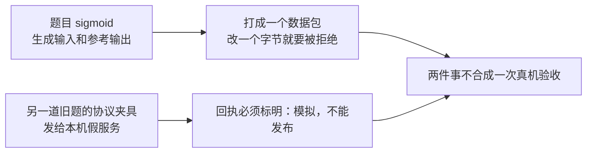

# 清微 NPU：只模拟数据和协议

这一目录回答一个问题：在没有清微真机、没有清微编译器的时候，我们能不能把题目数据和现有假服务的协议走通，并且不把结果说成真机成绩。

答案是能走通，但只能当模拟。真机阶段 NPU-P0 仍然是 blocked，不能据此说清微上算对了或更快了。

## 先看这张表

| | 旧记录 `report.json` | 当前记录 `report.current.json` |
| --- | --- | --- |
| 是什么 | 当时留下的历史记录 | 用现在的代码重放出来的记录 |
| 数据题 | v2 的 `sigmoid`，fp16，small | 同一道 sigmoid |
| 协议夹具 | 当时叫 `rope` | 现在叫 `sem_attention_odd_scale` |
| 和今天的代码逐字比较 | 对不上，验收不再要求它对上 | 验收要求逐字段相同 |
| 能不能当成绩 | 不能 | 不能 |

两份记录都写着：这是模拟（`simulated=true`），不许拿去发布（`publication_allowed=false`）。

## 它实际做了两件分开的事



1. **数据。** 用仓库里的 sigmoid 题目，种子 7，生成输入和 64 位参考输出，再另存一份 16 位的候选输入。这份 16 位输入不是设备跑出来的结果。完整张量只记形状、类型和摘要；数据包里放前 256 个元素。数据包来回读写必须逐字节一致，改任意一个字节必须被拒绝。
2. **协议。** 用现有的假清微服务走一遍请求、签名、回执。回执必须写明这是模拟，并且不能发布。报告里故意不写耗时和加速比。

数据题和协议夹具不是同一道题。协议通过，不等于 sigmoid 在清微上算对了。

## 怎么验收

整包检查（摘要、边界、以及和 `report.current.json` 逐字段比较）：

```bash
uv run python docs/架构/清微NPU数据模拟/verify.py
```

只重跑模拟、只和当前记录比较：

```bash
uv run python docs/架构/清微NPU数据模拟/simulate.py \
  --replay-against docs/架构/清微NPU数据模拟/report.current.json
```

题目、协议或预期数据确实变了，才允许重写当前记录。旧的 `report.json` 不要覆盖：

```bash
uv run python docs/架构/清微NPU数据模拟/simulate.py \
  --output docs/架构/清微NPU数据模拟/report.current.json
```

临时的服务状态和落盘目录用完即删，不会写进搜索运行、已确认结果或目录简报。
