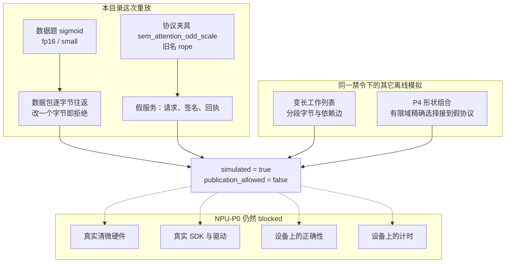
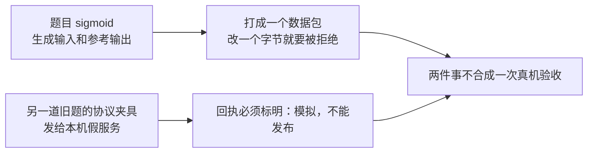

# 清微 NPU：只模拟数据和协议

这一目录回答一个问题：在没有清微真机、没有清微编译器的时候，我们能不能把题目数据和现有假服务的协议走通，并且不把结果说成真机成绩。

答案是能走通，但只能当模拟。真机阶段 NPU-P0 仍然是 blocked，不能据此说清微上算对了或更快了。

## 模拟边界

一次离线模拟同时留下两道彼此独立的题，再带上同一条发布禁令。通过其中一道，不自动证明另一道。

| | 数据题 | 协议夹具 |
| --- | --- | --- |
| 要证明的事 | 张量能按字节打包、原样读回，改一个字节会被拒绝 | 本机假服务能走完请求、签名和回执 |
| 用的题 | 仓库里的 v2 任务 `sigmoid`，类型 `fp16`，档位 `small`，种子 7 | 保留的 v1 夹具，现在叫 `sem_attention_odd_scale`。旧记录 `report.json` 里它还叫 `rope` |
| 数字从哪来 | 本机参考实现生成输入和参考输出。另存的 16 位张量是模拟用的候选输入 | 假服务返回一份模拟回执。报告里不写耗时，也不写加速比 |
| 通过之后可以说明 | 数据包逐字节一致 | 协议接线和结果标记正确 |
| 通过之后仍不能说明 | `sigmoid` 在清微上算对了 | 数据题曾经在清微上跑过 |

工作列表和形状组合不在本目录这次重放里面。它们是同一禁令下的另外两条离线模拟：工作列表看变长任务的分段字节和依赖边，形状组合看有限域上的精确选择能否接到假服务。两条都到不了真机。



虚线表示记录到此为止，不能跨进右侧。

| 主张 | 离线模拟证明了什么 | 依据 | 仍然停在 NPU-P0 |
| --- | --- | --- | --- |
| 协议接线 | 假服务上的请求、签名、回执能走完，并写明不可发布 | 本目录的协议夹具 | 真实 SDK、驱动和设备通道 |
| 数据序列化 | `sigmoid` 的张量摘要、数据包往返、单字节篡改拒绝 | 本目录的数据题 | 设备写出的结果 |
| 工作列表投影 | 变长任务的工作列表字节和依赖边，能与另一条 host 视图对照 | `tests/support/npu_sim/varlen_worklist.py` | 清微 kernel 是否算对、是否更快 |
| 形状组合投影 | 有限域的精确选择能接到同一套假 source/bundle 协议 | `tests/support/npu_sim/shape_portfolio.py`，即 P4 | 真机性能，以及可发布的加速比 |
| 结果标记 | 上述记录都是 `simulated=true`、`publication_allowed=false` | 本目录报告，以及 P4 / 工作列表模拟 | 进入发布、目录简报或真机成绩 |

NPU-P0 仍包括四件没有做的事：真实清微硬件、真实 SDK 与驱动、设备上的正确性、设备上的计时。本目录报告里的 `npu_p0.status` 固定为 `blocked`。

## 先看这张表

| | 旧记录 `report.json` | 当前记录 `report.current.json` |
| --- | --- | --- |
| 是什么 | 当时留下的历史记录 | 用现在的代码重放出来的记录 |
| 数据题 | v2 的 `sigmoid`，fp16，small | 同一道 sigmoid |
| 协议夹具 | 当时叫 `rope` | 现在叫 `sem_attention_odd_scale` |
| 和今天的代码逐字比较 | 对不上，验收不再要求它对上 | 验收要求逐字段相同 |
| 能不能当成绩 | 不能 | 不能 |

两份记录都写着：这是模拟（`simulated=true`），不许拿去发布（`publication_allowed=false`）。

## 它实际做了两件分开的事



1. **数据。** 用仓库里的 sigmoid 题目，种子 7，生成输入和 64 位参考输出，再另存一份 16 位的候选输入。这份 16 位输入不是设备跑出来的结果。完整张量只记形状、类型和摘要；数据包里放前 256 个元素。数据包来回读写必须逐字节一致，改任意一个字节必须被拒绝。
2. **协议。** 用现有的假清微服务走一遍请求、签名、回执。回执必须写明这是模拟，并且不能发布。报告里故意不写耗时和加速比。

数据题和协议夹具不是同一道题。协议通过，不等于 sigmoid 在清微上算对了。

## 怎么验收

整包检查（摘要、边界、以及和 `report.current.json` 逐字段比较）：

```bash
uv run python docs/架构/清微NPU数据模拟/verify.py
```

只重跑模拟、只和当前记录比较：

```bash
uv run python docs/架构/清微NPU数据模拟/simulate.py \
  --replay-against docs/架构/清微NPU数据模拟/report.current.json
```

题目、协议或预期数据确实变了，才允许重写当前记录。旧的 `report.json` 不要覆盖：

```bash
uv run python docs/架构/清微NPU数据模拟/simulate.py \
  --output docs/架构/清微NPU数据模拟/report.current.json
```

临时的服务状态和落盘目录用完即删，不会写进搜索运行、已确认结果或目录简报。
