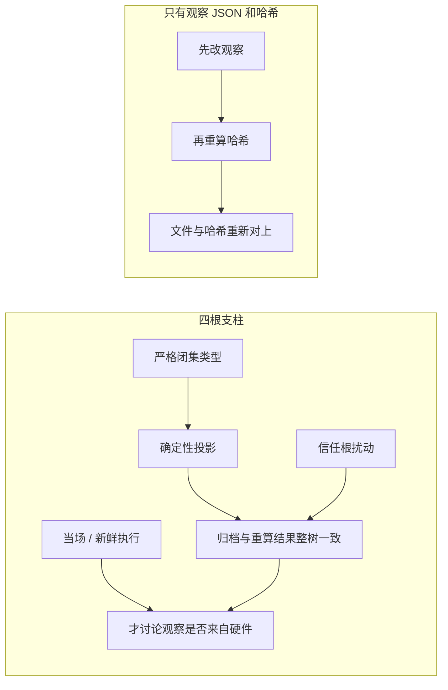

# 证据验收方法：问题、外部建议与实施判断

> 文档性质：架构讨论与决策素材，不是已批准的实施计划，也不改变已经关闭的 P0、P1、P2 的完成状态。
> 来源：P1 的实际验收经验、`证据验收器复杂度问题-外部咨询.md`，以及外部模型对这份咨询的回答
>（原始回答暂存于 `.pytest_cache/argon 对于如何 verify 的建议.md`）。
> 本文保留有价值的问题与回答，同时标明外部建议中需要收窄或纠正的地方。
> 后文里对 P2 的落地顺序是当时的设计讨论。P2 已另行关闭；本文不改写 P0、P1、P2 的验收结论。

## 0. 可信验收的四根支柱

验收要同时站住四件事。少一件，另外三件仍可能被一份手改过的 JSON 骗过。

「原始观察 JSON + 哈希」只证明一件事：哈希算完之后，这几个字节没有再被改过。它不证明这几个字节来自那次 GPU 运行。攻击者可以先把观察改掉，例如把错误计数从 1 改成 0，再对改过的文件重算哈希。文件和哈希重新对上，只比较这一对的检查就会接受。确定性投影也一样：它证明报告是由这些观察算出来的，不证明观察来自硬件。

| 支柱 | 它在做什么 | 它能挡住 | 它挡不住 |
| --- | --- | --- | --- |
| 确定性投影 | 用同一段纯函数，从冻结输入和原始观察重算出整份报告，再和归档整树比较。冻结输入是合同、候选字节、目标和接口；原始观察是这次运行声称发生的事 | 派生字段被改了而没有改来源；同一事实写成互相矛盾的两份 | 攻击者连观察一起改，再重算报告和哈希 |
| 严格闭集类型 | 只接受事先声明的字段和精确类型。`true` 不能当成 `1`，未知字段直接拒绝。闭集的意思是：名单以外的字段都是错误 | 用类型变形绕过计数、相等判断和空容器判断 | 类型合法、数值却是编的 |
| 信任根扰动 | 归档保持不动。在临时副本里只改一个外部事实，例如候选源的一个字节、合同的一个字段、域里的一个实例。验收器若仍接受原归档，说明它没有真正依赖那个事实。信任根是放在被检文件之外的事实 | 检查写在那里，结论却在自证 | 不能证明每一条检查都写对。没有列入清单的根，这次也碰不到 |
| 当场 / 新鲜执行 | 在设备上再用候选没见过的输入跑一次，比对其中稳定的部分。新鲜执行是一次新的运行，不是把存档 JSON 再读一遍 | 离线文件无法自证的耗时，以及没见过的形状是否真的算对 | 不能代替前三项。跑通一次，也不证明归档的结构、类型和派生关系已经正确 |



## 1. 背景：我们到底在解决什么问题

系统允许 LLM 或人自由编写候选 GPU kernel：算法、融合、Tiling、Host Tiling 和
ExecutionGeometry 都属于候选；harness 负责任务合同、ABI、安全、测量边界和证据。
**不能为了让验收器简单，反过来限制候选的表达力。**

P1 在真实 Apple M4 Max 上验证了“两个特化 variant + 通用 fallback”的垂直切片。归档为
6 份 JSON，独立 reviewer 的逐叶子攻击覆盖约 3527 个叶子；最终验收器约 5105 行，而被验
runner 约 1094 行。P1 已通过，但这个比例说明验收方法本身可能无法扩展到 P2/P3。

这不是从 KDA/CAKE2 继承来的现成 checker 问题。我们学习的是：

```text
ShapePlanner → specialization portfolio → exact dispatch → correct fallback → domain validation
```

上游没有可直接复用的通用 VariantRegistry、DispatchManifest、held-out shape gate、Metal 交付、
schema-4 证据身份或 fresh confirmation。本文讨论的是**本地新增证据层应该怎样设计**。

---

## 2. 外部回答指出的三个核心误判

### 2.1 把“富含派生视图的报告”误当成了最小证据

当前归档同时保存输入合同、几何与 Bundle 派生视图、硬件观察和最终统计结论，而且同一事实在
多个路径重复出现。结果是：每多存一个派生字段或冗余副本，验收器就要多证明一条
“副本 A == 副本 B”或“派生 C == f(输入)”。

**核心建议：不要让绝大多数派生叶子成为可篡改的独立输入面。**

### 2.2 用 `dict[str, Any]` 承载安全边界

P1 中实际出现过的绕过包括：

- `int(-0.5) == 0`，让非整数坏元素计数被截断；
- `float(True) == 1.0`、`float(False) == 0.0`，让 bool 冒充数值；
- 普通字典相等中 `True == 1`；
- 空 list 与空 dict 都是 falsy，导致容器类型混淆。

这些不是某个业务规则单独写错，而是严格类型边界没有一次性建立。`_strict_json_equal` 是有效的
局部修复，但长期更需要“解析即合法”的强类型证据对象，而不是不断给裸字典补类型分支。

### 2.3 让离线归档检查承担了它原理上无法承担的职责

如果攻击者能修改归档并重算公开摘要，那么无法确定性重算的原始测量（如 `samples_s`、
`elapsed_s`、`compile_s`）仍然只是自述。协议范围检查可以排除明显不可能的值，却不能证明
那次 GPU 运行真的产生了这些值。

**离线 checker 的职责应是证明结构、类型、派生关系和外部可重建事实；原始观察的真实性必须由
live/fresh execution 或更强的外部信任根锚定。**

---

## 3. 建议的目标形态：Evidence Log + Deterministic Projection

外部回答建议把“最小原始记录”和“完整报告视图”分开：

```text
冻结输入（Frozen Inputs）                 原始观察（Raw Observations）
- OpSpec / DomainAuthority                - instance_key
- Candidate Bundle 原始字节               - actual provider / grid / threads
- 目标与 ABI 身份                         - correctness 观察与原始样本
- P2 外部注入的 fresh seed                - device probe 身份
                 \                              /
                  \                            /
                   ▼                          ▼
             唯一确定性投影器（Pure Projector）
             - 严格类型解析
             - 重算 dispatch / geometry / identity / stats
             - 检查 actual 与 expected 的关系
             - 生成完整 EvalReport / Manifest / root digest
                            |
              ┌-------------┴-------------┐
              ▼                           ▼
       完整可读报告（缓存视图）         最小证据日志与根摘要
```

验收流程因此变成：

1. **Strict Parse**：严格解析冻结输入和原始观察，拒绝未知字段与类型变形；
2. **Re-project**：调用同一确定性投影器，从最小输入重建完整期望报告；
3. **整树比较**：归档报告与重建报告严格相等，不再逐字段手写派生比较；
4. **Live/Fresh 锚定**：真实执行得到新观察，再比较其稳定核心；原始计时等不能离线认证的
   部分交给 fresh confirmation。

### 必须保留的纠正：Raw Observation 在离线归档中并不天然“不可伪造”

外部回答有时把 Raw Telemetry 直接称为“不可伪造观察”。这在普通可编辑 JSON 中不成立：

- 攻击者可以同时修改原始观察和公开摘要；
- Projector 只能证明“报告是这些观察的确定性投影”，不能证明“观察确实来自硬件”；
- 把 `n_bad=1` 改成 `0` 后重投影，离线门仍可能完全自洽。

所以最小化的价值是**缩小自述面和消除派生冗余**，不是 magically 让原始观察可信。
真正不可绕过的是独立执行、外部持有的秘密/分片、受保护的设备证明，或其它不在攻击者写入域内
的信任根。

---

## 4. 八组有价值的问题与回答

### 问题 1：怎样让验收器复杂度不随证据叶子数失控？

**外部建议要点**

- 归档以冻结输入和最小原始观察为信任输入；完整 EvalReport 只是 Projector 的缓存输出；
- 验收器不再逐字段解释 3527 个叶子，而是重投影后做整树严格比较；
- live 端也走同一 Projector，比较 stable core。

**我们的判断**

方向成立，且比继续加字段级负例更有扩展性。但“验收器降到 300–500 行”只能当目标，不能当承诺：
真实复杂度会转移到严格证据模型、Projector 和外部锚点。应控制的是**信任根数量和手写重复规则数**，
不是单纯追求行数。

### 问题 2：严格类型、不变量、外部事实三层怎样落地，而不自造大型 DSL？

**外部建议要点**

- 用 Pydantic v2 strict model 或 msgspec.Struct，`extra="forbid"`；
- 用少量 `FiniteNonNegFloat`、严格整数等类型别名统一处理数值边界；
- 跨字段协议放在 model-level validator；
- 生产 writer 与 verifier reader 使用同一个强类型构造器；
- 字段标注 `derived / observed_stable / observed_volatile`，自动决定投影与 live 比较方式。

**我们的判断**

值得采用“严格模型 + 单一构造边界”，但不要相信库的默认 strict 模式自动覆盖所有语义。
`bool`、整数值 float、有限性、非负性、字符串数字等必须用固定攻击向量验证；未知字段闭集、
 canonical 编码和 digest 规则也要单独冻结。

“生产与验收共用模型”能防止序列化漂移，但不能保证模型本身正确；它必须与 golden vectors、
根扰动和独立 reviewer 组合。

### 问题 3：证据最小化与可审计/可复现怎样兼顾？

**外部建议要点**

- 磁盘仍保留完整、可读、可供 Observe 使用的报告；
- 但验收器把它视为 `Projector(FrozenInputs, Observations)` 的派生缓存，而不是独立事实来源；
- 最小日志和完整报告通过根摘要绑定。

**我们的判断**

这是比“派生字段一律删除”更稳妥的折中：**可以保存，不能让它成为独立权威**。
原始候选字节、任务包、设备/工具链身份、原始观察和协议 epoch 必须可定位；派生报告可以重算。
若保存 root digest，它也只是完整性/寻址手段，不是对自述真实性的签名。

### 问题 4：复用生产函数做重建，怎样控制同源漂移？

**外部建议要点**

- Identity、hashing、CanonicalBundle 等格式约定应复用唯一生产实现，并用冻结 golden vectors
  钉住输入与预期摘要；
- Exact Dispatch 与 Guard 求值属于核心安全边界，可在测试中保留一个极简、刻意独立的参考 oracle，
  与生产 resolver 交叉验证。

**我们的判断**

“唯一权威实现 + golden”适合格式与身份；“独立小 oracle”适合有限、短小、语义明确的判定。
但不能机械要求所有核心逻辑都写两套：第二实现自身可能错误，也可能悄悄形成第二语义来源。
对 P0 的有限域 guard，更优先利用**有限实例穷举、固定 goldens 和异常分类对照**；独立 oracle 若存在，
只能是测试角色，不能进入生产双路径。

### 问题 5：怎样发现“检查存在但写错了/在自证”，而不只是“无人检查”？

**外部建议要点：信任根扰动（Two-Point Decoupled Mutation）**

- 保持归档完全不变；
- 在临时副本中分别修改一个外部信任根：候选源一字节、OpSpec 一字段、DomainAuthority 一实例、
  ABI/设备限制；
- 若验收器仍接受原归档，说明相应链路没有真正依赖该外部事实，可能在自证。

**我们的判断**

这是本次回答中最值得落地的建议之一。它直接测试“归档 ↔ 外部事实”的耦合，而普通叶子变异只能
测试字段是否影响 verdict。

但“100% 自动找出所有自证路径”说过满：覆盖范围取决于信任根清单、扰动点和预期敏感性。
应为每个根声明“哪些证据结论必须随它改变”，拒绝遗漏根，也要区分**合法不影响**与**异常不敏感**。
所有扰动都应在临时副本进行，不能改冻结证据或生产基线。

### 问题 6：LLM agent 会写候选、也可能改验收器，怎样治理？

**外部建议要点**

- checker、强类型 schema、golden vectors 属于受保护面，hash pin 并在运行前核对；
- 候选/业务 agent 不能在同一工作流里自行修改 checker；
- checker 修改需要独立 diff 与人工/独立 reviewer；
- P2 的 master seed 与未见分片不进入候选可读上下文。

**我们的判断**

方向必要，但**把 lock 文件和 checker 放在同一个 agent 可写目录里不构成安全边界**，因为攻击者可以
一起改。锁与隐藏种子必须由上层 harness、独立进程或人工持有的位置控制；仅放环境变量也不够，
如果同一 agent 能读环境/进程内存，它仍可获知。真正的边界是权限与执行主体，不是文件名。

### 问题 7：Dispatch / fallback / 激活代次值得使用 TLA+ 或 Alloy 吗？

**外部建议要点**

当前没有必要先上 TLA+/Alloy；优先对真实 Python 实现使用 Hypothesis，生成有限域、重叠/空洞 guard、
资源越界和激活/撤销序列，直接断言：

1. 域外请求永不走 fallback；
2. 合法请求的执行体匹配数只能为 0 或 1，多匹配必须是 `dispatch_overlap`；
3. fallback 执行不能给 variant 的 correctness/performance 记功；
4. revoked manifest 不能被解析为可执行。

**我们的判断**

适合先用属性测试和状态机测试，且必须补充而非替代固定回归、真实 GPU 节点与身份负例。
如果未来出现真正的跨主体并发激活、分布式恢复或复杂代次协议，再重新评估 TLA+/Alloy。
属性测试生成器本身也要接受审查，不能只生成容易通过的输入。

### 问题 8：什么时候停止加固一个阶段的 checker？

**外部建议要点**

- 入口不再依赖裸动态字典和松散 Python 相等；
- 派生字段和稳定观察的变异都能被重投影或 live diff 拦截；
- 每个声明的外部信任根都有扰动负例；
- 必须靠新 seed/新执行才能证伪的事项明确移交 fresh confirmation，不在离线 checker 里堆启发式。

**我们的判断**

可采纳为风险接受框架，但不要机械追求“手写类型防御行数为 0”或“所有叶子变异都必须失败”。
volatile 字段允许变化，合法不影响的信任根也不应误报。最终仍需：

- 未篡改真实证据通过；
- 负例按**预期语义理由**拒绝，而不是任意异常；
- 固定计数与无 skip 门成立；
- 超出归档能力的边界写入文档；
- 独立 reviewer 签署，而不是作者自签。

---

## 5. 字段分类：每类字段应由什么机制证明

| 类别 | 例子 | 离线归档能证明什么 | 还需要的锚点 |
|---|---|---|---|
| 冻结输入 | OpSpec、候选原始字节、DomainAuthority、target/ABI | 内容寻址、闭集解析、与 pack/golden 一致 | 受保护 manifest、协议 epoch |
| 派生字段 | projection、geometry pair、bundle/native/evaluation 身份、统计结论 | 由 Projector 从输入与观察确定性重算 | golden vectors、整树严格比较 |
| 稳定原始观察 | actual provider/grid/threads、实际 Host Tiling 执行记录 | 类型与协议边界、与 expected 的关系 | live 重跑或真实执行证据 |
| 浮动原始观察 | `samples_s`、`elapsed_s`、`compile_s` | 只能是有限数值及少量协议硬边界 | fresh confirmation；不得把范围检查当真实性 |
| 外部秘密/未见输入 | P2 master seed、mastered unseen instance_keys | 不应出现在候选可读档案中 | 独立进程与冻结后派生 |
| 人类可读派生报告 | 完整 EvalReport、展示用 Manifest | 与重投影缓存整树一致 | Observe 只能按声明角色读取 |

关键原则：**来源标签决定验证方式；没有来源的字段不应进入证据模型。**
但标签本身不是证明，仍需由单一构造器、schema 和测试确保它没有被错标。

---

## 6. 对 P2 的建议落地顺序

这不是对 P1 的返工计划。P1 的历史 verifier、证据和签署保持不动；新架构优先用于 P2 新增证据。

1. **先定义证据权威图，再写 P2 schema**  
   明确每个字段是 frozen input、derived、stable observation、volatile observation 还是外部秘密；
   画出它由哪个函数、哪份字节或哪次执行产生。

2. **建立严格证据模型和单一写入边界**  
   未声明字段、未知字段、bool/数值/容器变形在解析与序列化两侧都拒绝；用现有攻击向量做
   模型自测，不依赖库默认行为的想象。

3. **让完整 P2 报告成为确定性投影的缓存**  
   DispatchManifest、激活视图和统计结论尽量由冻结输入 + 最小观察重建；保留可读报告，但避免
   同一事实出现多个相互独立的权威副本。

4. **给生产函数与 Projector 配冻结 golden 和协议 epoch**  
   格式/身份继续唯一实现；golden 固定旧输入与旧摘要，防止生产与验收一起漂移后仍互相认可。

5. **默认运行信任根扰动与分类变异门**  
   根扰动查自证，叶子变异查未检查字段；输出按路径和字段类别聚合，不人工逐叶子审计。
   对允许变化的字段声明明确豁免理由。

6. **为 DispatchManifest 激活/撤销/恢复补属性测试**  
   用真实生产状态转换生成序列，保留固定崩溃恢复负例和独立身份检查，不用属性测试替代所有测试。

7. **把 fresh confirmation 当作独立信任根，而不是 Projector 的又一个输入字段**  
   未见分片、fresh seed 和测量选择由 harness 外部持有；原始计时和未见泛化不能由离线重投影代替。

---

## 7. 明确不采纳或需要避免的极端做法

- **不追求无限红队或无限负例**：用结构收敛替代“第 190、191 个字段补丁”。
- **不把 Raw Telemetry 当作天然防伪**：没有外部信任根时，它仍是可编辑自述。
- **不为减少行数而建立第二套生产语义**：Projector 与独立 oracle 的角色必须分清。
- **不用自动变异测试证明 checker 正确**：它只能发现部分未检查/不敏感，不证明检查逻辑正确。
- **不靠同目录 hash lock 防 agent 篡改**：锁必须位于其写入权限之外。
- **不用 Hypothesis 替代真实 GPU、固定回归和 fresh confirmation**。
- **不回写 P1 历史证据或为了让新架构好看而重写旧验收结论**。
- **不限制候选 kernel 的算法、循环、多阶段或 Host Tiling 表达力来换取简单证据**。

## 8. 一句话结论

四根支柱的图和表在第 0 节。这次讨论最有价值的结论是：

> **把验收从“逐字段检查一份大 JSON”改成“严格解析最小证据、确定性重建派生视图、扰动外部信任根，
> 并用 live/fresh execution 证明那些离线永远无法证明的观察”。**

其中，**Evidence Log + Deterministic Projection**解决派生冗余，**严格类型模型**解决类型变形，
**信任根扰动**解决自证路径，**fresh confirmation**解决原始观察与未见泛化。四者缺一不可；
任何一项都不能单独冒充完整的真实性证明。
