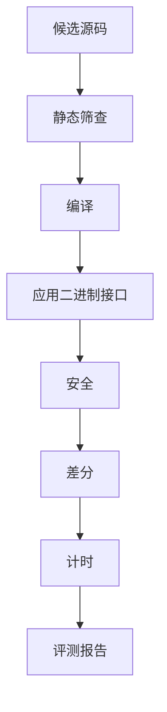
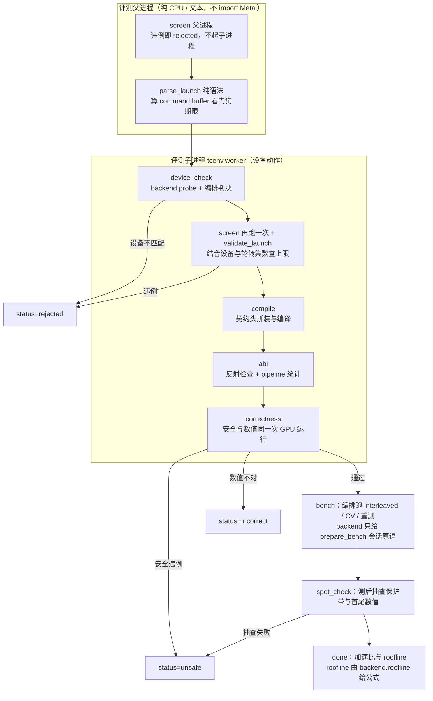
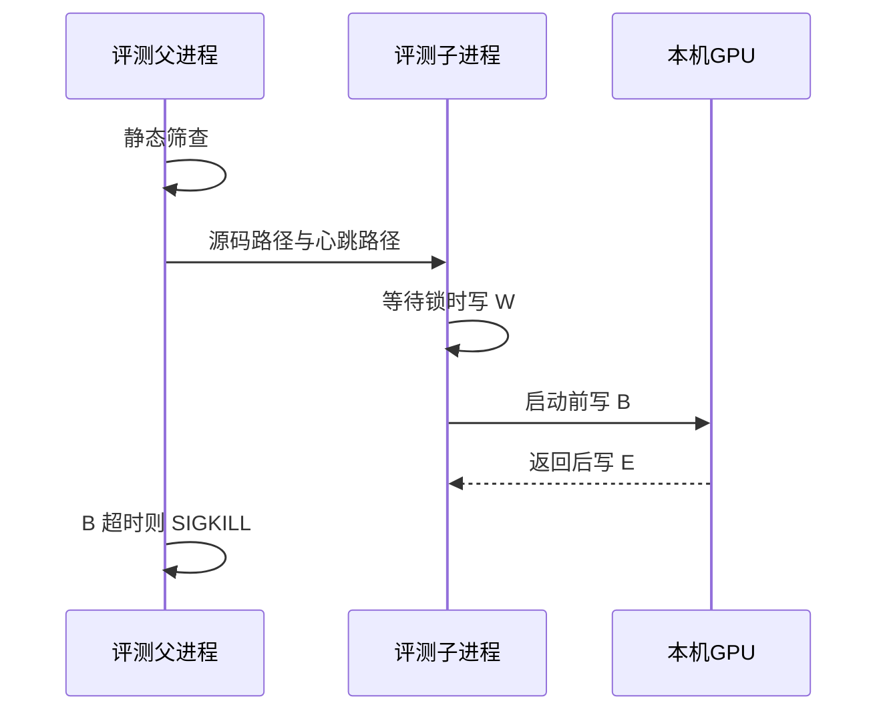

# 评测

这一篇回答：一份候选怎样被判成安全、算对、快或慢。模型不参与判决。`status == ok` 只表示这次安全检查和抽到的输入过了，不表示它比库快，也不表示已经证明等价。进程怎么分工见 [架构说明.md](../架构说明.md)。什么数字可以对外说，见 [搜索.md](搜索.md)。这些断言对应的测试目录、放置规则、运行命令和失败日志见 [tests/README.md](../../tests/README.md)。

## 这篇讲什么

- 一次评测的产物是 `EvalReport`：一个子进程交给父进程的判决，带版本号，未知字段一律拒绝。
- 关卡顺序固定为「编译 → 接口 → 安全 → 数值 → 计时」，前一关失败就不再占用 GPU。
- 加速比统一用墙钟中位数；计时阶段用机器级独占锁，避免和同工程其他 GPU 工作重叠。
- 慢本身不会让状态离开 `ok`；判「快」要另外过噪声门槛和确认阶段（见 [搜索.md](搜索.md)）。

关键词：**关卡**（gate）、**保护带**（guard band）、**差分**（differential test）、**上界**（roofline）、**变异系数**（CV，标准差除以均值）。

## 评测报告与文件版本

评测报告 `EvalReport` 是子进程交回父进程的判决。版本边界避免旧进程删掉不认识的字段后仍构造对象，从而把新报告读成另一份结论。`eligible` 等于 `status == ok`。写出的 JSON 含 `schema_version`。

读入规则：

| 情况 | 处理 |
| --- | --- |
| 没有 `schema_version` 键的历史文件 | 按版本 0 读取 |
| 版本高于本进程 | 读入拒绝，并说明需要人工检查 |
| 出现本版本未列出的字段 | 读入拒绝，并说明需要人工检查 |
| 多出来的键（`result.json`/`state.json`/`ledger.json`） | 留在字典里，不因为不认识就拒绝 |

禁止删掉未知字段后再构造对象。请求文档使用同一规则。

当前评测请求版本是 4，报告版本是 3，定义在 `tcenv/schema.py`。

| 版本 | 请求新增/要求 | 报告新增 |
| --- | --- | --- |
| 1 | — | 基础字段 |
| 2 | 可选字段 `fast_bench` | `target_id`、`backend`、`device_name`、`gpu_family` |
| 3 | 可选 `require_contract_launch` | `backend_version` 与 `timeline` |
| 4 | 要求 `target_id`，并增加可选 `measure_serial` | — |

`read_request` 不按版本号放宽必填字段，所以缺 `target_id` 的版本 1–3 请求会被拒绝；旧请求要能读，也必须带着这个字段。版本 0、1、2 的报告仍可读。只认识旧版本的子进程会拒绝新请求，所以父进程和子进程必须是同一套代码。

`result.json`、`state.json`、`ledger.json` 的版本均为 1，由 `taic/artifacts.py` 的 `read_versioned` 读取。文件存在但损坏，或 `schema_version` 比本进程新时，抛出 `NeedsInspection`。评测报告和子进程请求才拒绝不认识的字段。缺失文件表示该产物尚未写出；损坏文件不得被批量脚本当成「尚未运行」而覆盖重跑。`transcript.jsonl` 是已记账请求的追加记录。检查点可以加速恢复，不得改写转录，否则续跑会把没记账的请求再发送一次，或丢掉已经花过的记录。

`EvalReport` 的字段：

| 字段 | 约束 |
| --- | --- |
| `task` / `dtype` / `size` / `mode` | 与本次 `evaluate` 一致 |
| `status` | 下表之一 |
| `stage` | 最后到达的关卡 |
| `message` | 首条失败说明 |
| `seed` | 本次评测实际使用的输入种子 |
| `compile` / `abi` / `safety` / `correctness` | 各关明细 |
| `benchmark` | 计时与变异系数。各计时器的逐次墙钟在 `samples_s`；没有样本时不写这个字段 |
| `roofline` / `pipeline` | 性能上界与管线反射 |
| `speedup` | 最快基线耗时除以候选耗时 |
| `speedups` / `candidate_us` / `baseline_us` | 各基线的倍数与微秒 |
| `compiler_baseline` | 可选。由缓存比值估算，不是与候选同一次头对头计时 |
| `verification` | `verify()` 的结果。子进程产出的报告恒为 `unsupported`，且没有 `counterexample` 装差分反例；父进程在起子进程前拒绝、或子进程超时/崩溃时写出的报告没有这一项 |
| `correctness.coverage` | 证据范围。取值域扫描通过时 `kind` 为 `domain_sweep`，并带 `scope`、工具链和源码哈希。没有这份记录时按抽样读 |
| `protocol_version` | 评测协议版本，当前 `"3"` |
| `target_id` / `backend` / `device_name` / `gpu_family` | 目标与后端标识；报告版本 2 起有 |
| `backend_version` | 后端版本；报告版本 3 起有 |
| `device_warnings` | 目标档案与设备探测给出的提醒；反馈会逐条打印 |
| `timeline` | 各关卡的 `status` 与 `duration_s`；报告版本 3 起有 |
| `elapsed_s` | 本段墙钟秒数 |

`pipeline.max_total_threads_per_threadgroup` 是这条管线允许的线程组上限（Metal 里的字段名是 `maxTotalThreadsPerThreadgroup`），不是寄存器压力的诊断。没有显式属性时它常直接等于设备上限；低于上限也可能来自线程组内存或核自己写的属性。报告和反馈只用它描述 launch 限制；要判断 spill/寄存器压力，需要另外的编译器或计时证据。见 `tcenv/backends/metal/profile.py` 与 `taic/hwfeedback.py`。

状态取值：

| `status` | 条件 |
| --- | --- |
| `ok` | 该模式要求的关卡均通过 |
| `rejected` | 静态筛查、launch 规格、工作区分配、自检上限或设备/目标检查拒绝；不一定都发生在编译前 |
| `compile_error` | Metal 编译器拒绝 |
| `abi_error` | 已编译，签名或启动规模不符 |
| `unsafe` | 保护带、输入不变性、确定性或着色器校验失败 |
| `incorrect` | 超出容差，或输出仍含未写入的毒化图案 |
| `runtime_error` | GPU 在正确性或计时阶段报错 |
| `timeout` | 父进程已发送 `SIGKILL` |
| `crash` | 子进程未留下报告 |

候选 `Candidate` 保存源码、评测前已经确定的标签、方案名和报告。当前标签示例为 `init`、`init2`、`prior`、`r3.p0`；旧的多分支运行里还见过 `init.s2`、`r2.p1.fix1`。`Candidate.idx` 按已有候选数在评测开始前分配，不参与种子派生。

运行结果写入 `result.json`。`confirmed_speedup` 是确认测量值。`best_speedup` 是搜索入选时的测量值。`confirmation_source_sha256` 是确认胜者源码的 SHA-256；确认未绑定源码时为 `null`。旧文件若没有该键，发布结论为「旧版未绑定源码」。`search_seed_label` 与 `confirm_winner_label` 可以不同：确认测量可以改选噪声范围内的另一候选。

一次搜索目录中的文件如下。

| 路径 | 写入者 | 内容 |
| --- | --- | --- |
| `best.metal` | 结束时 | 当时种子的源码 |
| `result.json` | 编排器 | 版本 1 的运行结果 |
| `candidates/<序号>_<标签>/` | 每次评测 | `kernel.metal`、`report.json`、`feedback.txt`；复查失败时另有 `differential_recheck.json` |
| `transcript.jsonl` | 模型客户端 | 已记账对话。密钥已打码 |
| `ledger.json` | 账本 | 版本 1。缓存命中与未命中分开 |
| `state.json` | 编排器 | 版本 1 的阶段。写失败不停止搜索 |
| `run_config.json` | 启动时 | 见下表 |
| `confirm_report.json` | 确认测量 | 胜者的完整评测报告 |
| `control.json` | 观测或操作者 | 只升不降的预算、`max_rounds`、`patience` |
| `budget_events.json` | 账本 | 预算变更。落盘失败的一行被丢弃，该文件不是完整账单 |
| `eval_progress.json` | 评测 | 当前关卡 |

`run_config.json` 版本 2 的字段如下。不含 API 密钥与端点。

| 字段 | 约束 |
| --- | --- |
| `schema_version` | 整数 2 |
| `protocol_version` | 评测协议版本，当前 `"3"` |
| `target` | `{id, backend, backend_version, display_name}` |
| `task_fingerprint` | 合同、Triton 源码、naive 实现、用例、容差、flops、min_bytes 与 ieee/domain meta 的指纹 |
| `run_seed` | 无符号 64 位。新运行由 `secrets.randbits(64)` 生成，或由 `--seed` 指定。`0 <= seed < 2**64` |
| `contract_description_sha256` | `sha256(contract.describe().encode("utf-8"))` |
| `triton_source_sha256` | `sha256(task.triton_source.encode("utf-8"))` |
| `hash_scope` | 声明上述两个哈希不含参考实现与基线实现 |
| `git_commit` / `git_dirty` | 启动时的 git 状态。采集失败时提交为 `unknown`，脏标记为空 |
| `llm` / `search` | 启动时已经叠好预设与命令行之后的值 |
| `committees` | 恰好 first 与 second。每项记录 `name` 与 `members`；每名成员记录 provider 与 model，不含密钥与端点 |
| `launch_protocol` / `loop_protocol` | 启动与循环协议；当前为 `1` / `"flame_chase_1"` |
| `agent_guidance` | 冻结的 `device.md`、`experience.md`、`msl_reference.md` 与技能 `SKILL.md` 的 sha256 |
| `system_prompt_sha1` | 本次系统提示的 SHA-1 |
| `cost_may_be_incomplete` | 恒为真。见字段旁的 `cost_note` |

新运行若指向已有非空目录，启动拒绝。续跑（`resuming=True`）才读取既有目录，且不重写 `run_config.json`、不重新抽取 `run_seed`。没有 `run_seed` 的旧运行，评测种子保持由评测器随机抽取，不得事后写成可重放。配置文件写入失败时抛出 `RunStartError`。命令行以此退出码 5 结束。此时尚未发送模型请求，也不写看似成功的 `state.json` 或 `result.json`。本次新建的空目录可以留下，不得删除已有运行目录。

## 两种 Metal 编译器，不要混

`tcenv` 评测候选时**不调用 `xcrun metal`**。`tcenv/backends/metal/runtime.py` 通过 PyObjC 调 `MTLDevice.newLibraryWithSource_options_error_`，用 macOS 的 Metal runtime/framework 在进程内编译 MSL；`compile_s` 和 `pipeline_s` 是这一步的耗时。它不需要 Xcode 的 Metal Toolchain 命令行组件。

两条路径的分工：

| 路径 | 谁在用 | 用途 |
| --- | --- | --- |
| 进程内 Metal runtime（PyObjC，`newLibraryWithSource`） | `tcenv` 评测候选 | 候选编译与管线创建 |
| `xcrun metal` / `xcrun metallib` | `tcenv triton-baseline`、`tests/backends/metal/test_hw_features.py`、一些外部工具/探针 | 用 triton-msl 编译 Triton 规格；用命令行动态编译证据 |

`xcrun metal` / `xcrun metallib` 是另一条路，用于：

- `tcenv triton-baseline`：用 triton-msl 编译 Triton 规格；
- `tests/backends/metal/test_hw_features.py`：用命令行动态编译证据；
- 一些外部工具/探针。

所以可能出现：

- `xcrun metal --version` 报 `missing Metal Toolchain`；
- 同时 `tcenv eval` 的候选报告是 `status=ok`，`compile.ok=true`，`cache_hit=false`，`compile_s`/`pipeline_s` 有真实耗时。

判断候选报告是否真实，先看这三项：`cache_hit`、`compile` 明细、`elapsed_s`；再对照 `candidates/<序号>_<标签>/report.json` 和 `transcript.jsonl`。`cache_hit=true` 才表示复用了旧报告。

检查命令：

```bash
xcodebuild -license check          # 0 = 许可已通过
xcodebuild -checkFirstLaunchStatus # 69 = 首次启动任务未完成
xcodebuild -showComponent MetalToolchain # installed / uninstalled
xcrun metal --version
```

缺命令行组件时，修的是 `triton-baseline` 和 hw-feature 测试，不是候选编译路径：

```bash
sudo xcodebuild -runFirstLaunch
xcodebuild -downloadComponent MetalToolchain
```

## 评测流水线

关卡按编译、接口、安全、数值、计时排列，前一关失败则不再占用 GPU。这样一份不能编译或数值不合格的源码不会进入计时，也不会因为“更快”被留下。和当前种子逐字相同的提交不进入这条流水线：搜索在调用 `evaluate` 之前记为 `unchanged`。规则和 2026-10-19 那场把旧内核写回去的例子在 [搜索.md](搜索.md) 的「和当前种子相同的文件」。

### 启动契约：`/* taic-launch */`

源码可以带一段 `/* taic-launch */`。没有这段时，仍是契约里的那一颗核、题目网格、`math fast`。有这段时，worker 在 `_evaluate_in_process` 里用 `tcenv/backends/metal/launch.py` 解析：

- 最多 32 段，同一条 command buffer、一次等待；
- 每段自己的网格和线程；
- 命名工作区；
- 可选动态 threadgroup；
- `math safe` 关掉 fast-math。

32 段是给解析和 ABI 检查一个有限输入；编码在计时窗内，段数不再能把编排藏到窗外。单段线程组总数不超过 2^24，65536 组仍允许；2^32−1 不算上限。

解析失败在编译前是 `rejected`。工作区在每次计时迭代里由 harness 的计算核填零，填零在计时窗内，算进候选时间；工作区越小这笔越少。编码也在计时窗内。挂死看的是这一次 command buffer：单核 2 秒；流水线按段数乘 2 秒，封顶 8 秒。着色器校验是这个数的 2 倍。超过仍 SIGKILL，并计入 `max_hangs`。

这次没有放开的：按运行时数据决定网格、多队列或事件、题目以外的新标量、自选 MSL 版本、私有存储、`<metal_*>` 以外的 include、纹理和采样器。输入仍是 `device const`，运行后字节必须不变。下界仍按参考算法的运算量和字节量计算，字段是 `roofline.bound_kind = reference_algorithm`。

### 入口与模式

`evaluate(task, dtype, size, kernel_source, *, mode, seed)` 按关卡顺序执行。传入的 `seed` 为整数时使用该种子；为空时由评测器抽取。

`full` 先做着色器校验，是因为保护带发现不了页内松弛里的小越界；校验通过后才花费完整差分和计时。校验子进程打开线程组插桩后，`staticThreadgroupMemoryLength` 会报成声明值的大约两倍。这一条若是唯一的 ABI 问题，不否决内核，也不在校验进程里启动：插桩后的数字超过 32768 时，Metal 会在 `validateComputeFunctionArguments` 里断言并中止进程。接着的不插桩编译用设备上限 32768 字节再判一次。签名、槽位或线程数不对，仍停在校验这一段。

| 模式 | 调用者 | 范围 |
| --- | --- | --- |
| `quick` | `eval --quick`、复查 | 设备检查、静态筛查、编译、应用二进制接口、安全、差分。无着色器校验，无计时 |
| `timed` | `eval --timed` | 与 `quick` 相同，再加和外层同一套的计时。默认不做着色器校验；加 `--validate` 会先多跑一遍校验子进程。搜索写给代理的命令把 `self_checks.jsonl` 放到工作区内的 `.selfcheck/`。没写 `--self-check-dir` 时，日志在内核旁边。出现过 timeout、crash，或累计 20 次 / 120 秒自检后，同一目录再测会被拒绝 |
| `full` | `naive`、`eval` 默认、正式候选与确认 | 先运行 `validate` 子进程，通过后再运行完整子进程 |
| `validate` | `full` 的第一段，或 `--timed --validate` | 紧缓冲、一个用例、打开着色器校验 |

关卡顺序如下。



报告里的 `stage` 不按上面这张概念图取值：设备检查是 `device_check`，静态筛查 `screen`，编译 `compile`，接口 `abi`，安全与差分都记为 `correctness`，计时 `bench`，全部完成 `done`，超时 `timeout`。

| 关卡 | 文件 | 失败条件 |
| --- | --- | --- |
| 设备检查 | `tcenv/target.py` | 目标未激活或设备不匹配 |
| 静态筛查 | `tcenv/backends/metal/screen.py` | 去掉注释后的 `while (true)`、无条件 `for (;;)`、`goto`，或非 `<metal_...>` 的 `#include` |
| 编译 | `tcenv/contract.py`、`tcenv/backends/metal/runtime.py` | `newLibraryWithSource` 失败。行号减去契约头 |
| 应用二进制接口 | `tcenv/backends/metal/abi.py` | 槽位、名称、读写或线程规模不符 |
| 安全 | `tcenv/backends/metal/sanitize.py` | 保护带、输入、确定性 |
| 差分 | `tcenv/backends/metal/testing.py`、`tcenv/distributions.py` | 缩放误差超过允许值 |
| 计时 | `tcenv/bench.py`、`tcenv/backends/metal/baselines.py`、`tcenv/backends/metal/profile.py` | GPU 报错。慢本身不使 `status` 离开 `ok` |

### backend 协议：阶段分工

上面这些关卡是 `tcenv/backends/base.py` 里 `Backend` 协议的阶段划分，不是 Metal 的私有流程；Metal 是它们的第一个实现（`tcenv/backends/metal/`）。分工按「编排层做什么、backend 做什么」定，不按语言定。

| `rep.stage` | 谁做 | 分工要点 |
| --- | --- | --- |
| `device_check` | backend 探测 + 编排判决 | 子进程内 `backend.probe` 之后判决，设备不匹配记 `rejected`，在任何内核编译或启动前返回；`tcenv/target.py::device_matches` / `limit_notes` 已委派 `Backend.device_matches` / `limit_notes` |
| `screen` | backend | 父进程先筛一次，拒绝就不起子进程；子进程再筛一次，拒绝理由进反馈 |
| （启动规格解析） | backend | 分两步：父进程纯语法解析算看门狗期限（`deadline_for_source` → `launch_stage_count`），子进程编译前 `parse_launch` + `validate_launch` 结合设备与轮转集数查上限，失败记 `rejected` |
| `compile` | backend | 契约头拼装与编译，入参含已解析的 launch 规格 |
| `abi` | backend | ABI 反射检查；`pipeline_stats` / `pipeline_stats_many` 的管线统计也写在这一关，**没有独立的 profile 阶段** |
| `correctness` | backend 原语 + 编排判决 | 安全（保护带、输入不变、确定性）与数值正确性是**同一次 GPU 运行**：有安全违例先记 `unsafe`，安全干净而数值不对才记 `incorrect`。协议不把它们拆成两个互不相干的方法 |
| `bench` | 编排（计时协议）+ backend 会话原语 | backend 先 `prepare_bench_sets` / `prepare_bench` 备好轮转 buffer 与候选/基线计时闭包，编排再跑 `interleaved`、CV 与重测；测完调 `harness.spot_check()` 查发射过的 buffer，非空改判 `unsafe` |
| `done` | 编排 | 加速比与可选 `compiler_baseline` 在这里落定 |

父/子进程的切分是这张表读不出来的部分：



父进程只负责拒绝、算期限和监督（超时 / 崩溃由它判决，与 backend 无关）；`gpulock` 的共享→独占升级也留在编排层。

两条不因换 backend 而变的约束：

- **父进程只做纯 CPU/文本动作**：静态筛查、启动规格解析、构造插桩环境变量、解析校验 `stderr`、按 `target.file_ext` 落临时源文件。backend 模块顶层不得 `import Metal` / PyObjC / `torch.mps`，设备上下文只在子进程内惰性初始化（`backend.context()`）。`tests/backends/metal/test_backend_registry.py` 在子进程里断言 `load_backend("metal")` 后 `sys.modules` 无 `Metal`。
- **计时协议不进 backend**：交替计时、CV、重测、噪声门与确认批次属于测量协议，由编排层掌握；backend 只提供「跑一次 / 跑一批」的会话原语、标定峰值与 roofline 公式（`calibration` / `roofline`）。否则每个 backend 各写一套计时，结果不可比且无人察觉。同理 `prepare_bench` 必须把测速后 `spot_check()` 封进同一次会话：无状态的 `launch()` 会漏掉这一步安全抽查。

backend 还负责自己那三份校验钩子：注入插桩环境变量（`validation_env`）、解析校验子进程 `stderr` 的违例（`parse_validation_stderr`）、判断 ABI 失败是否仅因插桩使静态线程组内存翻倍（`is_instrumented_size_only`，是则放行给后面的非插桩子进程去比目标档案上限）。`Capabilities` 的 `supports_launch_spec` / `supports_validation` / `supports_device_timestamps` / `supports_profiler` 等能力门决定编排层能问哪些事。

### 容差怎么定

差分判据把 GPU 上的粗精度结果和 CPU 参考分开：允许误差覆盖舍入，而不是要求逐位相同。库基线自己更差时把允许值放宽到其误差的 2 倍且不超过 8，避免一个算歪的库把测试放成怎样都算对。

```text
|out - ref| <= rtol * |ref| + atol_rel * scale
```

`scale` 默认是参考输出的均方根。最准库基线的缩放误差大于 1 时，允许值升到该误差的 2 倍，且不超过 8。

### 用例

下表的名字是仓库里出现过的抽查。多数题用的是 `normal`、`wide_range`、`large`、`tiny`、`outlier`、`ieee`。`cancel` 只在 `reduction_sum`，`const` 只在 `softmax`。`bitdelta_gemm` 用 `random`、`edge_bits` 替换 `normal`、`wide_range`，其余仍含 `large`、`tiny`、`outlier`、`ieee`。

`large` 的幅度由各题自定：多数一元逐元素题与 `softmax` 用 10000，`swiglu` 用 200，`rope` 用 40000，矩阵类题多为 20 或更小。只在一种用例上失败时，模型可以按该分布改，而不必重写整个内核。

| 用例 | 输入 |
| --- | --- |
| `normal` | 普通幅度 |
| `wide_range` | 跨数量级 |
| `large` | 接近溢出 |
| `tiny` | 接近下溢。FP16 含次正规数。BF16 与 FP32 停在最小正规数之上 |
| `outlier` | 约千分之一的尖峰 |
| `cancel` | 大数成对抵消 |
| `const` | 常数 |
| `ieee` | 注入 NaN、正无穷、负无穷、负零。默认打到每个浮点输入；题目的 `ieee_inputs` 可缩小范围。NaN 的位置和 Inf 的符号必须与参考一致。负零写成正零仍然通过。次正规数在 `tiny` |

### 三次启动

数值通过后再启动两次，用来抓住“结果碰巧对上、但内核读了输出区旧值或有数据竞争”的情况。第二次输出区填 0，结果须与毒化初值那次逐位相同。第三次再启动一次，结果仍须逐位相同。

## 评测子进程与心跳

GPU 上的内核不返回时，同一块芯片上的画面也会停，而且无法从核内抢占。子进程把单次启动关在可杀死的进程里；父进程按心跳限时，避免一次挂起拖住整次搜索。等待锁写成 `W` 且不计入总超时，避免别人占着 GPU 时把本次评测误判为挂起。

父进程先做静态筛查，然后启动 `python -m tcenv.worker`。子进程在 GPU 启动前写心跳 `B`，结束后写 `E`，等待机器锁时写 `W`，Metal 编译期间写 `C`。

心跳的挂接点属于 backend：worker 启动后经 `backend.set_heartbeat_hooks(on_compile=..., on_launch=...)` 把 `C` / `B` / `E` 绑到该 backend 的编译与启动路径上，再做探测、编译、接口、正确性与计时准备。父进程的超时判决（`supervise()`）和机器锁的共享→独占升级完全留在编排层，backend 不参与判决。



| 条件 | 时限 |
| --- | --- |
| 单核 command buffer，心跳为 `B` | 2 秒 |
| 流水线 command buffer，心跳为 `B` | 每段 2 秒，封顶 8 秒 |
| Metal 编译，心跳为 `C` | 90 秒 |
| 着色器校验 | 上面对应时限的 2 倍。单核仍是 4 秒 |
| `validate` / `full` / `quick` 整段 | 120 / 420 / 240 秒。`timed` 的整段是 420 秒。`full` 是校验最多 120 秒，通过后再最多 420 秒 |
| 发送 `SIGKILL` 之后 | 再等待 3 秒 |

`max_hangs` 默认为 1。真实挂死测试需要 `TCENV_ALLOW_GPU_HANG_TESTS=1`。监督由 `tests/support/fake_worker_*.py` 覆盖。 搜索进程收到 SIGTERM/SIGINT/SIGHUP/SIGQUIT 时先杀掉登记的 hmz/tcenv 子进程组再退出，避免关窗口后孤儿会话继续花钱。

## 机器级图形处理器锁与计时

两份程序同时用 GPU 时，测得时间会偏慢，一次嘈杂测量还曾把更好的内核挤掉。独占锁让计时段不与本工程的其他 GPU 工作重叠；不计时的编译和差分用共享锁，因此不同实验仍可同时做这些工作。本工程以外的进程不受这把锁约束。

锁文件默认为 `~/.cache/ai_lowerling/gpu.lock`，可由 `TCENV_GPU_LOCK_FILE` 覆盖。实现为 `flock`。进程退出后由操作系统释放。文件不可写时改为只读打开：`flock` 仍然独占或共享，只是不把持有者写进文件。编程代理的自测因此用同一把机器锁。搜索进程会先把这个文件建出来。

| 持有者 | 模式 |
| --- | --- |
| 候选计时、库基线、triton-msl、峰值标定、Instruments | 独占 |
| 编译、差分、着色器校验 | 共享 |

### 用哪一把钟

加速比使用墙钟中位数，不用 GPU 设备时间戳。三方必须用同一把钟：MLX 与 PyTorch 没有和候选相同的 `GPUStartTime` / `GPUEndTime`。只把候选改成设备时间，库基线仍用墙钟，候选会少掉排队和完成通知，比值偏大。设备时间戳仍写入 `RunTiming.gpu_s`，供对照，不进入 `speedup`。

一次样本是一批 `k` 次启动的墙钟除以 `k`。`k` 选得使这一批大约 15 毫秒，把单次提交和等待的固定开销摊开。一批的墙钟另有上限 `BATCH_WALL_BUDGET_S = 1.6` 秒（`tcenv/bench.py`）。这个上限不随段数变大。单核的心跳 `B` 是 2 秒；流水线按段数乘 2 秒、封顶 8 秒，着色器校验再乘 2。慢核的 `k` 仍按 `1.6 / 单次墙钟` 反推，可能小于旋转组数；那时这一批只转过前 `k` 组缓冲，`run()` 每批都从第 0 组开始。两条路径（`per <= 0.1` 与更慢）共用这个上限，`tests/backends/metal/test_bench_limit.py` 盯着它与看门狗的一致性。

另跑 2 次预热并丢掉。正式留下 15 次，对这 15 次取中位数。候选与各基线在每一轮里打乱顺序交错测量，升温和后台负载同时作用在两边。缓冲区轮换多组，避免小数据一直命中缓存。

下表是加速比所用墙钟的起点和终点。候选的 `perf_counter` 在创建命令缓冲之前取，编码和填写命令缓冲都在计时窗内。

| 对象 | 起点 | 终点 | 窗口内 | 窗口外 |
| --- | --- | --- | --- | --- |
| 候选 MSL | 创建命令缓冲之前的 `perf_counter` | `waitUntilCompleted` 返回之后 | 填写命令缓冲、提交、GPU 上这 `k` 次发射、等到命令缓冲完成 | 管线创建在预热中丢弃 |
| MLX | `mx.eval` 之前 | `mx.eval` 返回 | 已建好的图的编码与 GPU 执行 | 建图 |
| PyTorch-MPS | `k` 次调用的 Python 循环之前 | `torch.mps.synchronize` 返回 | Python 循环、每次启动、同步 | 更早的输入搬运 |

候选的设备时间戳是同一份命令缓冲的 `GPUEndTime - GPUStartTime`，也是整批再除以 `k`。并发发射时这 `k` 次可以重叠，除以 `k` 是这一批跨度的平均，不是各次发射时长的加总。若每次发射单独一个命令缓冲，或在每次发射前后插计数器采样，调度就和现在这套、也和 MLX 的一批求值不同，加速比不再沿用本协议。

### 抖动与重测

抖动仍然存在。安静时重复之间的变异系数约为 0.5% 到 1.5%；仓库外的程序占用 GPU 时可以到百分之十几，测得时间整体偏慢。交错、中位数、以及换种子的噪声门槛，用来避免一次嘈杂样本直接换种子。

是否重测看候选和库基线的变异系数，不看 `candidate_serial`：

| 条件 | 动作 |
| --- | --- |
| 变异系数超过 0.05 | 最多共测 3 次（首次加至多两次重测） |
| 三次都不安静 | 仍保留最安静的一次，并设 `benchmark.noisy` |
| 确认值被 `timing_is_uncertain` 判为不安静 | 发布标记为「不确定」 |

这样一次被打扰的计时不会直接成为换种子的依据。候选计时与 MLX 一样允许并发发射，避免候选因为发射方式比库基线慢一截。串行派发默认不测；`measure_serial`（`--serial`）打开时才另记 `candidate_serial_us`，否则报告里是 `null`。

### 上界与噪声门槛

性能上界给出“慢在搬数据还是慢在计算，以及离该算法的估计下界还有多远”，供下一轮改动对准短板。它不是物理最优：基线耗时小于下界的 0.95 倍时，只说明当前下界假设不成立。

峰值标定写在 `~/.cache/ai_lowerling/calibration/apple-m4-max.json`（`TCENV_CALIBRATION` 可覆盖）；`targets/apple-m4-max/calibration.json` 只在缓存缺失时作为旧文件读取，新测量不写回源码树。`bound` 为 `memory` 或 `compute`，只取决于题目与标定，不随候选源码改变。

加速比的相对标准误把两次计时的变异系数合成一个门槛，使落在噪声里的略快不能换种子。公式在 `tcenv/bench.py` 的 `approximate_speedup_se`，搜索侧经 `speedup_se_of_report` 使用同一式。该数是近似，不是有保证的置信区间。`timing_is_uncertain` 在 `benchmark.noisy` 为真，或候选或最强基线的变异系数高于安静阈值时为真；为真时对外不把该次确认值标成确定结论。

`triton_runner.py` 在 `.venvs/triton-msl` 中编译规格文本。主环境不导入 Triton。`compiler_baseline` 用缓存比值乘以本次库时间，是估计值。


## 文件

| 文件 | 职责 |
| --- | --- |
| `tcenv/events.py` | 无网页依赖的事件；无订阅者时为空操作；文件日志供观测读取 |
| `tcenv/evaluate.py` | `evaluate`、监督、`EvalReport` |
| `tcenv/schema.py` | 请求与报告的版本 |
| `tcenv/worker.py` | 子进程与心跳 |
| `tcenv/backends/metal/screen.py` | 编译前拒绝 |
| `tcenv/backends/metal/runtime.py` | Metal 调用 |
| `tcenv/backends/metal/abi.py` | 签名检查 |
| `tcenv/backends/metal/testing.py` | 差分与三次启动 |
| `tcenv/bench.py` | 计时与标准误近似 |
| `tcenv/verify.py` | 形式等价插槽 |
| `tcenv/backends/metal/domain.py` | 取值域扫描的输入与 `coverage` |
