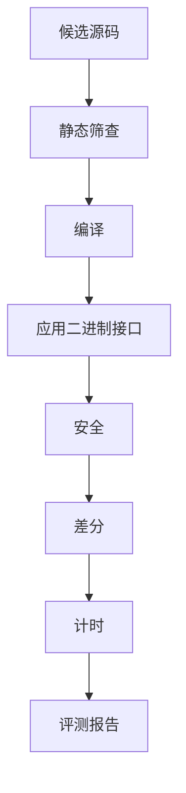
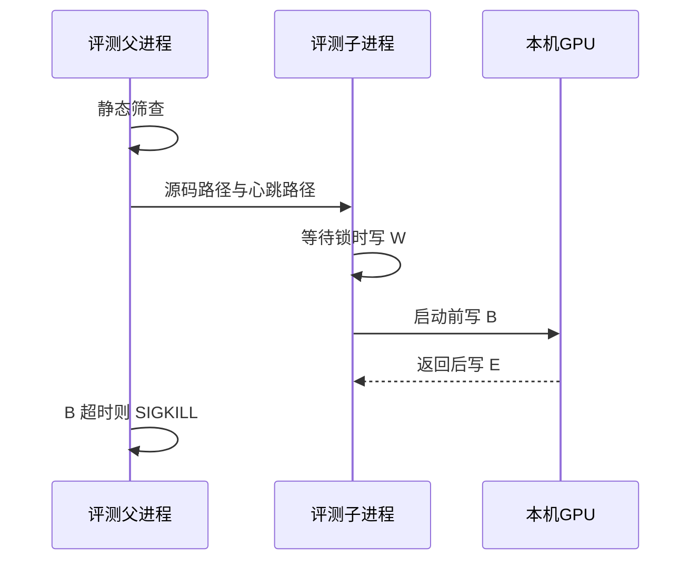

# 评测

这一篇回答：一次评测怎样判决安全、数值和耗时，报告和请求的版本边界在哪里。进程怎么分工见 [架构说明.md](../架构说明.md)。发布条件见 [搜索.md](搜索.md)。

## 评测报告与文件版本

评测报告 `EvalReport` 是子进程交回父进程的判决。版本边界避免旧进程删掉不认识的字段后仍构造对象，从而把新报告读成另一份结论。`eligible` 等于 `status == ok`。写出的 JSON 含 `schema_version`。没有该键的历史文件按版本 0 读取。版本高于本进程，或出现本版本未列出的字段时，读入拒绝，并说明需要人工检查。禁止删掉未知字段后再构造对象。请求文档使用同一规则。当前评测请求版本是 2，报告版本是 1，定义在 `tcenv/schema.py`。版本 2 比版本 1 多一个可选字段 `fast_bench`；没有该字段的版本 1 请求仍可读取。只认识版本 1 的旧子进程会拒绝版本 2 的请求，所以父进程和子进程必须是同一套代码。`result.json`、`state.json`、`ledger.json` 的版本均为 1，由 `taic/artifacts.py` 读取。文件存在但损坏，或版本不可读时，抛出 `NeedsInspection`。缺失文件表示该产物尚未写出；损坏文件不得被批量脚本当成「尚未运行」而覆盖重跑。`transcript.jsonl` 是已记账请求的追加记录。检查点可以加速恢复，不得改写转录，否则续跑会把没记账的请求再发送一次，或丢掉已经花过的记录。

| 字段 | 约束 |
| --- | --- |
| `task` / `dtype` / `size` / `mode` | 与本次 `evaluate` 一致 |
| `status` | 下表之一 |
| `stage` | 最后到达的关卡 |
| `message` | 首条失败说明 |
| `seed` | 本次评测实际使用的输入种子 |
| `compile` / `abi` / `safety` / `correctness` | 各关明细 |
| `benchmark` | 计时与变异系数。逐次样本不在第一期报告中保存 |
| `roofline` / `pipeline` | 性能上界与管线反射 |
| `speedup` | 最快基线耗时除以候选耗时 |
| `speedups` / `candidate_us` / `baseline_us` | 各基线的倍数与微秒 |
| `compiler_baseline` | 可选。由缓存比值估算，不是与候选同一次头对头计时 |
| `verification` | `verify()` 的结果。当前恒为 `unsupported`，且没有 `counterexample` 装差分反例 |
| `correctness.coverage` | 证据范围。取值域扫描通过时 `kind` 为 `domain_sweep`，并带 `scope`、工具链和源码哈希。没有这份记录时按抽样读 |
| `elapsed_s` | 本段墙钟秒数 |

| `status` | 条件 |
| --- | --- |
| `ok` | 该模式要求的关卡均通过 |
| `rejected` | 静态筛查在编译前拒绝 |
| `compile_error` | Metal 编译器拒绝 |
| `abi_error` | 已编译，签名或启动规模不符 |
| `unsafe` | 保护带、输入不变性、确定性或着色器校验失败 |
| `incorrect` | 超出容差，或输出仍含未写入的毒化图案 |
| `runtime_error` | GPU 在正确性或计时阶段报错 |
| `timeout` | 父进程已发送 `SIGKILL` |
| `crash` | 子进程未留下报告 |

候选 `Candidate` 保存源码、评测前已经确定的标签、方案名和报告。标签示例为 `init`、`init.s2`、`prior`、`r2.p1.fix1`。`Candidate.idx` 在评测之后才分配，不参与种子派生。

运行结果写入 `result.json`。`confirmed_speedup` 是确认测量值。`best_speedup` 是搜索入选时的测量值。`confirmation_source_sha256` 是确认胜者源码的 SHA-256；确认未绑定源码时为 `null`。旧文件若没有该键，发布结论为「旧版未绑定源码」。`search_seed_label` 与 `confirm_winner_label` 可以不同：确认测量可以改选噪声范围内的另一候选。

一次搜索目录中的文件如下。

| 路径 | 写入者 | 内容 |
| --- | --- | --- |
| `best.metal` | 结束时 | 当时种子的源码 |
| `result.json` | 编排器 | 版本 1 的运行结果 |
| `candidates/<序号>_<标签>/` | 每次评测 | `kernel.metal`、`report.json`、`feedback.txt`；复查失败时另有 `differential_recheck.json` |
| `transcript.jsonl` | 模型客户端 | 已记账对话。密钥已打码 |
| `ledger.json` | 账本 | 版本 1。缓存命中与未命中分开 |
| `state.json` | 编排器 | 版本 1 的阶段。写失败不停止搜索 |
| `run_config.json` | 启动时 | 见下表 |
| `confirm_report.json` | 确认测量 | 胜者的完整评测报告 |
| `control.json` | 观测或操作者 | 只升不降的预算、`max_rounds`、`patience` |
| `budget_events.json` | 账本 | 预算变更。落盘失败的一行被丢弃，该文件不是完整账单 |
| `eval_progress.json` | 评测 | 当前关卡 |

`run_config.json` 版本 1 的字段如下。不含 API 密钥与端点。

| 字段 | 约束 |
| --- | --- |
| `schema_version` | 整数 1 |
| `run_seed` | 无符号 64 位。新运行由 `secrets.randbits(64)` 生成，或由 `--seed` 指定。`0 <= seed < 2**64` |
| `contract_description_sha256` | `sha256(contract.describe().encode("utf-8"))` |
| `triton_source_sha256` | `sha256(task.triton_source.encode("utf-8"))` |
| `hash_scope` | 声明上述两个哈希不含参考实现与基线实现 |
| `git_commit` / `git_dirty` | 启动时的 git 状态。采集失败时提交为 `unknown`，脏标记为空 |
| `llm` / `search` | 启动时已经叠好预设与命令行之后的值 |
| `committees` | 恰好 first 与 second。每名记录 provider 与 model，不含密钥与端点 |
| `system_prompt_sha1` | 本次系统提示的 SHA-1 |
| `cost_may_be_incomplete` | 恒为真。见字段旁的 `cost_note` |

新运行若指向已有非空目录，启动拒绝。续跑（`resuming=True`）才读取既有目录，且不重写 `run_config.json`、不重新抽取 `run_seed`。没有 `run_seed` 的旧运行，评测种子保持由评测器随机抽取，不得事后写成可重放。配置文件写入失败时抛出 `RunStartError`。命令行以此退出码 5 结束。此时尚未发送模型请求，也不写看似成功的 `state.json` 或 `result.json`。本次新建的空目录可以留下，不得删除已有运行目录。

## 评测流水线

关卡按编译、接口、安全、数值、计时排列，前一关失败则不再占用 GPU。这样一份不能编译或数值不合格的源码不会进入计时，也不会因为“更快”被留下。

`evaluate(task, dtype, size, kernel_source, mode, seed)` 按关卡顺序执行。传入的 `seed` 为整数时使用该种子；为空时由评测器抽取。`full` 先做着色器校验，是因为保护带发现不了页内松弛里的小越界；校验通过后才花费完整差分和计时。校验子进程打开线程组插桩后，`staticThreadgroupMemoryLength` 会报成声明值的大约两倍。这一条若是唯一的 ABI 问题，不否决内核；接着的不插桩编译用设备上限 32768 字节再判一次。签名、槽位或线程数不对，仍停在校验这一段。

| 模式 | 调用者 | 范围 |
| --- | --- | --- |
| `quick` | `eval --quick`、`quick_check`、复查 | 静态筛查、编译、应用二进制接口、安全、差分。无着色器校验，无计时 |
| `full` | `naive`、`eval` 默认、正式候选与确认 | 先运行 `validate` 子进程，通过后再运行完整子进程 |
| `validate` | 仅作为 `full` 的第一段 | 紧缓冲、一个用例、打开着色器校验 |

关卡顺序如下。



| 关卡 | 文件 | 失败条件 |
| --- | --- | --- |
| 静态筛查 | `screen.py` | 去掉注释后的 `while (true)`、无条件 `for (;;)`，或非 `<metal_...>` 的 `#include` |
| 编译 | `contract.py`、`metal_runtime.py` | `newLibraryWithSource` 失败。行号减去契约头 |
| 应用二进制接口 | `abi.py` | 槽位、名称、读写或线程规模不符 |
| 安全 | `sanitize.py` | 保护带、输入、确定性 |
| 差分 | `testing.py`、`distributions.py` | 缩放误差超过允许值 |
| 计时 | `bench.py`、`baselines.py`、`profile.py` | GPU 报错。慢本身不使 `status` 离开 `ok` |

差分判据把 GPU 上的粗精度结果和 CPU 参考分开：允许误差覆盖舍入，而不是要求逐位相同。库基线自己更差时把允许值放宽到其误差的 2 倍且不超过 8，避免一个算歪的库把测试放成怎样都算对。

```text
|out - ref| <= rtol * |ref| + atol_rel * scale
```

`scale` 默认是参考输出的均方根。最准库基线的缩放误差大于 1 时，允许值升到该误差的 2 倍，且不超过 8。

下表的用例各自压一种常见算错。只在一种用例上失败时，模型可以按该分布改，而不必重写整个内核。

| 用例 | 输入 |
| --- | --- |
| `normal` | 普通幅度 |
| `wide_range` | 跨数量级 |
| `large` | 接近溢出 |
| `tiny` | 接近下溢。FP16 含次正规数。BF16 与 FP32 停在最小正规数之上 |
| `outlier` | 约千分之一的尖峰 |
| `cancel` | 大数成对抵消 |
| `const` | 常数 |
| `ieee` | NaN、正无穷、负无穷、负零。位置与符号须与参考一致 |

数值通过后再启动两次，用来抓住“结果碰巧对上、但内核读了输出区旧值或有数据竞争”的情况。第二次输出区填 0，结果须与毒化初值那次逐位相同。第三次再启动一次，结果仍须逐位相同。


## 评测子进程与心跳

GPU 上的内核不返回时，同一块芯片上的画面也会停，而且无法从核内抢占。子进程把单次启动关在可杀死的进程里；父进程按心跳限时，避免一次挂起拖住整次搜索。等待锁写成 `W` 且不计入总超时，避免别人占着 GPU 时把本次评测误判为挂起。

父进程先做静态筛查，然后启动 `python -m tcenv.worker`。子进程在 GPU 启动前写心跳 `B`，结束后写 `E`，等待机器锁时写 `W`。



| 条件 | 时限 |
| --- | --- |
| 单次启动且心跳为 `B` | 2 秒 |
| 着色器校验下的单次启动 | 4 秒 |
| `validate` / `full` / `quick` 整段 | 120 / 420 / 240 秒 |
| 发送 `SIGKILL` 之后 | 再等待 3 秒 |

`max_hangs` 默认为 1。真实挂死测试需要 `TCENV_ALLOW_GPU_HANG_TESTS=1`。监督由 `tests/fake_worker_*.py` 覆盖。

## 机器级图形处理器锁与计时

两份程序同时用 GPU 时，测得时间会偏慢，一次嘈杂测量还曾把更好的内核挤掉。独占锁让计时段不与本工程的其他 GPU 工作重叠；不计时的编译和差分用共享锁，因此不同实验仍可同时做这些工作。本工程以外的进程不受这把锁约束。

锁文件默认为 `~/.cache/ai_lowerling/gpu.lock`，可由 `TCENV_GPU_LOCK_FILE` 覆盖。实现为 `flock`。进程退出后由操作系统释放。同一次搜索内，评测、快速检查与 Instruments 还共用一把异步锁。

| 持有者 | 模式 |
| --- | --- |
| 候选计时、库基线、triton-msl、峰值标定、Instruments | 独占 |
| 编译、差分、着色器校验 | 共享 |

加速比使用墙钟中位数，不用 GPU 设备时间戳。三方必须用同一把钟：MLX 与 PyTorch 没有和候选相同的 `GPUStartTime` / `GPUEndTime`。只把候选改成设备时间，库基线仍用墙钟，候选会少掉排队和完成通知，比值偏大。设备时间戳仍写入 `RunTiming.gpu_s`，供对照，不进入 `speedup`。

一次样本是一批 `k` 次启动的墙钟除以 `k`。`k` 选得使这一批大约 15 毫秒，把单次提交和等待的固定开销摊开。预热的一批丢弃。正式重复默认 15 次，再丢弃最前 2 次，对其余取中位数。候选与各基线在每一轮里打乱顺序交错测量，升温和后台负载同时作用在两边。缓冲区轮换多组，避免小数据一直命中缓存。

下表是加速比所用墙钟的起点和终点。编码发射命令在候选的计时开始之前。

| 对象 | 起点 | 终点 | 窗口内 | 窗口外 |
| --- | --- | --- | --- | --- |
| 候选 MSL | `commit` 之前的 `perf_counter` | `waitUntilCompleted` 返回之后 | 提交、GPU 上这 `k` 次发射、等到命令缓冲完成 | 填写命令缓冲；管线创建在预热中丢弃 |
| MLX | `mx.eval` 之前 | `mx.eval` 返回 | 已建好的图的编码与 GPU 执行 | 建图 |
| PyTorch-MPS | `k` 次调用的 Python 循环之前 | `torch.mps.synchronize` 返回 | Python 循环、每次启动、同步 | 更早的输入搬运 |

候选的设备时间戳是同一份命令缓冲的 `GPUEndTime - GPUStartTime`，也是整批再除以 `k`。并发发射时这 `k` 次可以重叠，除以 `k` 是这一批跨度的平均，不是各次发射时长的加总。若每次发射单独一个命令缓冲，或在每次发射前后插计数器采样，调度就和现在这套、也和 MLX 的一批求值不同，加速比不再沿用本协议。

抖动仍然存在。安静时重复之间的变异系数约为 0.5% 到 1.5%；仓库外的程序占用 GPU 时可以到百分之十几，测得时间整体偏慢。交错、中位数、变异系数超过 0.05 时最多重测 3 次、以及换种子的噪声门槛，用来避免一次嘈杂样本直接换种子。三次都不安静时仍保留最安静的一次，并设 `benchmark.noisy`。确认值若被 `timing_is_uncertain` 判为不安静，发布标记为「不确定」。这样一次被打扰的计时不会直接成为换种子的依据。候选计时与 MLX 一样允许并发发射，避免候选因为发射方式比库基线慢一截；`candidate_serial` 另记串行时间，供核对这截差距。

性能上界给出“慢在搬数据还是慢在计算，以及离该算法的估计下界还有多远”，供下一轮改动对准短板。它不是物理最优：基线耗时小于下界的 0.95 倍时，只说明当前下界假设不成立。峰值缓存在 `runs/calibration.json`。`bound` 为 `memory` 或 `compute`，只取决于题目与标定，不随候选源码改变。

加速比的相对标准误把两次计时的变异系数合成一个门槛，使落在噪声里的略快不能换种子。公式在 `tcenv/bench.py` 的 `approximate_speedup_se`，搜索侧经 `speedup_se_of_report` 使用同一式。该数是近似，不是有保证的置信区间。`timing_is_uncertain` 在 `benchmark.noisy` 为真，或候选或最强基线的变异系数高于安静阈值时为真；为真时对外不把该次确认值标成确定结论。

`triton_runner.py` 在 `.venvs/triton-msl` 中编译规格文本。主环境不导入 Triton。`compiler_baseline` 用缓存比值乘以本次库时间，是估计值。


## 文件

| 文件 | 职责 |
| --- | --- |
| `tcenv/events.py` | 无网页依赖的事件；无订阅者时为空操作；文件日志供观测读取 |
| `tcenv/evaluate.py` | `evaluate`、监督、`EvalReport` |
| `tcenv/schema.py` | 请求与报告的版本 |
| `tcenv/worker.py` | 子进程与心跳 |
| `tcenv/screen.py` | 编译前拒绝 |
| `tcenv/metal_runtime.py` | Metal 调用 |
| `tcenv/abi.py` | 签名检查 |
| `tcenv/testing.py` | 差分与三次启动 |
| `tcenv/bench.py` | 计时与标准误近似 |
| `tcenv/verify.py` | 形式等价插槽 |
| `tcenv/domain.py` | 取值域扫描的输入与 `coverage` |
