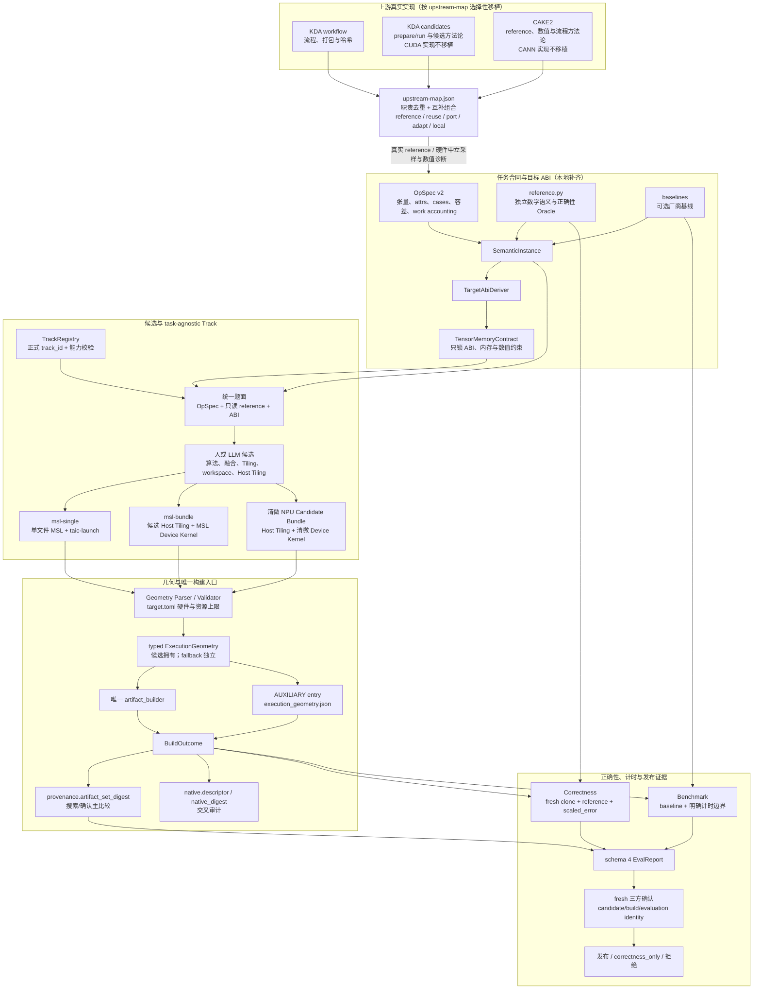

# 跨硬件算子生成：上游实现移植与证据底座集成计划

状态：**completed（G0、A1–A6 全部通过；A6 经两轮复核退回，修复后完整 verify 无 `--skip-*` 全绿，库存阶段固定 92 passed；NPU-P0 仍 blocked，等待清微真机与单独授权）。目标设计记录如下：Mac 侧 G0 已通过；A1、A2、A3、A4 已通过（A4 经独立复核退回修复后，完整 verify 无 `--skip-*` 全绿，验收见跨硬件算子生成分工-阶段验收/A1.md、A2.md、A3.md、A4.md），A5 经复核退回修复后已通过（完整 verify 无 `--skip-*` 全绿，验收见跨硬件算子生成分工-阶段验收/A5.md），A6 复核退回三处与二次复核发现的 verifier G0 覆盖缺口（82 组合节点漏入固定清单）已修复；完整 `A6/verify.py` 无 `--skip-*` 重新全绿后恢复 completed（库存阶段固定 92 passed），NPU-P0 无真机阻断**。R5/R6 已通过；原直接 evaluate 缺 task-pack 与
`build_identity_mismatch` 已修复，完整 GPU 复测为 153 passed、1 skipped。阶段验收见 `跨硬件算子生成分工-阶段验收/G0.md`。此前停止时留下的 G0 快照草稿已过期，必须按本版
重新生成。

已完成的上游源码对照见 `跨硬件算子生成分工-G0/upstream-map.json`（KDA workflow
`acdd79343c5e`、KDA kernels `f539baab8e46`、CAKE2 `b699c3247241`）。它只证明组件存在性与
reuse/port/adapt/local 决策，**不代表 G0 已整体完成**：旧路径语料、manifest/replay、性能比例和人类
NPU 合同仍未封口。

## 0. 第一原则与实施策略

> **学习工业界已验证的分工，不闭门造车，不限制 LLM 或人所写候选内核的表达力。**

候选拥有算法、融合、Tiling、workspace、Host Tiling 与 ExecutionGeometry；harness 拥有任务验收、
ABI、安全、测量边界与证据；Track 只提供 task-agnostic 的语言和交付链。相同候选字节不得因作者是人、
LLM、committee 或会话不同而改变 verdict。

实施采用**选择性移植**，不要求 fork，也不以“借鉴”为名重新发明：

1. 上游已有且适用的组件，直接复用或移植；
2. 上游存在但不适配本仓库的组件，做薄适配，不重写其语义；
3. 只有 G0 证明上游缺位或许可证/硬件/安全约束确实不适用时，才选择本地实现；
4. 每个本地实现必须登记上游差距、保留原因和退出条件，不能变成默认自研路线；
5. 不追求同时兼容整个 KDA 与 CAKE2，不为它们再建一层庞大兼容框架。按组件选择最合适来源。
6. **职责去重、互补组合**：同一职责的等价实现只保留一个权威和运行路径；不同职责可以来自
   不同上游并与本地组件组合，但必须有清晰接口和独立验收。组合不是形成 KDA 路径与 CAKE2 路径，
   而是形成一条去重后的本地交付链。多 Track 只用于真正不同的交付机制。

## 1. 复用边界：上游交付 + 本地证据

### 1.0 硬件与知识过滤

目标平台只有 **Mac GPU（Metal/MSL）**与**清微 NPU（本地冻结的工具链）**。学习分为三层：

| 层级 | 允许 | 禁止进入生产、pack 或 guidance |
| --- | --- | --- |
| 架构与流程 | Task Contract、reference、Candidate 生命周期、Track 分工、验证/晋级方法 | 把上游具体项目结构当成必须照搬的本地目录 |
| 方法论 | 候选拥有融合/Tiling、prepare/run、Host+Device 分工、差分与性能分析、反作弊设计 | CUDA/CANN 的调度规则、shape 特化、芯片技巧、专有优化模板 |
| 硬件中立实现 | 通用哈希/打包、纯 Python 工具、经语义核对的 reference、通用采样与诊断函数 | CUDA、PTX、CuTe/TIRx、AscendC、EasyAsc、msopgen、CANN build/install、ACL/PyBind、msprof 及其专用知识 |

上游源码即使被读作方法论证据，也不等于允许移植。`reference` 仅表示研究来源，`reuse/port/adapt`
才允许代码进入本地，而且必须逐文件通过硬件中立检查。清微 NPU 的设备、工具链、profiler、ABI 与 baseline
一律由本地 G0 和人类合同决定，不能用 CUDA 或 CANN 代替。

### 1.1 组件复用与本地边界

| 平面 | 优先移植/复用 | 本地保留或补齐 | 禁止 |
| --- | --- | --- | --- |
| 任务合同 | CAKE2 `op_desc` 互操作摘要、真实 PyTorch reference、采样与数值指标；KDA 仅有合同文字说明 | **本地 OpSpec v2 主合同与 loader**（上游没有完整合同）、现有任务迁移和 G0 对照 | 把 op_desc 示例当完整 schema，或另造 IR/pattern |
| 候选交付 | KDA `prepare/run` 生命周期与通用反作弊方法；Host+Device 分工仅作方法论 | **本地 Candidate/ExecutionGeometry/Canonical Bundle**、Metal 与清微运行时；不移植 CUDA 调度或 Ascend 项目代码 | 把 CUDA/CANN 候选或芯片知识带入 Track/production/guidance |
| Track | 上游多交付路线的方法论；硬件中立校验思想 | **本地 TrackRegistry**、Metal track 与清微 NPU track | 以 CUDA/CANN 交付路线充当本地路线，或按 op_name/shape 路由算法 |
| 构建与证据 | KDA 通用打包/快照哈希的硬件中立部分，以及上游冷启动剔除与计时方法论 | 唯一 artifact_builder、BuildOutcome、Metal/清微构建与 profiler 适配、schema 4、evaluation identity、fresh confirmation、resume、远程安全与审计 | 用上游结论替代本地证据，或移植 CUDA/CANN 构建与 profiler |
| 知识与技能 | 适用的优化指南、诊断技能和硬件文档 | guidance_catalog 与 agent_guidance 哈希 | 知识正文进入 task_pack_digest |

**上游不是许可证或证据的替代品。** 移植文件必须保留 license/notice 与 repo/commit/path；上游性能结论
只能作参考，本地发布仍需真实构建、正确性与 fresh confirmation。

## 2. 目标架构

### 2.0 总体图：上游移植 + 候选交付 + 本地证据



读图要点：上游只提供经审计存在的实现，不把通用 Task Contract、Candidate 或 Geometry 框架
想象成现成代码；候选拥有实现与几何，Track 不提供逐题算法；确认几何的主机制是
`provenance.artifact_set_digest`，`native.descriptor/native_digest` 只做交叉审计。知识与技能只进入
`run_config.agent_guidance`，不进入 `task_pack_digest`。

### 2.0.1 标准目录入口（A6 完成态）

A1–A6 全部完成后，普通算子的标准入口只有两项必需文件：

```text
tasks/<op>/
  opspec.json       必需：任务合同
  reference.py      必需：独立参考实现
```

按需可选：

```text
  reference.json    reference 版本、采样与误差尺度 profile
  baselines.json    性能 baseline 登记
  baselines.py      有 baselines.json 时必需的 baseline runner
  display.json      description、核名等表示覆盖
  known_good.metal  harness 自检核
```

已迁移任务不再包含 `task.py`、`track.json`、`kernel_triton.py`、逐题 LoweringProfile、
专用题面模板、手写 `pack_files` 或中央任务名登记。`naive.metal` 只有主动保留为
`known_good.metal` 时才存在，不是加题门槛。

文件职责固定如下：

| 文件 | 唯一职责 | 明确禁止 |
| --- | --- | --- |
| `opspec.json` | 张量及顺序、shape/dtype/layout/access、语义 attrs、cases/sizes、容差、work accounting、发现元数据 | grid/threads/tile、num_warps、Track 选择、候选优化参数 |
| `reference.py` | 独立正确性实现；可选输入生成与误差尺度 | import 候选、renderer 或 known-good 来生成答案 |
| `reference.json` | reference 版本、采样/error-scale profile | 第二份任务语义、无结构顶层 `params` |
| `baselines.*` | 性能比较对象与实现身份 | 充当正确性 oracle 或加题必填项 |
| `display.json` | 表示层覆盖 | 改变 reference、cases、容差、ABI 或启动 |
| `known_good.*` | harness 自检 | 充当 reference、baseline 或新算子前置条件 |

`reference.py` 的标准接口为：

```python
def reference(inputs, attrs):
    return {"y": ...}

# 可选：
def gen_inputs(case, seed, instance): ...
def error_scale(inputs, reference_outputs, instance, tolerances): ...
```

`read_write` 张量的最终值也是结果，reference 必须返回其期望终值并纳入差分。没有
`baselines.json` 时 `Task.baselines` 为空，自动走 `effective_correctness_only`，不发布 speedup。

### 2.0.2 作者工作流（A6 完成态）

**新增普通算子或融合算子。** 作者只提供 `opspec.json + reference.py`，有厂商 baseline 时才加
`baselines.*`。无需修改后端、注册 pattern、写 Triton、写 task.py/track.json、写 naive kernel 或
改中央任务清单。融合算子（包括 `MatMul → Softmax → MatMul`）入口完全相同，不产生
`matmul_softmax_matmul.pattern`、StagePartitioner、TileConnector 或专用 LoweringRule。

**候选作者（人或 LLM）。** 候选作者不修改任务目录，而是根据 TrackRenderer 渲染的
`OpSpec + 只读 reference + TensorMemoryContract` 提交实现：

- `msl-single`：单个 `.metal` 文件与可选 `taic-launch` 几何声明；
- `msl-bundle`：候选 Host Tiling + MSL Device Kernel + Schedule/资源声明。

候选拥有算法分解、融合、Tiling、grid/threads、workspace、多阶段流水、Host Tiling、
Derived Scalars 与 stage 参数绑定；系统不规定候选应采用哪一种内核写法。

**工具/平台作者。** 只有新增 Track 或 target 才修改系统侧：

- 新 Track：`tracks.json` + renderer + validator + build adapter + 独立真实证据；
- 新清微 target：清微 backend/target 档案 + Clang 工具链适配 + ABI/资源限制 +
  baseline/profiler + 真实设备证据。

算子目录不因新增 Track/target 而改变。清微无真机时只能做流程、数据和协议模拟，Track 不得标
available，也不得发布性能。

**从作者到发布的完整链路：**

```text
opspec.json + reference.py
→ 自动发现与 SemanticInstance
→ TargetAbiDeriver 派生 TensorMemoryContract
→ TrackRegistry 选择交付 Track
→ TrackRenderer 渲染统一题面
→ 人或 LLM 候选自主决定算法、融合、Tiling 与 ExecutionGeometry
→ 几何校验与唯一 artifact_builder
→ fresh-clone correctness + reference/scaled_error
→ 有 baseline 才测速，否则 correctness_only
→ 几何进入构建产物 artifact_set_digest
→ schema 4 + fresh 三方确认
→ 发布 / correctness_only / 拒绝
```

一句话：**加算子只写 `opspec.json + reference.py`；写候选就实现算法和几何；加 Track/target
才改系统侧。**

### 2.1 任务合同与 reference

- 源码审计已经证明上游没有完整通用 Task Contract：KDA `docs/agent-flow.md` 只有文字要求，CAKE2
  `op_desc_template.json` 只是缺少 read_write、alias、workspace、容差、work accounting 和 baseline 身份的
  示例。因此本地必须实现 `opspec.json` v2 主合同与 loader；这不是绕过移植原则，而是
  `upstream-map.json` 中有证据的 local 项。上游真实 reference 与采样器优先移植，op_desc 仅作互操作摘要，
  不能成为第二权威。**正确性 pass/fail 的唯一公式仍是本仓库 tolerances + `scaled_error`**；CAKE2
  `precision.py/ulp.py` 只作诊断统计，`datagen.py` 仅作 `sampling_profiles.json` 的可选采样器，
  不改变既有种子流、cases、error scale 或 R0–R6/G0 黄金向量。
- 默认题面统一展示任务合同、只读 `reference.py` 与 `TensorMemoryContract`。formula 只是简短摘要，
  reference 提供无歧义数学语义；候选不能 import reference 充当自己的实现。只有 G0 冻结的 `sem_*`
  白名单可用 `display.json.spec_text` 覆盖题面。
- attrs 只表达语义参数，不能携带 `block_m/num_warps` 等优化参数；无 IR 时删除 `uses`，所有声明 attrs
  进入 `resolved_attrs`。v2 的 `@variant` 在装配期拒绝，v1 未迁移题保留原行为。
- OpSpec/reference/表示冲突时判 `semantic_unresolved`，由已知答案、独立库、G0 或人工评审仲裁，不自动
  选边改写。超出合同/ABI 能力时判 `unsupported_contract_capability`，不得改回按拓扑 pattern 拒绝。

### 2.2 候选与 ExecutionGeometry

候选拥有实现自由，环境只固定 TensorMemoryContract 的 ABI、内存和数值约束：

- 不设置 pattern resolver、LoweringRuleRegistry、StagePartitioner 或 TileConnector；不删除循环形态、
  `goto`、persistent、状态机或多阶段写法。runaway 由外部看门狗处理。
- 目标 SDK 公开的原生矩阵、同步、原子与汇编能力不由 harness 另设风格白名单；真实 toolchain/target
  决定可用性。宿主任意路径 include、未声明资源与沙箱逃逸仍拒绝。
- `role: output` 可读写，支持多阶段中间结果；`access: read_write` 的张量是结果的一部分，reference
  必须给出期望终值并纳入差分。输入输出不共享 buffer，alias 必须显式声明。
- TensorMemoryContract 不提供 tile/并行度常量，也不包含 fallback 几何。fallback 是独立、低优先级的
  typed ExecutionGeometry，并进入执行身份。

Metal 缺口只在 G0 证明需要后补齐：OpSpec JSON Term 与 launch 文本表达式的一致求值、唯一启动块内
`when` 条件 stage、Derived Scalars 按名 `setBytes`、MSL 反射 Per-Stage Argument Binding。派生标量只能
依赖 symbols/attrs，候选手写 binding_slot 不需要也不允许；每个 stage 使用自己的连续槽位并校验类型、
权限、宽度与绑定完整性。未激活 stage 不参与该实例 ABI 检查，零激活 stage 拒绝。

### 2.3 Track 与交卷

Track 必须 task-agnostic：不得按 `op_name` 或 shape 提供 tiling 算法，无法通用交付时标 unavailable，
不能用逐题模板补救。Host Tiling 源文件始终属于候选 bundle，不属于 Track。

上游没有 Metal 交付路线，因此首批本地 Metal track 仅为：

1. `msl-single`/`1`：单文件 MSL + 声明式 `taic-launch`；
2. `msl-bundle`/`1`：候选 Host Tiling/Launch + MSL Device Kernel Bundle。

两者使用同一任务合同、reference 与 ABI 题面，独立构建、正确性与确认，speedup/cache/confirmation 不串用。
只复用上游 Host+Device 分工方法论；构建、绑定与运行时适配器均针对本地 Metal 与清微 NPU 实现，
不引入 CANN/CUDA 适配器。上游没有通用 CandidateArtifact、canonical ArtifactBundle 或几何摘要协议，
这些必须由本地实现。若现有单文本 agent 链需要传输适配，可使用固定 manifest +
`taic-file` 文件段的**单提交分段 envelope**。它只是传输格式，不是新的候选语义或第二套 Bundle：
解析为受控 ArtifactBundle 后，candidate_sha256 使用**仅候选源 entries** 的 canonical manifest digest，prune_work、自检、
worker 与 evaluate_task 不得丢失文件段，不修改六 RPC。

### 2.4 构建、执行证据与发布

- 候选只经唯一 artifact_builder，报告只用 schema 4；full+native+measured、逐批 identity match 与唯一
  发布谓词不因移植而改变。
- **提交身份在构建前固定**：`candidate_sha256 == provenance.source_sha256`。`msl-single` 是单文件字节
  SHA-256；`msl-bundle` 与清微 Bundle 是**仅含候选提交源文件 entries** 的 manifest digest。候选 Host
  Tiling、Device Kernel、Schedule 均包含在内，builder 尚未追加任何构建产物。
- **构建产物身份在构建后生成**：完整 canonical ExecutionGeometry 以 `AUXILIARY` entry
  （`execution_geometry.json`）同时加入 `BuildOutcome.bundle.entries` 与 `BuildOutcome.artifacts`，随后重算
  `provenance.artifact_set_digest`。它表示候选 entries + 冻结几何等完整构建产物，与提交身份不是同一个值。
  现有确认门通过 `two_period` 比较该 digest 拦截几何漂移。`native.descriptor` 另存几何
  `schema_id/path/sha256` 并计入 `native_digest`，只作交叉审计，因为当前 policy 不直接比较 native_digest。
  顺序固定为编译 → 候选 Host Tiling → 冻结几何 entry → 重算 artifact_set_digest 与
  descriptor/native_digest → correctness/benchmark/confirmation。builder、worker、evaluator 共用同一份
  typed ExecutionGeometry。不得事后修改 entry/descriptor，也不新增 EvalReport 自由字段。
- 没有 baseline 就走 `effective_correctness_only`，不发布 speedup；reference、known_good 或模拟结果不能
  冒充 baseline 或真实设备证据。

## 3. 正确性与测量合同的本地硬约束

### 3.1 `read_write` 与 workspace

- Correctness 的 `out1/out2/out3` 每次启动前都重新加载 read_write 初值；poison/zero 只作用于纯 write
  输出和协议指定的 workspace，不覆盖 read_write 输入；read_write 跳过 unwritten 统计并使用
  `GUARD_PATTERN(0xCD)`。特殊值按 reference/case 判断，不 blanket 要求 finite。
- Benchmark 连续 reps 后可只检查 guard band、越界与硬件状态，不重复做终值差分或 blanket overflow
  断言；但必须使用 fresh clones/rotation 或登记为 stateful timing，不能把反复修改后的状态冒充原始输入
  的单次性能。
- `workspace_fills()` 只清声明 `zero` 的 workspace。未声明 zero 的区域在 benchmark 不插清零核，在
  correctness 的 out1/out3 毒化、out2 清零，证明不依赖垃圾初值。

### 3.2 计时边界

- Host Tiling 只生成几何、资源与 launch 参数，不得计算 reference、预处理输入或替 Device Kernel 完成
  数学工作。需要的输入预处理必须进入受测执行。
- prepare/run 的行为、缓存与计时归属必须版本化登记并进入身份。输入相关 prepare 必须计时；输入无关且
  可复用的准备绑定 candidate/bundle、target、实例和缓存身份。
- workspace 分配/清零、descriptor、Host readback 与输入恢复使用同一 candidate/baseline 测量口径。
  未声明的 Host 计算、prepare 或计时外缓存不得用于发布。

## 4. 配置、provenance 与兼容边界

- 本地新增的注册元数据继续使用带 JSON Schema 的版本化 JSON，未知版本/字段/实现引用拒绝；但不为了
  格式偏好重写上游合同。每类配置只有一个权威和读取器，不上游/本地双读。
- `upstream-map.json` 是移植台账，不是运行期第二注册表。每项至少包含：
  `{component, source, upstream_path, action, local_path, reason, verification}`，其中
  `action ∈ reference|reuse|port|adapt|local`。`reference` 只作方法论证据，代码与专用知识均不进入本地；
  `reuse|port|adapt` 仅可用于通过硬件中立检查的内容。功能重叠时必须在顶层 `selection_groups`
  或对应条目上登记 `selection_group`、`selected_source` 与 `alternatives_rejected`；同一 responsibility
  只能有一个权威实现，其他来源不进入 pack 或运行路径。职责互补时在顶层或条目上写
  `composition_role` 与组合接口，条目可通过 `selection_group` 链接到顶层职责组，允许组合但不得重复
  承担同一职责。local 必须有上游缺位或不适用证据。
  唯一允许的并存是交付机制不同（msl-single/msl-bundle）或职责不同（正确性判决 vs 诊断统计），
  不是 KDA 路径与 CAKE2 路径并存。
- pack 文件集由注册关系与仓库内静态 import 闭包自动派生；知识只进 guidance_catalog 和
  `run_config.agent_guidance` 哈希，不进 task_pack_digest。
- v1/v2 按 `spec_version` 分派，混合目录装配错误，v2 失败不回退 v1。历史 run/R0 保留为不可变档案，
  不迁移、不回填；run_config schema 3 记录 track、task_pack_digest 与 effective_correctness_only。
- known_good 仅是可选 harness 自检物，不是新算子门槛、reference 或 baseline。

## 5. 分阶段实施

每阶段通过必须可机器重放：固定命令/node id、稳定负例、`verify.py`（或等价脚本）与 `manifest.sha256`。
只有叙述或上游引用、没有本地证据的阶段不得标通过。

### G0. 基线、上游盘点与移植台账（纯只读）

- 冻结 HEAD、tracked diff、纳入范围未跟踪文件哈希、静态任务清单、配置读取点和 v1/v2 边界。
- 用旧路径生成所有待迁移题的 `(task,dtype,size,variant,case)` 与固定种子语料：输入、reference 输出、
  容差、error scale、work accounting、baseline、template_literals 与 pack 清单。small 存原始张量，
  paper 存 shape/dtype/digest+可复现种子。
- 登记当前失败：CPU 的 ArtifactBundle.materialize(anchor) 草稿问题、并行 pipe 时序波动，以及真实 GPU
  的直接 evaluate 缺 pack 和 `build_identity_mismatch`。G0 不为冻结语料重跑 GPU/NPU。
- 盘点 KDA/CAKE2 的实际仓库、commit、license、Task Contract、reference、Candidate、prepare/run、
  Host Tiling、Bundle、Track adapter、构建与 profiler。形成 `upstream-map.json`，明确 reuse/port/adapt/
  local 与本地落点；不得在未盘点时默认本地重写。按 responsibility 去重，互补职责登记组合接口；
  同一 responsibility 不得保留两个运行期实现。CUDA/CANN 相关项只能标 reference/rejected，
  不得进入生产、pack 或 agent_guidance。
- Mac v1/v2 性能登记比例已由人类批准为 **1.10**。清微按 Clang 工具链处理，当前无真机，
  只允许流程、数据、协议和模拟验证；NPU-P0 保持 blocked，模拟不得作为 NPU 性能或发布证据。
  未来真机合同仍需单独冻结设备、代表算子、baseline、阈值、预算、计时口径与确认批次。

### A1. 移植任务合同与 reference

**A1 已通过**（验收：`跨硬件算子生成分工-阶段验收/A1.md`、`A1/verify.py` 与 `A1/manifest.sha256`）。

- 按 upstream-map 实现本地 OpSpec v2 主合同与 loader，移植真实 reference 与采样器；A1 以 RMSNorm/
  sigmoid 为代表题，把 v1 采样器移植进标准 `gen_inputs`，将 v2 reference 输出与 G0 档案逐字节对照；
  其余题目的完整 port 在 A5。op_desc 只实现只读互操作摘要（闭集模板、确定性、不进入身份/判决），
  不写“上游已有完整合同”的兼容层。pass/fail 只认本仓库 tolerances + scaled_error，CAKE2
  precision/ulp 仅作诊断，不得改变 G0/A5 的判决与种子流。
- 已完成 24 个 shipped v1 OpSpec 到 v2 的映射（98 个 dtype/size 组合逐字段语义比较）、上述代表题的
  G0 输出/输入字节对照、语义冲突和 v1/v2 负例；没有迁移任何 shipped v1 题。
- `display.spec_text` 只允许 G0 固定的 `sem_*` 与 `sem_int_<1..18 位 ASCII 十进制种子>`，后缀按登记
  语法校验；冻结面包含 `tcenv/task.py`（任务身份）与 `tcenv/contract.py`（Contract 投影）。
- reference 初值合同包含 `role=input` 与所有 `read_write`（包括 `role=output` 的初值）；生成、输入
  校验、reference 执行和采样计划共用该定义。`load_task_contract(..., variant=...)` 对任何非 `None`
  值（含空字符串）在装配期拒绝。v2 attr 标识符冻结为 `^[A-Z][A-Z0-9]*(_[A-Z0-9]+)*$` 并拒绝几何
  拼写变体；候选路径逐段拒绝 `.`/`..`；默认 dtype/size 只在 `None` 时应用。
- `error_scale` 与 reference 共用工作副本和 `_version` 边界；整数采样按每个声明 case 的有效
  `tensor > case > default` profile 在装配期校验，避免默认/case 优先级不一致。

### A2. 移植候选交付并补 Metal 缺口

- 本地实现通用 Candidate/ExecutionGeometry/Canonical Bundle；只适配硬件中立的 KDA prepare/run 生命周期
  和 Host+Device 分工方法论，不移植 CUDA 调度/内核或 Ascend 项目文件。A2 通过门只含 Mac 与通用层。
- 清微 NPU 的工具链、ABI、profiler 与构建适配归 NPU-P0；CANN msopgen/build/install/EasyAsc/msprof
  不属于任何阶段的移植范围。
- 只实现上游缺失的 Metal ABI/几何/反射绑定能力，以及 `build_profiles.json` 一次性切换。不得借适配之名
  新建逐题 tiling 或 pattern 规则库。

### A3. 接入证据、任务发现与恢复

- 贯通 CandidateArtifact、Reference/BaselineRegistry、自动发现、静态 pack 闭包、TaskLocator 与
  evaluate_task；支持暂存任务跨本地 worker 重建并校验指纹。
- 接入 BuildOutcome、几何 entry/provenance.artifact_set_digest 的确认比较与 native.descriptor 交叉审计、
  schema 4、run_config schema 3、resume/replay 与 agent_guidance；正式 track_id 未知/不支持即拒绝，
  v1 仅允许 track_id=None。
- 若使用单提交分段 envelope，完成 kernel_agent/prune_work/自检/worker 全链验收。

### A4. 真实 Mac 垂直切片

**A4 已完成，并通过完整 RLAR 独立复核（Reviewer `done=true`）。** 当前生产路径为
`MetalV2Runtime` + `MetalV2Executor`，真实 Mac 切片覆盖：

- RMSNorm 的 `msl-single` full 计时，以及 `msl-bundle` 的候选 Host Tiling + Device Kernel full 计时；
- `tasks/sigmoid_shift` 标准目录自动发现与 correctness-only 评测，无需中央任务登记；
- 融合算子 128/256 threads 几何对照与 replay、多激活 stage、Derived Scalar/when、read_write、
  workspace 清零与 Host 计时边界。

runtime 在真实 `dispatchThreadgroups_threadsPerThreadgroup_` 前记录逐段 kernel/grid/threads/
threadgroup/workspace，并以 `selection_parity` 审计实际 provider。Host Tiling 是真实 CPU host plan，
device stage 消费它写入的 workspace；read_write 每个 correctness trial 恢复初值，benchmark 只清
候选声明 `zero` 的 workspace，反射绑定按名设置 Derived Scalar。

Track 身份与构建边界已经封口：控制机把 TrackSpec、完整 registry、track/registry/presentation 摘要
冻结进 worker 请求，worker 不得改读默认 registry；父进程只做预编译检查，首次真实编译与执行都在
`run_bounded_v2` 的有界外部 worker 内，候选只编译一次。worker 返回真实 schema-4 build 记录，控制机
根据 canonical bundle 交叉审计候选 entries、冻结几何、native descriptor、artifact-set/native digest
和任务身份。缺失、额外、重复或路径别名 artifact、canonical SOURCE 漂移、非 native partial，以及
自洽但错误的 build 均拒绝；编译失败只保留真实 partial，超时/崩溃不伪造 full build。

最终执行 `A4/verify.py`（无 `--skip-*`）：41 个交付文件、30 个冻结路径、37 个固定负例节点、
3 项 self-test、194 个固定 CPU 测试、24 个真实 GPU 测试全部通过；`A4/evidence/` 七份 JSON 与 live
运行逐字段相等。逐轮退回与修复历史见 `跨硬件算子生成分工-阶段验收/A4.md`。A5 同口径的完整
`A5/verify.py` 已通过（16 题/82 组合、G0 字节对照、paper+small 性能门、fresh v2 复核、6 条真实
GPU 切片 + 3 个手写 simdgroup GEMM 变体、remote/observe 回归；验收见
`跨硬件算子生成分工-阶段验收/A5.md`）；A6 同口径的完整 `A6/verify.py` 也已通过（旧实现退出、
preserved v1 装配与身份锚点、v2 库存/G0、唯一读取器、真实 GPU 双路径、现场 fresh 性能门；验收见
`跨硬件算子生成分工-阶段验收/A6.md`），NPU-P0 仍 blocked。

### NPU-P0. 真实 NPU 性能风险门

与 Mac A5/A6 分叉并行，需单独授权真实**清微 NPU**。只复用上游架构、流程和方法论；设备、
toolchain、Candidate ABI、profiler、厂商 baseline 和计时口径均由清微目标合同冻结。不得引入 CUDA、
AscendC、CANN、EasyAsc、msopgen 或 msprof。**当前没有清微真机，只允许流程/数据/协议模拟，NPU-P0
保持 blocked；模拟不得解除阻断或形成性能/发布证据。**未授权、未实测、
未达标分别标 blocked/performance_unproven/performance_below_target；Mac、模拟与 correctness_only
不替代 NPU 性能结论。

### A5. 逐题原子迁移

- 逐题切到移植后的标准合同+reference，G0 独立对照输入、输出、容差、error scale、work accounting 与
  baseline 身份；同变更删除 task.py、track.json、kernel_triton.py、专用题面与手写 pack_files。
- 不保留 v2 Triton 题面兼容；naive.metal 仅在新合同可用时保留为可选 known_good，否则删除。
- 契约常量移除 tile/并行度、fallback 几何和 @variant 退役属于登记差异；有 baseline 时记录 v1/v2
  性能，超出 G0 比例须登记原因并人工批准。

**已完成**：16 题/82 组合迁移、v1 拒绝/无 fallback、G0 字节对照、paper 1.004657 / small 1.067889
（每轮 <=1.10）与现场 fresh v2 复核、6 条真实 GPU 切片 + 3 个手写 simdgroup GEMM 变体、5 个 remote 与
1 个 observe 回归。复核退回的三项测试覆盖删减/弱断言已修复并完整复测；`A5/verify.py` 无 `--skip-*`
全绿。验收见 `跨硬件算子生成分工-阶段验收/A5.md`。旧 v1 装配的 GPU 测试与旧 LoweringProfile/解析器
一起留给 A6 删除。

### A6. 退出旧实现与重复自研层

删除已迁移题旧 LoweringProfile、生成族旧解析器、静态名字条目，以及与上游重复的本地注册、交卷或交付
代码。保留未迁移题 v1 路径、历史 run/R0 和上游 provenance；复核唯一配置读取器，不形成第二套自研架构。

**已完成**：`tasks/generated/`（14 文件）与 `_pointwise.py`/`_matmul.py` 删除；`tasks/__init__.py`
只登记 8 题 preserved v1（16 个迁移名按 `spec_version` typed refusal，无 fallback/第二 registry），
`FIXED_NAMES` 只留 `sem_attention_odd_scale`；`tcenv/backends/metal/lowering.py` 686→450 行，9 份
迁移 profile/2 个 lowerer/GEMM variant factory 退役，8 个 preserved profile 与 `git show HEAD`
逐字段相同。preserved v1 仍可装配（含 `sem_int` 动态族、`flash_attention@64x32t256`），R0/Mac
phase-0 的 contract/prompt 身份锚点仍复现；16 个标准目录仍只有 v2 entry 且无启动事实；每类配置
（v2 契约、Track registry、v1 发现、lowering、打包、build profile、数值判决）结构上只有一个读取器，
upstream-map 7 个责任各有唯一本地权威。真实 Mac 上 v2 路径在 v1 lowering 读取器全部替换为
“调用即失败”后仍跑通，v1 `rope` 仍有真实计时；现场 fresh v2 paper/small 门 1.022359/1.060051
（另两轮 1.043526/0.968809、归档轮 1.020205/1.068561）均 <=1.10。`A6/verify.py` 无 `--skip-*`
全绿，完整 GPU 151 passed/1 skipped，fast CPU 3486 passed/33 沙箱失败/8 skipped（与基线同集合）。
A5 的 v1 预迁移证据、G0/A1–A5 文档与 manifest 未被改写（`test_track_a4.py` 的 `KeyError`→typed
refusal 已在 A6.md §9 披露）。验收见 `跨硬件算子生成分工-阶段验收/A6.md`。

## 6. 最终验收

1. **移植真实发生且职责去重**：upstream-map 的每项都有来源、license、action、本地落点和验证；
   同一 responsibility 只有一个权威实现，互补组件有清晰接口，未形成 KDA/CAKE2 双路径；
   CUDA 与 Ascend/CANN 的代码、工具链、芯片知识和专用 guidance 未进入生产、pack 或 agent_guidance。
2. **候选表达力未被限制**：无 pattern/拓扑/循环/goto 风格闸门，符号几何、派生标量、多阶段、read_write、
   workspace 与 SDK 原生能力可用；相同候选字节不因作者或来源改变 verdict。
3. **Track 是交付而非算法库**：msl-single 与 msl-bundle 经正式 track_id 分别真实成证，Host Tiling 属于
   候选，Track 不按 op_name/shape 提供 tiling，证据不串用。
4. **证据门没有降级**：唯一 builder、schema 4、evaluation identity、fresh confirmation 与唯一发布谓词完整有效；冻结几何 entry 已纳入 provenance.artifact_set_digest 的搜索/确认比较，native.descriptor 仅作交叉审计；缺 pack 和 build_identity_mismatch 已修复并经 GPU 复测。
5. **正确性与计时诚实**：read_write 三连跑/终值/隔离、workspace 清零、fresh-rotation/stateful timing、
   prepare/run 和 Host Tiling 计时边界全部通过固定负例，无计时外隐藏工作。
6. **迁移可重放且无性能暗退**：G0 对照、阶段 verify/manifest/负例和 A5 性能记录齐全；超比例退化有原因
   与人工批准。
7. **NPU 声明有真实证据**：NPU-P0 达标才扩张或宣称工业能力；Mac、模拟、source-only、unknown、
   correctness_only 均未冒充 NPU 性能证据。
