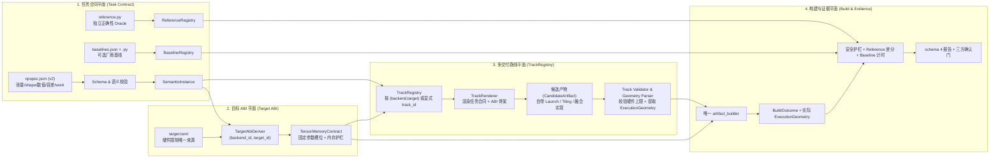

# 跨硬件算子生成：对齐 KDA / CAKE2 的目标架构与重构计划

状态：**目标设计，未实施**。主计划 **R5/R6 均已通过**（见 `docs/架构/构建执行与证据语义升级-阶段验收/R5.md` §27 与 `R6.md` §13）。**G0 仍为 pending**：代码快照、旧路径输出语料、配置读取点清单与 v1/v2 边界尚未冻结；G0 完成前不得开始 A1–A6。

---

## 0. 核心转向：学习工业界已验证的分工，不闭门造车，不限制 LLM或人所写候选内核的表达力

先前的设计试图在注册表里维护一套「整图 pattern 签名 → 共享默认启动规则 → 原子 Stage 切分器（StagePartitioner）→ 阶段连接器（TileConnector）→ 自动生成 `naive.metal`」的封闭编译体系。对照 **KDA（Kernel Design Agents）** 与 **CAKE2（CANNBot-CAKE）** 的源码与工程实践，那条路存在两个根本缺陷：

1. **把组合放在注册表里，必然导致规则膨胀**：真实大模型算子（FlashAttention、MLA、MoE Grouped GEMM、Mamba2/KDA 状态递推）的融合边界、分块（Tiling）、片上缓存复用和流水同步千变万化。KDA 与 CAKE2 之所以没有 pattern 爆炸，是因为**算子组合与分块调度发生在候选源码里，不发生在 harness 的注册表里**。
2. **把 `grid/threads/tile` 锁死在静态 Contract 里，卡死了核心优化空间**：GPU 与 NPU 算子性能的主体来自 Tiling、Swizzling、Split-K、Persistent Threadgroup 以及 Host/Device 协同。harness 预先拍死一套默认网格，既限制了候选内核的表达力，又迫使工具维护者为每种算子结构编写启动推导器。

因此，本计划直接采用 KDA 与 CAKE2 已经验证的工业分工：

| 职责 | KDA / CAKE2 的做法 | 本计划的落地方式（v2） |
| --- | --- | --- |
| **算什么（Task Contract）** | KDA 用 Task Contract + Python reference；CAKE2 用 `op_desc.json` + PyTorch reference | **`opspec.json` + `reference.py`**：只定义输入输出张量、shape/dtype/layout、attrs、数值容差、测试域与参考实现 |
| **怎么锁安全边界（ABI）** | 固定入口签名（如 `run(...)` 或 `aclnn` 参数顺序）与内存护栏 | **`TensorMemoryContract`**：由 OpSpec + target 机械派生 buffer/scalar 槽位、const 权限与越界护栏，**不规定 grid/threads/tile** |
| **怎么分块、融合与启动** | 写在候选源码里（CuTe/TIRx kernel，或 CAKE2 的 Host Tiling + AscendC kernel） | **`ExecutionGeometry` 由候选给出**：Metal 候选通过启动声明（或单阶段核声明）自定多段 `grid/threads/workspace`；NPU 候选通过 Host Tiling + Device Kernel 束给出 |
| **怎么走多 DSL 路线** | 多条完整交付 Track 并存（CuTe / TIRx / PTX；AscendDSL / easyasc），共享同一验证门 | **`TrackRegistry`**：按 `(backend_id, target_id)` 登记完整交付路线（规格渲染、候选校验、编译适配），不把所有 DSL 先解析成同一份 IR |
| **怎么判对错与晋级** | 克隆输入数据 → 跑候选 → 对照 reference 差分 → 对照厂商 baseline 测速 | **直接用 `reference.py` 差分判对错**，用 `baselines.py` 测速确认；**取消 pattern 级 known-good emitter 与「加题必须手写 `naive.metal`」这道门槛**（`known_good` 降级为可选的 harness 冒烟物，见 §3.2） |

---

## 1. 不变量

1. **任务合同是唯一的「完成标准」权威。** 新增任何算子（无论基础算子还是任意复杂的跨阶段融合算子），作者只需提供 `tasks/<op>/opspec.json` 与 `tasks/<op>/reference.py`（可选 `reference.json`、`baselines.json` + `baselines.py`、`display.json`、`known_good.<ext>`）。若**必须**新增 `LoweringProfile`、`track.json`、专用题面模板或中央任务名清单才能加题，则架构验收失败。
2. **组合与启动发生在候选源码里，不在注册表里。** 取消整图 pattern 签名表、取消 `LoweringRuleRegistry`、取消 `StagePartitioner` 与 `TileConnector`。系统不按算子类别猜 `grid/threads`，也不因为「没在 pattern 表里登记过 `matmul → reduce`」而拒绝任务。任何能由声明式任务合同、ABI 与所选 track 表达的算子，都能直接进入生成与评测；超出内存/ABI 能力时以 `unsupported_contract_capability` 明确拒绝并登记所需合同扩展，不得改按拓扑拒绝。Track 只提供语言、校验和编译适配；Host Tiling 源码属于候选 bundle 并计入 `candidate_sha256`，不得在 track 内按算子或形状再放一套 tiling 库。
3. **内存安全契约与执行几何彻底分离。**
   - **`TensorMemoryContract`（环境锁定，模型只读）**：由 OpSpec 的张量声明与 target 机械派生（buffer/scalar 参数槽位顺序、dtype、shape、读写权限、对齐与 NaN/guard-band 护栏）。候选不得修改输入输出 ABI。
   - **`ExecutionGeometry`（候选拥有，环境校验并审计）**：`grid`、`threads`、多阶段流水（stages）、临时显存 `workspace_bytes`、Host Tiling 参数全部由候选源码（或候选 bundle）声明。环境用 `target.toml` 的硬件上限（如 `max_threads_per_threadgroup`、`max_threadgroup_memory_bytes`、`max_workspace_bytes`）做确定性校验，越界即拒绝。
4. **多交付 Track 是并存的完整工程路线。** `TrackRegistry` 登记 `(track_id, track_version)`，每条 track 包含自己的规格表示 renderer、候选 validator、编译/构建 adapter 与 `candidate_artifact_kind`（`single_source` 或 `host_device_bundle`）。知识与技能文件只登记在独立的 `guidance_catalog.json` 并进入 `run_config.agent_guidance` 哈希，绝不进入 `task_pack_digest`。
5. **正确性只认独立 `reference.py`，不靠每题手写内核。** 评测链直接使用 `reference.py` 的参考输出做差分检验（含 guard bands、NaN 投毒、输入不可变性、确定性重放与 `ieee` 特殊值）。取消 pattern 级 known-good emitter，也取消「加题必须附带朴素核」这道门槛。harness 自身的冒烟自检分两层：后端固定探针（`backends/metal/probes.py`）覆盖工具链与设备；可选的逐题 `known_good.<ext>` 覆盖「契约 → 编译 → ABI → 安全 → 正确性 → 计时」整条链路（§3.2）。两者都不是正确性 oracle，也不是 baseline。
6. **正确性与性能发布分离。** 没有 baseline 就没有 speedup，只有 `correctness_only`；`correctness_only` 由已装配的 `Task.baselines` 为空派生，并与 `search.correctness_only` 合成 `effective_correctness_only` 贯通全链路。
7. **唯一构建与 schema 4 证据链不变。** 候选只经唯一 `artifact_builder`，报告只用 schema 4；full + native + measured、逐批 identity match 和唯一发布谓词继续有效。本计划不破坏主计划 R4–R6 的闭集契约。
8. **v1 与 v2 按 `spec_version` 显式分派，无静默回退。** 已迁移题升为 `spec_version: 2`，未迁移题保留 `spec_version: 1` 旧路径；同一目录禁止混放 v1/v2 文件，v2 失败绝不回退 v1。历史 run 与 R0 语料保留为不可变档案，不删除、不双读、不回填。
9. **候选表达力默认放行，限制只能来自可执行与可信交付边界。** 不以循环形态、`goto` 方向、控制流风格或 harness 尚未预料的算法拒绝候选；无法终止由运行时看门狗判失败，不做源码终止性证明。相同候选字节无论由人还是 LLM 编写，都必须得到相同校验结果。其余拒绝必须同时具备：具体安全/ABI/资源/证据理由、候选可用的等价交付方式、固定负例与复审触发条件。只为「实现方便」「当前题目用不到」而设的闸门一律删除。详见 §4.3。

---

## 2. 目标架构：四个平面



| 平面 | 唯一权威 | 产出物 | 明确禁止 |
| --- | --- | --- | --- |
| **任务合同** | `opspec.json` (v2) + `reference.py` | `SemanticInstance`、输入生成、reference 闭包 | 逐算子写启动配置、在注册表枚举融合 pattern、reference 读候选代码 |
| **目标 ABI** | `TargetAbiDeriver` + `target.toml` | `TensorMemoryContract`、`Specialization` | 预先锁死 `grid/threads/tile`、按 `op_name` 分支 |
| **交付 Track** | `tcenv/track/tracks.json` | 规格题面、`CandidateArtifact`、`ExecutionGeometry` | 把所有 DSL 先解析成 canonical IR、知识文件混入 `task_pack_digest` |
| **证据与确认** | `artifact_builder`、`ReferenceRegistry`、`BaselineRegistry` | schema 4 `EvalReport`、确认结论 | 手写 `naive.metal` 充当加题门槛、模拟/unknown/mismatch 发布 |

---

## 3. 任务合同平面：`opspec.json` v2 与 `reference.py`

### 3.1 OpSpec v2：干净的算子合同，不为启动器背书

OpSpec v2（`spec_version: 2`）只描述**算什么**与**怎么验收数值**：

- `op_name`、`category`（纯说明标签）、`formula`（面向人与模型的不透明数学/算法文本；harness 不解析它，也不用于启动匹配）。需要结构化规格时由某条 track 的 renderer 自行生成或消费，不把结构化 IR 变成 OpSpec 必填字段或全局语义入口；
- `type_vars`、`symbols`（符号维度及其最小约束）；
- `tensors`：输入输出张量的声明顺序、role（`input | output`）、`dims`、`dtype`、`layout`、`strides`、`space`、`access`；
- `attrs`：语义标量超参数及其类型、default、domain（`uses` 自动校验或显式对齐）；只能改变算法语义或问题实例，不得承载 `block_m`、`num_warps` 等候选优化/启动参数，避免以 attrs 形式复活 `@variant`；
- `numerics`：`acc_dtype`、`rounding`、`tolerances`（`rtol`/`atol_rel`）、`exact`；
- `cases` 与 `sizes`（含 `golden | benchmark` 用途）；
- `work_accounting`：`flops` 与 `min_bytes` 表达式（用于 Roofline 计算）；
- 发现元数据：可选的 `phase`（决定 `list_tasks` 默认枚举）。

**关键简化**：
- 不再要求作者把算子塞进「逐元素 / 按行归约 / 矩阵乘」三个封闭的整图签名里；
- 无论是简单的 `relu`、带广播的 `rmsnorm`，还是 `matmul → softmax → matmul`（Attention）、`mamba2_chunk_scan`（序列状态递推），在 OpSpec v2 里都只是一份声明了输入输出张量、属性、容差和工作量的合同；
- **`variant_acceptance` 与 `@variant` 在 v2 退役**：它们原本用来切换 profile 提供的 tile 常量（如 `gemm@64x64x32t128` 改 `BLOCK_M/N/K`）。v2 的 tile 由候选自己写在源码里，环境不再提供 tile 常量，因此没有可切换的对象。想比较不同 tile，就是提交两个候选，由 `candidate_sha256` 区分。v2 任务名携带 `@...` 时必须在装配期拒绝，不能静默忽略后缀；v1 未迁移题保留原有 variant 行为直到各自切迁。

### 3.2 标准目录入口：必需两项 + 按需可选文件

新算子目录放在 `tasks/<op>/` 下，由注册表自动扫描发现，无需修改 `tasks/__init__.py`：

```text
tasks/<op>/
  opspec.json      必需：算子语义与数值合同（spec_version: 2）
  reference.py     必需：独立硬件无关参考实现，固定暴露 reference(inputs, attrs)
  reference.json   可选：登记 reference 版本，或配置共享采样/误差尺度参数（schema_version: 1）
  baselines.json   可选：测量侧厂商基线登记（schema_version: 1；存在时同目录 baselines.py 必需）
  display.json     可选：description/核名覆盖；spec_text 仅限 G0 冻结的 sem_* 夹具（schema_version: 1）
  known_good.<ext> 可选：harness 自检用的朴素核，仅供 `tcenv naive` 冒烟，不是加题门槛
```

**`known_good` 只是 harness 自检物。** 它既不是正确性 oracle（那是 `reference.py`），也不是 baseline，更不是加新算子的前置条件。保留它是因为 `tcenv naive <task>` 是本仓库零成本（不调模型、不花钱）验证整条评测链（契约 → 编译 → ABI → 安全 → 正确性 → 计时）的烟雾测试；`backends/metal/probes.py` 是裸源码诊断探针，覆盖不了这条逐题链路。没有 `known_good` 的任务，`tcenv naive` 明确报「该任务没有自检核」，不影响搜索与评测。

### 3.3 ReferenceRegistry 与 BaselineRegistry

1. **`reference.py`（必需）**：
   - 它是独立的可执行正确性实现，不是天然真理，也不是与 OpSpec 平级的第二份 ABI/验收合同。OpSpec 与 reference 在张量、定义域、数值或终值语义上冲突时判 `semantic_unresolved`，不得自动以一边为准修改另一边；由已知答案、独立库、G0 语料或人工语义评审仲裁。
   - 固定暴露 `reference(inputs, attrs) -> {output_name: tensor}`；默认登记身份为 `<op>.reference`、版本 `1`、`params={}`。对 `access: read_write` 的张量，返回值必须同时包含该张量的期望终值，差分对象包含这块 buffer，不能只检查独立 output；
   - 可选暴露 `gen_inputs(case, seed, instance) -> {input_name: tensor}`（需配正整数常量 `GEN_INPUTS_VERSION`）与 `error_scale(inputs, reference_outputs, instance, tolerances) -> {output_name: tensor}`（需配正整数常量 `ERROR_SCALE_VERSION`）。
   - 若不定义可选符号，默认使用通用张量采样器（按 `instance.tensors` 的 shape/dtype 与 `cases.inputs` 域自动采样），可通过 `reference.json` 的闭集嵌套字段选择采样分布与误差尺度 profile 并传入各自参数（如 `mags`、`default_mag`、`large`、`seed_stride`、`sum_abs_rows`）；不允许无结构顶层 `params`。通用采样与误差尺度工厂登记在 `tcenv/sampling_profiles.json`（`schema_version: 1`），接收完整 `SemanticInstance`。
   - 同一角色禁止同时在 `reference.py` 定义可选符号又在 `reference.json` 配置覆盖。
2. **`baselines.json` + `baselines.py`（可选）**：
   - `baselines.json`（`schema_version: 1`）登记 `{name, framework, implementation_id, implementation_version, params}`。
   - `baselines.py` 暴露 `BASELINES` 映射，值为 `make_baseline(params, instance) -> runner` 工厂，组装为现有 `BaselineImpl`（保持位置参数调用约定）。
   - 无 `baselines.json` 即 `Task.baselines` 为空，自动走 `correctness_only`。

---

## 4. 目标 ABI 与候选执行几何：解耦安全护栏与性能优化

### 4.1 `TargetAbiDeriver`：机械派生 ABI，不锁死网格

在 `tcenv/lowering.py` 中，v2 任务不再查找逐算子 `LoweringProfile` 或按 pattern 合成网格，而是按 `(backend_id, target_id)` 调用唯一的 **`TargetAbiDeriver`**：

- **输入**：`SemanticInstance`、只读表示绑定（默认核名 `<op_name>_kernel` 或 `display.json` 覆盖核名）、以及 `target.toml` 的设备档案。
- **确定性派生规则（`TensorMemoryContract`）**：
  1. 按 `instance.tensors` 声明顺序分配 buffer 槽位 `0..k-1`；读写权限**按 OpSpec 的 `access` 派生**：`read` 绑定为 `device const`，`write`/`read_write` 绑定为可写指针（`read_write` 同时让安全阶段跳过该张量的不可变断言，guard band 与越界检查不变）；
  2. 将 `instance.symbols`（维度符号，如 `M, N, K, H`）与 `instance.resolved_attrs`（标量属性，如 `EPS`）派生为契约常量（`constants`）或标量参数；
  3. `workspace` 不属于契约：只有候选的执行几何声明了 `workspace <name> <bytes> [zero]`（现有 `taic-launch` 语法）时，ABI 才追加对应的可写 buffer 槽位与 guard band，由评测器按预算分配、可选清零；字节数、清零与生命周期归 `ExecutionGeometry`，不写进 `TensorMemoryContract`。

- **契约常量收敛**：v2 的 `Contract.constants` 只包含符号维与 attrs。`BLOCK_M`/`BLOCK_N`/`BLOCK_K`、`NUM_WARPS` 这类 **tile 与并行度常量不再由环境提供**——它们是候选的优化决策，由候选写在自己的源码里。A5 对照时，这属于登记在案的「允许差异」。
- **保持 schema 4 身份闭集不变**：
  - `TargetAbiProfile` 序列化为 v2 `LoweringProfile` 文档，通过现有 `lowering_profile_digest` envelope 计算摘要；
  - `Specialization` 仍携带 `opspec_digest`、`lowering_profile_digest`、`spec_params`、`backend_params` 与 `contract`，主计划 R4–R6 的 `EvalReport.build` 和确认门无需修改任何字段。

### 4.2 `ExecutionGeometry`：由候选决定启动、分块与多阶段流水

候选源码（或候选 bundle）是执行几何的唯一制定者：

1. **Metal 后端（`single_source`）**：
   - 题面给出的 `TensorMemoryContract` 只提供必守的**函数签名、参数槽位、内存与数值约束（ABI）**；fallback 几何是独立的 typed `ExecutionGeometry`，不是 Contract 字段或 ABI 的一部分；
   - 候选内核通过 `/* taic-launch ... */` 启动块自主定义单阶段或多阶段（multi-stage）的 `grid`、`threads`、动态 `threadgroup` 字节、`workspace`（可选 `zero`）与 `math` 模式；这些能力在现有 `tcenv/backends/metal/launch.py` 已经具备，A2 只做解析统一与限制清理，不重造语法；
   - 解析器将候选源码与 `TensorMemoryContract` 结合，在构建前确定性物化出 typed `ExecutionGeometry`（含每阶段的核名、grid、threads、threadgroup_bytes、workspace），并用 `target.toml` 校验线程数、线程组内存、workspace 预算与阶段数上限。
2. **NPU / 多文件后端（`host_device_bundle`）**：
   - 候选产物是包含 Host Tiling/Launch、Device Kernel 与 Schedule 的受控 Bundle；
   - 声明式/Python Tiling 在构建前求值出 `ExecutionGeometry`；编译型 C++ Host Tiling 在构建前绑定源码与 bundle digest，构建完成后、设备计时前对固定 `(shape, dtype, attrs)` 确定性求值并冻结 `ExecutionGeometry`。Host Tiling 的实现源文件属于候选 bundle，不属于 track；
3. **身份与防作弊绑定**：
   - 候选源码（含启动声明或 Host Tiling）完整计入 `candidate_sha256`；
   - builder、worker 与 evaluator 共用同一份 typed `ExecutionGeometry`；确认期重算的几何必须与搜索期逐字段一致，漂移即判 mismatch、不予发布。Mac 声明式几何由候选源码 + ABI 在构建前确定，沿用现有 candidate/build/evaluation 身份，不为它新增 schema 4 字段；NPU 编译型 Host Tiling 的构建后几何必须在 NPU-P0 前冻结独立的版本化执行证据归属及 digest 绑定，不得塞入自由 `compile_profile`/benchmark 字段，也不得宣称现有 BuildOutcome 闭集天然已有位置。

**默认几何只是兜底，不是建议。** 候选未声明启动块时，使用独立的 target 级确定性兜底 `ExecutionGeometry`（一维覆盖最大输出张量的元素数，线程数取该 target 登记的默认线程组宽度，`threadgroup_bytes` 为 0：函数体内静态 `threadgroup` 数组的字节数由编译产物报告，不需要启动参数）。它不属于 `TensorMemoryContract`，优先级低于候选几何，并进入执行身份。动态 `[[threadgroup(n)]]` 的字节数只能由候选自己的启动声明给出（单核用单段 `taic-launch` 的 `threadgroup=<bytes>`，与多段同一机制），兜底几何不猜这个值；声明了动态 threadgroup 参数却缺字节声明时按装配错误拒绝，不得按 0 启动。启动块只在候选要改 `grid`、`threads`、`workspace`、`math` 或声明动态 threadgroup 字节时才需要；不使用启动块的单核仍可用函数体内静态 `threadgroup` 数组。该规则在题面中明写为「fallback，不针对本算子结构优化；要拿性能请自行声明启动块」，**不得**把它渲染成「推荐配置」或「契约要求的启动」。对按行归约、矩阵乘这类结构，兜底几何与算法天然不匹配是预期行为，候选应当声明自己的几何。

**单核与多段能力对齐。** v2 的单核候选与多段候选走同一条几何解析与 ABI 校验路径（单核即「一段的 pipeline」）。动态 threadgroup 内存、workspace、`math` 模式在两条路径上同样可用，不存在「不写启动块就少一项能力」的落差。

### 4.3 候选表达力宪章：默认放行，限制必须登记

本节是 §1 不变量 9 的执行细则。A2 必须按此清理现有静态闸门，并把结果固化为测试。

**（1）必须放开的三处（当前代码会压表达力）**

| 现状 | 问题 | A2 的处理 |
| --- | --- | --- |
| `screen.py` 把 `while (true)` / `for(;;)` 一律判为不可终止并在编译前拒绝 | 直接封死 persistent kernel / work-stealing，且把终止性证明误当成静态筛子的职责 | v2 **删除循环形态审查**：不看 `break`/`return`、不做浅扫描、可达性或控制流判断。任何循环写法都可提交；runaway 由单次启动外部看门狗与 GPU 锁判超时失败 |
| `screen.py` 一律拒绝 `goto` | `goto` 的方向与风格不是安全边界，向后跳转同样可形成有界循环 | v2 **删除 `goto` 方向与使用审查**，向前/向后均不因此拒绝；终止性仍由运行时证据判定 |
| `abi.py` 把所有 `input` 强制为 `device const`，安全阶段再断言输入不可变 | OpSpec schema 的 `access` 本就有 `read_write`，但 ABI 把它当 `read`，于是优化器步进、KV cache 原地更新、就地归一化这类算法无法表达 | ABI 按 OpSpec 声明派生：`access: read_write` 的张量绑定为可写指针，安全阶段跳过该张量的不可变断言；guard band、越界与 NaN 投毒检查仍然全部生效。`access: read` 的张量继续强制 `const` |

**（2）保留但必须登记的限制（Metal `candidate_language=msl` 的闭集，A2 冻结）**

每一条都要在代码旁写明理由与等价写法，并各有一条固定负例测试。source screen、ABI validator、
launch/resource validator、build sandbox 与 runtime guard/watchdog 分层登记，不能用一张 source 规则表
覆盖或删除其他安全层：

| 限制 | 保留理由 | 候选的等价写法 | 复审触发条件 |
| --- | --- | --- | --- |
| 禁止 texture / sampler 参数 | harness 只绑定 buffer，绑定 texture 需要新的 ABI 与输入生成语义 | 用 `device` buffer 表达同一访存 | 出现必须靠采样硬件才能达标的算子 |
| 禁止契约与 workspace 之外的额外 buffer | 额外 buffer 没有分配者，运行时必然未绑定 | 在启动块声明 `workspace` | workspace 预算不足以表达某类算法 |
| 标量参数宽度/类型必须与契约一致 | `setBytes` 按契约布局拷贝，放宽会静默读越界 | 用契约给定的标量类型 | 不复审（正确性必需） |
| 动态 `[[threadgroup(n)]]` 必须由启动声明给出 `threadgroup=<bytes>` | 签名只说明存在动态片上内存、不含长度，按 0 启动会静默越界 | 单段 `taic-launch` 声明 `threadgroup=<bytes>`（单核与多段同一机制） | 出现无需候选声明即可确定长度的语言/硬件机制 |
| 只允许 `<metal_*>` 标准头 | 任意 include 会把宿主文件系统带进编译 | 把需要的代码写进候选源码 | 不复审（安全边界） |

**（3）开关与默认值**

- `require_contract_launch` 在 v2 默认 `False`，仅用于「禁用候选几何」的对照实验；它不是生产默认，也不得作为规避几何审计的手段。
- 不得新增未登记的静态闸门。A2 用结构测试分别钉死：每种 `candidate_language`、每一校验层的拒绝
  路径集合等于该语言/层登记的闭集。本节的表只约束 Metal/MSL，未来 NPU 对 host 指针进入 device 等
  限制必须有自己的版本化登记表与负例，不得套用或修改 MSL 表冒充跨语言一致。安全修复需要新增拒绝时，
  必须在同一变更新增登记、理由、等价写法与负例，不能暗中绕过登记表。

**`read_write` 的重放与差分隔离。** 每个 candidate/reference/baseline、每个 case/rep/confirmation batch
  都从独立输入副本开始，不得共享可变输入或被上一轮原地写污染。输入输出不共享 buffer：原地更新只在同一张量
  上通过 `access: read_write` 表达，harness 不猜测任何输入输出 alias，也不把两个声明张量绑定到同一块内存。
  `read_write` 张量的最终内容属于结果，reference 必须给出期望终值并纳入差分。guard band、越界、NaN 投毒和
  未声明输入的不可变断言继续生效。

### 4.4 计时边界：候选拥有优化，不拥有测量口径

任务合同与 harness 固定测量边界，候选不得通过把输入相关工作移到计时区外获得 speedup：

- Host Tiling 只生成几何、资源描述与 launch 参数，不得计算 reference、预处理输入数据或替 Device Kernel
  完成部分数学工作；候选确实需要数据预处理时，它必须作为受测执行的一部分交付。
- `prepare/run` 若由 track 支持，prepare 可做什么、缓存什么、是否计时必须版本化登记并进入运行与评测
  身份。输入相关的 prepare 必须纳入受测执行并计时，不得移到计时外；输入无关且可复用的准备必须绑定 candidate/bundle、
  target、实例与缓存身份，确认期不得改用更便宜的准备路径。
- workspace 分配、初始化/清零、descriptor 构造和 Host readback 的计时归属必须明确，candidate 与
  baseline 采用同一口径。未声明的 prepare、Host 计算或计时外缓存一律不得用于发布。

---

## 5. 多交付路线平面：`TrackRegistry`

### 5.1 什么是交付 Track（对齐 KDA / CAKE2）

一条 Track 是一条**从任务合同到可执行工件的完整交付路径**（对应 KDA 的 CuTe / TIRx / PTX 路线，或 CAKE2 的 AscendDSL / easyasc 路线），登记在 `tcenv/track/tracks.json`（`schema_version: 1`）：

- 注册键：`(track_id, track_version)`；
- 闭集字段：`backend_id`、支持的 `targets`、`spec_representation`（如 `opspec`、`triton`）、`candidate_language`（如 `msl`、`cute_dsl`、`ascendc`）、`candidate_artifact_kind`（`single_source | host_device_bundle`）、规格 `renderer`、候选 `validator`、构建 `adapter` 的 `implementation_id/version` 与稳定 `module/symbol`。
- **知识与交付分离**：Track 的技能、优化指南与硬件文档引用只写在 `tcenv/track/guidance_catalog.json`（`schema_version: 1`），由 `Orchestrator._agent_guidance_record` 单读并记入 `run_config.agent_guidance` 哈希，**不进入 `tracks.json` 和 `task_pack_digest`**。

**Track 必须 task-agnostic 且作者中立。** renderer/validator/adapter 不得按 `op_name` 或具体 shape
选择 tiling 算法；shape 只用于合同与资源校验。Track 无法从通用任务合同渲染或交付时应标
unavailable，不能用逐题模板或 Track 内 tiling 库补救。相同候选字节无论来自人、LLM、哪个 committee
或会话，都必须经过相同规则并得到相同 verdict；作者与来源元数据不得进入静态闸门和确认谓词。

### 5.2 首批登记的 Track 与选择规则

- **确定性选择**：按 `(backend_id, target_id)` 选默认 track；同时在搜索（`taic`）与评测（`tcenv`）提供正式的受控 `track_id` 参数供显式指定。未知 track、不支持当前 target、或对 `spec_version: 1` 旧题显式传非空/空串 `track_id`，一律在模型调用前拒绝。
- **Mac 首批两条 Track**：
  1. `opspec-to-msl`/`1`：直接将 OpSpec v2 合同（公式、张量 ABI、数值与容差、自由启动说明）渲染为通用题面，不再包一层 Triton 伪代码；这是跨硬件通用算子生成的标准形态。
  2. `triton-spec-to-msl`/`1`：保留 Triton 风格规格表示（由 renderer 生成或读取历史夹具表示），用于与现有实验同口径对照。
- **运行记录与恢复**：`RUN_CONFIG_SCHEMA_VERSION` 升为 3，记录 `{track_id, track_version}`、`task_pack_digest` 与 `effective_correctness_only`（v1 旧题记 `track_id=null`）。`resume`/`replay` 严格按记录的 `TaskLocator`（含 root、task、dtype、size、track）重建，绝不重新跑默认路由。

---

## 6. 配置边界与唯一读取器

**在范围内**（算子生成平面，全部使用带 JSON Schema 的版本化 JSON，单读取器，未知版本/未知键拒绝）：

| 文件 | 文档版本 | 唯一读取器与用途 |
| --- | --- | --- |
| `tasks/<op>/opspec.json` | `spec_version: 2`（v1 保留给未迁移题） | OpSpec loader；算子语义与数值合同 |
| `tasks/<op>/reference.json`（可选） | `schema_version: 1` | ReferenceRegistry；仅登记版本或选择 `sampling_profiles.json` 参数，禁止顶层 `params` |
| `tasks/<op>/baselines.json`（可选） | `schema_version: 1` | BaselineRegistry；测量侧厂商基线声明 |
| `tasks/<op>/display.json`（可选） | `schema_version: 1` | DisplayLoader（在派生 ABI 前单读）；`description`/核名覆盖，`spec_text` 仅限 G0 `sem_*` 白名单 |
| `tcenv/sampling_profiles.json` | `schema_version: 1` | ReferenceRegistry；通用输入采样与误差尺度工厂登记 |
| `tcenv/track/tracks.json` | `schema_version: 1` | TrackRegistry；多交付路线元数据与实现引用 |
| `tcenv/track/guidance_catalog.json` | `schema_version: 1` | Orchestrator 指引装配单读；track 知识/技能关联（不进 task pack） |
| `tcenv/track/semantic_recovery_fixtures.json` | `schema_version: 1` | DisplayLoader 单读；封闭 `{op_name, spec_text_sha256}` 历史夹具白名单 |
| `backends/<backend>/dtype_spelling.json` | `schema_version: 1` | 任务装配器 dtype 拼写加载器单读 |
| `backends/metal/build_profiles.json` | `schema_version: 1` | `source_builder.py` 单读；A2 一次性替换 `DIAGNOSTIC_BUILD_PROFILES` |

**不在范围内**（保持现状，不复制、不双读、不换格式）：`backends/<id>/backend.toml`、`targets/<id>/target.toml`、`targets/<id>/trust.toml`、`taic.toml` / `taic.paper.toml`、`backends/metal/tools.json`。

`pack_files` 由注册关系与仓库内静态 import 闭包（含函数内 import 与父包 `__init__.py`，不含第三方包与知识文档）自动派生，不再手写。

---

## 7. 分阶段实施计划

每阶段通过都必须可机器重放：冻结固定命令/node id、稳定负例、`verify.py`（或等价脚本）与
`manifest.sha256`，记录实际产物与既有无关失败。只有叙述、没有可重放 gate 的阶段不得标通过。

### G0. 门禁、基线与独立对照语料（纯只读）

- 确认主计划 R5/R6 已通过；冻结代码快照（HEAD + 纳入范围文件的 `(path, sha256)` 清单摘要）。
- 用现有旧代码为所有待迁移算子的 `(task, dtype, size, variant, case)` 与固定种子生成独立对照语料：输入张量（small 存原始张量，paper 存 shape/dtype/sha256 与种子）、reference 输出、容差、error scale、work accounting、baseline 登记与 `template_literals`。
- 冻结静态任务清单与 v1/v2 边界。G0 不跑模型、不跑 GPU/NPU。
- 登记当前真实 GPU 基线中的两类失效：直接 `evaluate()` 的 task-pack 未登记，以及端到端确认的
  `build_identity_mismatch`。它们不得被 R5/R6 历史通过掩盖；直接评测与确认身份链修复并经授权 GPU
  复测前，A4 不得判通过。G0 只记录已有结果，不为冻结语料再次运行 GPU。
- 冻结 v1/v2 性能登记比例，A5 用它登记同设备同 baseline 的性能变化；同时由人类冻结 NPU-P0 的
  设备/toolchain/track、代表算子、厂商 baseline、性能阈值、搜索预算、Host/Device/端到端计时口径与
  确认批次。未冻结时 NPU-P0 不得开始，correctness-only 不充当性能合同。

### A1. 任务合同 OpSpec v2 与 TrackRegistry 骨架

- 建立 OpSpec v2 schema 与 `instantiate`：校验张量、符号维、attrs、数值与 work accounting；同题严格按 `spec_version` 分派（v2 目录禁止残留 `task.py`/`track.json`/旧模板，v1 目录禁止混入 `reference.py` 等 v2 文件，混合即报错，v2 绝不回退 v1）。
- 冻结 `TensorMemoryContract`、`ExecutionGeometry`、`CandidateArtifact` 与 `TrackRegistry`（`tracks.json`）接口。Mac `single_source` 的 `candidate_sha256`、`Contract` 序列化投影与 `task_fingerprint` 保持零开销兼容。

### A2. 目标 ABI 派生与候选执行几何解析

- 在 `tcenv/lowering.py` 实现 `(backend_id, target_id)` 级的 `TargetAbiDeriver`，从 `SemanticInstance` 机械生成 buffer/scalar ABI 与常量（读写权限按 `access` 派生，常量只含符号维与 attrs），产出 `Specialization` 与 `lowering_profile_digest`。
- 打通 `target_id` 到任务发现、装配与缓存键。
- 将候选源码的启动配置（`taic-launch` 多阶段 `grid/threads/threadgroup/workspace/math`）解析为 typed `ExecutionGeometry`，接入 `target.toml` 硬限制检查，并贯通 builder / worker / evaluator；单核候选按「一段的 pipeline」走同一路径，消除与多段路径的能力差。
- 落实 §4.3 候选表达力宪章：v2 删除 `screen.py` 的循环形态与 `goto` 方向审查，终止性交给外部看门狗；`abi.py` 按 `access` 放行 `read_write`、动态 threadgroup 内存在单核与多段一致可用、`require_contract_launch` 默认 `False`。为每条保留的安全/ABI/资源限制补理由注释与固定负例，并加结构测试分别钉死「每种 candidate_language、每一校验层的拒绝路径 == 对应登记闭集」，不把 Metal 表当全局安全边界。冻结 §4.4 的 prepare/run、workspace 与 Host Tiling 计时边界，禁止把输入相关工作移到计时外。
- `source_builder.py::DIAGNOSTIC_BUILD_PROFILES` 一次性切到 `backends/metal/build_profiles.json` 并删除 Python 字典。

### A3. 注册表、Track 渲染与任务自动发现

- 实现 `DisplayLoader`、`TrackRegistry`（含 `opspec-to-msl` 与 `triton-spec-to-msl` 两条 track，以及正式 `track_id` 参数）、`ReferenceRegistry`（`reference.py` 自动发现 + `sampling_profiles.json`）、`BaselineRegistry`（`baselines.json` + `baselines.py`）与静态 `pack_files` 闭包派生。
- 实现 `task_evaluation_mode`（`Task.baselines` 为空即 `correctness_only`）与 schema-3 `run_config.json`（记录 `track_id/version`、`task_pack_digest`、`effective_correctness_only`），贯通 `Orchestrator` 与 `resume/replay`。
- 提取内部 `evaluate_task` 与受控 `TaskLocator`（含 root、task、dtype、size、track），支持 A4 暂存目录跨本地 worker 评测并校验指纹。

### A4. Mac 三个垂直切片（验证「零后端配置 + 候选自主定几何与融合」）

在 `tests/support/` 或新算子目录完成三个垂直切片（需用户显式授权 Mac GPU 后跑真机 build/ABI/safety/correctness）：

1. **暂存 RMSNorm（归约 + 广播）**：只交 `opspec.json` + `reference.py` + `baselines.*`，在 `opspec-to-msl` 与 `triton-spec-to-msl` 两条 track 上分别跑通真实评测。
2. **全新算子切片**：在生产 `tasks/<new_op>/` 只放 `opspec.json` 与 `reference.py`，不改任何后端/track/中央清单文件，跑通自动发现与 `correctness_only` 真实评测。
3. **融合与候选自主几何对照切片（如 GEMM-SiLU 或 MatMul→Reduce）**：同一任务合同下，对比不同候选自主声明的 `grid/threads/tile/workspace`，验证组合逻辑与分块完全在候选源码内完成，builder/worker/evaluator 共用同一 typed `ExecutionGeometry`，`opspec_digest`/`lowering_profile_digest` 不变而 `candidate_sha256` 改变，确认期几何漂移不发布。A4 验收包保存各候选 canonical 几何、逐段实际 dispatch（grid/threads/threadgroup/workspace）及 candidate/build/evaluation digest 对照，纳入 manifest 并可 replay；worker 错用兜底几何或实际 dispatch 偏离必须 mismatch。

此外，A4 必须包含一组**表达力回归用例**（离线即可，不占 GPU 授权）：persistent `while (true)` 通过预筛并能编译；没有语法 `break/return` 的循环也不被 source screen 拒绝；向前和向后 `goto` 均通过，真正的 runaway 由看门狗负例判超时；声明 `access: read_write` 的张量可被候选原地写入，reference/差分检查其期望终值且各 case/rep 使用独立输入副本；不写启动块的单核可用函数体内静态 threadgroup 数组；单核用签名 `[[threadgroup(n)]]` 的动态内存经单段 `taic-launch` 声明 `threadgroup=<bytes>` 后同样可用（与多段同一机制），兜底几何不会把它改写成 0，缺字节声明按装配错误拒绝。相同候选字节附加“人写”或“LLM 写”元数据时 verdict 完全一致。任一项不通过，A4 失败。

### NPU-P0. 真实 NPU 性能风险门（Mac A4 后，与 Mac A5/A6 分叉并行）

- 需用户单独授权真实 NPU。不阻塞 Mac A5/A6。
- 验证 `host_device_bundle`（Host Tiling + Device Kernel + 声明式 `workspace_bytes`）与编译型 Host Tiling 的构建后 `ExecutionGeometry` 冻结。
- 直接用复杂融合算子（如 `MatMul→Softmax→MatMul` 或跨 Cube/Vector 流水）验证：不需要在 harness 注册表里拆 Stage，直接由候选 Bundle 实现分块与流水，并在厂商 baseline 与冻结预算下达标。Host Tiling/prepare 不做计时外隐藏计算，workspace 与准备工作的计时归属符合 §4.4。

### A5. 现有算子原子切迁（Mac A4 通过后）

- 逐题将现有逐元素、归约、矩阵乘与生成族算子原子切迁至 v2 标准入口（`opspec.json` + `reference.py` + 可选 `reference.json`/`baselines.*`/`display.json`），同变更删除该题的 `task.py`、`track.json` 与专用题面模板。原 `naive.metal` 若还能在新契约下编译运行，可原地保留为可选的 `known_good.metal` 供 `tcenv naive` 冒烟；否则删除，该题的 `tcenv naive` 报「无自检核」。两种处理都不影响加题与评测。
- 严格用 G0 冻结语料逐 `(dtype, size, case, seed)` 独立对照输入张量、reference 输出、容差、error scale、work accounting 与 baseline 身份。
- **登记在案的允许差异**：契约常量不再包含 `BLOCK_M/N/K`、`NUM_WARPS` 等 tile/并行度常量；默认几何改为 target 级兜底；`@variant` 在 v2 退役。这些差异逐题记录，不算回归。
- 有 baseline 的题记录同设备、同 baseline 下 v1/v2 计时对照；v2 慢于 G0 登记比例时须登记原因并获
  人工批准。默认几何变化允许，但不得把“正确性通过 + 可发布”当成没有性能回归。

### A6. 共享旧代码退出

- A5 全量通过后，删除已迁移题的逐题 `register_profile`、`tasks/generated/elementwise.py` 旧解析器与 `tasks/__init__.py` 中的已迁移静态名字条目。
- 复核 `build_profiles.json` 唯一读取器；保留未迁移题的 v1 路径与历史 run 不可变档案。

---

## 8. 最终验收标准

1. **真正的零配置加题与无 pattern 爆炸**：新增任何能由声明式任务合同与 ABI 表达的基础或复合融合算子只需 `opspec.json` + `reference.py`（及可选 baseline），无需在任何注册表登记算子拓扑 pattern、启动规则或专用渲染器；超出合同能力时明确报 `unsupported_contract_capability`，不是改回拓扑拒绝。
2. **启动与融合归还候选**：`TensorMemoryContract` 只锁死内存安全与 ABI 槽位；候选源码（或候选 bundle 的 Host Tiling）自主决定 `grid/threads/tile/workspace` 与多阶段融合，typed `ExecutionGeometry` 经硬件上限校验并在全链路可审计。契约常量只剩符号维与 attrs，tile/并行度常量全部归候选；NPU 编译型 Host Tiling 的构建后几何已有版本化证据归属与 digest 绑定，未塞入 schema 4 自由字段。
3. **候选表达力无风格闸门**：persistent/无语法出口循环、向前与向后 `goto` 均不被 source screen 拒绝，runaway 由看门狗处理；`access: read_write` 的原地更新与终值差分、单核路径的静态/动态 threadgroup 内存全部按合同工作；`require_contract_launch` 默认关闭；相同候选字节不因人/LLM/committee/会话来源而改变 verdict。每种 candidate_language 与每个校验层的安全/ABI/资源限制分别登记，结构测试证明拒绝路径等于对应闭集，未把 Metal 表误作全局安全边界。
4. **多 Track 交付与知识分离**：`opspec-to-msl` 与 `triton-spec-to-msl` 经正式 `track_id` 入口分别成证，恢复时不重新默认路由；知识只进 `guidance_catalog.json` 与 `agent_guidance` 哈希，不污染 `task_pack_digest`。
5. **证据门不降级**：`reference.py` 输出与 G0 独立语料一致；无 baseline 严格走 `effective_correctness_only` 且不发布 speedup；schema 4、唯一 `artifact_builder` 与三方确认门完整有效。
6. **验收可重放且性能不静默退化**：每阶段 verify/manifest/负例齐全；A4 的 canonical 几何、实际 dispatch 与 digest 对照可 replay，worker 错用兜底几何或 dispatch 偏离均 mismatch；A5 性能对照已登记，超比例退化有原因与人工批准。
7. **语义与计时边界闭合**：OpSpec/reference 冲突判 `semantic_unresolved`，attrs 不偷渡优化参数；
   Track 不按 op_name/shape 提供 tiling 算法，无法通用交付时标 unavailable 而非逐题模板补救；
   Host Tiling/prepare/workspace 未把输入相关工作或隐藏缓存移到计时外，candidate 与 baseline 同口径。
8. **跨硬件证据不串用、已有失效不掩盖**：Mac 的 build/ABI/正确性/性能证据只证明 Metal track，
   不得用 Mac、模拟器、无 baseline 或 correctness-only 宣称 NPU 可用或达标；NPU 能力只由 NPU-P0
   的真实设备证据成立。G0 登记的「直接 evaluate 缺 pack」与 `build_identity_mismatch` 未修复并经
   授权 GPU 复测前，A4 与最终验收均不得判通过。
