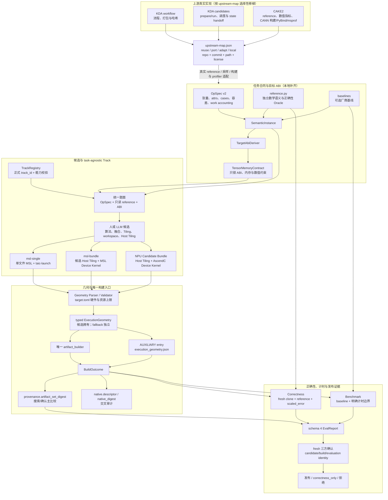

# 跨硬件算子生成：上游实现移植与证据底座集成计划

状态：**目标设计，未实施**。R5/R6 已通过，但当前 GPU 基线仍登记直接 evaluate 缺 task-pack 与
`build_identity_mismatch`。G0 未完成前不得开始 A1–A6。此前停止时留下的 G0 快照草稿已过期，必须按本版
重新生成。

已完成的上游源码对照见 `跨硬件算子生成分工-G0/upstream-map.json`（KDA workflow
`acdd79343c5e`、KDA kernels `f539baab8e46`、CAKE2 `b699c3247241`）。它只证明组件存在性与
reuse/port/adapt/local 决策，**不代表 G0 已整体完成**：旧路径语料、manifest/replay、性能比例和人类
NPU 合同仍未封口。

## 0. 第一原则与实施策略

> **学习工业界已验证的分工，不闭门造车，不限制 LLM 或人所写候选内核的表达力。**

候选拥有算法、融合、Tiling、workspace、Host Tiling 与 ExecutionGeometry；harness 拥有任务验收、
ABI、安全、测量边界与证据；Track 只提供 task-agnostic 的语言和交付链。相同候选字节不得因作者是人、
LLM、committee 或会话不同而改变 verdict。

实施采用**选择性移植**，不要求 fork，也不以“借鉴”为名重新发明：

1. 上游已有且适用的组件，直接复用或移植；
2. 上游存在但不适配本仓库的组件，做薄适配，不重写其语义；
3. 只有 G0 证明上游缺位或许可证/硬件/安全约束确实不适用时，才选择本地实现；
4. 每个本地实现必须登记上游差距、保留原因和退出条件，不能变成默认自研路线；
5. 不追求同时兼容整个 KDA 与 CAKE2，不为它们再建一层庞大兼容框架。按组件选择最合适来源。

## 1. 复用边界：上游交付 + 本地证据

| 平面 | 优先移植/复用 | 本地保留或补齐 | 禁止 |
| --- | --- | --- | --- |
| 任务合同 | CAKE2 `op_desc` 互操作摘要、真实 PyTorch reference、采样与数值指标；KDA 仅有合同文字说明 | **本地 OpSpec v2 主合同与 loader**（上游没有完整合同）、现有任务迁移和 G0 对照 | 把 op_desc 示例当完整 schema，或另造 IR/pattern |
| 候选交付 | KDA 具体候选的 `prepare/run` 与调度/state-handoff 范式；CAKE2 Host+Device 项目布局和真实构建适配 | **本地 Candidate/ExecutionGeometry/Canonical Bundle**、Metal 运行时与几何解析 | 假定上游有通用 Candidate，或让 Track 拥有逐题 tiling |
| Track | CAKE2 可复用的 Ascend 构建/绑定/EasyAsc 适配器；KDA 候选交付范式仅作参考 | **本地 TrackRegistry** 与上游没有的 Metal track；每条 Track 独立证据 | 双 Prompt 冒充多交付、按 op_name/shape 路由算法 |
| 构建与证据 | 上游可复用的构建诊断、profiler 与测量工具 | 唯一 artifact_builder、BuildOutcome、schema 4、evaluation identity、fresh confirmation、resume、远程安全与审计 | 用上游结论替代本地证据，削弱发布门 |
| 知识与技能 | 适用的优化指南、诊断技能和硬件文档 | guidance_catalog 与 agent_guidance 哈希 | 知识正文进入 task_pack_digest |

**上游不是许可证或证据的替代品。** 移植文件必须保留 license/notice 与 repo/commit/path；上游性能结论
只能作参考，本地发布仍需真实构建、正确性与 fresh confirmation。

## 2. 目标架构

### 2.0 总体图：上游移植 + 候选交付 + 本地证据

读图要点：上游只提供经审计存在的实现，不把通用 Task Contract、Candidate 或 Geometry 框架
想象成现成代码；候选拥有实现与几何，Track 不提供逐题算法；确认几何的主机制是
`provenance.artifact_set_digest`，`native.descriptor/native_digest` 只做交叉审计。知识与技能只进入
`run_config.agent_guidance`，不进入 `task_pack_digest`。

### 2.1 任务合同与 reference

- 源码审计已经证明上游没有完整通用 Task Contract：KDA `docs/agent-flow.md` 只有文字要求，CAKE2
  `op_desc_template.json` 只是缺少 read_write、alias、workspace、容差、work accounting 和 baseline 身份的
  示例。因此本地必须实现 `opspec.json` v2 主合同与 loader；这不是绕过移植原则，而是
  `upstream-map.json` 中有证据的 local 项。上游真实 reference 与采样器优先移植，op_desc 仅作互操作摘要，
  不能成为第二权威。**正确性 pass/fail 的唯一公式仍是本仓库 tolerances + `scaled_error`**；CAKE2
  `precision.py/ulp.py` 只作诊断统计，`datagen.py` 仅作 `sampling_profiles.json` 的可选采样器，
  不改变既有种子流、cases、error scale 或 R0–R6/G0 黄金向量。
- 默认题面统一展示任务合同、只读 `reference.py` 与 `TensorMemoryContract`。formula 只是简短摘要，
  reference 提供无歧义数学语义；候选不能 import reference 充当自己的实现。只有 G0 冻结的 `sem_*`
  白名单可用 `display.json.spec_text` 覆盖题面。
- attrs 只表达语义参数，不能携带 `block_m/num_warps` 等优化参数；无 IR 时删除 `uses`，所有声明 attrs
  进入 `resolved_attrs`。v2 的 `@variant` 在装配期拒绝，v1 未迁移题保留原行为。
- OpSpec/reference/表示冲突时判 `semantic_unresolved`，由已知答案、独立库、G0 或人工评审仲裁，不自动
  选边改写。超出合同/ABI 能力时判 `unsupported_contract_capability`，不得改回按拓扑 pattern 拒绝。

### 2.2 候选与 ExecutionGeometry

候选拥有实现自由，环境只固定 TensorMemoryContract 的 ABI、内存和数值约束：

- 不设置 pattern resolver、LoweringRuleRegistry、StagePartitioner 或 TileConnector；不删除循环形态、
  `goto`、persistent、状态机或多阶段写法。runaway 由外部看门狗处理。
- 目标 SDK 公开的原生矩阵、同步、原子与汇编能力不由 harness 另设风格白名单；真实 toolchain/target
  决定可用性。宿主任意路径 include、未声明资源与沙箱逃逸仍拒绝。
- `role: output` 可读写，支持多阶段中间结果；`access: read_write` 的张量是结果的一部分，reference
  必须给出期望终值并纳入差分。输入输出不共享 buffer，alias 必须显式声明。
- TensorMemoryContract 不提供 tile/并行度常量，也不包含 fallback 几何。fallback 是独立、低优先级的
  typed ExecutionGeometry，并进入执行身份。

Metal 缺口只在 G0 证明需要后补齐：OpSpec JSON Term 与 launch 文本表达式的一致求值、唯一启动块内
`when` 条件 stage、Derived Scalars 按名 `setBytes`、MSL 反射 Per-Stage Argument Binding。派生标量只能
依赖 symbols/attrs，候选手写 binding_slot 不需要也不允许；每个 stage 使用自己的连续槽位并校验类型、
权限、宽度与绑定完整性。未激活 stage 不参与该实例 ABI 检查，零激活 stage 拒绝。

### 2.3 Track 与交卷

Track 必须 task-agnostic：不得按 `op_name` 或 shape 提供 tiling 算法，无法通用交付时标 unavailable，
不能用逐题模板补救。Host Tiling 源文件始终属于候选 bundle，不属于 Track。

上游没有 Metal 交付路线，因此首批本地 Metal track 仅为：

1. `msl-single`/`1`：单文件 MSL + 声明式 `taic-launch`；
2. `msl-bundle`/`1`：候选 Host Tiling/Launch + MSL Device Kernel Bundle。

两者使用同一任务合同、reference 与 ABI 题面，独立构建、正确性与确认，speedup/cache/confirmation 不串用。
优先复用上游真实 Host+Device 项目布局、构建和绑定适配器；上游没有通用 CandidateArtifact、canonical
ArtifactBundle 或几何摘要协议，这些必须由本地实现。若现有单文本 agent 链需要传输适配，可使用固定 manifest +
`taic-file` 文件段的**单提交分段 envelope**。它只是传输格式，不是新的候选语义或第二套 Bundle：
解析为受控 ArtifactBundle 后，candidate_sha256 使用 canonical artifact_set_digest，prune_work、自检、
worker 与 evaluate_task 不得丢失文件段，不修改六 RPC。

### 2.4 构建、执行证据与发布

- 候选只经唯一 artifact_builder，报告只用 schema 4；full+native+measured、逐批 identity match 与唯一
  发布谓词不因移植而改变。
- `msl-single` 保持现有 candidate_sha256；Bundle 使用 artifact_set_digest。builder、worker、evaluator
  共用同一 typed ExecutionGeometry，确认期漂移即 mismatch。
- 构建后物化几何的统一归属是：完整 canonical ExecutionGeometry 以 `AUXILIARY` entry
  （`execution_geometry.json`）同时进入 `BuildOutcome.bundle.entries` 与 `BuildOutcome.artifacts`，随后重算
  `provenance.artifact_set_digest`。**现有确认门通过比较该 digest 拦截几何漂移**，它覆盖源码/候选 Bundle
  与冻结几何等完整构建产物；`source_sha256/candidate_sha256` 仍只表示提交的候选。`native.descriptor`
  另存几何 `schema_id/path/sha256` 并计入 `native_digest`，只作交叉审计，因为当前 policy 不直接比较
  native_digest。顺序固定为编译 → 候选 Host Tiling → 冻结几何 entry → 重算 artifact_set_digest 与
  descriptor/native_digest → correctness/benchmark/confirmation。不得事后修改 entry/descriptor，也不新增
  EvalReport 自由字段。
- 没有 baseline 就走 `effective_correctness_only`，不发布 speedup；reference、known_good 或模拟结果不能
  冒充 baseline 或真实设备证据。

## 3. 正确性与测量合同的本地硬约束

### 3.1 `read_write` 与 workspace

- Correctness 的 `out1/out2/out3` 每次启动前都重新加载 read_write 初值；poison/zero 只作用于纯 write
  输出和协议指定的 workspace，不覆盖 read_write 输入；read_write 跳过 unwritten 统计并使用
  `GUARD_PATTERN(0xCD)`。特殊值按 reference/case 判断，不 blanket 要求 finite。
- Benchmark 连续 reps 后可只检查 guard band、越界与硬件状态，不重复做终值差分或 blanket overflow
  断言；但必须使用 fresh clones/rotation 或登记为 stateful timing，不能把反复修改后的状态冒充原始输入
  的单次性能。
- `workspace_fills()` 只清声明 `zero` 的 workspace。未声明 zero 的区域在 benchmark 不插清零核，在
  correctness 的 out1/out3 毒化、out2 清零，证明不依赖垃圾初值。

### 3.2 计时边界

- Host Tiling 只生成几何、资源与 launch 参数，不得计算 reference、预处理输入或替 Device Kernel 完成
  数学工作。需要的输入预处理必须进入受测执行。
- prepare/run 的行为、缓存与计时归属必须版本化登记并进入身份。输入相关 prepare 必须计时；输入无关且
  可复用的准备绑定 candidate/bundle、target、实例和缓存身份。
- workspace 分配/清零、descriptor、Host readback 与输入恢复使用同一 candidate/baseline 测量口径。
  未声明的 Host 计算、prepare 或计时外缓存不得用于发布。

## 4. 配置、provenance 与兼容边界

- 本地新增的注册元数据继续使用带 JSON Schema 的版本化 JSON，未知版本/字段/实现引用拒绝；但不为了
  格式偏好重写上游合同。每类配置只有一个权威和读取器，不上游/本地双读。
- `upstream-map.json` 是移植台账，不是运行期第二注册表。每项至少包含：
  `{component, upstream_repo, upstream_commit, upstream_path, license, action, local_path, reason, verification}`，
  其中 `action ∈ reuse|port|adapt|local`。选择 local 必须有上游缺位或不适用证据。
- pack 文件集由注册关系与仓库内静态 import 闭包自动派生；知识只进 guidance_catalog 和
  `run_config.agent_guidance` 哈希，不进 task_pack_digest。
- v1/v2 按 `spec_version` 分派，混合目录装配错误，v2 失败不回退 v1。历史 run/R0 保留为不可变档案，
  不迁移、不回填；run_config schema 3 记录 track、task_pack_digest 与 effective_correctness_only。
- known_good 仅是可选 harness 自检物，不是新算子门槛、reference 或 baseline。

## 5. 分阶段实施

每阶段通过必须可机器重放：固定命令/node id、稳定负例、`verify.py`（或等价脚本）与 `manifest.sha256`。
只有叙述或上游引用、没有本地证据的阶段不得标通过。

### G0. 基线、上游盘点与移植台账（纯只读）

- 冻结 HEAD、tracked diff、纳入范围未跟踪文件哈希、静态任务清单、配置读取点和 v1/v2 边界。
- 用旧路径生成所有待迁移题的 `(task,dtype,size,variant,case)` 与固定种子语料：输入、reference 输出、
  容差、error scale、work accounting、baseline、template_literals 与 pack 清单。small 存原始张量，
  paper 存 shape/dtype/digest+可复现种子。
- 登记当前失败：CPU 的 ArtifactBundle.materialize(anchor) 草稿问题、并行 pipe 时序波动，以及真实 GPU
  的直接 evaluate 缺 pack 和 `build_identity_mismatch`。G0 不为冻结语料重跑 GPU/NPU。
- 盘点 KDA/CAKE2 的实际仓库、commit、license、Task Contract、reference、Candidate、prepare/run、
  Host Tiling、Bundle、Track adapter、构建与 profiler。形成 `upstream-map.json`，明确 reuse/port/adapt/
  local 与本地落点；不得在未盘点时默认本地重写。
- 冻结 v1/v2 性能登记比例；由人类冻结 NPU 设备/toolchain/track、代表算子、厂商 baseline、阈值、预算、
  Host/Device/端到端口径与确认批次。缺失项标 human_pending，NPU-P0 不得开始。

### A1. 移植任务合同与 reference

- 按 upstream-map 实现本地 OpSpec v2 主合同与 loader，移植真实 reference 与采样器；op_desc 仅作互操作
  摘要，不写“上游已有完整合同”的兼容层。pass/fail 只认本仓库 tolerances + scaled_error，CAKE2
  precision/ulp 仅作诊断，不得改变 G0/A5 的判决与种子流。
- 完成现有任务到所选合同的映射与 G0 对照、语义冲突和 v1/v2 负例。

### A2. 移植候选交付并补 Metal 缺口

- 本地实现通用 Candidate/ExecutionGeometry/Canonical Bundle；适配 KDA 具体候选的 prepare/run 生命周期和
  CAKE2 `op_host/op_kernel` 布局。A2 的通过门只包含 Mac 与通用层，不包含 Ascend 工具链。
- CAKE2 `gen_project.py`/`build_and_install.py`/`generate_pybind.py`/EasyAsc/msprof 的真实适配归 NPU-P0；
  A2 至多覆盖其离线协议单测，不阻塞 Mac A4。
- 只实现上游缺失的 Metal ABI/几何/反射绑定能力，以及 `build_profiles.json` 一次性切换。不得借适配之名
  新建逐题 tiling 或 pattern 规则库。

### A3. 接入证据、任务发现与恢复

- 贯通 CandidateArtifact、Reference/BaselineRegistry、自动发现、静态 pack 闭包、TaskLocator 与
  evaluate_task；支持暂存任务跨本地 worker 重建并校验指纹。
- 接入 BuildOutcome、几何 entry/provenance.artifact_set_digest 的确认比较与 native.descriptor 交叉审计、
  schema 4、run_config schema 3、resume/replay 与 agent_guidance；正式 track_id 未知/不支持即拒绝，
  v1 仅允许 track_id=None。
- 若使用单提交分段 envelope，完成 kernel_agent/prune_work/自检/worker 全链验收。

### A4. 真实 Mac 垂直切片

先修复并经授权 GPU 复测直接 evaluate 缺 pack 与 build_identity_mismatch，否则 A4 不通过。

1. RMSNorm：只交任务合同、reference 与可选 baseline，在 msl-single 和 msl-bundle 分别真实
   build/ABI/safety/correctness；msl-bundle 必须真实交付 Host Tiling+Device Kernel 和构建后几何证据。
2. 全新算子：生产目录只需标准合同+reference，自动发现并进行 correctness_only 真实评测，不改后端或
   中央任务清单。
3. 融合与几何对照：不同候选自主决定 grid/threads/tile/workspace，opspec/ABI 身份不变而 candidate
   digest 改变；归档 canonical 几何、逐段实际 dispatch 和 candidate/build/evaluation digest，可 replay，
   worker 错用 fallback 或 dispatch 偏离均 mismatch。

离线回归覆盖：循环/goto、SDK 原生能力、符号表达式/when、Derived Scalars、反射绑定、read_write 三连跑
与多轮计时、workspace 清零、静态/动态 threadgroup，以及人/LLM 同字节同 verdict。记录有 baseline 的
v1/v2 同设备性能对照。

### NPU-P0. 真实 NPU 性能风险门

与 Mac A5/A6 分叉并行，需单独授权真实 NPU。复用 CAKE2 的真实 msopgen/build/install/PyBind/msprof
适配器和 Host+Device 示例，不把文档中的 Host Tiling 或 EvoOrchestrator 当作现成通用实现。本地绑定
CandidateArtifact/ExecutionGeometry 后，在简单算子和复杂融合算子上验证真实构建、正确性、计时边界、
厂商 baseline 与冻结阈值。未授权、未实测、
未达标分别标 blocked/performance_unproven/performance_below_target；Mac、模拟与 correctness_only
不替代 NPU 性能结论。

### A5. 逐题原子迁移

- 逐题切到移植后的标准合同+reference，G0 独立对照输入、输出、容差、error scale、work accounting 与
  baseline 身份；同变更删除 task.py、track.json、kernel_triton.py、专用题面与手写 pack_files。
- 不保留 v2 Triton 题面兼容；naive.metal 仅在新合同可用时保留为可选 known_good，否则删除。
- 契约常量移除 tile/并行度、fallback 几何和 @variant 退役属于登记差异；有 baseline 时记录 v1/v2
  性能，超出 G0 比例须登记原因并人工批准。

### A6. 退出旧实现与重复自研层

删除已迁移题旧 LoweringProfile、生成族旧解析器、静态名字条目，以及与上游重复的本地注册、交卷或交付
代码。保留未迁移题 v1 路径、历史 run/R0 和上游 provenance；复核唯一配置读取器，不形成第二套自研架构。

## 6. 最终验收

1. **移植真实发生**：upstream-map 的每项都有来源、license、action、本地落点和验证；上游已有适用实现的
   组件没有本地重复版本，local 项都有缺位证据。
2. **候选表达力未被限制**：无 pattern/拓扑/循环/goto 风格闸门，符号几何、派生标量、多阶段、read_write、
   workspace 与 SDK 原生能力可用；相同候选字节不因作者或来源改变 verdict。
3. **Track 是交付而非算法库**：msl-single 与 msl-bundle 经正式 track_id 分别真实成证，Host Tiling 属于
   候选，Track 不按 op_name/shape 提供 tiling，证据不串用。
4. **证据门没有降级**：唯一 builder、schema 4、evaluation identity、fresh confirmation 与唯一发布谓词完整有效；冻结几何 entry 已纳入 provenance.artifact_set_digest 的搜索/确认比较，native.descriptor 仅作交叉审计；缺 pack 和 build_identity_mismatch 已修复并经 GPU 复测。
5. **正确性与计时诚实**：read_write 三连跑/终值/隔离、workspace 清零、fresh-rotation/stateful timing、
   prepare/run 和 Host Tiling 计时边界全部通过固定负例，无计时外隐藏工作。
6. **迁移可重放且无性能暗退**：G0 对照、阶段 verify/manifest/负例和 A5 性能记录齐全；超比例退化有原因
   与人工批准。
7. **NPU 声明有真实证据**：NPU-P0 达标才扩张或宣称工业能力；Mac、模拟、source-only、unknown、
   correctness_only 均未冒充 NPU 性能证据。
