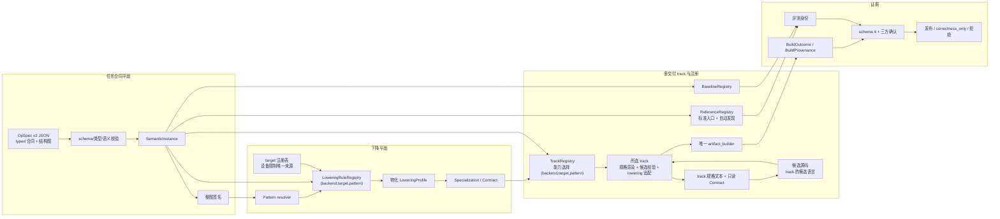

# 跨硬件算子生成：目标架构与迁移计划

状态：**目标设计，未实施**。主计划 **R5/R6 均已通过**（R5 正式复核见
`docs/架构/构建执行与证据语义升级-阶段验收/R5.md` §27）。**G0 仍为 pending**：代码快照、旧路径输出
语料、配置读取点清单、v1/v2 边界与无关失败集尚未冻结；这些证据冻结前，本文的 A1–A6 都不得开始。

范围边界：A1–A6 只把已覆盖的三个 pattern 迁到 v2 新路径；未迁移题继续走 v1 的
`formula`/track 旧路径。v1 路径不是新路径的 fallback，A6 不删除它；已迁移题不得双读 v1/v2。

本文与主计划的分工：

| 主题 | 唯一权威 |
| --- | --- |
| typed IR、整图 pattern、共享下降规则、reference/baseline 标准入口、任务发现、本文的配置边界 | 本文 |
| OpSpec 身份 envelope、`instantiate`/`lower` 两阶段、`lowering_profile_digest`/`task_fingerprint`/`task_pack_digest`/`evaluation_fingerprint` 的字段与版本纪律、唯一构建入口、schema 4、确认门 | `构建执行与证据语义升级-plan.md` |

两处冲突时按上表所属权威判断，不各写一套规则。本文的 A1 起会升级 OpSpec 形态并由主计划冻结的
envelope 重新计算身份；主计划 R1/R2 的验收记录保持为历史，不追改。v1 未迁移题不是本文定义的目标
架构，其现行 formula/track 路径仍由主计划与代码约束；本文只规定 v2 新路径不得读取它，也不得回落。

## 0. 这次不是“继续改 task”，而是重建边界

本计划的目标不是把现有 task 的 profile/track 再抽象一层，而是建立一个**通用算子生成架构**：

- 用户只提供语义（typed OpSpec）与 reference，不写 Triton、启动配置、track、baseline 或已知正确核；
- 已覆盖 pattern 的新算子不需要任何后端 profile、逐题 track 文件、专用题面、naive 模板或中央名字登记；
- 多交付 track 是工具侧的完整生成路线：每条 track 像 CAKE2/KDA 一样具有规格表示、候选语言、校验、
  lowering/build 适配与独立交付证据，共享同一任务合同与证据门；任务作者不选 track，系统按能力选，
  选不出就拒绝。借鉴的是工业路线的分工与交付闭环，不把别人的验证结果当作本地证据；
- 新 pattern、新 track 或新 target 是工具侧一次性建设，不是每个算子的重复劳动；
- 语义、下降、执行、证据各自只有一个权威来源，不通过隐含默认值或第二套配置把它们粘起来。

当前事实（HEAD 与代码核对，不是目标）：`tasks/<op>/` 仍是「OpSpec + track.json + task.py +
kernel_triton.py + naive.metal」的多文件装配；`tasks/__init__.py` 手写 `TASK_NAMES`/`PHASE2_TASK_NAMES`/
`SEMANTIC_NAMES`/`GENERATED_NAMES`，`PHASE2_TASK_NAMES` 同时承担阶段归属；
`tcenv/backends/metal/lowering.py` 为逐题登记 `metal-relu`/`metal-rmsnorm`/`metal-gemm-silu` 等 profile；
`tcenv/lowering.py` 只有按名字取 profile 的 registry；`tcenv/opspec/model.py` 的 `formula` 是必填自由
文本，且 `tasks/generated/elementwise.py` 把 `formula` 当表达式解析；`track.json` 同时登记
reference/gen/error scale/baseline/pack 文件/题面/known-good，GEMM 类还登记 `variant_factory` 与
`baseline_variant`，所有题还登记 `template_literals`。**对已覆盖 pattern 的题，这些正是要替换的对象，
不是目标架构的组成；未迁移题保留它们作为显式 v1 边界。**

开工门禁：主计划 **R5/R6 的阶段验收均已通过**，且 G0 的代码快照、旧路径语料、配置清单、
v1/v2 边界与无关失败集已冻结。G0 未完成则不启动 A1，避免两个大重构同时改变同一证据面。

## 1. 不变量

1. **v2 的完成标准只有一个权威：任务合同。** 任务合同是 OpSpec v2 的 typed 事实（张量、结构图、数值、case、容差、work accounting）加上独立的 `reference.py`：前者供校验、pattern 与能力选择，后者是正确性 oracle。`formula`、各 track 的规格文本、pattern、prompt 都是派生物或表示。候选 DSL 源码是被评测的实现，不是第二份合同：它不得重定义输入输出、容差、case 或 reference，也不需要先被解析成这份 IR。某个 track 可以自带 importer/分析器，但那只是 track 内部能力，不是全局入口，也不能改写合同。未迁移题的 v1 `formula` 路径是明确的历史边界，只能服务未迁移
   题；A5/A6 只移除三个已覆盖 pattern 的 v1 路径，其他题在各自迁移前不得进入 v2，v2 也不得回落 v1。
2. **已覆盖 pattern 的新算子只需 OpSpec + reference。** 标准入口是 `tasks/<op>/opspec.json` 与
   `tasks/<op>/reference.py`；`reference.json` 只在需要登记 reference 版本或选择 pattern 级
   gen/error-scale 实现时出现，顶层 `params` 禁止，也可改用 `reference.py` 的固定可选符号。若还需要
   新增 track.json、LoweringProfile、专用 Triton/MSL 模板、naive.metal、input-gen/error-scale 的
   隐藏登记或中央任务名，则架构验收失败。
3. **单 Stage pattern 是整图签名，多 Stage 是唯一确定的组合。** 当前 Mac 的 resolver 按整张 IR 图
   匹配已登记 pattern，单 Stage 图必须恰好命中一个；matmul+SiLU/Neg、行归约+逐元素收尾等阶段内复合图
   不得拆成“主 pattern + 丢弃节点”。跨 Stage 图则由 §4.5.3 的 StagePartitioner 得到唯一确定、全图覆盖
   的 Stage DAG，零/多切分拒绝；两者都不得按 `op_name`/`category` 分流。Stage 组合本身必须在 A2/A3
   离线成证（分区/connector 结构与多拓扑复用同一批 Stage Renderer 的离线 MSL），不得把“组合模型是否
   成立”拖到 NPU-P0；NPU-P0 只补真实设备、Host Tiling 与性能阈值。
4. **启动由共享规则派生。** 规则键为 `(backend,target,pattern)`，一个键最多一条规则；规则是
   `SemanticInstance` 与只读表示绑定（核名/表示模式）的纯函数，只读 typed 结构、shape、dtype、attrs
   与登记能力，不读算子名、category 或 task 目录。pattern 签名自身的 id/version 也是登记身份，进入
   物化 profile 与 `lowering_profile_digest`。
5. **用户零配置不等于隐藏约束。** 模型看到派生 Contract 的只读 ABI/启动约束，但不拥有或修改它；
   默认 input-gen/known-good 由 pattern 登记派生，`reference.json`/`baselines.json`/`display.json`
   是显式可选覆盖，不是新算子必填。
6. **无默认、无猜测、无静默 fallback。** 无 pattern、多 pattern、target 无规则、能力不支持、
   同一键多条规则、未登记融合都在模型调用前明确拒绝。尚未迁移的题继续走 v1 现有路径，但这是按
   `spec_version` 的显式边界；新路径一旦对某题启用就不得回落到旧 profile，v2 也不得读取 v1 formula。
7. **正确性与性能发布分离。** 没有 baseline 就没有 speedup，只有 `correctness_only`；不能用
   reference、known-good 或另一个算子的 baseline 冒充厂商 baseline。`correctness_only` 默认由
   **已装配的 `Task.baselines` 为空**派生：v1 的 `Task.baselines` 来自现有 track 装配，v2 的来自
   BaselineRegistry；v1 不在 registry 发现范围不等于空注册表。`search.correctness_only` 可作为语义
   恢复实验的显式覆盖；`Task.baselines` 只是统一读取面，不是第二注册表。
   known-good/naive 只作验收自检，不是 baseline，也不是用户加题必填。
8. **唯一构建与证据链不变。** 候选只经 `artifact_builder`，报告只用 schema 4；full+native+measured、
   逐批 identity match 和唯一发布谓词继续有效。本文不新增报告、wire 或 RPC 字段。
9. **Mac 是试验场，NPU 性能另设硬门。** 先用 `metal` + `apple-m4-max` 验证三个 pattern、两条 Metal
   规格 track 与共享底座；Mac A4 后分叉，NPU 扩张前必须经真实 NPU-P0 证明性能可达性，Mac A5/A6
   不被 NPU 授权/调优阻塞。TrackRegistry 登记
   不等于可用：没有 renderer、validator、lowering/build 适配、真实正确性与冻结 baseline 阈值的 track 只能
   标 unavailable。模拟、source-only、Mac 证据或无 baseline 的 correctness-only 都不能替代 NPU 性能结论，
   也不能靠改名宣称支持 CuTe、TIRx、AscendDSL 或 easyasc。
10. **历史不销毁、不伪装兼容。** 旧 run/R0/旧报告保留为不可变档案，但不作为当前证据，不迁移、
    不双读、不回填。A1–A6 对**已迁移题**的身份重置不能靠删除历史目录实现：R4 前的 run 由
    `report_schema_epoch` 拒绝；R4–R6 产生的、属于已迁移题的 schema 4 旧 run 仍会被严格读取，但其
    `task_fingerprint`/`evaluation_fingerprint` 与当前 expected 不同，确认门按 mismatch/unknown 处理；
    未迁移 v1 题的身份不变，不因 fingerprint 变化被判为历史；但 A3 前 run 缺
    `effective_correctness_only` 时仍按 §5.4 标历史/拒绝，不能以指纹相同抵赖。
    续跑不得把它当作确认/发布证据，搜索期若复用旧候选必须重新评测或显式标为历史，不回写旧文件。
11. **配置边界可执行。** 算子生成平面的新声明只用带 JSON Schema 的版本化 JSON，注册元数据引用
    受审代码；既有设备/授权/搜索/工具注册表保持各自唯一读取点，本计划既不复制它们进 JSON，也不
    双读。不新增 TOML。每类配置只有一个读取器。
12. **身份与门禁不因本计划降级。** IR 化、规则 JSON 与 reference/baseline 标准入口会**有意**重置
    `opspec_digest`/`lowering_profile_digest`/`task_fingerprint`/`task_pack_digest`/
    `evaluation_fingerprint`；这不是兼容性事故，也不允许借机削弱 schema 4、缓存/确认 epoch 或发布
    谓词。v1 未迁移题的现有身份保持不变。

## 2. 目标架构：语义、下降、表示与注册、证据



| 平面 | 唯一权威 | 只读派生物 | 明确禁止 |
| --- | --- | --- | --- |
| 任务合同 | OpSpec v2 typed 事实 + 独立 reference（含类型/规则版本） | SemanticInstance、整图签名、formula 与各 track 的规格文本 | 候选 DSL 重定义输入输出/容差/case、用户手填 pattern、reference 反推合同 |
| 下降 | LoweringRuleRegistry + target 能力登记 | 物化 LoweringProfile、Specialization、Contract | 逐算子 profile、按 op_name 分支、跨 target/pattern fallback、模型自拟默认启动 |
| 多交付 track | TrackRegistry：每条 track 登记规格表示、候选语言、validator、lowering/build 适配与能力域 | 所选 track 的规格文本、候选源码、Reference/Baseline 登记视图 | 只登记名字就宣称支持某 DSL、track 绕过 artifact_builder、每题专用模板成为新算子入口 |
| 证据 | ReferenceRegistry、BaselineRegistry、BuildProvenance、设备/协议事实 | schema 4、evaluation identity、确认结论 | reference/known-good 冒充 baseline、模拟/unknown/mismatch 发布 |

上表描述 v2 新路径。未迁移题的 v1 `formula`/track 路径仍由现行主计划和代码约束；它不进入 v2
resolver、规则或 ReferenceRegistry，也不是 v2 失败后的 fallback。多交付 track 在这里指多条完整生成
路线，不是一道「先把所有 DSL 解析成同一份 IR」的入口工序。Triton 在 `triton-spec-to-msl` 中只是规格
表示；将来某个 track 若要把 Triton 当候选语言，那是另一条交付路线，要有自己的编译/lowering 与评测
证据。首批两条 track 只证明多 track 骨架，不证明已经具有 CAKE2/KDA 的候选语言多样性。

**LoweringProfile 仍存在，但只是规则的物化结果。** 它不是用户文件，也不是逐算子手工配置；它的
完整物化文档（含 pattern 签名、规则、渲染器、selector、lowerer 的 id/version）仍按主计划 §3.1 的
envelope 进入 `lowering_profile_digest`。

## 3. 任务合同平面：OpSpec 与 reference 定完成标准

### 3.1 OpSpec v2 与 IR

OpSpec v2（`spec_version: 2`）是输入文件格式；它的 `ir` 块是唯一语义对象。至少包含：

- 有类型的操作节点与数据依赖：节点 id、kind、输入引用、输出引用，不是只有公式字符串；
- 闭集节点种类（A1 冻结完整列表与字段，首批至少）：`tensor`（引用声明的张量）、
  `scalar`（字面量或 attr 引用）、`broadcast`（按声明轴或广播规则对齐维度的张量扩展）、
  `elementwise`（引用登记的算子表）、`reduce`（sum/max/mean、
  axis、keepdims）、`matmul`；`program` 作为已登记的**不透明节点种类**为未来迁移预留，由现有
  program 规则校验，不另造第二套表达式语言；A1–A6 不迁移 `sem_int`，它仍走 v1，v2 对它零匹配并
  拒绝；
- 每个节点的输出 shape/dtype 由登记的节点类型规则推导；形状、dtype、布局不一致在实例化前拒绝；
- tensor role、shape/symbol、dtype、layout/stride、memory space、access；
- reduction axis、是否保留维、逐元素/矩阵乘等结构；
- attrs 及其类型、default、结构化 domain；
- accumulation/rounding、tolerances/exact；`error_scale` 是测量侧登记（§5.2），不放进 OpSpec；
- case/domain、size 及 `golden|benchmark` 用途；`phase` 与默认枚举声明只是发现
  元数据，不参与语义、pattern 或启动选择；它们仍随整份文档进入 `opspec_digest`，因此改变它只改变
  文档身份，不形成第二语义权威；
- work accounting 与语义/校验/节点类型规则版本。

`instantiate` 只负责：schema 与语义校验、节点类型检查、dtype/size 绑定、attrs 物化、
shape/domain 检查、work accounting 和 SemanticInstance 生成。SemanticInstance 持有同一个 typed
graph 视图；它不重新解析文本，也不把节点降成字符串。v2 校验至少拒绝：重复 node id、图环、读未声明
tensor、同一输出多 writer、输出未写、未声明 attr、非法 reduce axis、dtype/shape 不一致。

v2 文档使用 `spec_version: 2`；v1 文档继续由现行 schema/loader 读取，只服务未迁移题。同一题只能由
一个版本装配：v2 loader 不得回退 v1，v1 路径也不得把题交给 v2。`display` 是可选表示块。普通 v2 的
formula 只由 IR 渲染（不读 Contract），默认题面由 IR+Contract 渲染；`display.formula` 只是迁移可读性的冗余字段，若出现，由
**独立的表示一致性检查**读取并与 IR 渲染结果做规范化相等比较（不一致是装配错误）。该检查不得进入语义、pattern、reference、case、容差或正确性判决。

`uses` 不再手写：attr 引用由 IR 节点给出，`instantiate` 扫描得到 `uses`，并要求每个声明的 attr
至少被一个节点引用、每个被引用的 attr 有实例值或显式 default。这样 attr 使用关系只有一处。

**TrackRegistry：多交付 track 注册表。** A1 就冻结该骨架，目标是支持 CAKE2/KDA 那种候选语言与
交付链不同的路线。它登记的是完整生成路线，不是把所有 DSL 解析成同一份 IR 的前端：

- 注册键为 `(track_id, track_version)`；元数据存于 `tcenv/track/tracks.json`，每条 track 闭集声明：
  `spec_representation`（规格表示，如 `triton`、`opspec`）、`candidate_language`（如 `msl`）、
  `backend_id`、支持的 target/pattern/能力域、`launch_owner`、`candidate_artifact_kind`
  （`single_source|host_device_bundle`）、可选 Tile Pipeline 能力、规格 renderer、候选 validator、
  lowering/build adapter 的 `implementation_id/version` 与稳定 `module/symbol`。tracks.json 只含交付
  元数据，不含知识/技能正文或引用；知识由独立 guidance catalog 按 track 关联，不进入 pack。
  算法仍是受审代码，未知 id/version、实现引用或能力不支持在模型调用前拒绝。
- track 的生命周期固定为四步，接口在 A1 冻结、A3 实现：按任务合同与只读 Contract 渲染规格文本；
  校验候选源码（围栏、语言、启动块政策）；把候选适配成后端 builder 的 SourceBundle；交给唯一
  `artifact_builder`。任何一步都不能绕过构建与确认门，也不能改写 OpSpec、reference、case 或容差。
  某个 track 可以自带 importer/分析器把自己的 DSL 源码转成结构事实供校验，但那不是全局入口，
  其结果不能覆盖任务合同，更不能成为第二语义权威。
- 选择是确定性能力门，不是模型偏好：按 `(backend_id, target_id, pattern)` 与任务能力在已登记 track
  中选；每个键最多一条默认 track。**搜索与评测都有正式的受控 `track_id` 参数**，运行者显式指定一条
  已登记 track 做实验，缺省才走默认；未登记、版本不符或不支持该 target/pattern 的指定一律在模型调用
  前拒绝（对应 CAKE2 的弃权）。resume 不提供换 track 的覆盖参数，只读原 run_config。A4 不能只靠测试
  locator 让第二 track 可达，必须经这个正式入口验收。本计划不做按历史成绩自动路由的 router；那种路由
  要有同口径观测后再立项。
- `launch_owner` 在 tracks.json schema v1 中接受 `contract | candidate_host`。`contract` 表示候选服从
  派生 Contract 的启动，或使用后端已允许的候选启动块；`candidate_host` 只能由 NPU-P0 的受控 track
  按 §4.5 的 ExecutionGeometry/证据规则使用。当前 Metal backend 的任何规则与 track 仍只允许
  `contract`，`candidate`/`lowering` 等其他值拒绝。枚举存在不代表能力可用：缺少 Host Tiling 实现、
  几何物化、身份绑定与真实验收的 track 只能标 unavailable。
- 首批登记两条 Metal track，候选语言都是 MSL、都经 Metal builder，差别在规格表示与提示路线：
  `triton-spec-to-msl`/`1`（Triton 文本作规格，现有路线）与 `opspec-spec-to-msl`/`1`（中立合同文本作
  规格）。两条 track 分别登记、分别验收；一条通过不自动证明另一条。将来新增 CuTe、TIRx、AscendDSL、
  easyasc 一类 track 时，按 §6.3 一次性补齐 renderer、validator、adapter、知识与真实评测证据后才可
  标 available；只写一个名字不算支持。
- track 身份进入 task-pack 与评测身份：`track_id/version`、renderer/validator/adapter 的 id/version
  进入 pack 派生集合，规格文本进入 `task_fingerprint`，候选源码进入 `candidate_sha256`。同一任务在
  不同 track 上的结果是不同候选证据，不得互相搬运 speedup 或确认结论。
- 实际选择的 `track_id/track_version` 还进入 TaskLocator 与 `run_config.json`，不是只藏在 pack 里。
  resume/replay 必须按记录的 track 重建 Task，不得重新跑默认路由；track 不存在、版本/能力变化或
  fingerprint/pack 不一致时拒绝恢复或标历史，不能回退到当前默认 track。它们属于运行配置与内部
  locator，不新增 EvalReport、wire 或 RPC 字段。
- 多交付 track 是工具侧建设，不增加新算子标准入口文件；已覆盖 pattern 的新算子仍只需 OpSpec +
  reference.py，也不由任务作者选择 track。首批两条 Metal 规格 track 只验证该骨架，非 MSL 候选路线
  在后续按同一接口交付，不宣称本阶段已经完成完整多 DSL。

### 3.2 formula、pattern、prompt 都是表示或派生

- 普通 v2 的 formula 只由 IR 渲染（不把 Contract/启动事实带进 `opspec_digest`）；`display.formula` 只保留为迁移可读性的冗余字段，若出现
  必须与 IR 派生结果规范化一致，否则装配错误。**v2 语义、pattern、ReferenceRegistry、case、容差与
  正确性路径**不得读取它；唯一例外是独立的表示一致性检查，只做规范化相等比较，不进入任何判决。
  A1 用 AST/结构检查钉住这些路径，同时允许该检查读取。v1 未迁移题仍按
  现行 formula 路径装配，A5/A6 只移除三个已覆盖 pattern 的 v1 路径；v1 不得成为 v2 的 fallback。
- `display.formula` 是 OpSpec 文档内的表示，进入 `opspec_digest` 但不参与语义；`display.json` 是
  任务级表示，进入 task/pack 身份但不进入 `opspec_digest`。普通 v2 的默认题面只能由 TrackRenderer
  从 IR+Contract 渲染；`display.json.spec_text` 只允许 G0 冻结的 `sem_*` 语义恢复/验收夹具，
  普通 v2 任务带 `spec_text` 是装配错误。`description`/`kernel_name` 是表示覆盖；核名会物化进
  Contract，因此也进入 lowering 身份；它们不改变 launch 几何、pattern、reference、case 或容差。
  这些字段都不是第二语义源，也不得被 reference、case、容差或验证判决读取。
- 给模型看的默认规格文本由 IR + Contract 渲染（§5.1）。`description`、题面模板与已知正确文本属于
  **表示**：语义恢复题可以登记故意误导的文本（`sem_*`），但它只能影响显示，不能改变 reference、
  case、容差、work accounting 或验证判决；它也不是 pattern 或下降规则的输入。
- `pattern` 不是 OpSpec 字段，schema 拒绝该键；它由 resolver 从 IR 推导（§3.3）。
- `category` 只是说明性元数据，不参与 pattern、规则、启动或发布选择。
- **reference 必须独立**：它可以用 torch 等框架直接实现语义，但不得 import IR 解释器、Triton/MSL
  渲染器或 known-good emitter 来产生预期值；迁移期必须由 G0 冻结的旧 reference 独立对照
  （§8 A5），不能由新 IR/新渲染器自产 expected。**reference 是 IR 语义的独立实现，不是第二份规范**：
  两者冲突时**不得自动以 IR 为准修改 reference，也不得反向改写 IR**：先判为语义 unresolved 并使
  迁移/正确性验收失败，再由 G0 冻结 reference、独立库实现、已知答案或人工语义评审仲裁。IR 是装配
  结构权威，不是正确性争议中的自动真理。reference 行为经仲裁确需变化而 IR 不变时，必须升实现版本
  并重算评测身份，不能把任何一边变成无需验证的第二权威。

### 3.3 整图 pattern 签名

pattern 是**整图签名**：注册时以版本化元数据（id/version/签名种类/接受域）加受审谓词代码声明它对
节点种类、边与输出关系的完整要求；resolver 只在已登记签名中寻找唯一接受整张图的 pattern。签名谓词
只读 IR 图，不读 `op_name`/`category`/task 目录。这一唯一整图命中规则适用于当前 Mac 的单 Stage
路径；跨 Stage 图不由它强行选一个主 pattern，而由 §4.5.3 的 StagePartitioner 处理。

首批 `elementwise`/`row_reduction`/`matmul` 同时定义为**原子 Tile Stage**。当前 Mac 的整图匹配是
`num_stages == 1` 的单 Stage 退化形式；未来复杂融合由 §4.5.3 的 Stage DAG + TileConnector 组合，
不是为每种跨 Stage 拓扑再枚举一个整图计算 pattern。三个 Stage 是首批原语而非永久闭集，未来可经
§6.2 独立评审增加新原语。

| pattern | 签名要求（A2 冻结精确谓词） | 首批覆盖 |
| --- | --- | --- |
| 逐元素 | 无 `reduce`、无 `matmul`；每个输出元素只依赖同位置的输入元素；支持多输入 | relu、sigmoid、silu、swiglu、生成族逐元素题、sem_relu_gelu_comment、sem_gelu_named_relu |
| 按行归约 | 至少一个行轴 `reduce`，同一图内所有 `reduce` 沿同一行轴（允许多个，如 softmax 的 max 与 sum）；其余节点只能是 `elementwise`/`broadcast`/`scalar`/`tensor`；输出与主输入共享前导行维（保留归约轴如 `[M, H]`/`[M, N]`，或消去归约轴如 `[M]`） | rmsnorm、softmax、reduction_sum |
| 矩阵乘 | 恰有一个 `matmul`；其下游可以是由零个或多个已登记逐元素节点组成的 epilogue 链（可空），再写回输出 | gemm、gemm_silu、sem_gemm_neg |

关键规则：

- `gemm_silu` 与 `sem_gemm_neg` 命中 **matmul 一个 pattern**，不是同时命中 matmul 与 elementwise；
  epilogue 链由同一个 TrackRenderer 从 IR 节点渲染，matmul 规则文件不出现 `silu`/`neg` 等名字表，
  也不按名字选择。
- **解析入口唯一且顺序固定**：先由 StagePartitioner 判定 Stage 数，`num_stages == 1` 才进入单 Stage
  整图 resolver，`> 1` 走多 Stage 组合路径。不得先跑 resolver、失败后再升级到 partitioner，否则
  `unregistered_fusion` 与 `unsupported_pattern_on_target` 的归属会随实现顺序漂移。**组合机制本身
  在 A2/A3 离线验证**（见 §4.5.3）：分区确定性、全图覆盖、零/多切分拒绝、connector 校验，以及至少
  两种拓扑复用同一批 Stage Renderer 生成离线 MSL，全部不需要设备。Mac 生产 target 的能力门当前只
  放行单 Stage 规则（多 Stage 报 `unsupported_pattern_on_target`），这是**能力声明**，不是“组合模型
  留到未来”；NPU-P0 不得成为该模型的首次验证点。
- 图不能被拆成“主 pattern + 残余节点”。拒绝分两层：**未在任何 pattern/pipeline registry 登记的
  拓扑**（包括尚未登记的 `matmul → reduce`）由语义 Resolver 以 `unregistered_fusion` 拒绝；**已登记
  但当前 target 没有规则或可用 track 的拓扑**由后续能力门以 `unsupported_pattern_on_target` 拒绝。
  两者都在模型调用前发生，不得把 target 不支持伪装成语义未知，或把语义未知当成可换 target 的提示。
- 注册期只做签名元数据/schema、实现引用与 G0 语料的重叠检查；任意受审谓词无法被静态证明互不重叠，
  不得声称注册期已经完成这种证明。resolver 每次必须评估**全部**已登记签名，零匹配或多匹配都在模型
  调用前拒绝；不得按注册顺序、算子名或首个命中选择一个。
- 改名 `op_name`、改 `category`、把注释写成另一种算子，都不改变 pattern 解析与规则选择
  （`sem_gelu_named_relu`/`sem_relu_gelu_comment` 的负例）。核名不是 pattern 解析输入：默认核名机械
  生成，`display.json` 可覆盖为表示名（如 `sem_gelu_named_relu` 的 `relu_kernel`），规则只校验 ABI
  合法性。
- `sem_int` 的 program 不在三个 pattern 内；新路径对它零匹配并拒绝，它继续走现有夹具。GEMV、RoPE、
  attention、conv、mamba、bitdelta、lion、`sem_attention_odd_scale` 同样不在首批范围：新路径明确
  拒绝，现有路径保留；不得为了“覆盖”把算子名伪装成新 pattern 或硬塞进三个模式。
- 尚未迁移的题继续走 v1 现有路径；**不存在**新路径失败后自动改用旧 profile 的 fallback。迁移验收是
  按题的显式清单；运行期按 `spec_version` 分派，不做猜测。

### 3.4 版本与身份

- `OPSPEC_SCHEMA_VERSION` 升为 2，`SEMANTIC_RULES_VERSION` 升级；`opspec_digest` 仍是主计划 §3.1
  的 canonical envelope，`document` 是整份 OpSpec v2（IR + 可选 display）。同一 IR、不同 display
  文本是不同身份——这与主计划“整份 OpSpec 进摘要”的规则一致，不引入 IR-only 第二摘要。
- v1 schema/loader 保留给未迁移题；v2 schema 用于新路径。两者按 `spec_version` 分派，但同一题只读
  一个版本，v2 不得回退 v1。A5/A6 只移除三个已覆盖 pattern 的 v1 入口，未迁移题的身份不变。v1 文档
  继续使用登记在 v1 规则表里的旧 `SEMANTIC_RULES_VERSION`/`WORK_ACCOUNTING_VERSION`；v2 用新版本。
  不能用一个全局常量把 v1 的 `opspec_digest` 改掉。
- `SemanticInstance.fingerprint_document()` 的字段闭集不变；IR 的语义内容已由 `opspec_digest` 覆盖，
  不新增 `ir_digest` 或第二套实例投影。
- `task_fingerprint` v2、`task_pack_digest`、`evaluation_fingerprint` 的结构不变；**已迁移题**的值
  因 IR 化而有意重置，未迁移 v1 题的 `task_fingerprint`/`evaluation_fingerprint` 不变。R4 前的 run
  由主计划 R4 的 `report_schema_epoch` 拒绝；R4–R6 产生的、属于已迁移题的 schema 4 旧 run 仍可被
  严格读取，但其 `task_fingerprint`/`evaluation_fingerprint` 与当前 expected 不同，确认门按
  mismatch/unknown 处理；续跑不得把它当作确认/发布证据，搜索期若复用旧候选必须重新评测或显式标为
  历史，不回写旧文件。未迁移 v1 题不因 fingerprint 变化被标为历史；但 A3 前 run 缺
  `effective_correctness_only` 时仍按 §5.4 处理。
- 已迁移题的旧 `formula`、旧 `semantic_rules_version` 与旧 digest 只作迁移对照；不得为保持旧哈希
  而让 v2 读取 formula。未迁移题的 v1 formula 路径保留到该题迁移。
- LoweringProfile 同样按版本隔离：v1 的 `LoweringProfile` 类、`LOWERING_PROFILE_SCHEMA_VERSION`、
  校验和 `to_dict()` 字节保持原样；v2 使用独立的 profile 类型/schema 常量与物化器，新增 pattern/rule/
  renderer/selector 字段只进入 v2 文档。禁止全局替换常量或给 v1 `to_dict()` 加字段，否则未迁移题的
  构造与 `lowering_profile_digest` 会在 A2 被无意重置。

## 4. 下降平面：共享规则，不是逐算子 profile

### 4.1 LoweringRuleRegistry

规则键为：

```text
(backend_id, target_id, pattern_id)
```

一个键最多一条规则，**一份规则文件只描述一个完整键**。多个 target 共享同一算法时，各 target 的文件
分别引用同一个 `implementation_id/version`，不把多个 target 混写进一份文档；不引入 target family 选择层，
也不允许代码里另有一张映射表。文件路径与 JSON 内的 `backend_id/target_id/pattern` 三字段必须一致，
重复键或路径/内容不一致拒绝。每条规则包含：

- `rule_id/rule_version`；
- `pattern` 签名的 `pattern_signature_id/version`（§3.3；签名代码单独登记）；
- `renderer`、`lowerer`、可选 `selector` 的 `implementation_id/version`（指向受审代码）；
- 能力约束（dtype、layout、shape/整除性、capability）；
- 从 `SemanticInstance` 与只读表示绑定到完全物化 LaunchPlan/LoweringProfile 的纯函数；
- 默认启动事实（grid/threads/constants/backend_params）。

**规则登记数据在 JSON，算法在受审代码。** JSON 声明 `implementation_id/version` 和稳定的
`module/symbol`；代码只暴露受审函数，不另维护 id/version 注册表。加载时 import 符号并校验可调用性/
签名，未知引用拒绝。现有 `register_lowerer`/`register_profile`/`register_variant_factory` 的 Python
注册调用在 A2/A6 迁走，或只保留为测试夹具，不能成为第二份元数据。`renderer` 指生成 lowering 载荷/
MSL 体的受审实现，不是 §5.1 的 TrackRenderer。

目标路径例如：

```text
backends/metal/lowering_rules/apple-m4-max/
  elementwise.json
  row_reduction.json
  matmul.json
```

`tcenv/backends/metal/lowering.py` 中现有逐题 `RMSNORM_PROFILE`、`SOFTMAX_PROFILE`、
`REDUCTION_SUM_PROFILE`、`RELU_PROFILE`、`GEMM_PROFILE`、`GEMM_SILU_PROFILE` 等只是迁移输入，
不允许继续作为新产品对**已迁移** pattern 的第二权威；未迁移 pattern 的逐题 profile 保持现状，A6
不删除。`source_builder.py::DIAGNOSTIC_BUILD_PROFILES` 在 A2 一次性迁到
`backends/metal/build_profiles.json` 并删除 Python 数据，不留双读。
pattern 签名元数据放在 `tcenv/patterns/patterns.json`（A2 冻结 schema），签名谓词在受审模块；
同一文件还登记各 pattern 的 gen_inputs/error_scale 实现（id/version/module/symbol、参数 schema 与
默认值），供 ReferenceRegistry 解析，不新增逐题注册。backend 的 `lowering_rules/` 只引用签名
id/version，不复制签名或接受域。

示意（字段名与 JSON Schema 在 A2 冻结；启动词使用现有 `tcenv/terms.py` 文法，不新造表达式语言）：

```json
{
  "schema_version": 1,
  "rule_id": "metal.elementwise",
  "rule_version": 1,
  "backend_id": "metal",
  "target_id": "apple-m4-max",
  "pattern": "elementwise",
  "pattern_signature": {"id": "elementwise", "version": 1},
  "renderer": {"implementation_id": "metal.elementwise.renderer", "version": 1,
               "module": "tcenv.backends.metal.elementwise", "symbol": "render_body"},
  "lowerer": {"implementation_id": "metal.elementwise.lower", "version": 1,
              "module": "tcenv.backends.metal.elementwise", "symbol": "lower"},
  "selector": null,
  "launch": {
    "grid": [{"ceil_div": {"numerator": {"symbol": "N"}, "denominator": 1024}}, 1, 1],
    "threads": [128, 1, 1],
    "constants": {
      "N": {"msl_type": "uint", "source": "symbol:N"},
      "BLOCK_SIZE": {"msl_type": "uint", "source": "literal:1024"}
    },
    "backend_params": {
      "BLOCK_SIZE": "literal:1024",
      "NUM_WARPS": "literal:4"
    }
  },
  "capabilities": {"dtype": ["fp16", "bf16"], "layout": ["contiguous", "row_major"]}
}
```

这份 JSON 是一族算子共享的规则，不是每题一份 profile。几点必须写进实现与验收：

- 逐元素规则用 `ceil_div(N, BLOCK_SIZE)`：在现有 relu 的两个登记 size（都能被 1024 整除）上与原
  grid 相同，对非整除 N 覆盖尾部；尾部 mask 是 pattern 渲染体的一部分，不是新算子要写的专用分支。
- 矩阵乘规则检查默认 tile 对 M/N/K 的整除性，不整除就 typed reject；不得静默 padding 或借用
  variant 之外的 profile。
- 规则的 `capabilities` 只声明该 pattern 的约束；**设备限制（最大线程数、threadgroup memory 等）
  只从既有 target 注册表读取**，不复制进规则 JSON，避免第二份设备事实。
- `lowerer`/`renderer`/`selector`/pattern 签名的 implementation id/version 指向受审代码；加载时
  import 并校验该符号存在、可调用且版本一致，未知引用拒绝。JSON 中不允许 shell、路径执行、
  Python 表达式 eval 或未登记 builder。
- `pack_files` 由注册关系**自动派生**：标准入口文件（`opspec.json`、`reference.py` 及可选的
  `reference.json`/`baselines.json`/`display.json`）、规则/pattern/track JSON、实际使用的历史表示许可、
  所选 track 的 renderer/validator/adapter、renderer/selector/emitter/lowerer 代码、dtype 拼写表、TrackRenderer、reference/baseline 实现，以及这些模块静态
  import 闭包内的共享依赖。静态分析必须包含函数内 import；只收仓库内、经过校验的常规文件，拒绝绝对
  路径、符号链接逃逸与运行时动态加载。外部包不进入 pack，其名称/版本由 evaluator environment identity
  记录，不能复制 site-packages 或把外部包摘要冒充仓库 pack 文件。不手写逐题清单；动态或无法静态确定的
  依赖拒绝，不靠运行时读取。派生集合与其 digest 进入 `task_pack_digest`，实现路径不得读取派生集合之外的文件。
  知识正文与知识/技能引用一律不在派生集合中：`device.md`、experience、skill、wiki 和 guidance catalog
  只进入 `run_config.agent_guidance` 及现有 guidance/skill 哈希，作为本次运行出处；修改说明或链接不改变
  task-pack/evaluation identity。若实际 renderer/validator/adapter 代码改变，仍由代码文件与实现版本
  正常使身份失效。
- pattern 签名、规则、renderer、selector 的身份进入 **v2** 物化 profile 的字段，并按主计划 §3.1 的同一
  envelope 进入 `lowering_profile_digest`；不为它们新增 envelope 键。增加这些字段只升 v2 profile schema
  并与 v2 lowerer 版本同批更新，v1 profile schema/序列化字节不变。这里的 `renderer` 只指生成 lowering
  载荷/MSL 体的实现；TrackRenderer 与 known-good emitter 不改变 lowering 身份，只进入 task/pack 身份。

LaunchPlan 再物化为 v2 LoweringProfile，并经唯一 `lower` 入口生成 Specialization/Contract。现行
`lower`/`lowering_profile_digest` 只接受 v1 `LoweringProfile` 并从 Python `_LOWERERS`/`_VARIANT_FACTORIES`
取实现与版本；A2 让该入口按 profile 类型分派：v1 分支保持原逻辑与字节，v2 分支的 lowerer/variant
factory 身份取自规则/pattern JSON 引用并经加载校验，不查 Python 注册表。两支产出同一 Specialization
类型并使用主计划 §3.1 的同一 envelope，不新增第二派生入口。规则可以读取
shape、dtype、attrs、layout、case usage 等语义值以及只读表示绑定（核名/表示模式），但：

- 不得按 `op_name`、`category`、task 目录或 track 名分支；
- 不得为某个算子写专用线程/tile；
- 不得用其他 target/pattern 的规则顶替，也不得回落到 default target；
- 无规则、多规则或能力不满足时，在模型调用前拒绝。
- `@<variant>` 由**按 pattern 选定**的 variant factory 解析，只改变 launch/tile/threads；它不是新
  规则、不是新 pattern，也不按算子名分支。是否接受 variant 由每题 OpSpec v2 的
  `variant_acceptance` 显式声明（可选，缺省即关闭，零配置不会从 pattern 继承）；声明必须匹配
  pattern factory 的 `factory_id`/`factory_version`，否则装配错误。factory 只校验文法与
  launch/tile/threads；未声明、文法非法、tile 不整除或与 shape 冲突都拒绝，不能静默回落到默认
  profile。删除 track.json 的 `variant_factory` 不丢失关联，也不新增逐题 factory 注册文件。

### 4.2 登记 selector：结构选择，不是算子选择

有些 pattern 的启动需要随结构变化（例如归约宽度、shape 整除性、threadgroup 预算）。这类选择由
**登记的 selector 实现**完成：

- selector 是 `SemanticInstance` 的纯函数，返回完全物化的启动参数；
- selector 只读 typed 结构、shape、dtype、attrs 与 target 能力，不读算子名/category/目录；
- selector 有独立 `implementation_id/version`，进入规则与 profile 身份；
- 规则 JSON 的静态 `launch` 是默认值；有 selector 时，selector 必须对没有结构理由的实例返回同一
  默认值，避免“默认值 + selector”两套隐含规则；A2 用 property test 验证这一点；
- selector 不读 `display`/核名；核名是表示绑定，不是结构选择。
- 两个具有相同 typed 事实的算子由一个规则给出同一启动；如果这与其中一个算子的现有 profile 不同，
  该变化属于 A5 **允许并必须登记的差异**（重新做正确性与性能测量，不搬旧 speedup），不是保留逐题
  profile 的理由。如果共享规则无法表达 G0 冻结范围内的任一题/实例，A2/A5 必须失败并修正 IR/规则/
  selector；不得把该题列入未迁移清单、缩小 A5 迁移域，也不得新增按算子名的 selector 分支。A6 不
  得在这种情况下开始。

### 4.3 三个共享规则的覆盖方式与复合图

| pattern | 共享机制 | 新算子落在该族时的作者工作 |
| --- | --- | --- |
| 逐元素 | `ceil_div(N,BLOCK)`、默认 threads、尾部 mask 由渲染体给出 | 只写 IR 与 reference |
| 按行归约 | 每行一个 threadgroup；归约宽度/shape 由 selector 物化常量与 threads | 只写 IR 与 reference |
| 矩阵乘 | 登记的默认 tile + epilogue 渲染；variant factory 仍只换 tile/threads，且只在题目声明 `variant_acceptance` 时放行 | 只写 IR 与 reference |

复合节点规则：

- `matmul` 的 epilogue 是 IR 中位于 matmul 下游的零个或多个已登记逐元素节点；同一个 matmul 规则与
  同一个 TrackRenderer 渲染 `identity`/`silu`/`neg` 及其链，规则文件不出现 epilogue 名字表，也不因
  epilogue 节点分流。
- `rmsnorm`/`softmax` 的“逐元素 + reduce + 逐元素”是**一个** row_reduction 图，不是 elementwise
  与 row_reduction 的双命中。
- 未登记融合（如 matmul→reduce、两个 matmul 串联）零匹配并拒绝；不得为了通过验收把它拆成两段
  分别构建（那会产生两个 Contract/两次构建，和唯一构建链冲突）。
- `sem_gemm_neg` 与 `gemm_silu` 使用同一 matmul 规则与同一默认 tile；差异只在 IR、reference、
  display 与 epilogue，因此 contract 的启动字段可以相同，而 `opspec_digest` 必须不同。

### 4.4 Contract、target_id 与核名

装配顺序冻结为：

```text
load OpSpec → instantiate
→ DisplayLoader 读取一次表示绑定（description/kernel_name/spec_text）
→ 整图 pattern resolver → rule/selector
→ LaunchPlan / v2 LoweringProfile / Specialization / Contract
→ TrackRenderer 渲染规格文本
→ pattern known-good emitter 生成自检候选
```

DisplayLoader 是任务装配器的唯一表示文件读取器；它把同一份只读表示绑定传给 lowerer 与 TrackRenderer。
因此核名覆盖在 Contract 物化前已经确定，TrackRenderer 不再读盘，也不能事后回写 Contract。规则
renderer、TrackRenderer、known-good emitter 是三个不同接口：分别生成 lowering 载荷/MSL 体、规格文本、
自检候选，不得互相兼任或共用含混的 `renderer` 字段。

- `target_id` 贯通 task 装配、derive、缓存键、执行请求和证据；不得只在 CLI 外层替换 `Contract.gpu`。
- `task_fingerprint` 继续绑定完整 SemanticInstance、Specialization/Contract 全字段、规格文本和
  backend reference source；IR 化使其值重置，但字段不减少。
- `lowering_profile_digest` 的 envelope 不变（主计划 §3.1）；pattern 签名、规则/renderer/selector
  身份作为 profile 字段进入其中。
- Contract 仍是当前 Metal 的 MSL ABI；本计划不虚构跨厂商统一 ABI。跨硬件中立的是语义与规则接口，
  不是 launch 参数或容差。
- 核名由表示绑定提供：默认按 pattern 机械生成（例如 `<pattern>_kernel`，不读 `op_name`）；
  `display.json` 可覆盖为登记的表示名（如 `sem_gelu_named_relu` 的 `relu_kernel`）。规则只校验 ABI
  合法性；覆盖进入 task/pack 身份，不进入 `opspec_digest`，也不是按算子名的 launch 特例。A5 只对
  没有覆盖的题登记机械核名差异。

### 4.5 NPU 性能所需的扩展接口（A1 冻结骨架，NPU-P0 实证）

当前 Metal track 的 `launch_owner=contract` 保持不变，但 A1 必须同时冻结以下扩展点，避免把 Mac 简单
形态误当成永久工业边界：

1. **安全合同与执行几何分层。** `TensorMemoryContract` 永久锁定输入输出、shape/dtype/layout、读写
   权限、对齐、越界约束、reference/case/容差，候选不得修改。`ExecutionGeometry` 描述 grid/block/tile、
   片上内存、pipeline stages、swizzle/split-k 与 Host Tiling 结果。当前 Metal 仍由 Contract 拥有几何；
   未来 `candidate_host` track 可由登记的 Host Tiling 生成几何，物化时序分两种：声明式/Python Tiling
   可在构建前求值并冻结；编译型 C++ Host Tiling 在构建前只绑定其实现源码与 bundle digest，构建完成后、
   设备启动与计时前对固定 `(shape,dtype,attrs)` 确定性求值，得到 typed ExecutionGeometry，经 target
   能力校验后冻结进 BuildOutcome/执行与评测身份。原始构建请求只声称它绑定了 tiling 实现，不能伪造
   构建前尚不存在的几何值。确认期若重算必须逐字段一致，否则 mismatch，严禁静默采用新 tiling。
   **Mac 的声明式 `taic-launch` 不走这个构建后时序**：它在构建前由候选源码 + Contract 确定性物化，
   因而现有 candidate/build/evaluation 身份已能绑定最终几何，不为 Mac 复制一份 schema 4 字段。A4 必须
   验证实际执行的就是这份几何；NPU 编译型 Host Tiling 的构建后证据归属仍在 NPU-P0 前单独冻结。
2. **CandidateArtifact/Bundle 接口。** A1 定义统一角色与 canonical digest：当前 Mac 是
   `single_source`；未来 NPU 可用 `host_device_bundle`，闭集包含 manifest、Host Tiling/Launch、Device
   Kernel、Schedule 与声明式资源。`candidate_sha256` 对完整 canonical bundle 计算，worker/resume/outbox/
   builder 只传这一受控对象，不接受任意构建命令。Host 代码、Device 代码与最终 Schedule 分别可审计，
   不能用其中一个文本摘要代替整个交付物。**Mac 的零开销表征保持不变**：`single_source` 的 canonical
   字节就是现有单文件源码字节（含既有 `taic-launch`），不把 bundle 路径/artifact kind/包装字段加入摘要，
   所以 Mac `candidate_sha256` 数值不变；`TensorMemoryContract + ExecutionGeometry` 只是现有 Contract 的
   内部拆分视图，Contract 序列化投影与 `task_fingerprint` 不变。现有 schema 4 不变；若 NPU-P0 证明
   报告/请求闭集不足，停止并另立版本化变更，不在 track 内偷加旁路字段。
3. **Tile Pipeline = 原子 Stage DAG + TileConnector，不是逐拓扑枚举。** 当前三个 pattern 是首批原子
   Stage，Mac 继续走单 Stage 退化路径。跨 Stage 的 IR 由登记的 `StagePartitioner` 全图切分：每个节点
   恰好归属一个 Stage、无丢弃节点、Stage DAG 无环；`patterns.json` 登记 partitioner id/version 与受审
   实现，resolver 评估全部切分规则，零切分或多切分都拒绝，不按首个命中或默认分数任选一个。
   `matmul→reduce` 若尚无可接受切分是 `unregistered_fusion`；若已有合法 Stage DAG 但 Mac 没有规则/
   track，则是 `unsupported_pattern_on_target`。

   相邻 Stage 只通过版本化 `TileConnector` 连接。Connector 校验 tile shape/index mapping、dtype/layout、
   归约轴、地址空间、中间张量生命周期、容量、alias 与同步；寄存器/Shared Memory/UB/Cube→MTE→Vector
   等是 target 特定的 connector 实现，不是无限新增的自由字段。新 connector 允许经评审加入，但不能为
   某个融合拓扑写一个专用隐式通道。

   渲染采用“外层 Pipeline Renderer + 内层原子 Stage Renderer”。A1 冻结 `StageRenderingContext`：
   tile view、输入/输出 slice、中间 buffer、tile index mapping、ExecutionGeometry 与 connector resources。
   现有整题 renderer 不得在未适配该上下文时假装可直接复用；Pipeline Renderer 负责循环、buffer 生命周期
   与同步，Stage Renderer 只负责阶段计算。新增融合拓扑不得自动产生新的整图计算 renderer；新增原子
   Stage/Connector 则必须按 §6.2 独立实现和验收。最终 partition、connector、Schedule 与 ExecutionGeometry
   全进入 candidate/build/evaluation 身份。

   **组合性在 Mac 阶段就要离线成证，不得留到 NPU-P0**：A2 冻结 StagePartitioner 的确定性、每节点恰
   属一个 Stage、全图覆盖、DAG 无环、零/多切分拒绝，以及 TileConnector 对 tile/layout/轴/生命周期/
   容量/alias 的校验（纯结构，不跑设备）；A3 用 Pipeline Renderer 为至少两种不同拓扑（例如
   `matmul→row_reduction` 与 `matmul→row_reduction→matmul`）生成离线 IR→MSL，并且必须复用同一批
   Stage Renderer 与 Connector——第二种拓扑若需要新增专用计算 renderer 或逐拓扑 pattern 名称，即为
   组合模型失败，必须回改设计而不是继续往 NPU 推。NPU-P0 只验证这些拓扑在真实设备上的 Host Tiling、
   跨单元流水与冻结阈值，不承担“首次证明组合模型成立”。

这些接口是性能空间的预留，不是 NPU 可用性的预先声明。只有 NPU-P0 的真实构建、正确性与性能门槛通过，
才能把相应能力标为 available。

## 5. 表示、注册与发现

### 5.1 TrackRenderer

TrackRenderer 按 `(spec_representation, kernel_representation, pattern)` 工作：

- 从 SemanticInstance/IR 与只读 Contract 渲染默认规格视图与候选题面；同一 pattern 共用渲染逻辑。
  普通 v2 的 formula 只由 IR 渲染，默认题面由 IR+Contract 渲染；`display.formula` 若出现，由独立表示一致性检查与 IR 渲染结果做
  规范化相等比较，不一致拒绝；该检查不参与渲染或任何语义判决。`display.json` 的 `description`/`kernel_name` 是一般表示覆盖；`spec_text` 仅允许 G0
  冻结的 `sem_*` 语义恢复/验收夹具，普通 v2 带 `spec_text` 拒绝。它们都不改变语义、pattern、
  reference、case 或容差；核名已在 Contract 物化前由 DisplayLoader 绑定，TrackRenderer 只把同一值渲染进
  规格文本，不得回写 Contract，也不新增占位符来源；
- 不默认写“翻译 Triton”，Triton→MSL 只是现有表示路线；每条 track 的规格 renderer、候选 validator
  与 lowering/build adapter 在 TrackRegistry 中分别登记、分别版本化，任何一条 track 通过都不自动证明
  另一条 track 或某种完整语言兼容；
- 默认 TrackBinding 由规则自动合成，新算子不写 track.json；
- dtype 拼写表按表示登记一次（`{{T}}`/`{{TL}}`/`{{TORCH}}`），不是每题重复；任务装配器的 dtype 拼写
  加载器是 `dtype_spelling.json` 的唯一读取器，每次装配读一次，以同一只读表传给 TrackRenderer、规则
  renderer 与 known-good emitter，三者都不自行读盘；迁移时逐 dtype 对照现有
  track 表，任何拼写差异逐项登记，不得靠共享表静默改名；
- 占位符来源仍只有三个（`spec_params`、`dtype_spelling`、`backend_params`），键冲突、未声明来源、
  渲染后残留一律拒绝（主计划 §4.4）；线程/tile 字面量必须来自 `backend_params`，不得写死后靠另一处
  drift check 提醒；
- 语义恢复题的故意误导文本/核名只以 `display.json` 登记为表示覆盖，不是新的语义源，也不进入
  launch 选择；普通新算子省略该文件即使用默认渲染。

### 5.2 标准入口（目标形态）：必需两项 + 可选三项

新算子的标准入口是 OpSpec 所在目录的固定文件，由注册表**自动发现**，无需修改任何中央清单：

```text
tasks/<op>/
  opspec.json     语义 + typed IR（必需）
  reference.py    独立的硬件无关 oracle（必需，固定 reference(inputs, attrs)；可带固定可选符号）
  reference.json  可选：仅选择 pattern 级 gen/error-scale 实现或登记 reference 版本（schema_version: 1）
  baselines.json  可选：测量侧 baseline 登记（schema_version: 1；存在时同目录 baselines.py 必需）
  display.json    可选：description/核名覆盖；spec_text 仅 G0 冻结 sem_*（schema_version: 1）
```

**ReferenceRegistry** 负责正确性，按以下确定性规则自动发现：

1. 只对 **v2 标准入口**（`spec_version: 2` 且目录无 `task.py`/`track.json`/旧模板）执行发现：
   扫描 `tasks/**/opspec.json`，任务名取 OpSpec 的 `op_name`；同目录必须有 `reference.py`，并暴露
   固定符号 `reference(inputs, attrs)`，接收输入张量与已解析 attrs，返回按输出张量名组织的张量。
   v1 未迁移题不在 ReferenceRegistry/BaselineRegistry 的发现范围，继续用现行 reference/baseline；
   v1 的 `Task.baselines` 由现有 track 装配，不能把“未发现”实现成空 registry。v2 文档缺
   `reference.py` 是装配错误，v1 文档不要求它。
2. 默认登记身份由发现器派生：`implementation_id = <op>.reference`、`implementation_version = 1`、
   `params = {}`。这里及 `<op>.gen_inputs`/`<op>.error_scale` 中的 `<op>` **严格取 OpSpec 内已校验的
   canonical `op_name`**，不得取目录 basename；例如 `tasks/generated/xxx/` 若声明 `op_name=gen_xxx`，
   身份必须是 `gen_xxx.reference`/`gen_xxx.gen_inputs`/`gen_xxx.error_scale`。默认 input-gen/error-scale
   由 task 所属 pattern 的实现提供；其 id/version/module/
   symbol、参数 schema 与默认值登记在 `tcenv/patterns/patterns.json`（A2 冻结 schema；A3 只读取和
   校验，不新增逐题注册）。该身份进入 `evaluation_fingerprint` 的 `reference`/`gen_inputs`/
   `error_scale` 分量，不需要额外文件。
3. `reference.json` 只在覆盖默认值时出现；文档必须带独立的 `schema_version: 1`，闭集字段为
   可选的 `implementation_id`、`implementation_version`，以及可选的 `gen_inputs`/`error_scale`
   覆盖对象。每个覆盖对象闭集为 `implementation_id`、`implementation_version`、`params`
   （canonical JSON）。**顶层 `params` 禁止出现**：reference 的调用固定为 `reference(inputs, attrs)`，
   没有 params 绑定；`implementation_id` 若出现必须等于 `<op>.reference`，不得重定向到另一实现；
   `implementation_version` 是参考实现版本，不是文档 schema 版本。未知版本、未知键、缺
   `schema_version`、未知/未登记实现、版本非正整数、params 不可 canonical 化一律拒绝。
4. `gen_inputs`/`error_scale` 覆盖只能选择 **task 所属 pattern 在 `patterns.json` 中登记的实现**：
   `implementation_id` 必须在同一 pattern 的实现表中，`implementation_version` 必须匹配该表，
   `module/symbol` 只能来自登记，不得在 `reference.json` 写模块路径或符号。登记符号是受审工厂：
   `make_gen_inputs(params, instance)` 返回 `(case, seed) -> {input_name: tensor}`，其中 `instance` 是完整
   SemanticInstance，工厂可读取全部输入 tensor role/shape/dtype、attrs 与 `cases.inputs` 域，不能只有一个
   含混的 shape；`make_error_scale(params, instance, tolerances)` 返回
   `(inputs, reference_outputs) -> {output_name: tensor}`；`reference.json` 的 params 只原样传给该
   工厂，不进入 Task 语义。`reference.json` 只登记参数与选择关系，不携带实现代码；被选中的实现
   模块/symbol 必须进入静态 pack 闭包，A5 检查 pack 覆盖它且没有隐藏的逐题登记文件。选择另一
   pattern 或未登记 id 是装配错误。
5. `reference.py` 另有两个固定的可选符号，供没有 `reference.json` 覆盖的题使用：
   `gen_inputs(case, seed, instance) -> {input_name: tensor}` 与
   `error_scale(inputs, reference_outputs, instance, tolerances) -> {output_name: tensor}`。`instance` 同样是
   完整 SemanticInstance，多输入各自 shape/dtype、attrs 和 case 域不得从目录或全局状态补取。装配器把
   `reference(inputs, attrs)`、可选符号与 pattern 工厂产物分别绑定 attrs/instance 后，物化为现有
   `Task.reference(inputs)`、`Task.gen_inputs(case, seed)`、`Task.error_scale(inputs, reference_outputs)`
   的调用形状，Task 字段与调用约定不变。发现器自动
   读取；若同一角色的 `reference.json` 覆盖对象与可选符号同时存在，直接装配错误（无优先级、无
   静默选一边）。两者都没有时使用 `patterns.json` 的默认实现；pattern 默认也缺是装配错误，不得
   回落到任意旧 task.py。可选符号的身份是确定的：`gen_inputs` 为
   `{implementation_id: "<op>.gen_inputs", implementation_version: GEN_INPUTS_VERSION, params: {}}`，
   `error_scale` 为
   `{implementation_id: "<op>.error_scale", implementation_version: ERROR_SCALE_VERSION, params: {}}`。
   `GEN_INPUTS_VERSION`/`ERROR_SCALE_VERSION` 是 `reference.py` 内的正整数常量；符号存在而对应常量
   缺失或非正整数是装配错误。两个身份分别进入 `evaluation_fingerprint` 的 `gen_inputs`/`error_scale`
   分量；行为变化必须升对应常量，仅字节/依赖变化至少由 `task_pack_digest` 捕获（`reference.py` 已在
   静态 pack 闭包，常量与符号字节都被覆盖）。`reference.json.implementation_version` 只作用于
   reference，不作用于这两个符号。需要非空 params 时只能改用 `reference.json` 的 pattern 实现选择，
   不能给可选符号另加隐藏 params。
6. `reference.py` 不读 `display`、不读 IR 渲染器、不 import 规则或 known-good emitter；它可以用 torch
   等框架直接实现语义。同一实现模块可以被多个 `reference.py` 包装复用，但每个算子的登记 id 仍是
   `<op>.reference`，一个 `reference.json` 不得指向另一个算子的 id。默认 version=1 不是“永不升版”：
   行为变化必须升 `implementation_version` 并按语义变更审查；仅字节/依赖变化至少由
   `task_pack_digest` 捕获。
7. `gen_inputs`/`error_scale` 的 `params` 只允许该登记实现的分布/尺度参数（如 `mags`、`large`、
   `scale`），不得重复或覆盖 IR/attrs 的语义参数；`axis`、`epilogue`、`expression`、`matmul`
   等语义事实只能来自 typed IR/attrs 或 `reference.py` 的固定实现，登记实现的参数 schema 必须显式
   拒绝这些保留键。旧 `track.json` 的 `implementations.reference.params` 不得整包搬入 v2：语义键进
   IR/attrs 或固定 reference 代码，`accumulate` 等实现策略随 `reference.py` 版本；v2 顶层
   `reference.json.params` 始终不存在。默认 input generation 从 tensor role、shape、dtype 与
   `cases.inputs` 域推导；迁移期把现有 `gen_inputs`/`error_scale` 的非语义参数搬入 `reference.json`
   （或改用可选符号），A5 逐 `(case,seed)` 比较输入与 reference 输出；不得为了省一个文件而换成
   pattern 默认分布。
8. `reduction_sum` 的确定性迁移例：`reference.py` 只保留固定的
   `reference(inputs, attrs)`（按 IR 的 last-axis reduce 实现 `sum`，不以 `axis` JSON 参数作第二
   语义源）；`reference.json` 没有顶层 `params`，只选择 pattern 级实现（不挂后端前缀）：
   `gen_inputs` 指向 `row_reduction.gen_inputs`（params
   `mags={"normal":1.0,"wide_range":0.1}`、`default_mag=1.0`、`large=300.0`）与 `error_scale`
   指向 `row_reduction.error_scale`（params `{"scale":"sum_abs_rows"}`）。这些实现登记在
   `patterns.json`，`reduction_sum.error_scale` 不再作为逐题实现；A5 的 pack 闭包必须包含
   `reference.py` 与两个 pattern 实现模块，逐 `(case,seed)` 对照旧 reference/输入。
   `gemm_silu`/`sem_gemm_neg` 的 `epilogue` 与 reduction 的 `axis` 同样只来自 IR/attrs，不得写进
   `reference.json` 的 `params`。

known-good 由 pattern 级注册 emitter 从 IR 渲染（§5.3），不是每算子一份 naive.metal。缺
`reference.py`、入口符号不存在、id/版本/params 不可 canonical 化、实现与登记不符、覆盖实现不在
`patterns.json`、覆盖与可选符号冲突都是装配错误，不是可发布 unknown；缺 `reference.json` 是正常情况。

`display.json` 是唯一可选表示覆盖文件，文档必须带 `schema_version: 1`，闭集字段为可选
`description`、`spec_text`、`kernel_name`；`spec_text` 是完整文本，不允许占位符（出现 `{{...}}`
拒绝），不读 IR/规则；普通 v2 任务的默认题面由 IR+Contract 渲染，带 `spec_text` 是装配错误；
`spec_text` 只允许 G0 冻结的 `sem_*` 语义恢复/验收夹具。未知版本、未知键、缺 `schema_version`
拒绝。它由任务装配器的 DisplayLoader 单读并转成只读表示绑定，不进入 `opspec_digest`，也不得携带语义、
case、容差或 launch 参数；TrackRenderer 只消费绑定，不再读取文件。
`spec_text` 的合法性由 `tcenv/track/semantic_recovery_fixtures.json` 判定：该版本化闭集只登记 G0
从当时 v1 track 提取并永久冻结的 `{op_name, spec_text_sha256}`，DisplayLoader 只在两项都匹配时放行。
text 的规范化规则与字节哈希算法同批冻结，不依赖未来才存在的 v2 IR/display 文件。A5 可另记当题 v2
`opspec_digest/display_digest` 作审计，但它们不是 G0 许可条件。该白名单仅是历史语义恢复题的表示许可，
不参与 pattern/lowering/reference/启动，也不能新增条目让普通 v2 任务获得 `spec_text`。A6 删除中央任务名
清单时仍保留它；未匹配、文本漂移或普通题携带 `spec_text` 一律拒绝。
若 v2 OpSpec 保留 `display.formula`，独立表示一致性检查只可读取它做规范化相等比较；必须等于
只由 IR 派生的 formula 渲染结果（不读 Contract），否则拒绝。渲染器本身不读取它，语义/pattern/reference/case/容差/正确性
路径也不读取。

**BaselineRegistry** 负责性能对照：

- `baselines.json` 必须带 `schema_version: 1`，文档形状为
  `{"schema_version": 1, "baselines": [{name, framework, implementation_id, implementation_version, params}, ...]}`；
  存在该文件时，同目录 `baselines.py` 必须暴露固定 `BASELINES` 映射（name → 受审 factory）。每个 factory
  的签名为 `make_baseline(params, instance) -> runner`：完整 SemanticInstance 提供多输入 shape/dtype、attrs
  （如 RMSNorm EPS）与 case 域，返回的 runner 仍沿用现有 `BaselineImpl` 的位置参数调用约定；Registry 再把
  runner 与 JSON 中的 name/framework/implementation identity 组装成 `BaselineImpl`。无文件即无 baseline。
  未知版本/未知键/缺 `schema_version`、缺 factory 或签名不符拒绝。不得把 measured baseline 塞进
  `reference.py`，也不得要求 baseline factory 从 task 目录或全局常量偷取 attr。
- `Task.baselines` 是 `task_evaluation_mode` 的唯一读取面，不是第二注册表：v2 由 BaselineRegistry
  派生，v1 继续由 track 的 `baselines` 装配（例如 `sem_int` 的空 track 判为 correctness_only，
  RMSNorm 的非空 track 判为 timed）；厂商/库实现、可用性与实际库版本按主计划 §7.2 的
  `baseline_implementation_digest`/`baseline_environment_digest` 进入评测身份；`compiler_baseline`
  仍是诊断列，不是 measured baseline。
- 新增算子想进入性能确认时只加 `baselines.json` 与 `baselines.py`，仍不需要写 track/profile。

**边界**：

| 产物 | 归属 | 进入什么身份 | 能否替代 baseline |
| --- | --- | --- | --- |
| `reference.py`/`reference.json` | v2 ReferenceRegistry | evaluation fingerprint 的 reference/gen/error-scale 分量 | 否 |
| `baselines.json`/`baselines.py` | v2 BaselineRegistry | baseline implementation/environment digest | 是（v2 measured baseline 来源） |
| `track.json` 的 `baselines`（v1） | v1 task assembler | baseline implementation/environment digest | 是（v1 measured baseline 来源） |
| pattern known-good emitter | 验收自检 | task-pack digest；作为 `Task.reference_sources` 时也进 task_fingerprint | 否 |
| `compiler_baseline`/`baseline_variant` | 后端诊断 | 诊断列，不进 `Task.baselines` | 否 |

reference、known-good、compiler 估计都不进 `Task.baselines`；baseline 不能替代正确性 oracle；
known-good 不能当 baseline；baseline 缺失与 baseline 已登记但库不可用是两种不同状态（后者是评测
环境 unknown，不是 correctness-only）。

**任务发现**：`get_task` 的静态全集由扫描 `tasks/` 下含 `opspec.json` 的目录得出，任务名取 OpSpec 的
`op_name`（`tasks/generated/<op>/` 沿用现有 `gen_<op>` 约定），dtype/size 域来自 OpSpec；同一 `op_name`
出现两次是装配错误，目录只作定位。OpSpec v2 用声明的 `phase`/默认枚举字段决定 `list_tasks` 是否
默认列出；它不是语义、pattern 或启动输入。OpSpec v2 的可选发现字段 `variant_acceptance` 是逐题
variant 接受的唯一权威，闭集为 `{"factory_id": <registered id>, "factory_version": <registered
version>}`；缺省该字段即不接受任何 `@variant`，不会从 pattern 自动继承。A2 的 matmul pattern factory
复用当前 G0 的 `metal.gemm.variant`/`"1"`；若必须升版，A5 要把它当行为变更重新验收 G0，并同步 gemm
的声明。整个字段缺省是合法的关闭状态；字段存在时缺 `factory_id`/`factory_version`、未知 factory/
version、未知键或重复键拒绝。它不是语义或启动输入，不按 op_name/task 目录分支，也不新增隐藏注册
文件。`gen_*` 迁移后由标准入口发现，`gen_` 只是命名约定，不再是第二份生成器/任务清单；动态族只有
范围外的 `sem_int_<seed>` 保留显式登记。`@variant` 由 pattern factory 解析，逐题是否接受由该字段
决定。

已迁移题的 `TASK_NAMES`/`SEMANTIC_NAMES`/`GENERATED_NAMES` 条目由发现结果替代，新增静态算子不再改
`tasks/__init__.py`。未迁移题仍需要最小阶段清单（当前 `PHASE2_TASK_NAMES` 的剩余条目）来决定
`list_tasks` 默认枚举；它不是任务存在性或装配权威，A6 只删除已迁移题的条目，并不得让它与发现结果
冲突。同一个语义若同时有静态题与生成题，两份 OpSpec 的 IR 可以相同，但 display/表示不同，因此仍是
两个任务身份（整份文档进 `opspec_digest`）；不得把生成题当成第二份语义权威。发现结果与 G0 冻结
清单加 A4 显式切片逐项比较，其他漂移即验收失败。未知名字、未覆盖 pattern、非法 variant 一律拒绝。

发现只决定库存、`(dtype,size)` 域与 variant 接受域；**运行期分派唯一按 `spec_version`**：`2` 走 v2 schema/装配器，
要求 v2 标准入口；`1` 走 v1 schema/装配器，要求 v1 旧装配文件。混合形态是装配错误，不是选路提示：
`spec_version: 2` 但目录仍有 `task.py`/`track.json`/旧模板，或 `spec_version: 1` 但缺 `task.py`/
`track.json`、或带 `reference.py`/`reference.json`/`baselines.json`/`display.json` 等 v2-only 文件，
都直接拒绝；其他 `spec_version` 值也拒绝。v2 不得静默交给 v1，v1 也不得被 v2 认领。目录形态只是
结构校验，不是第二分派权威。A5 的逐题迁移是**原子切换**：同一变更加入 v2 标准入口并删除该题旧
文件，生产 `tasks/<op>` 不会出现混合目录；暂存 v2 目录放在 `tests/support/`，不进入生产发现。
A5 的迁移清单只是验收记录，不是运行期配置。新路径失败不得回落旧路径；旧路径也不因发现而被迫
走新路径。A6 只删除共享旧代码，不承担逐题切迁。

### 5.3 known-good 与可执行证明

对已覆盖 pattern 的算子，验收链必须包含：

```text
OpSpec + reference
→ typed IR / SemanticInstance / Contract
→ pattern 解析 + 共享规则
→ 通用规格视图
→ pattern 级 known-good emitter 渲染的候选
→ 真实 build / ABI / correctness
→ 有 baseline 时才 benchmark + confirmation
```

known-good 是测试与 harness 自检物，不是用户加题必填项，也不是 baseline。没有 pattern 级 emitter，
就不能宣称零配置路径已被端到端证明；A3 必须为三个 pattern 各交付一个 emitter。emitter 从 IR 渲染，
与 reference 独立；其 id/version 进入 task-pack 身份。若渲染结果仍作为 `Task.reference_sources` 的
自检/硬件天花板源，该源文本按主计划进入 `task_fingerprint`；它不是 reference oracle，也不是
baseline。新算子目录不得出现 `naive.metal`；若 emitter 缺失，A3 失败，不能把写 naive 的工作转嫁给
用户。

`baseline_variant`/triton-msl 编译基线属于诊断表示，不是 `Task.baselines`，也不是 measured baseline；
它由 TrackRenderer 的 compiler-baseline 表示模式从同一 IR 渲染，不新增逐题模板，不进入
BaselineRegistry，也不进入发布身份。

真实 build/ABI/correctness（以及有 baseline 时的 benchmark）需要打开 Metal 设备；**用户显式授权
GPU 之前，这些步骤只能标 blocked，不能用模拟或 source-only 结果冒充**。

### 5.4 correctness_only：由已装配 Task.baselines 派生，按有效模式贯通

`task_evaluation_mode` 不是 schema 4 字段、不是 wire 字段，也不是新的任务配置：

```text
task_evaluation_mode(task) = correctness_only  iff  task.baselines 为空
effective_correctness_only = search.correctness_only OR task_evaluation_mode(task)
```

- `task_evaluation_mode` 是 A3 的纯函数，只读**已装配**的 `Task.baselines`，不读文件、不按全局配置
  猜。来源按版本固定：v1 的 `Task.baselines` 继续由现有 track 装配；v2 的由 BaselineRegistry 派生。
  v1 不在 BaselineRegistry 发现范围**不等于**它的注册表为空：`sem_int` 的空 track 判为
  correctness_only，RMSNorm 的非空 track 判为 timed。`search.correctness_only` 保留为语义恢复实验
  的显式覆盖。
- `Task.baselines` 是 `task_evaluation_mode` 的唯一读取面，不是第二注册表：v2 是 BaselineRegistry
  的派生物化视图，v1 是现有 track 装配的视图。
- `Orchestrator` 在 run 开始计算并保存 `effective_correctness_only`，必须贯通：
  `Candidate.correctness_only`、`Candidate.eligible`/`candidate_eligible`、`_eval` 的
  `mode="quick"`、`fast_bench=false`、`_recheck`、`_confirm` 的跳过条件、trace/run_config 记录。
  不能只改 `candidate_eligible`/`_confirm` 两个点。
- `RUN_CONFIG_SCHEMA_VERSION` 从 2 升为 3。新 run 都写 schema 3：v2 track run 必须记录非空
  `{track_id, track_version}` 与 `task_pack_digest`；未迁移 v1 task run 可以显式记录 `track_id=null`、
  `track_version=null`，不得伪造一条 v2 track。真实旧 schema≤2 run 在本设计前没有 `effective_correctness_only`，因此它们按本节缺字段规则
  拒绝 resume/标历史；不得写“仅缺 track 可恢复”的死分支，也不得仅用
  `recorded_search OR task_evaluation_mode(current_task)` 给旧 run 补推一个有效模式。若未来要恢复其中
  一部分，必须另立迁移验收，证明 task fingerprint、baseline 实现/环境身份与有效模式一致。run_config
  同时记录 run 级 `effective_correctness_only`（bool；与
  `task_fingerprint` 同层，不是 `EvalReport` 字段）；`search.correctness_only` 仍记录在 `search` 块。
  resume 先按记录的 TaskLocator
  （含 track）重建并校验 track identity、`task_fingerprint` 与 `task_pack_digest`，不得重新执行默认
  track 选择；随后**只**按下面公式重算，不得把 recorded effective 自身再 OR 进去：

  ```text
  recorded_search = run_config.search.correctness_only   # 校验为 bool
  recorded_effective = run_config.effective_correctness_only  # 校验为 bool
  current_task = assemble(recorded_task_locator_including_track)
  current_effective = recorded_search OR task_evaluation_mode(current_task)
  require current_effective == recorded_effective
  ```

  字段缺失、不是 bool 或等式不成立时：resume 抛 `NeedsInspection`（不播放旧候选）；observe/brief
  按现有 currentness 将该 run 标为历史，不把它当作当前证据，也不据它 replay/confirm。等式成立后，
  以 `current_effective`（等于 recorded）贯通 Candidate restore、`taic.resume._replay`、合格性与
  比较；live 与 replay 用同一函数。
- 无 baseline 的题（`Task.baselines` 为空）在有效模式下必须：不跑 benchmark（`mode=quick`、
  `fast_bench=false`）、`speedup`/`baseline_us` 为空、不进入 `_confirm`/`confirmation_publication`；
  报告仍是 schema 4，`status=ok` 表示构建/ABI/安全/正确性通过，`baseline_implementation_digest`
  是空 `Task.baselines` 的真实身份（主计划 §7.2 已允许空集）。
- 有 baseline 且有效模式为假时照常 full/benchmark/确认；baseline 已登记但库不可用**不是**
  correctness-only：它是评测环境 unknown，不能伪造 speedup，也不能因为“拿不到 baseline”就静默降级。
- A3/A5 不改变 `confirmation_publication` 谓词、schema 4、缓存键或发布身份；需要改谓词/字段时停止并
  另立变更。无 baseline 不发布 speedup；有 baseline 才可能进入 `confirmation_publication`。这条不改。

### 5.5 配置边界与迁移范围

**在范围内**（算子生成平面，本计划新建或迁移为版本化 JSON；只针对已覆盖的三个 pattern）：

| 配置 | 当前位置 | 目标 |
| --- | --- | --- |
| 算子语义与 IR | `tasks/<op>/opspec.json` | 已迁移题升 v2；未迁移题保留 v1；不增加第二份语义文件 |
| 多交付 track | 当前只有逐题 `track.json` 的 `triton-spec-to-msl` | `tcenv/track/tracks.json` + 受审 renderer/validator/adapter；首批两条 Metal 规格 track 验证骨架，后续非 MSL 路线独立交付 |
| track 知识与技能关联 | backend skills、`device.md`、experience、wiki | `tcenv/track/guidance_catalog.json`；Orchestrator 指引装配单读，只进 agent_guidance，不进交付 pack |
| 历史 `spec_text` 许可 | G0 冻结的 `sem_*` 夹具 | `tcenv/track/semantic_recovery_fixtures.json`：封闭 `{op_name,spec_text_sha256}`；DisplayLoader 只用于表示校验 |
| pattern/StagePartitioner | resolver/切分代码内部 | `tcenv/patterns/patterns.json` 元数据 + 受审谓词/切分代码；id/version 进 profile/候选身份 |
| reference 登记 | `tasks/<op>/track.json` 的 `implementations.reference` | `tasks/<op>/reference.py`（必需，固定 `reference(inputs, attrs)`）；`reference.json` 只登记 reference 版本或选择 pattern 级 gen/error-scale 实现，顶层 params 禁止 |
| input-gen/error-scale 参数 | `track.json` 的 `implementations.gen_inputs`/`error_scale` | 默认由 pattern 派生；覆盖只选择 `patterns.json` 登记实现，参数放 `reference.json`，或使用 `reference.py` 固定可选符号；二者互斥 |
| baseline 登记 | `track.json` 的 `baselines` | `tasks/<op>/baselines.json` + `baselines.py`（可选） |
| 题面/description/核名覆盖 | `track.json` 的 `spec_text`/`description`/核名 | 默认由 TrackRenderer 派生；`description`/核名可放 `display.json`（可选）；`spec_text` 仅 G0 冻结 `sem_*` |
| 诊断用 compiler baseline 表示 | `track.json` 的 `baseline_variant` | TrackRenderer 的 compiler-baseline 表示模式（同一 IR，不同 representation）；note/params 进 task pack，不进 BaselineRegistry |
| dtype 拼写表 | 各 `track.json` 的 dtype spelling | `backends/<backend>/dtype_spelling.json`，按表示登记一次；dtype 拼写加载器单读，逐 dtype 对照 G0 |
| 逐题 LoweringProfile | `tcenv/backends/metal/lowering.py` | `backends/<backend>/lowering_rules/<target>/<pattern>.json`，一族共享；仅已迁移 pattern |
| lowerer/renderer/selector/variant factory 登记 | `tcenv/lowering.py` 的 Python 注册调用 | 元数据 JSON + 稳定 `module/symbol`；算法仍在受审 Python；逐题 variant 接受只放 OpSpec v2 `variant_acceptance`，缺省关闭 |
| 诊断构建 profile | `source_builder.py::DIAGNOSTIC_BUILD_PROFILES` | `backends/metal/build_profiles.json`；A2 **一次性切换**，Python 数据同批删除，`source_builder.py` 只读 JSON |
| pack 文件集 | `track.json` 的 `pack_files` | 由注册关系与静态 import 闭包自动派生，不手写 |

每个声明式文件都有独立的文档版本；`schema_version` 不是 `implementation_version`，后者是参考/算法
实现的版本：

| 文件 | 文档版本 | Schema 与唯一读取器 |
| --- | --- | --- |
| `tasks/<op>/opspec.json` | `spec_version: 2`（v1 保留给未迁移题） | OpSpec schema；opspec loader |
| `tasks/<op>/reference.json`（可选） | `schema_version: 1` | ReferenceRegistry schema/loader |
| `tasks/<op>/baselines.json`（可选） | `schema_version: 1` | BaselineRegistry schema/loader |
| `tasks/<op>/display.json`（可选） | `schema_version: 1` | display schema；任务装配器 DisplayLoader 单读 |
| `backends/<backend>/dtype_spelling.json` | `schema_version: 1` | dtype spelling schema；任务装配器的 dtype 拼写加载器单读，只读表供 TrackRenderer/规则 renderer/emitter 共用 |
| `tcenv/track/tracks.json` | `schema_version: 1` | track 注册 schema；TrackRegistry 单读 |
| `tcenv/track/guidance_catalog.json` | `schema_version: 1` | guidance 关联 schema；Orchestrator 指引装配/`_agent_guidance_record` 单读，不进入 task pack |
| `tcenv/track/semantic_recovery_fixtures.json` | `schema_version: 1` | 封闭历史夹具 schema；DisplayLoader 单读，仅许可 G0 `sem_*` 表示覆盖 |
| `tcenv/patterns/patterns.json` | `schema_version: 1` | pattern/StagePartitioner/默认 gen-error-scale schema；resolver/切分器单读 |
| `backends/<backend>/lowering_rules/<target>/<pattern>.json` | `schema_version: 1` | 一文件一个完整键；rule schema；LoweringRuleRegistry |
| `backends/metal/build_profiles.json` | `schema_version: 1` | diagnostic profile schema；`source_builder.py` 单读 |

未知版本、缺失 `schema_version`/`spec_version`、未知键、重复键一律拒绝；每类文件只有一个读取器，
不出现 TOML+JSON 双读，也不以 `implementation_version` 代替文档版本。

`template_literals` 不是运行期配置：G0/A5 把它当迁移对照与漂移检查输入，A5 随已迁移题的旧模板删除，
不得把它复制成新配置或第二权威。

**不在范围内**（保持现状，各自只有一个读取点；本计划不复制、不双读、不换格式）：

| 配置 | 当前读取点 | 原因 |
| --- | --- | --- |
| `backends/<id>/backend.toml` | `tcenv/backends/registry.py` | 后端 id/entrypoint/版本；与算子生成无关 |
| `targets/<id>/target.toml` | `tcenv/target.py` | 设备身份与限制；规则只读其已加载对象，不能复制 |
| `targets/<id>/trust.toml` | 授权/信任模块 | 安全边界与人工 grant；格式变更需独立安全评审 |
| `taic.toml`、`taic.paper.toml` | 搜索/委员会配置 | 搜索预算与凭据边界；`docs/security.md` 列为安全关键文件 |
| `backends/metal/tools.json`、`tools/*.toml` | 工具 manifest/registry | 工具注册与 digest，不是算子生成配置 |

规则：

- 新声明只用带 JSON Schema 的版本化 JSON；加载时未知字段拒绝、类型/枚举校验、canonical digest、
  版本与实现引用检查。`reference.py`/`baselines.py`/规则实现模块是受审代码，不是配置；只有它们的
  登记元数据在 JSON。`backends/<id>/` 按仓库现有布局保存后端 metadata，`tcenv/backends/<id>/` 保存
  可执行后端代码；规则/诊断/dtype JSON 不因“靠近代码”再复制一份到 tcenv。
- 每类配置只有一个读取器；不出现 TOML+JSON 双读，也不以“兼容旧文件”为名保留第二读取路径。
  同一题也不得同时读 v1 和 v2 OpSpec；v1/v2 是按题分派的两个 schema，不是双读。
- 不新增 TOML。范围内旧文件由 A5 的**逐题原子切迁**删除（该题目录的 task.py/track.json/专用模板/
  naive/pack_files）；A6 只删除共享旧代码与全局逐题 profile/register，不重复处理逐题文件。未迁移题的
  v1 track/profile 保持现状；范围外文件不动，未来若迁移必须是一次性替换读取器的独立人工变更
  （安全关键文件另走安全评审），不是本计划的验收项。
- 迁移顺序：先建 v2 schema 与 v1 旧路径分派、JSON loader/schema 与实现引用检查，再迁 pattern/规则与
  诊断构建配置（A2 一次性切换），A4 做测试暂存切片，A5 逐题原子切迁。旧 profile 在各自 A5 切迁前
  仍是 v1 生产路径；A2/A3 不迁移、不改写旧 profile；A2 只新增 v2 共享规则并完成
  诊断配置一次性切换，独立对照由 G0 冻结语料承担，v2 不读取旧 profile，A6 才退出共享旧代码。
- 本计划的配置迁移不触碰 R4/R5/R6 的报告/确认面；若实现中发现必须改 schema 4、缓存键或发布谓词，
  停止并另立变更，不把本文当作放宽那些门禁的理由。

## 6. 作者工作流：三种新增，不再混成一件事

### 6.1 新增一个已覆盖 pattern 的算子

只允许：

1. 写 `tasks/<op>/opspec.json`（含 IR）；
2. 写 `tasks/<op>/reference.py`；只有需要覆盖默认派生的登记身份/gen/error-scale 参数时才加
   `reference.json`；
3. 如需性能发布，加 `tasks/<op>/baselines.json` 与受审的 `baselines.py`；
4. 仅 G0 冻结的 `sem_*` 语义恢复题可写 `display.json.spec_text`；普通新算子不得写 `spec_text`，
   `description`/`kernel_name` 仍是表示覆盖。

禁止新增：LoweringProfile、track.json、专用 Triton/MSL 模板、naive.metal、逐题 register_profile、
中央任务名、`pack_files` 清单、gen/error-scale 隐藏登记、逐题 variant factory 或隐藏 variant 接受
文件。新算子不写 `variant_acceptance` 就没有 variant；共享 pattern 不会自动授予。无 baseline 时可以
完成正确性生成与验证，但不发布 speedup。

### 6.2 新增一个 pattern

工具侧一次性建设，需同时提供：

- IR 节点/类型规则与整图签名（签名元数据 id/version + 受审谓词代码）；
- 各目标 pattern 的 LoweringRule（含 selector，如果需要）与载荷 schema；
- TrackRenderer 与 pattern 级 known-good emitter；
- 默认 input-gen/error-scale 规则、reference 的独立对照机制与负例；
- 全语义域与负例（零匹配、多匹配、签名重叠、未登记融合、跨 target）。

不得只为一个算子定义 pattern 来逃避共享要求。新增跨 Stage 融合拓扑本身**不等于**新增原子
pattern：应优先由现有 StagePartitioner + TileConnector 组合；只有出现无法由现有原语表达的新计算阶段，
才按本节新增原子 Stage。不得用 `matmul_softmax`、`matmul_softmax_matmul` 等逐拓扑名称绕过组合模型。

### 6.3 新增一条 track 或一个 target

新增一条 track（同一后端内换规格表示、候选语言或 lowering 路线）是工具侧一次性建设，需同时提供：

- TrackRegistry 登记：track id/version、规格表示、候选语言、backend/target/pattern 能力域、
  `launch_owner` 与交付实现；知识/技能引用只登记到独立 guidance catalog，不写入交付 tracks.json；
- 该 track 的规格 renderer、候选 validator 与 lowering/build adapter，输出只能进入唯一
  `artifact_builder`；
- pattern 级 known-good 或等价自检、真实 build/ABI/correctness 证据；有 baseline 时还要同口径的
  benchmark/confirmation 证据；
- 能力选择的负例：不支持的 target/pattern、未知 track、多默认 track 时在模型调用前拒绝。

新增 target 还需建设：

- target/capability/device identity 的既有注册项；
- 各所需 pattern 的 LoweringRule 与载荷 schema；pattern 签名可共享，但不得在读 target 时重新定义语义；
- builder、BuildProvenance、设备执行与计时证据；
- 真实设备验收，另行授权。

OpSpec/reference 不变。不得借用 Metal 证据宣称该 target 或某条新 track 已可用；只在渲染层加一个
名字不算一条 track（主计划 D19/D20/D23）。

## 7. 身份与证据

| 身份/证据 | 绑定内容 | 本文的变更 |
| --- | --- | --- |
| `opspec_digest` | 已迁移题是整份 OpSpec v2（typed IR、shape/dtype/domain、attrs、数值、display 文本）与规则版本；未迁移题仍是 v1 文档 | v2 化后有意重置；envelope 不变；v1 身份不动 |
| `lowering_profile_digest` | 物化 profile（含 pattern 签名/rule/renderer/selector/lowerer id/version）与 lowerer/factory 版本 | 规则与签名身份作为 profile 字段；envelope 不变 |
| `task_fingerprint` | 完整 SemanticInstance、Specialization/Contract（含表示绑定带来的核名）、规格文本、backend reference source | 结构不变；已迁移题值重置，未迁移 v1 不变 |
| `task_pack_digest` | OpSpec 目录标准文件（含可选 reference.json/baselines.json/display.json）、pattern/规则/交付 track JSON、实际使用的历史表示许可、所选 track 的 renderer/validator/adapter、TrackRenderer/emitter/selector/lowerer 代码、dtype 拼写表、reference/baseline 实现与静态 import 闭包依赖 | 文件集自动派生，不手写；track 身份在此绑定，知识正文与引用不进 pack，不新增报告字段 |
| `candidate_sha256` | 候选源码及后端启动块 | 不变 |
| BuildProvenance / artifact / native | 同一次真实构建的工具链、SDK、build host、compile profile、工件与 live executable | 不变 |
| evaluation/baseline identity | oracle、默认/覆盖的输入生成与 error scale、baseline 实现与实际库版本、测量环境 | ReferenceRegistry 默认身份自动派生；v2 BaselineRegistry 空集与 v1 空 track 都是合法身份；不新增字段 |
| device/topology/epoch | 设备组、拓扑、资源代际与 evaluator epoch | 不变 |

候选仍只经唯一 `artifact_builder`，报告仍只读写 schema 4。发布仍需 full+native+measured、fresh 确认、
逐批 build/evaluation identity match，以及适用设备/计时证据。缺证据为 unknown，不一致为 mismatch；
模拟、source-only、确认期缓存命中、不可比较或不一致均不发布。本文不新增“只生成不确认”的发布旁路，
也不新增报告/请求字段来表示 pattern、规则或 correctness_only。

A1–A6 的身份重置不新增 report schema/epoch：**已迁移题**的旧 schema 4 报告仍是合法结构，但其
`task_fingerprint`/`evaluation_fingerprint` 与当前 expected 不同；确认门必须判 mismatch/unknown，续跑
不得复用为确认/发布证据；搜索期若复用旧候选必须重新评测或显式标为历史。历史 run 目录不改写、不删除；
R4 前的 run 仍由 `report_schema_epoch` 拒绝。R6 的“schema 4 即当前”在 A1–A6 后不够：已迁移题的旧
schema 4 run 仍是合法结构。**未迁移 v1 题**的 `task_fingerprint`/`evaluation_fingerprint` 不变，不因
fingerprint 变化被判为历史；但 A3 前 run 缺 `effective_correctness_only` 时仍按 §5.4 标历史/拒绝，
不能以指纹相同抵赖。`run_config.json` 已记录 `task_fingerprint`；schema-3 的 v2 track run 还记录实际
`track_id/track_version` 与 `task_pack_digest`，schema-3 的未迁移 v1 task run 可显式记 null track。
真实旧 schema≤2 run 缺 `effective_correctness_only`，按 §5.4 拒绝 resume/标历史；不存在仅靠缺 track
豁免恢复的旧 run 旁路。A3/A5 在 observe/brief/resume 读取时按记录的
TaskLocator（含 track）重建，只对**已迁移题**比较 track identity、`task_fingerprint` 与
`task_pack_digest`，不一致即历史；显式第二 track 不与当前默认 track 比较，也不重新路由。v1 未迁移题
不据此被标历史。同一 `run_config.json` 还记录 `search.correctness_only` 与 A3 的
`effective_correctness_only`；resume 校验两者都是 bool 后，用
`current_effective = recorded_search OR task_evaluation_mode(current_task)` 重算，其中 `current_task`
来自 recorded locator，要求它等于 `recorded_effective`（不得把 recorded effective 再 OR 进去）；
不相等或 A3 前的 run 缺字段时，按 §5.4 由 resume 抛 `NeedsInspection`、observe/brief 标历史。
这些都不新增 `EvalReport` 字段、不改 schema 4。历史 run 缺/不匹配即非当前，不回填、不删除。

主计划 §7.2 的 `task_pack_digest` 算法与 manifest 文档形状不变；本文只把文件集来源从手写的
`pack_files` 改为注册关系与静态 import 闭包自动派生，`tcenv/track/__init__.py::pack_digest` 仍是唯一
摘要实现。
派生集合写入任务 pack manifest；远端部署缺文件、多文件或与派生集合不一致时校验失败，不得跳过或
临时补齐。知识/技能正文和引用不是 pack 的可选补充项，不能通过“部署需要文档”重新加入；运行指引只由
`run_config.agent_guidance` 与既有 guidance/skill 哈希冻结。

## 8. 分阶段实施：先垂直证明，再横向迁移

每个阶段的“通过”必须可机器重放，不靠叙述：该阶段冻结一份 `verify.py`（或等价脚本）+ `manifest.sha256`
+ 稳定负例集，覆盖该阶段固定的命令与 node id，任何人用同一命令可重放并得到相同结论。R0 的
`verify.py --replay` 是既有范例；A1 的闭集与 dry-run、A2 的零/多命中与重叠拒绝、A3 的 track 分派与
`run_config` 边界、A4 的几何对照、A5 的 G0 逐项对照都必须有对应条目。缺少可重放 gate 的阶段不得
标为通过，也不得进入下一阶段。

### G0. 门禁、基线与独立对照语料

- 只读确认主计划阶段验收：R5/R6 均已通过（R5 正式复核见 R5.md §27）；G0 同时仍需冻结代码快照、
  旧路径输出语料、配置读取点清单、v1/v2 边界与无关失败集。G0 证据未冻结完成前不得开始 A1–A6。
- 冻结 G0 代码快照（HEAD、完整工作树 diff 的内容哈希、工作树状态、无关失败集）与**旧路径输出语料**：
  只记 HEAD 不足以复现未提交草稿；`git diff` 不含未跟踪文件，因此快照哈希定义为“已跟踪修改的 diff +
  纳入范围的未跟踪文件”按路径排序的 `(path, sha256)` 清单摘要，必须覆盖本次采用的生产/测试文件，
  生成脚本与 manifest 同批冻结。
  用当时的 `get_task`/`derive`/`lower`/reference 为每个 `(task,dtype,size,variant,case)` 与固定种子集生成
  Contract 全字段、题面、known-good、输入张量、reference 输出、cases/容差/error scale/work accounting、
  baseline 登记、`variant_factory`、`baseline_variant`、`template_literals` 与 pack 文件清单。种子集与现有
  测试/复现命令一致并登记；语料由旧代码产生并只读保存，新 IR/渲染器/emitter 不得参与生成。small 等
  有界语料保存原始输入/reference 张量；paper 等大语料只保存张量 shape/dtype/逐文件摘要与可复现种子，
  不把摘要当成逐位对照本身，A5 需要逐位比较时先从冻结旧代码和种子重放并核对摘要。
- 盘点配置读取点：opspec/track、逐题 LoweringProfile、`DIAGNOSTIC_BUILD_PROFILES`、lowerer/variant
  登记、backend/target/trust/tool/taic 配置，明确哪些在本计划范围内（§5.5），并冻结 v1/v2 分派边界
  （哪些题仍在 v1、哪些在 A1–A5 迁到 v2）。
- 冻结 NPU 工业化性能合同的**输入项**，不预设数值：目标设备/工具链与拟选 track、一个简单算子与一个
  至少两种不同拓扑的性能敏感切片及其 shape/dtype 域、厂商 baseline 实现/版本、必须达到的性能阈值、最大搜索预算、
  Host/Device/端到端计时口径、确认批次与 profiler 指标。阈值和预算由人类在 G0 决策，缺少任一项则
  NPU-P0 不得开始；不能用 correctness-only 充当性能合同。
- 冻结静态任务清单（`TASK_NAMES`/`PHASE2_TASK_NAMES`/`SEMANTIC_NAMES`/`GENERATED_NAMES` 的展开结果）
  与每题的 dtype/size/variant 接受域；A4 新增切片不在 G0 清单中，A5 对照时单独列出。
- 冻结**允许差异的分类闭集**与判定规则，避免 A5 把回归误判成“有意变更”：`representation_only`
  （题面/核名/display/pack 文件集，不改数值）、`intended_semantic_rule`（error scale、work accounting、
  gen/error-scale 选择等 G0 预批准并登记新期望值的规则变更）、`regression`（任何未登记差异）。A5 必须
  按这三类逐项给出结论；无分类、分类不属于前两类或新期望值未预登记，一律按 `regression` 使 A5 失败。
- 冻结 v1→v2 的**性能登记比例**（不是新的硬性能目标）：A4/A5 必须记录同设备、同 baseline 下 v1 与
  v2 的计时对照；v2 慢于该比例时必须显式登记原因并经人工批准。未冻结该比例前，不得把“correctness
  通过 + 可发布”当作迁移完成。
- 后续“无回归”指相对该基线没有新增失败，不把既有沙箱/并发失败写成必须假绿。

G0 不运行模型、GPU/NPU 或付费实验。

### A1. typed IR、任务合同与 TrackRegistry 接口

- 建立 TrackRegistry 与 `tcenv/track/tracks.json`，冻结 track 生命周期接口（规格渲染、候选校验、
  lowering/build 适配、能力选择）与注册 schema；`launch_owner` v1 枚举为 `contract|candidate_host`，
  当前 Metal 只接受 `contract`，`candidate_host` 仅供 NPU-P0 受控 track，同时登记
  `candidate_artifact_kind` 与未来几何/pipeline 能力域。登记首批两条 track 的元数据
  （`triton-spec-to-msl`/`1`、`opspec-spec-to-msl`/`1`），实现留到 A3。不建立全局 DSL→IR 前端。
- 按 §4.5 冻结 NPU 性能扩展骨架：`TensorMemoryContract` 与 `ExecutionGeometry` 分层、
  `single_source|host_device_bundle` 的 CandidateArtifact/Bundle 角色与 canonical digest，以及组合式
  Tile Pipeline 的 StagePartitioner、StageRenderingContext、TileConnector、资源/同步接口。首批 pattern
  是原子 Stage，Mac 是单 Stage 退化，禁止逐拓扑注册整图计算 renderer。当前 Mac 仍只用 single_source
  与 contract-owned geometry；扩展接口的存在不宣称
  NPU 可用，实际 Host Tiling/Bundle/Pipeline 由 NPU-P0 验证。A1 用 G0 golden 证明 Mac single_source 的
  candidate_sha256、Contract 序列化与 task_fingerprint 数值不变，新接口不得引入包装字段或隐藏身份重置。
  未知 track 或能力不支持在模型调用前拒绝。
- 冻结 OpSpec v2 schema：`ir` 节点/边闭集（含 `broadcast`）、类型规则、attr 引用、`display` 可选字段、`phase`/默认
  枚举字段的字段名、闭集、默认值与 schema；`formula` 在 v2 中不再是语义输入。A3 只实现发现和
  `list_tasks` 枚举行为，不再另定这些字段。普通 v2 的 formula 只由 IR 渲染（不读 Contract）；若保留冗余
  `display.formula`，A1 在 OpSpec 加载/校验期就由**独立表示一致性检查**读取它，与同一 IR 派生结果做
  规范化相等比较，不一致立即拒绝；该比较不依赖 Contract。渲染器与语义/pattern/reference/case/容差/
  正确性路径不读取它，A3 不再延期检查。
- 冻结可选的 `variant_acceptance` 发现字段：闭集 `factory_id`/`factory_version`，缺省即无 variant；
  A2 的 pattern factory 只提供文法与 launch/tile/threads 校验，A1 不把 pattern 的 variant 能力自动
  转成逐题接受。
- 建立唯一按 `spec_version` 的分派：`2` 走 v2 schema/装配器并要求 v2 标准入口；`1` 走 v1
  schema/装配器并要求 v1 旧装配文件。`v2 + task.py/track.json/旧模板`，或 `v1` 缺 `task.py`/
  `track.json`/带 v2-only `reference.py`/`reference.json`/`baselines.json`/`display.json`，以及其他
  `spec_version` 值，都是装配错误，不能静默选一侧；v2 不得回退 v1。
- 建立 IR 校验、节点类型推导、`instantiate` 与 SemanticInstance 的 typed graph 视图。
- **闭集冻结前先做全量 dry-run**：用 A5 迁移清单的每一题（含 `gemm_silu`、`sem_gemm_neg`、生成族、
  `reduction_sum` 与 `sem_*`）手工构造 v2 IR 并通过校验，只构造不 lower。构造失败或需要新增节点/attr
  时当场补闭集，不得留到 A5 才发现；dry-run 清单与覆盖证据是 A1 冻结闭集的依据。否则 A5 改 schema
  会二次重置身份，并使 A1–A4 的 G0 对照全部作废。
- 同批冻结新增目录的**测试分层归属**：`tcenv/patterns/`、`tcenv/track/` 与 v2 任务形态各属哪一层
  （`tests/shared/` 只做不触设备的合同/注册/负例，backend 相关放 `tests/backends/<id>/`）；
  `tests/support/` 的 A4/A5 暂存切片随后续切迁删除；`tests/shared/test_structure.py` 的规则按新目录
  同批扩展并作为各阶段 gate，不得用临时白名单让结构测试失效。
- v2 新路径不得调用 v1 的 `formula` 解析或生成族 `document_expression`，改读 IR；用 AST/结构检查
  钉住 v2 语义/pattern/reference/case/容差/正确性路径不读取 `display.formula`；独立表示一致性
  checker 是唯一例外。未迁移题的 v1 formula 路径与生成族旧解析
  保留；A5 迁移生成族时才删除旧解析，A1 不用全局删除让未迁移题失效。
- 为 A4/A5 的题集编写 v2 IR 与 `reference.py`，但在 A5 原子切迁前，迁移题的 v2 文件全部只放在
  `tests/support/` 暂存（A4 的 RMSNorm/GEMM-SiLU 同样），不得写入仍为 v1 的生产 `tasks/<op>/`，否则触发
  §5.2 的混合目录装配错误；A4 新建的逐元素题从创建起就是 v2，可直接建生产目录；A5 在每题切迁的
  同一变更中才把 `reference.py` 放进生产目录。用 G0 旧 reference 独立验证：同一
  `(dtype,size,case,seed)` 的新旧 reference 输出一致。G0 冻结的 v1 formula/AST、OpSpec 与旧
  reference 可以作为 gen_* 的一次性离线迁移输入，但必须登记映射并用 G0 独立语料验收；禁止 v2 运行期
  解析/回退 formula，也禁止用新渲染器反推旧语义。
- 覆盖三个 pattern 的节点、类型与负例（错 shape/dtype、未声明 attr、非法 reduce axis、重复 node id、
  图环、多 writer、未写输出、未登记节点种类、`pattern` 字段、`uses` 与节点引用不一致；variant 负例
  包括 `gemm_silu@64x64x32t128`、`sem_gemm_neg@64x64x32t128`、新算子 `@...` 无声明即拒绝，以及
  gemm 的 G0 接受/拒绝语料不漂移）。
- 为 v2 登记新的 `SEMANTIC_RULES_VERSION`/`WORK_ACCOUNTING_VERSION` 并记录已迁移题的身份重置；v1
  规则版本冻结、继续服务未迁移题。不保留 **v2** 的 formula 语义路径，但不让未迁移题失效。

### A2. 整图 pattern 与共享下降规则

- 建立 pattern 签名注册（`tcenv/patterns/patterns.json`，`schema_version: 1`；受审谓词代码）、resolver
  与 LoweringRuleRegistry。注册期只做 schema/实现/G0 语料重叠检查；运行期 resolver 评估全部签名，
  零/多命中拒绝，签名 id/version 进入 v2 profile。
- 建立三个共享规则的 JSON、统一 JSON loader（schema_version、schema、canonical digest、未知版本/
  未知键拒绝、实现引用检查）、物化 LaunchPlan/v2 LoweringProfile/Contract，贯通 `target_id`。规则 JSON
  用 `module/symbol` 引用受审代码，不再维护 Python id/version 注册表；一文件一个完整键，多 target 共享
  算法时分别写 target 文件并引用同一实现。v1 profile 类型、schema 常量与序列化字节保持不变，禁止用
  全局升版重置未迁移题身份；唯一 `lower`/`lowering_profile_digest` 入口按 profile 类型分派（§4.1），
  v2 分支不查 Python `_LOWERERS`/`_VARIANT_FACTORIES`。
- 逐元素用 `ceil_div` 覆盖尾部；矩阵乘检查 tile 整除，epilogue 链由签名接受、TrackRenderer 渲染；
  按行归约的 threads/常量由规则或 selector 物化；selector 只读结构，不读名字/display。
- row_reduction 在 A2 就必须覆盖 softmax 的**同轴多趟、有依赖归约**（max→exp/sub→sum）、中间值广播
  和所需同步/等价 online 处理，renderer/selector/emitter 用离线 IR→MSL 与结构负例验收。不得只实现
  单次 reduce 等 A5 再返工；也不要求固定双趟算法，online softmax 等等价单趟实现允许，但必须证明
  多依赖归约语义与同步正确性。
- 为**已覆盖三个 pattern** 新增 v2 共享规则 JSON（现有逐题 profile 作为迁移输入，不是 v2 运行期
  来源）；A2 不移除、不重定向现有 v1 逐题 profile，它们在各自 A5 原子切迁前仍是 v1 生产启动权威，
  v2 不得读取。其他未迁移 pattern 的逐题 profile 保持现状，A6 也不删除。算法仍留在受审代码。
- 诊断构建配置在 A2 **一次性切换**：`build_profiles.json`（`schema_version: 1`）成为生产唯一权威，
  `source_builder.py` 单读该文件，`DIAGNOSTIC_BUILD_PROFILES` Python 数据与回退分支同批删除；A2 验收
  覆盖 probe/bandwidth/fill 现有诊断 profile。A6 只复核，不再切换读取器。
- variant factory 只在 A2 按 pattern 登记并冻结 `factory_id`/`factory_version`；它只解析/校验
  launch/tile/threads，不按 op_name 分支。逐题是否接受由 OpSpec v2 的 `variant_acceptance` 决定：
  缺省不继承 pattern；声明必须匹配已选 pattern factory；`gemm` 声明 G0 的
  `metal.gemm.variant`/`"1"` 并保留 G0 接受/拒绝域，`gemm_silu`、`sem_gemm_neg` 与新算子不声明，
  因此继续拒绝 `@variant`。负例固定为 `gemm_silu@...`、`sem_gemm_neg@...`、新算子 `@...` 与未知
  factory/version；不得用 op_name 特判或新增隐藏 factory/接受登记文件。
- 实现并冻结 StagePartitioner 与 TileConnector 的结构契约（纯 CPU，不跑设备）：确定性切分、每节点
  恰好一个 Stage、全图覆盖、DAG 无环、零/多切分拒绝，以及 connector 的 tile/index mapping/dtype/
  layout/归约轴/生命周期/容量/alias 校验。负例覆盖丢节点、重复归属、有环、跨 Stage 轴不兼容、
  connector 容量越界与歧义切分。Mac 生产 target 仍只放行单 Stage 规则，但分区与 connector 规则必须
  在同阶段完成，否则后续无法区分“模型不成立”与“硬件不支持”。
- 冻结 pattern/规则 id/version、digest、无规则/多规则/签名重叠/能力拒绝行为、`unregistered_fusion` 负例。
- 此阶段旧 profile 仍是 v1 生产路径，不是“仅供对照”；A2/A3 的独立对照由 G0 冻结语料承担，v2 不
  读取旧 profile。新路径对尚未验收的题不启用，也不存在运行期回退。

### A3. 表示、注册表与任务发现

- 按 §4.4 冻结顺序建立 DisplayLoader、TrackRenderer 与默认 TrackBinding 合成：display 在 pattern/rule/
  Contract 之前只读一次，核名随表示绑定进入 Contract；TrackRenderer 只消费已物化 Contract/表示绑定，
  不读 display 文件、不回写 Contract。模型看到只读 Contract；普通 v2 的 formula 只由 IR 渲染，默认题面
  由 IR+Contract 渲染；`display.formula` 已在 A1 完成独立一致性校验，A3 不读取它；`spec_text` 仅允许
  G0 冻结的 `sem_*`，普通 v2 带它拒绝。规则 renderer、TrackRenderer、
  known-good emitter 分别验收，不能共用一个含混接口。
- 实现 Pipeline Renderer 并用**离线 IR→MSL** 证明组合性（不跑设备）：对至少两种不同拓扑生成 MSL，
  外层只负责 tile 循环/buffer 生命周期/同步占位，内层复用 A2 的三个原子 Stage Renderer 与同一批
  Connector；断言第二种拓扑没有新增专用计算 renderer、没有新增逐拓扑 pattern 名称。这是“pattern 不
  爆炸”的唯一实证，NPU-P0 不补做该项；失败则回改 Stage/Connector 设计，不得靠新增 pattern 绕过。
- 建立 TrackRegistry 的能力选择与两条首批 track：按 `(backend_id, target_id, pattern)` 选默认 track；
  搜索和评测提供正式 `track_id` 参数，显式指定时校验登记/version/能力，缺省才走默认，未知/无/多默认
  track 在模型调用前拒绝。`triton-spec-to-msl` 与 `opspec-spec-to-msl` 分别登记 renderer/validator/
  adapter 并分别验收；两条 track 的候选都只能经各自 adapter 进入唯一 Metal `artifact_builder`。实际
  选择结果写入 TaskLocator 与 schema-3 run_config，resume/replay 只按记录重建、不提供换 track 覆盖；
  对 `spec_version: 1` 的未迁移题，`track_id=None` 才走原有 v1 track.json，显式非空 track_id 直接装配
  错误，空字符串也按非法输入拒绝，不能借 v2 TrackRegistry 切换 v1 题。不新增 EvalReport 字段。
- 建立 ReferenceRegistry 的自动发现：只扫描 v2 标准入口的 `opspec.json` + `reference.py`（必需），
  `reference.py` 暴露固定 `reference(inputs, attrs)`；默认身份 `<op>.reference`/版本 1/params `{}`
  自动派生。可选 `reference.json` 禁止顶层 `params`，只允许登记 reference 版本，或用
  `gen_inputs`/`error_scale` 对象选择**同一 pattern 在 `patterns.json` 中登记的实现**（id/version/
  params，不得写 module/symbol）；被选实现进入静态 pack 闭包。`reference.py` 也可提供完整固定可选
  `gen_inputs(case, seed, instance)` 与
  `error_scale(inputs, reference_outputs, instance, tolerances)`；pattern 工厂使用
  `make_gen_inputs(params, instance)` / `make_error_scale(params, instance, tolerances)`，完整
  SemanticInstance 提供全部输入 shape/dtype/attrs/case 域；其身份固定为
  `<op>.gen_inputs` + `GEN_INPUTS_VERSION` + `params={}`、`<op>.error_scale` +
  `ERROR_SCALE_VERSION` + `params={}`，版本常量必须存在且为正整数，分别进入
  `evaluation_fingerprint` 的 gen/error 分量；`reference.py` 是标准 task-pack 文件，符号代码和两个
  版本常量由 `task_pack_digest` 覆盖。同一角色同时有 JSON 覆盖与可选符号即装配错误。
  v1 未迁移题不在发现范围，缺 `reference.py`（v2）是装配错误，缺 `reference.json` 是正常情况。
- 建立 **v2** BaselineRegistry：可选 `baselines.json` + `baselines.py` 的 `BASELINES` 映射，值是
  `make_baseline(params, instance) -> runner` 工厂而非闭包写死实例 attrs 的最终 runner；Registry 负责组装
  现有 `BaselineImpl`，保持其位置参数调用约定。v2 的 `Task.baselines` 由它派生；v1 继续由现有 track
  装配；默认 input-gen/error-scale 与 pattern 级 known-good emitter 各一。
- 用注册关系与静态 import 闭包自动派生 pack 文件集，替换手写 `pack_files`；函数内 import 也纳入分析，
  只收仓库内常规文件，缺文件、未登记文件、符号链接/绝对路径/动态依赖拒绝。父包路径上的
  `__init__.py` 必须纳入分析/pack；它们可以含无副作用常量或受控类型导出，但禁止在导入期 eager import
  逐题模块、v1 注册表或无关任务树，防止一个 v2 任务被整棵旧代码树传染。A3 负例必须证明：修改一个
  未迁移 v1 题不会改变已迁移 v2 题的 pack digest，同时远端解包后的父包重导出仍可用。外部包不进 pack，
  由 evaluator environment identity 记录；不得复制 site-packages。
- `get_task` 改为目录发现；`gen_*` 只按标准入口发现（`gen_` 是命名约定，不再显式登记），只有范围外
  `sem_int_<seed>` 动态族保留显式登记，且不能成为第二库存权威。OpSpec v2 的 `phase`/默认枚举字段
  使用 A1 冻结的字段名/闭集/默认值/schema；A3 只实现发现与 `list_tasks` 枚举，不再另定字段。可选的
  `variant_acceptance` 决定该题是否接受 `@variant`（缺省关闭，不从 pattern 继承）。v2 不再用
  `hasattr(task_module, "build_variant")` 判变体；variant 后缀只由 pattern factory 解析并由该字段
  放行；未声明 `variant_acceptance` 的任务带 `@variant` 直接拒绝。未迁移题保留最小阶段清单（仅阶段
  归属，不是装配权威），已迁移题不再有中央名字条目。发现器接受
  一个根目录参数：生产扫描 `tasks/`，A4 切片可用 `tests/support/` 的 v2 目录；生产 `get_task` 不扫描
  测试目录。
- 冻结 A4 的真实评测装配入口：从现有求值主体提取内部 `evaluate_task(task, ...)`，生产 `evaluate(...)`
  仍按任务名取得生产 Task 后委托它；A4 测试显式把暂存 root 装配出的 Task 传给 `evaluate_task`。现行
  `evaluate` 会拉起本地 `tcenv.worker` 子进程并在父/子进程多处按名字 `get_task`，Task 对象不能跨进程；
  因此 `evaluate_task` 内部统一使用受控 TaskLocator（发现根 + 任务名/dtype/size + **track_id/track_version**；
  生产固定为 `tasks/`），父进程各处取 Task/Contract/Specialization 与本地 worker 都按同一 locator 经同一
  发现器与 TrackRegistry 重建。worker 重建后同时校验 track identity、`task_fingerprint` 与
  `task_pack_digest`：规格文本偶然相同不能替代 track/pack 校验，不一致即拒绝。locator 只是本地父子进程的
  内部参数，只能由受控 harness 构造，候选/模型不能指定 root、track 或实现；远程 worker/RPC 不接受它，
  A4 暂存切片只走本地评测。不新增 RPC 字段、task_fingerprint 旁路或第二构建协议。A4 不得再用同名
  `get_task` 假装测到暂存 v2，也不得让 worker 把显式第二 track 换回默认 track。
- 为 A4 的 Mac 几何审计提供同一份 typed ExecutionGeometry：由候选 `taic-launch` + Contract 在构建前
  物化，builder、worker 与 evaluator 共用，不允许 builder 用一套、实际 launch 用另一套。它作为现有
  candidate/build/evaluation 身份的派生视图，不新增 schema 4 字段或第二几何来源。
- 分派只按 `spec_version`，目录形态只做结构校验；混合目录是装配错误。A5 的逐题原子切换是唯一
  切迁动作；不存在运行期迁移清单。冻结清单逐项等价（A4 新切片单独登记）。
- 实现有效 `correctness_only`：`task_evaluation_mode(task)` 只读已装配 `Task.baselines`（v1 track /
  v2 BaselineRegistry），与 run 的 `search.correctness_only` 取或得到 `effective_correctness_only`；
  在 run 开始计算并写入 `run_config.json`，贯通 `Candidate`、`mode=quick`、`fast_bench=false`、
  `candidate_eligible`、`_recheck`、`_confirm` 与 `taic.resume._replay`。resume 的唯一公式：
  `current_effective = recorded_search OR task_evaluation_mode(current_task)`（其中
  `recorded_search = run_config.search.correctness_only`，`current_task` 按含 track 的 recorded locator
  装配，track identity/fingerprint/pack 先对账），要求它等于记录的
  `effective_correctness_only`；不得把 recorded effective 再 OR 进去。字段缺失、非 bool 或不相等时
  resume 抛 `NeedsInspection`，observe/brief 标历史；等式成立后用
  `current_effective` 贯通 replay/restore。不新增报告字段，不改 `confirmation_publication` 谓词。
- 为 A3 可选的 `reference.json`/`baselines.json`/`display.json` 落地独立 `schema_version`、JSON
  Schema、未知版本/未知键拒绝与单读取器；A2 新建的 `patterns.json`/`build_profiles.json` 同样遵守；
  `implementation_version` 只表示实现版本。
- 在 observe/brief/resume 读取时只对**已迁移题**用 `run_config.json` 已有的 `task_fingerprint` 与
  当前任务比较；未迁移 v1 题的指纹不变，不据此标历史。A3 前 run 缺 `effective_correctness_only`
  时按 §5.4 的 resume 拒绝/observe 标历史处理，不用指纹代偿。不新增 `EvalReport`/报告字段、不改
  schema 4；历史 run 缺/不匹配即非当前，不回填、不删除。
- 只做离线检查：schema、derive、render、候选装配、静态 ABI、负例；其中必须含 softmax 的多依赖归约
  IR→MSL、静态 ABI 与 known-good emitter，不允许用 RMSNorm 单次归约代替这部分覆盖。真实 Metal 构建留到 A4。

### A4. 三个垂直切片

1. RMSNorm：用 IR 完整表达现有语义，走共享 row_reduction 规则；A4 用 `tests/support/` 下的 v2
   标准入口暂存副本做切片，生产 `tasks/rmsnorm` 仍走 v1，不先删除 `task.py`/`track.json`。只有 A4
   通过（含真实 GPU）后，A5 才对该题做一次原子切迁；否则生产 RMSNorm 仍走 v1，A4 标 blocked。
2. 一个不与 relu 重复的新逐元素算子：目录只含 `opspec.json` 与 `reference.py`；只有需要覆盖默认
   gen/error-scale 参数时才加 `reference.json`。不得新增任何后端/track/profile/模板/naive/task.py，
   不得改任务名清单或 `pack_files`；其 `phase`/默认枚举由 OpSpec 声明；不写 `variant_acceptance` 即
   不接受 `@variant`。
3. GEMM-SiLU：用 `tests/support/` 的暂存 v2 入口走 matmul 整图签名、tile 整除/拒绝、SiLU epilogue
   TrackRenderer 与 known-good emitter；生产 `tasks/gemm_silu` 仍走 v1，A5 才原子切迁。这个切片必须先
   证明复合 epilogue 与矩阵乘共享规则的真机闭环，不能把第一次矩阵乘真实检验推迟到 A5 全量迁移。

三个切片默认走 `triton-spec-to-msl`；至少一个切片（新逐元素算子或 RMSNorm）还要在
`opspec-spec-to-msl` 上用同一 OpSpec、reference 与 Contract 独立完成一次真实
build/ABI/correctness。该实验既要经正式搜索/评测 `track_id` 入口启动，也要让 TaskLocator 显式携带
`opspec-spec-to-msl`/`1`；父进程与本地 worker 都按它重建并核对 track/fingerprint/pack，证明第二条
track 在产品路径可达且不会被默认路由掉。两条 track 的
speedup 与确认结论不互相搬运。未知 track、track 不支持该
pattern/target、多默认 track 的负例必须在模型调用前拒绝。

至少一个切片（优先 GEMM-SiLU 或一个多段切片）还要做**候选几何对照实验**：同一 OpSpec/reference/
Contract 下，候选 A 用默认几何，候选 B 通过受控 `taic-launch` 改 grid/threads/workspace。硬断言：
实际执行几何确实不同且 B 与启动块一致；`opspec_digest`/`lowering_profile_digest` 不变，
`candidate_sha256` 改变；builder/worker/evaluator 使用同一 typed ExecutionGeometry；多段时逐段几何与
workspace 全部可审计；确认期几何漂移判 mismatch、不发布。A4 验收包必须保存 A/B 的 canonical
ExecutionGeometry、逐段实际 dispatch 记录（grid/threads/threadgroup/workspace），以及
candidate/build/evaluation digest 对照；这些产物纳入该阶段 manifest，可用 `verify.py --replay`
重放。固定负例必须让 worker 改用默认 Contract 几何替代候选几何，或让任一段实际 dispatch 偏离
冻结值，预期 identity mismatch/不发布。该切片必须跑真实 Mac，不能只检查源码中的
launch 文本。它证明候选几何与证据闭环，不宣称编译型 Host Tiling、Host+Device Bundle 或 NPU 性能已验证。

每个切片都必须通过：IR 校验、整图 pattern 解析、共享规则派生、通用题面、可执行候选、
pattern emitter 的 known-good，并经 A3 冻结的 `evaluate_task` 暂存 Task 入口完成真实
build/ABI/correctness、身份与证据；有 baseline 时再验证 benchmark/confirmation，无 baseline 时验证
`correctness_only` 的报告形态与“不发布 speedup”。有 baseline 的切片还必须记录同设备、同 baseline 下
v1 与 v2 的计时对照；v2 超出 G0 冻结的登记比例时登记原因并取得人工批准，不得只凭“可发布”宣称迁移
没有退化性能。
真实 build/ABI/correctness 需用户显式授权 GPU；未授权则 A4 标 blocked，A5 不开始。A4 的真实 Mac
验收只验证新路径切片，不宣称 R7 完成，也不触 NPU。

### NPU-P0. 真实 NPU 性能风险门（Mac A4 后，与 Mac A5/A6 分叉）

Mac A4 只证明共享底座。此后 Mac A5/A6 继续完成自身迁移与旧代码退出；NPU 线在任何 NPU 算子/track
横向扩张或跨硬件工业声明之前，必须先验证性能可达性。本阶段需要用户**单独授权真实 NPU、工具链和测量**。
未授权/未运行/未达标时 NPU-P0 与 NPU 扩张 blocked，但不阻塞 Mac A5/A6；不能用 FakeNpu、模拟或 Mac
证据替代。

入口必须先冻结 G0 的 NPU 性能合同，并做两个互不替代的切片：

1. **简单算子工具链切片**：使用一条真实登记的 NPU track，完成 Host+Device Candidate Bundle（若该
   track 需要）、唯一 builder、ABI、正确性、task-pack/candidate/build/evaluation 身份与 worker/resume
   闭环。它只证明“能交付”，不证明性能或复杂融合能力。
2. **性能敏感代表算子**：必须覆盖实际 Host Tiling、片上内存分块或 Cube/Vector 等跨单元流水中的至少
   一种工业关键路径，使用冻结 shape/dtype/case、厂商 baseline 和搜索预算，证明最终 Execution Geometry
   可生成、校验、冻结并进入身份。复杂图只能走已登记 Stage DAG + TileConnector，不得借 Mac pattern
   名称逃避新能力验收。至少选择两种不同拓扑（例如 `matmul→row_reduction` 与
   `matmul→row_reduction→matmul`，不要求一次实现完整 FlashAttention），复用同一批 Stage Renderer/
   Connector；第二种拓扑若还需新增专用计算 renderer，则组合性验收失败。

通过条件同时包括：真实 build/ABI/correctness、冻结阈值内的搜索预算、达到或超过人类冻结的性能阈值、
Host/Device/端到端指标完整、fresh 确认与设备/工具链/baseline 身份匹配。**没有 baseline、只跑通
 correctness-only、只在模拟器达标或只在 Mac 达标都不是 NPU-P0 通过。** 未达标时记录
`performance_below_target`/`performance_unproven`，停止扩大 NPU 算子与 track 投入并复审
ExecutionGeometry/Bundle/Pipeline；不得借 Mac A5/A6 的完成宣称 NPU 工业目标已完成。

### A5. 三个 pattern 的全量迁移（逐题原子切迁）

只有 Mac A4 通过才开始；它与 NPU-P0 分叉并行，NPU 未授权或未达标不阻塞 Mac 自身迁移。

- 逐元素：relu、sigmoid、silu、swiglu、生成族逐元素题与相关语义恢复题；
- 按行归约：rmsnorm、softmax、reduction_sum；
- 矩阵乘：gemm、gemm_silu、sem_gemm_neg。

每题一次原子切迁：同一变更加入 v2 `opspec.json`/`reference.py`/需要的 `reference.json`/
`baselines.json`/`display.json`，并删除该题的 `task.py`、`track.json`、专用题面模板、`naive.metal`
与手写 `pack_files`；生产目录不出现 `v2 + task.py/track.json` 或 `v1 + 只有标准入口` 的混合形态。
该题从切迁起只走 v2；v2 缺 pattern/规则/能力时失败，不回退 v1。全局逐题 profile/register 代码可以
暂时留在后端模块中给未迁移题使用，但已迁移题的 v2 路径不得读取它；这些共享旧代码的统一退出属于 A6。

- 迁移 `reduction_sum` 时，`reference.py` 只保留固定 `reference(inputs, attrs)`（last-axis reduce 来
  自 IR，不作为 JSON 参数）；`reference.json` 选择 `patterns.json` 的
  `row_reduction.gen_inputs`（mags/default_mag/large）与
  `row_reduction.error_scale`（`scale=sum_abs_rows`），不保留逐题
  `reduction_sum.error_scale`，也没有顶层 `params`。A5 检查 pack 闭包含 `reference.py` 与被选
  pattern 实现模块；同一角色不得同时有 JSON 覆盖与 `reference.py` 可选符号。`gemm_silu`/
  `sem_gemm_neg` 的 `epilogue` 同样来自 IR，不保留为 reference params。

验收覆盖：

- 每道迁移题的默认 track 仍是 `triton-spec-to-msl`，由 TrackRegistry 按能力选出；切迁不得把题
  静默改到 `opspec-spec-to-msl` 或任何其他 track。显式换 track 是独立实验，证据不与默认 track 混用；
- 全部已登记 dtype/size/variant、非整除 tail、多段与误导性表示文本；普通 v2 题的 formula 只由 IR 渲染，默认题面
  由 IR+Contract 渲染，`display.json` 不得带 `spec_text`；冗余 `display.formula` 必须与 IR 派生结果
  一致；
- variant 接受域逐题对照：`gemm` 声明 G0 的 `metal.gemm.variant`/`"1"`，接受/拒绝语料与 G0 一致；
  `gemm_silu`、`sem_gemm_neg` 不声明 `variant_acceptance`，其 `@...` 继续拒绝；新算子缺省不继承
  pattern 的 variant；不得按 op_name 特判或新增隐藏登记；
- **独立对照**：只用 G0 冻结语料，逐项比较 reference 输出（同一环境逐位一致；跨环境不要求）、固定
  种子下的输入张量、输入域、cases、容差、error scale、work accounting、tensor role/shape/dtype；
  A1 后已改动的旧路径不得充作 oracle。
- **允许的差异逐项登记**：默认机械核名（`display.json` 覆盖除外）、默认题面文本（渲染结果）、
  known-good 源（emitter）、pack 文件集、`baseline_variant`/compiler baseline 表示，以及由共享规则/
  selector 引起的 grid/threads 变化。任何启动变化都要重新做正确性与性能测量，**不得**把旧启动的
  speedup 或确认结论搬过来。每项差异必须按 G0 冻结的
  `representation_only`/`intended_semantic_rule`/`regression` 三分类标注；不属于前两类的即按
  `regression` 使 A5 失败；
- **性能不被架构改造默默交换**：有 baseline 的题在 A5 必须保留同设备、同 baseline 下 v1 与 v2 的计时
  对照，并把结论写入该题切迁记录。v2 慢于 G0 冻结登记比例而无登记理由与人工批准时，A5 失败；
  “正确性通过 + 可发布”不等于迁移没有性能回归；
- baseline 登记与实现身份逐项对照；`baseline_implementation_digest`/`baseline_environment_digest`
  按主计划 §7.2 重算；v2 空 BaselineRegistry 的题必须验证有效 correctness_only（不跑 benchmark、
  `speedup`/`baseline_us` 为空、不进入确认）；v1 未迁移题按自身 track 的 `Task.baselines` 判定，
  不被 v2 注册表覆盖。
- `opspec_digest`/`lowering_profile_digest`/`task_fingerprint`/`task_pack_digest`/
  `evaluation_fingerprint` 因 IR、规则与文件集变化而重置，这是预期的身份变更，不算语义差异；不得为
  保持旧摘要而保留旧路径；
- 除此之外的任何差异都使 A5 失败；不得让新 IR/生成器/oracle 自产预期；
- G0 冻结清单中属于三个 pattern 的任一题/实例都必须被共享规则表达；无法表达时 A2/A5 失败并修正
  IR/规则/selector，不得缩域或列入未迁移清单，A6 不得开始；
- 真实 Mac build/ABI/correctness/digest/live handle，在用户明确授权 GPU 后执行；有 baseline 的
  benchmark 与确认按主计划 §7.2，无 baseline 的 correctness-only 明确标识；
- 静态检查：已迁移的生产题目录只有标准入口与可选文件，没有 `task.py`/`track.json`/专用题面/
  naive.metal/手写 `pack_files`；v2 路径不读取逐题 profile/register；任务发现清单等于 G0 冻结清单加
  A4 显式切片，其他漂移失败；未迁移题仍在 v1，且不得被新路径认领；**已迁移题**的 A1–A6 之前
  schema 4 run 因 `run_config.json` 的 `task_fingerprint` 与当前不同而判为历史，未被
  observe/brief/resume 误当当前证据；未迁移 v1 题的指纹不变，A3 前 run 缺
  `effective_correctness_only` 时按 §5.4 处理。

### A6. 共享旧代码退出（按顺序）

只有 A5 全部通过后才：

1. 验证 A5 的逐题原子切迁：G0 范围内三个 pattern 的题目录全部 v2-only、无混合形态、无运行期
   回退，且没有因无法表达而被排除的题/实例；发现混合目录、回退或缩域即 A5 未完成，A6 失败。不存在
   需要删除的“旧生产回退开关”；回退能力由唯一 `spec_version` 分派和 v2 失败即拒绝保证。
2. 删除三个 pattern 的**全局**逐题 `register_profile`、逐题 profile 名与旧 lowerer/profile 代码块
   （只删不再被未迁移题使用的部分）；variant factory 已按 pattern 登记；未迁移 pattern 的
   profile/register 保留。
3. 删除生成族旧的 `tasks/generated/elementwise.py`/`document_expression` 解析器，以及所有已不再被
   未迁移题使用的旧共享 task 装配器；逐题模板/`task.py`/`track.json`/naive 已在 A5 删除，A6 不重复。
   A5 后 `gen_*` 只有标准入口发现，不再有生成器登记。
4. 删除 `tasks/__init__.py` 中已迁移题的静态名字条目（含 `GENERATED_NAMES` 的已迁移项）；未迁移题
   保留最小阶段清单（仅用于 `list_tasks` 阶段归属），不得保留已迁移题的第二权威条目。动态登记只
   保留范围外的 `sem_int_<seed>`。
5. 复核诊断构建配置：A2 已完成 `build_profiles.json` 一次性切换并删除 `DIAGNOSTIC_BUILD_PROFILES`
   Python 数据；生产树无第二读取器、无回退分支。A6 不再切换或删除读取器。
6. 不删除历史 run、R0、旧报告；它们仍是不可变档案，但拒绝为当前证据，不迁移、不双读。
7. 不迁移范围外的 `backend.toml`/`target.toml`/`trust.toml`/`taic*.toml`/工具 manifest；不新增
   第二配置源。
8. NPU-P0 属于独立的 NPU 性能风险分支；Mac A6 完成不代表 NPU-P0 或跨硬件工业目标完成，也不借
   Mac 验收宣称 NPU 可用。

## 9. 最终验收：架构是否成立，而不只是测试是否变绿

1. 新增加一个已覆盖 pattern 的算子，只有 `opspec.json` + `reference.py`（需要覆盖默认登记或性能时
   才加 `reference.json`/`baselines.json` + `baselines.py`），没有任何后端/track/profile/模板/naive/
   中央清单改动；
2. v2 新路径的 typed IR 与 formula/reference 不可能出现两个不同权威：普通 v2 的 formula 只由 IR 渲染，默认题面
   由 IR+Contract 渲染；若保留冗余 `display.formula`，它必须与 IR 派生结果规范化一致，否则拒绝；
   `display.json.spec_text` 只允许 G0 冻结的 `sem_*` 夹具，普通 v2 带它拒绝；v2 代码不读
   `display.formula`（独立表示一致性检查的规范化相等比较除外），IR 与 reference 不一致在迁移对照中
   失败，schema 拒绝用户手写 pattern；未迁移题
   的 v1 formula 路径被显式限定，不能进入 v2；
3. `matmul+silu`、`matmul+neg`、`row-reduction+elementwise` 各命中唯一 pattern，共享同一规则；
   matmul epilogue 链不被单一规则错误拒绝，也不按名字分流；未登记的 `matmul→reduce` 报
   `unregistered_fusion`，已登记 Tile Pipeline 但 Mac 无规则/track 报 `unsupported_pattern_on_target`；
   改名/改注释/改 display 核名不改变解析与规则；
4. 单 Stage 无/多 pattern、跨 Stage 零/多切分、target 无规则、能力不支持、同一键多规则均在模型
   调用前拒绝，不 fallback；
5. RMSNorm、新逐元素算子与 GEMM-SiLU 三个 A4 切片都有 pattern emitter 的真实
   build/ABI/correctness 证明，暂存 Task 经内部 `evaluate_task` 进入同一求值主体，本地 worker 子进程按同一
   含 track 的 locator 重建且 track identity、`task_fingerprint`、`task_pack_digest` 一致，不按同名生产
   任务或默认 track 冒充；GEMM-SiLU 的 tile/epilogue 已在 A4 验证，不只生成 prompt；GPU 未授权时明确 blocked；
6. 无 baseline 时按**已装配 `Task.baselines` 为空**判定 correctness_only（v1 来源 track，v2 来源
   BaselineRegistry；v1 不因未进入 registry 发现而误判为空），并使用 `effective_correctness_only`
   贯通 Candidate、quick/`fast_bench=false`、合格性、recheck/confirm 与 resume replay（resume 用
   recorded search flag + 当前 task mode 重算并与 recorded effective 对账）；报告无
   speedup/baseline_us、不跑 benchmark、不进确认；有 baseline 但库不可用时是 unknown，不是
   correctness_only；`Task.baselines` 是统一读取面；reference/known-good 从不冒充 baseline；
7. 改规则/pattern 签名 JSON 只改变 lowering 及下游身份；改候选启动块只改变 candidate 及下游构建
   身份；改 reference 实现/参数改变评测身份；改 `display.json` 只改变表示/核名与 task/pack（核名进入
   Contract 时也改变 lowering 身份），不改变语义、reference、case 或容差；四者不互相顶替；
8. 模拟、source-only、probe unavailable、BuildProvenance 缺失、baseline/oracle 漂移、identity
   mismatch/unknown 均不发布；schema 4 与唯一发布谓词未被削弱；
9. 三个 pattern 的全部登记域通过 G0 独立对照（清单为 G0 + A4 切片）、题面/核名等允许差异逐项登记、
   Mac GPU 验收后，旧逐题 profile 才退出；任一 G0 范围内题/实例无法被共享规则表达即 A2/A5 失败并
   修正设计，A6 不得开始，不得缩域；历史 run/R0 不删除；
10. 范围内声明性配置都来自唯一 JSON 权威：每个文件有独立文档版本（`spec_version` 或
    `schema_version`），未知版本/未知字段/未登记实现引用/范围内旧读取路径被拒绝；范围外配置仍只有
    原读取点，没有被复制成第二权威；不出现 TOML+JSON 双读；v1 与 v2 按题只读一个版本，不双读；
11. Mac A4 没有偷放第二后端、第二 target 或非 MSL 候选语言；NPU-P0 使用单独登记的真实 NPU
    target/track 和独立设备证据，两条 Metal track 与 NPU track 的证据分开记录，Mac 证据没有被用来
    宣称 NPU 可用；
12. 未迁移题（指 G0 范围外或未覆盖 pattern，不是 A5 三个 pattern 的题）的 v1 路径仍可装配、仍不被
    v2 认领，也不因 A5 删除已迁移题的旧文件而失效；
13. variant 接受由逐题 `variant_acceptance` 决定且缺省关闭：gemm 保留 G0 域，gemm_silu/sem_gemm_neg
    与新算子的 `@...` 继续拒绝；factory 只按 pattern 选择并只校验 launch/tile/threads，没有 op_name
    特判或隐藏登记；
14. **已迁移题**的 A1–A6 之前合法 schema 4 run 因 `run_config.json` 的 `task_fingerprint` 与当前
    不同而判为历史，未删除、未回填，也未被 observe/brief/resume 误当当前证据；未迁移 v1 题的指纹
    不变，A3 前 run 缺 `effective_correctness_only` 时按 §5.4 处理。
15. TrackRegistry 多交付骨架成立：两条 Metal 规格 track 分别登记、分别验收，至少一个 A4 切片通过
    **正式搜索/评测 track_id 入口**在第二 track 上完成真实 build/ABI/correctness，不是只在测试 locator
    中写死；track identity 已贯通 locator、worker、schema-3 run_config 与 resume/replay，第二 track 不会
    被默认路由掉，证据不串用。真实旧 schema≤2 缺 effective_correctness_only 即拒绝 resume/标历史，
    不靠当前 task 重算补值；知识正文/引用只进 agent_guidance 哈希，不进 task_pack_digest。未知/无/多默认 track
    在模型调用前拒绝；Mac 首批只证明 Metal 规格 track 骨架，不宣称候选语言多样性；非 MSL NPU 路线
    只能在 NPU-P0 独立验收后标 available。
16. `display.formula` 在 A1 加载期完成一致性校验；`spec_text` 只能命中 G0 从 v1 track 冻结的
    `{op_name,spec_text_sha256}` 白名单，不依赖未来 v2 digest；所有实现 id 的 `<op>` 都取 canonical op_name。
    pack 闭包覆盖父包 `__init__.py` 且不被无关 v1 树传染；row_reduction 在 A2/A3 已通过 softmax 多依赖
    归约、广播、同步/等价 online 的离线渲染、ABI 与 emitter 验收，未用 RMSNorm 单次归约代替。
17. NPU-P0 在任何 NPU 横向扩张前完成真实性能风险验收，与 Mac A5/A6 分叉而不阻塞 Mac 清理：
    简单算子证明 NPU 工具链与交付闭环，性能敏感算子证明
    Host Tiling/片上分块或跨单元流水，并在冻结预算、baseline、计时口径与阈值下通过 fresh 确认。
    编译型 Host Tiling 已证明在构建后、设备执行/计时前确定性物化并冻结几何，构建前绑定的是实现而非
    伪造的几何结果；A2/A3 已离线证明的组合性在真实设备上兑现（复用同一批 Stage Renderer/Connector，
    未因硬件约束新增专用计算 renderer 或逐拓扑 pattern）；ExecutionGeometry、Candidate Bundle 与
    Tile Pipeline 的身份已绑定；未授权/未实测/未达标明确
    blocked 或 performance_below_target，Mac、模拟、无 baseline、correctness-only 均未冒充 NPU 性能证据。
18. `guidance_catalog.json` 已有独立 schema 与 Orchestrator 唯一读取器，知识仍不进入 task pack；Mac
    single_source 的 candidate_sha256、Contract 序列化和 task_fingerprint 与新接口引入前完全一致；v1
    未迁移题只有 `track_id=None` 能走旧 track.json，显式非空值和空字符串均在装配前拒绝。
19. Mac A4 的候选几何对照通过真实设备：候选 B 的 taic-launch 确实改变实际 grid/threads/workspace，
    builder/worker/evaluator 共用同一 typed ExecutionGeometry，多段逐段可审计；opspec/lowering 不变、
    candidate_sha256 改变、确认期几何漂移不发布。A/B canonical 几何、逐段实际 dispatch 与
    candidate/build/evaluation digest 对照已归档入 manifest，可用 verify.py --replay 重放；worker 错用
    默认几何或实际 dispatch 偏离均 mismatch。没有仅靠源码文本宣称通过，也没有把该结果外推为
    编译型 Host Tiling、Host+Device Bundle 或 NPU 性能证据。
20. Stage 组合在 Mac 阶段即已离线成立：A2 的 StagePartitioner 确定性/全图覆盖/零多切分拒绝与
    TileConnector 校验有固定负例，A3 的 Pipeline Renderer 对至少两种拓扑生成离线 MSL 且复用同一批
    Stage Renderer/Connector，第二种拓扑未新增专用计算 renderer 或逐拓扑 pattern；Mac 生产 target
    只放行单 Stage 这一**能力声明**，没有被当成“组合模型未验证”的理由，也没有把组合模型首次验证
    推迟到 NPU-P0。

只有全部满足，才能把这次工作称为**新架构完成**，而不是一次更大的补丁。

## 10. 仍未冻结、需在对应阶段决定的问题

| 问题 | 何时关闭 |
| --- | --- |
| `ir` 节点种类与字段的完整闭集（本文只给首批必需项） | A1 冻结 schema 与负例 |
| NPU-P0 的目标设备/track、代表算子、厂商 baseline、性能阈值与搜索预算 | G0 由人类冻结；未冻结或未授权不得运行 NPU-P0 |
| 未来 Metal track 的 `launch_owner=candidate/lowering` 如何进入 Contract 与证据（当前 Metal 只接受 `contract`） | 新 track 立项时先补设计并升 TrackRegistry 版本；NPU-P0 按 §4.5 单独验收，不在 Mac 放行 |
| StagePartitioner 的切分规则、歧义处理与 NPU-P0 两种拓扑语料 | A1 冻结接口和拒绝规则，NPU-P0 冻结语料并证明 Stage/Connector 复用 |
| 编译型 Host Tiling 构建后 ExecutionGeometry 的版本化证据归属 | NPU-P0 前冻结；Mac 声明式几何不借它新增 schema 4 字段，NPU 不得塞入自由 compile_profile/benchmark 键 |
| 按行归约的 threads 由静态规则还是 selector 决定（softmax 与 reduction_sum 当前 threads 不同） | A2 用结构事实与证据决定；不得按算子名分支 |
| 普通题的 description 是否全部由渲染器生成 | A3/A5 按题清单登记；`spec_text` 的 G0 白名单机制已冻结，不再是待决问题 |
| 未迁移题（gemv/rope/attention/conv/mamba/bitdelta/lion/sem_int 等）各自的迁移时间表 | 不属本文；本文只保证它们保留 v1 路径且不被 v2 认领 |
| 未来是否把设备/授权/搜索/工具 TOML 迁到 JSON | 独立人工变更，安全关键文件另走安全评审；本文不做 |
| 某题 A5 切迁后发现对照失败需回滚时的处置 | 回滚以“题”为单位：恢复该题 v1 文件并让 v2 文件退出生产目录；已产生的 v2 run 因 `task_fingerprint`/`task_pack_digest` 与回滚后当前 expected 不符，一律按历史处理，不迁移、不回填、不复用为确认证据；回滚不改变其他已迁移题 |
| NPU-P0 分叉与 Mac 已完成阶段的接口稳定期 | A1 冻结的 ExecutionGeometry/CandidateBundle/Stage 接口在 NPU-P0 前不得因 Mac 便利性需求改写；NPU-P0 也不得单方面改变 Mac 已验收的几何与身份语义；若 NPU-P0 要求破坏性变更，先出复审结论并明确 Mac A4/A5/A6 哪些结论作废，不得静默重定义 |
