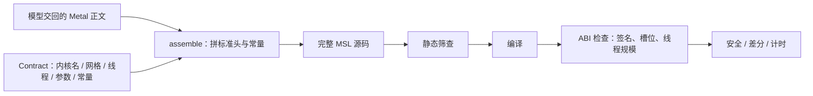

# 题目与契约

这一篇回答：一道题目带着什么编译约定。没有 `/* taic-launch */` 时，网格和每组线程数用题目契约。有这段时，同一次搜索里每一段可以自选网格和线程。缓冲区两头各留 16384 字节，用来抓写出界。进程怎么分工见 [架构说明.md](../架构说明.md)。

## 这篇讲什么

- **题目**（task）是一组数据：Triton 规格文本、CPU 参考、基线、输入生成器、容差、用例。搜索和评测都从 `tasks.get_task(name, dtype, size)` 取同一份。
- **契约**（contract）是编译约定：内核函数名、默认网格、每组线程数、参数槽位、编译期常量。
- 模型只交回 **Metal 正文**，契约头由程序拼接，所以模型改不了签名和槽位。
- 有 `/* taic-launch */` 时，内核可以自带网格和多段启动，代价是启动规格要过解析和 ABI 检查。

模型交回的是 Metal 正文。程序在前面拼上题目规定的函数名、缓冲区和常量。`gemm@` 与 `flash_attention@` 改契约里的 tile 常量和线程数，这两题以外没有 `@` 变体。契约菜单的子搜索会拒绝 `taic-launch`。



两种启动方式的分工：

| 项 | 没有 `/* taic-launch */` | 有 `/* taic-launch */` |
| --- | --- | --- |
| 网格 | 契约里的 `grid` | 每段自己写 |
| 每组线程数 | 契约里的 `threads` | 每段自己写 |
| 段数 | 单核 | 最多 32 段，同一条 command buffer、一次等待 |
| math | `math fast` | 可选 `math safe` 关掉 fast-math |
| 谁解析 | 不需要 | worker 用 `tcenv/backends/metal/launch.py` 解析 |

## 题目

题目由 `tasks/<名称>/task.py` 的 `build(dtype, size)` 填入 `tcenv.task.Task`。搜索与评测通过 `tasks.get_task(name, dtype, size)` 取得它。`dtype` 为 `fp16` 或 `bf16`。`size` 为 `paper`、`small` 或 `plan`。`plan` 只在论文规模与实现所用规模不一致的题目上定义，当前为 `reduction_sum`。名称在 `@` 之后带有另一组 tile 与线程数时，走该题的 `build_variant`。

`Task` 的字段如下。

| 字段 | 写入者 | 约束 |
| --- | --- | --- |
| `contract` | 题目 | 见下文 `Contract` |
| `triton_source` | 题目 | 给模型的规格文本。主环境不执行。其 SHA-256 写入运行配置 |
| `reference` | 题目 | CPU 参考。不进入运行配置的哈希范围 |
| `baselines` | 题目 | MLX 与 PyTorch 的 Metal Performance Shaders 路径，以及可融合的编译版。不进入运行配置的哈希范围 |
| `gen_inputs` | 题目 | 按用例名与种子生成输入 |
| `description` | 题目 | 给模型的一句话说明。写进 `TASK.md` 与存盘的系统提示 |
| `error_scale` | 题目 | 可选的逐输出误差尺度；省略时用参考输出的均方根 |
| `reference_sources` | 题目 | 按 backend id 的已知正确源码；`metal` 项与 `naive_msl` 同步 |
| `meta` | 题目 | `ieee_base`、`ieee_inputs`、`ieee_max`、`domain_case`、`source`；进入 `task_fingerprint` |
| `naive_msl` | 题目 | Metal 的已知正确慢内核；与 `reference_sources['metal']` 保持同步（旧拼写） |
| `rtol` / `atol_rel` | 通常为 `default_tolerances` | FP16 为 2e-3 / 1e-3；BF16 为 1.6e-2 / 8e-3 |
| `flops` / `min_bytes` | 题目 | 性能上界使用。这是指定算法的估计，不是硬件极限 |
| `cases` | 题目 | 差分用例名 |
| `exact` | 题目 | 为真时整数结果逐位比较 |

参考源码的 key 是 **backend id**（如 `"metal"`），不是语言名（`"msl"`）：两个 backend 可以同语言而 ABI 不同。`Task.reference_for(backend_id)` 按 backend id 取源，`naive_msl` 只作 Metal 兼容字段保留；`get_task(name, dtype, size)` 没有 backend 入参，选源在调用方（如 `tcenv/cli.py` 的 `reference_for(target.backend)`）。

这份“已知正确源码”身兼三职，改名或多值化会同时动到它们：**评测自检核**（`tcenv naive` 把它走一遍完整 `evaluate()`，某个 backend 没有参考源时须报「无参考」，不能静默通过）；**任务指纹成分**（`task_fingerprint(task, backend_id)` 哈希该 backend 的参考源，换 backend 后旧 run 指纹不可比，靠 `git_commit` 追溯）；**硬件特性天花板基准**（`hwfeatures` 以题目的朴素标量核为“无特性天花板”，没有参考源的 backend 这条天花板未定义，须关掉而不是拿别的 backend 的源码顶替）。

编译契约 `Contract`（`tcenv/contract.py`）固定内核名、默认的线程组网格、每组线程数和编译期常量。没有 `/* taic-launch */` 时用这套网格和线程。有这段时，每一段的 grid 和 threads 来自这段，契约网格不用。`assemble` 把标准头与常量拼在候选源码之前。头已包含 `<metal_stdlib>`、`<metal_simdgroup>`、`<metal_simdgroup_matrix>`。`contract.describe()` 的 SHA-256 写入运行配置。

| 字段 | 约束 |
| --- | --- |
| `kernel_name` | 候选必须使用该名 |
| `grid` | 三元整数组。由评测程序发射 |
| `threads` | 每个线程组的线程数，三元整数组 |
| `args` | `AbiArg` 序列 |
| `constants` | `(名称, MSL 类型, 值)`，渲染为 `constant constexpr` |
| `gpu` | 目标说明。当前为 Apple M4 Max 所在的 Apple9 GPU 族 |

参数记录 `AbiArg` 不含网格与线程数。

| 字段 | 约束 |
| --- | --- |
| `name` | 须与编译反射一致 |
| `index` | `[[buffer(n)]]` 槽位 |
| `role` | `input` 为只读 `device const`；`output` 为可写 `device`；`scalar` 为 `constant` 引用 |
| `dtype` | `tcenv.dtypes` 的类型键 |
| `shape` | 缓冲区形状。标量无形状 |
| `value` | 仅标量 |
| `doc` | 题面说明。可省略 |

`tcenv/backends/metal/abi.py` 允许指针元素类型放宽，例如以 `half4*` 读取 `half` 缓冲区。槽位、名称和读写模式不得放宽。

题目与计算的对应如下。前四项共用 `tasks/_elementwise.py`。固定四个 `sem_*` 与 `sem_int_<种子>` 都由 `tasks/semantic.py` 生成。`list_tasks()` 默认不含第二阶段。

| 目录 | 计算 |
| --- | --- |
| `sigmoid` | 映射到 (0, 1) |
| `relu` | 负数置 0 |
| `silu` | 负支平滑 |
| `swiglu` | 两路相乘 |
| `rmsnorm` | 按均方根缩放一行 |
| `softmax` | 归一化为和为 1 的正数 |
| `reduction_sum` | 求和 |
| `rope` | 按位置旋转 |
| `gemv` | 矩阵乘向量 |
| `gemm` | 矩阵乘矩阵 |
| `gemm_silu` | 矩阵乘后接 silu |
| `conv2d` | 滑动窗口乘加 |
| `flash_attention` | 第二阶段。注意力 |
| `lion` | 第二阶段。参数更新一步 |
| `bitdelta_gemm` | 第二阶段。比特权重上的矩阵乘 |
| `mamba2_chunk_scan` | 第二阶段。分块扫描。对照须包含该题最强的编译基线 |

`sem_relu_gelu_comment` 的标题与注释写 GELU，函数名为 `relu_kernel`，代码在 `x > 0` 时保留原值，否则写 0。NaN 不大于 0，所以写成 0。标准答案和朴素核都按这句比较。`torch.relu` 会留下 NaN，不是这道题的答案。


## 保护带

保护带解决两类静默错误：写出界，以及该写的输出格子没写。只看返回值发现不了这两件事。

`GuardedBuffer` 把逻辑缓冲区放在更大分配的中部。保护带长度 16384 字节。数据区长度向上取整到 256 字节，填充字节同样写入哨兵。

```text
输入: | 16384B 0xFF | 输入数据 | 16384B 0xFF |
输出: | 16384B 0xCD | 启动前为 0xFF 的输出区 | 16384B 0xCD |
```

输入边距 `0xFF` 在浮点下为 NaN。输出边距 `0xCD` 用于发现越界写。输出数据区的 `0xFF` 用于发现漏写。启动后输入区必须逐位不变。`validate` 置 `tight=True`，无保护带，以便着色器校验看见真实越界。父进程读取该子进程的标准错误。两套检查都通过，安全关卡才通过。

| 现象 | 谁发现 |
| --- | --- |
| 写到逻辑缓冲区之前或之后 | 边距里的哨兵（输入 `0xFF`、输出 `0xCD`） |
| 该写的输出格子没写 | 输出数据区仍是启动前的 `0xFF` |
| 内核把输入缓冲区改了 | 启动后输入区必须逐位不变 |
| 落在页内松弛里的小越界 | `validate` 的着色器校验（`tight=True`，无保护带） |


## 文件

| 文件 | 职责 |
| --- | --- |
| `tasks/generated/elementwise.py` | 由一个表达式生成 `gen_` 逐元素题 |
| `tcenv/contract.py` | 契约头与行号 |
| `tcenv/backends/metal/sanitize.py` | 保护带与校验环境 |
