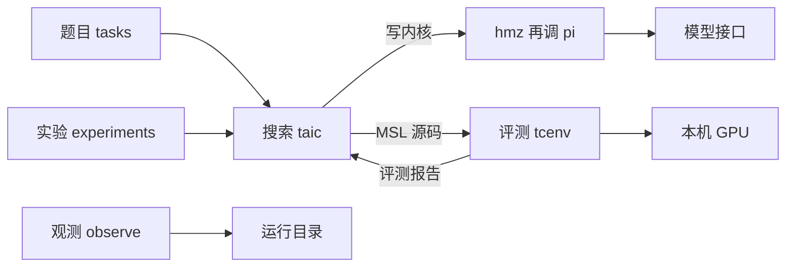
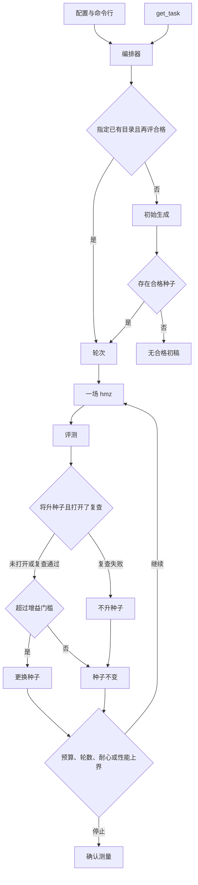

# 低层设计

先读这一屏。后面是给改代码的人对照实现用的，可以跳着查字段。

这件事是：让模型把仓库里的 Triton 题目写成苹果显卡上的 Metal 小程序，再由评测程序决定留不留。模型只写文字。它看不见显卡。抽查通过只说明这次没抓到错，不说明所有输入都对。

默认一次搜索大约 15 美元，两个模型轮流写：先是 DeepSeek 的 `deepseek-flash`，下一轮是月之暗面的 `kimi-k3`。每一轮是一场新的 `hmz` 会话。不合格的反馈写进下一场任务书。看起来更快的那一次不能对外说；要等搜索结束、换一批输入再测、源码对得上、计时也不吵。

`python -m taic.cli brief` 只读。`taic run` 和 `taic resume` 会花钱，也会把程序交给这台同时画屏幕的显卡。

Apple 图形处理器上，由语言模型生成金属着色语言内核，并由评测进程判定安全、数值与耗时的实现说明。

| 版本 | 说明 |
| --- | --- |
| 初始化版本 | 按低层设计七章记述当前实现。详细设计拆在 `docs/架构/` |

## 1. 概述

### 1.1 需求背景

本工程在本机 Apple 图形处理器（Graphics Processing Unit，GPU）上，把 Triton 规格文本写成金属着色语言（Metal Shading Language，MSL）内核，再由评测进程筛选。Triton 是一种 GPU 内核描述语言；主 Python 环境不执行它。数值对照来自中央处理器（Central Processing Unit，CPU）上的参考实现。

### 1.2 部署与职责

搜索进程、评测父进程与观测进程都在本机。GPU 与显示器共用，正在执行的 MSL 内核不能被抢占。杀死评测子进程不保证 GPU 上已提交的 dispatch 已经停止。

| 进程 | 代码 | 写入 | 读取 |
| --- | --- | --- | --- |
| 搜索进程 | `taic` | `runs/<一次搜索>/` | 题目、配置。写内核只调本机的 `hmz`，由 `hmz` 调用 `pi`。缺 `hmz` 时这次搜索不能启动 |
| 评测父进程 | `tcenv.evaluate` | 监督记录；收成评测报告 | 候选 MSL、题目 |
| 评测子进程 | `tcenv.worker` | 心跳、`report.json` | 候选 MSL；向 GPU 提交 |
| 观测进程 | `observe` | 加预算、重置预算、改下次两个委员会的模型、停止进程、带理由删除已结束的记录。写之前先做权限检查 | 状态、结果、账本、锁 |

一道题目包含一份编译契约，契约包含参数列表。每个缓冲区占三段：前端保护带 16384 字节、按 256 字节对齐的数据区、后端保护带 16384 字节。一次评测产生一份带版本号的评测报告。一次搜索把候选、结果和运行配置写入同一目录。

配置到达评测侧的路径：`taic.toml` 与命令行合成搜索配置和模型配置；编排器调用 `evaluate()`；父进程把源码路径交给子进程。

### 1.3 设计目标

1. 合格只表示本次安全检查与抽样差分通过。`status == ok` 与 `eligible` 同义。形式检查不参与该判定。
2. 计时只在本工程的机器级 GPU 锁下进行。第一次评测超时后不再启动 GPU 工作。
3. 搜索过程中的加速比不是对外结论。对外数值必须通过 [架构/搜索.md](架构/搜索.md) 的发布条件。
4. 续跑以转录中的计费记录和已完成候选为准，不重复已记账的请求。

### 1.4 范围与读者

本文覆盖 `tasks`、`taic`、`tcenv`、`experiments`、`observe` 的当前实现，详细设计按进程写在 `docs/架构/`。读者是实现者与测试对照人员。

本工程不是通用 MSL 编译器，也不替换 Triton。FP8 不在范围内。没有 `/* taic-launch */` 时，网格与每组线程数用题目契约。有这段时，同一次搜索里每一段可以自选网格和线程。`gemm@` 与 `flash_attention@` 改的是契约里的 tile 常量。

### 1.5 实现状态

| 对象 | 状态 |
| --- | --- |
| 评测流水线、搜索循环、`tasks/__init__.py` 的 `TASK_NAMES`（12）与 `PHASE2_TASK_NAMES`（4）、实验脚本、观测页面 | 已实现 |
| `run_config.json` 版本 1、`run_seed`、评测种子派生 | 已实现。配置写失败则退出码 5，且不进入 `run()`、不发送模型请求 |
| 非空目录上的新搜索 | 已拒绝。须改用 `taic resume` 或新目录 |
| 确认值与源码 SHA-256 绑定后的发布 | 已实现。未绑定、确认失败或计时不安静时，汇总不展示确认加速比 |
| `taic run --from`、`taic resume` 与 `--dry-run` | 已实现。旧运行缺记录的设置只列出来源，不因此拒绝续跑 |
| 升种子前的第二次正确性抽查 `differential_recheck` | 已实现，默认关闭 |
| 选择规则纯函数 `taic/policy.py` | 已实现。续跑回放使用同一组函数 |
| 报告与子进程请求的版本边界 | 已实现。评测报告和子进程请求：更高版本，或不认识的字段，拒绝读取 |
| `result.json`、`state.json`、`ledger.json` 的版本边界 | 已实现。损坏，或 `schema_version` 比本进程新，拒绝读取。多出来的键留在字典里 |
| triton-msl 对照 | 可选。未安装时主路径不调用它 |
| `verify()` | 已调用，返回值恒为 `unsupported` |
| 一元 fp16 取值域扫描与 `publication_role` | 已实现。确认之后另写 `domain_report.json`。`primary` 还要求加速比不低于 1.005。真机扫描未跑 |
| `task_fingerprint` | 已写入 `run_config.json`。不替换 triton-msl 缓存用的 `spec_fingerprint` |
| 契约菜单 `experiments/contract_menu.py` | 已实现。默认搜索用题目自己的网格和线程数。gemm 与 flash_attention 可以在一次搜索之外另选一套。菜单在实验驱动里，每个子目录仍是一次搜索 |
| `gen_` 逐元素题 | 已实现。由 `tasks/generated/elementwise.toml` 的一个表达式生成，不进入默认题目列表 |
| `profile_poor`、`hw_feedback`、`plan_mix`、`diversity_archive`、`fast_bench` | 已实现，默认关闭。历史单次运行不是这些开关的效果结论 |
| `plan_ledger` | 开关默认开，看板可按它重算计划结局。当前任务书只附最近 8 行普通历史。账本文本在 `_plan` 里生成，搜索循环不调用 `_plan` |
| 直调模型 `taic/llm.py` | 仍在，给实验脚本用。搜索写内核不再走这里。2026-10-20 起按流接收，900 秒是块与块之间的空闲。细则见 §2.4 |
| 与当前种子源码相同的提交 | 已实现。状态 `unchanged`，不评测、不升种子、不进入修补。提示要求失败的内核留在文件里。见 [架构/搜索.md](架构/搜索.md) |
| `hmz` + `pi` | 搜索写内核的唯一路径。一轮一场新会话。两个委员会轮流。接连两场 `agent_failed`（起不来、进程失败或超时，并且没有留下和种子不同的核）以 `agent_failure` 停止。交了核但不合格，或文件和种子相同，都不算这场失败 |
| 跨次经验索引 | 已实现，默认关闭。`search.experience_index` 指向一份已经建好的 JSON 才注入规划提示。搜索不会自己扫描 `runs/`。重复性实验把该路径置空 |
| 搜索开关的对照实验结论 | 未实现。对照脚本在，结论不是开工批准 |
| `/* taic-launch */` | 已实现。没有这段时用题目契约的网格和线程。有这段时，同一次搜索里每一段自选。契约菜单的子搜索会拒绝这段 |

### 1.6 验收准则

`python -m tcenv.cli naive gemm` 打印该朴素内核的评测结论。`python -m taic.cli run <题目>` 结束后，新目录含有 `result.json` 与 `run_config.json`；存在合格内核时含有 `best.metal`。加速比大于 1 不是验收条件。汇总中的对外加速比只在 [架构/搜索.md](架构/搜索.md) 的发布条件成立时给出。

## 2. 总体设计

### 2.1 搜索进程与评测进程的衔接

搜索进程不向 GPU 提交内核。它把候选源码交给 `evaluate()`。评测父进程在静态筛查通过后启动子进程。子进程调用 Metal，并把评测报告写成 JSON。父进程读回该文件。写内核不由搜索进程直接调用模型：它调用 `hmz exec`，`hmz` 启动 `pi`，模型在 `pi` 里。搜索进程读回本场的交卷文件（`{题目}-{dtype}-{规模}-{场次}.metal`），再交给评测。`kernel.metal` 是放进会话的种子。成绩单、失败反馈和证据写进这一场的 `TASK.md`。外层成绩和失败反馈各截到约 2000 字。`--kernel-agent off` 拒绝启动。

| 搜索侧 | 评测侧 | 传递物 |
| --- | --- | --- |
| `taic/orchestrator.py` 的 `_eval` | `tcenv/evaluate.py` 的 `evaluate` | MSL 原文、题目名、数据类型、规模、模式、派生种子 |
| `taic/kernel_agent.py` 的 `render_contract` | `tcenv/report.py` 的 `format_feedback` | 写进 `TASK.md` 的成绩，至多约 2000 字 |
| `runs/<一次搜索>/` | 子进程临时目录中的 `report.json` | 完整评测报告 |

`emit` 在没有监听者时直接返回。搜索和评测写进度时走 `publish`、`update_progress`、`note_gpu`，这三个函数会先在**自己这个进程**里装上写文件的监听者。看板是另一个进程，读已经落在磁盘上的文件，收不到搜索进程里的内存事件。搜索和评测不导入 `observe`。进度写入失败被忽略，不改变评测结论。

### 2.4 直调模型

搜索写内核不经过这一节。`search.kernel_agent` 是 `pi`。`--kernel-agent off` 拒绝启动。下面这些规则仍包住实验脚本里的直调。

2026-10-20 以前，同一次补全要等整段正文回来，`request_timeout_s`（900 秒）盖住整段等待。kimi-k3 的思考经常在第一块数据之前就超过这 900 秒，请求被当成超时。从这一天起，直调按流接收。900 秒改成两块数据之间允许的空闲：思考还在往下流，整段可以长过 900 秒；流静默超过 900 秒，才按超时重试。连接失败、服务端 5xx、限流同样重试，次数是 `max_retries`（默认 6），`Retry-After` 作为这一次等待的下限。

| 发生了什么 | 接着做什么 |
| --- | --- |
| 流静默超过 900 秒、连接断开、5xx、限流 | 同一份消息再发，最多 6 次。半截不写进下一次请求 |
| 正常结束，正文和工具调用都空 | 同一份消息再发。次数用尽时，思考里已经有 `kernel void` 的，把思考交给调用方；否则把空正文交出去 |
| 流干净结束，却没有结束原因 | 丢掉半截，同一份消息再发。次数用尽后这次请求失败，半截不返回 |
| 429 的正文是余额不足，或其它不能靠重发修好的 4xx | 停止这一次请求，不重试。拒绝 `stream_options` 的 400 会去掉该字段再发，不计入 `max_retries`。拒绝回传思考的 400 与超窗一样只削一次 |
| 上下文超窗 | 去掉回传的思考，缩短过长的工具结果，再发一次。仍然超窗就停 |
| 输出顶到长度上限，并且带了工具调用 | 不执行这些调用。这一条在 `chat_with_tools` 里。`llm.chat` 对顶满长度只留下正文并记一条警告 |
| 输出顶到长度上限，正文里没有内核 | 再问一次的代码在编排器的 `_develop`，当前搜索不调用它。`truncation_retry_effort` 默认仍是 `low` |

这些规则只包住实验脚本里直调的这一次 HTTP。搜索写内核走 `hmz` 和 `pi`，搜索不改那条路径。没有搬进直调的，是自动换模型、把整段历史做成摘要，以及编程代理的权限和子代理。操作细节和开关表在 [架构/搜索.md](架构/搜索.md) 的「直调模型」。看板按 `kernel_writer` 决定画模型请求表，还是再加 hmz epic 和 pi 输出，见 [架构/可观测.md](架构/可观测.md)。

### 2.2 模块划分

下列树给出源码目录。

```text
ai_lowerling/
├── tasks/          题目
├── taic/           搜索
├── tcenv/          评测
├── experiments/    批量搜索
├── observe/        观测。读运行目录；写入口是预算、默认模型、停止和删除已结束的记录
├── backends/       语言/工具链共用的 skill 与 wiki
├── targets/        设备档案、本机 calibration、trust.toml（按 target 的模型信任）
├── kernels/        确认内核目录（按 target/task/dtype/size）
├── data/           observe.sqlite、deleted/、books.sqlite（不进入 git）
├── tests/          假模型与假子进程
└── runs/           运行产物，不进入 git
```
数据怎么存、怎么索引、怎么查、哪些数字可以信，见 [架构/数据层.md](架构/数据层.md)。
```

下图是模块之间的数据方向。



### 2.3 数据流

一次新搜索的控制顺序如下。



## 3. 详细设计

详细设计按进程拆开。这一篇只保留分工和数据方向。

| 问题 | 文档 |
| --- | --- |
| 题目、编译契约、保护带是什么？ | [架构/题目.md](架构/题目.md) |
| 评测怎样判决，报告版本边界在哪里？ | [架构/评测.md](架构/评测.md) |
| 搜索怎样循环，什么数字可以发布，怎样续跑？ | [架构/搜索.md](架构/搜索.md) |
| 直调模型怎样收超时、空回复和截断？ | 本篇 §2.4。开关和数字在 [架构/搜索.md](架构/搜索.md) 的「直调模型」 |
| 直调和 hmz 怎么取舍，算不算 loop engineering？ | [直调与hmz取舍.md](直调与hmz取舍.md) |
| `hmz` 是什么，本工程调用了它的哪一层？ | [架构/hmz.md](架构/hmz.md) |
| 实验怎样分组，看板怎样读？ | [架构/可观测.md](架构/可观测.md) |

## 4. 验证


`tests/fake_worker_*.py` 模拟正常退出、心跳停在 `B`、以及等待锁。编排器测试使用脚本化模型与脚本化评测，不启动 GPU。`tests/test_eval_seed.py` 用 [架构/搜索.md](架构/搜索.md) 的固定向量独立复算种子，并检查分支完成次序不影响同一标签的种子。`tests/test_run_config.py` 检查版本 1 的哈希与写失败。`tests/test_publication.py` 与 `tests/test_differential_recheck.py` 检查未确认不得显示为确认值，以及复查关闭时选择轨迹不变。`tests/test_report_schema.py` 检查更高版本被拒绝。

`uv run pytest -q` 运行不要求 GPU 的测试。失败时先读 `logs/pytest/triage/triage_summary.md`。重跑单条时不加 `-n`。标为 `gpu` 的测试文件不能代替上述命令。`TCENV_ALLOW_GPU_HANG_TESTS=1` 不作为常规验收。取值域扫描、契约菜单、生成题和语义前置门的离线测试在 `tests/test_domain_sweep.py`、`tests/test_contract_menu.py`、`tests/test_generated_tasks.py`、`tests/test_elementwise_semantics.py`。

## 5. 未来演进

`verify()` 在出现可审计的 MSL 或 AIR 语义及证明范围之前保持 `unsupported`。一元 fp16 的取值域扫描已经是正确性关的一个 case，范围写在 `correctness.coverage.scope`。那不包括线程是否互相独立、下标和边界、并发，以及其他启动配置，所以不是整个内核的形式证明，也不改 `eligible`。bf16 和二元题本轮不扫。

没有 `/* taic-launch */` 时，默认搜索用题目自己的网格和线程数。有这段时，同一次搜索里每一段可以自选网格和线程。`gemm@` 与 `flash_attention@` 改契约里的 tile 常量，也可以交给 `experiments/contract_menu.py`。菜单的每个子目录仍是一次普通搜索，并且会拒绝 `taic-launch`。`experiments/contract_sensitivity.py` 的 `static_screen_contracts` 可在进模型之前丢掉每组 SIMD 上 32 个及以上累加器片段、或线程组声明超过 32768 字节的契约。跨运行经验索引默认关闭，见 §1.5。`--from` 只在调用者给出目录时使用，不进入重复性实验的默认初稿。

`profile_poor`、`hw_feedback` 保持关闭，直到单独的对照实验给出确认加速比或单位美元收益，且安全与正确性不下降。`plan_mix` 的字段还在，当前一轮一场不读它。历史目录的预算、模型、契约和是否续跑并不相同，不能当作该对照。

## 6. 依赖

| 依赖 | 用途 | 缺失时 |
| --- | --- | --- |
| Python 3.12 及以上，由 uv 安装 | 搜索与评测 | 主路径不可运行 |
| MLX、PyTorch、PyObjC Metal | 基线与 GPU | 评测不可运行 |
| OpenAI 兼容对话接口 | 实验脚本里的直调。搜索写内核不走这里 | 只跑评测、不跑那些脚本时仍可运行 |
| 本机命令 `hmz` 与 `pi` | 搜索写内核。`hmz exec` 跑一场 `kernel_once`。`hmz` 0.2.0 为当时的 PyPI 发布 | 这次搜索不能启动 |
| Metal 工具链与 `.venvs/triton-msl` | 可选对照 | 主路径不调用 |
| `xctrace` | 可选录制 | 默认搜索不调用 |

## 7. 附件

### 7.1 术语

| 术语 | 展开或英文 | 解释 | 章节 |
| --- | --- | --- | --- |
| 图形处理器 | Graphics Processing Unit，GPU | 本机 Apple GPU，与显示器共用 | §1 |
| 中央处理器 | Central Processing Unit，CPU | 参考与差分所在的处理器 | §1 |
| 金属着色语言 | Metal Shading Language，MSL | 候选内核的源语言 | §1 |
| Triton | Triton | 规格文本。主环境不执行 | §1 |
| 评测报告 | `EvalReport` | 一次 `evaluate` 的判决 | [评测](架构/评测.md) |
| 编译契约 | `Contract` | 内核名、网格、线程数与参数 | [题目](架构/题目.md) |
| 运行种子 | `run_seed` | 一次搜索的 64 位种子。各次评测由此派生 | [评测](架构/评测.md) |
| 加速比 | speedup | 最快库基线耗时除以候选耗时 | [评测](架构/评测.md) |
| 确认测量 | confirmation | 结束后的复测。对外值还须满足发布条件 | [搜索](架构/搜索.md) |
| 性能上界 | roofline | 实测峰值与题目运算量、字节量给出的时间下界 | [评测](架构/评测.md) |
| 变异系数 | coefficient of variation | 重复计时的离散程度。超过 0.05 为不安静 | [评测](架构/评测.md) |
| 保护带 | guard band | 缓冲区两端各 16384 字节 | [题目](架构/题目.md) |
| 着色器校验 | `MTL_SHADER_VALIDATION` | Metal 对非法访问与同步的检查 | [评测](架构/评测.md) |
| triton-msl | triton-msl | 可选编译器，位于独立虚拟环境 | [评测](架构/评测.md) |
| 前缀缓存 | prompt cache | 相同系统提示按命中价计费 | [搜索](架构/搜索.md) |

### 7.2 常量

| 常量 | 值 |
| --- | --- |
| 保护带 | 16384 字节 |
| 输入哨兵与输出毒化 | 字节 `0xFF` |
| 输出边距 | 字节 `0xCD` |
| 单次启动时限 | 单核 2 秒。流水线一条 command buffer 按段数乘 2 秒，封顶 8 秒。着色器校验是这个数的 2 倍。超过仍 SIGKILL，并计入 `max_hangs` |
| `taic-launch` 段数 | 最多 32。编码在计时窗外，段数用来封住藏在窗外的编排。Winograd 这类是个位数段 |
| 单段线程组总数 | 不超过 2^24。65536 组仍允许。2^32−1 不算上限 |
| buffer 槽位 | 0 到 30 |
| `validate` / `full` / `quick` | 120 / 420 / 240 秒。`timed` 走 full 子进程，整段 420 秒。`mode=full` 是先校验最多 120 秒，通过后再最多 420 秒 |
| 杀死子进程后的等待 | 3 秒 |
| 不安静变异系数 | 0.05 |
| 计时重测次数 | 3 |
| 反馈截断 | 写进任务书的外层成绩和失败反馈各至多约 2000 字。`FEEDBACK_CHARS = 6000` 只留给不再调用的规划 |
| 线程组静态内存上限 | 32768 字节 |
| 初始生成尝试次数 | 2。两次都没有合格种子才停 |
| 基线明显快于下界 | 耗时 < 下界 × 0.95 |
| 评测种子 | SHA-256 前 6 字节，大端 |
| 评测请求版本 | 3。版本 1 和 2 仍可读取。版本 3 增加可选字段 `require_contract_launch` |
| 报告、结果、状态、账本版本 | 1 |
| 固定评测种子向量 | 见 [架构/搜索.md](架构/搜索.md) |

### 7.3 命令

`python -m tcenv.cli` 的子命令：`tasks`、`show`、`naive`、`eval`（`--quick` 为快速模式）、`baseline`、`calibrate`、`profile`、`triton-baseline`。

`python -m taic.cli run <题目>` 的常用参数：`--dtype`、`--size`、`--budget`、`--preset paper|base`、`--from <目录>`、`--seed`、`--model`、`--branches`、`--max-rounds`、`--no-tools`、`--profile-best`，以及 [架构/搜索.md](架构/搜索.md) 各开关的 `--开关` 与 `--no-开关`。启动失败的退出码为 5。搜索结束且没有合格内核时退出码为 2。

`python -m taic.cli resume <目录>` 支持 `--dry-run`、`--add-budget`、`--budget`、`--lift-count-limits`。退出码：不能续为 3，锁冲突为 4，设置或预算错误为 5。

```bash
uv run python -m experiments.run_suite --tasks all --dtypes fp16,bf16
uv run python -m experiments.repeatability --tasks conv2d,gemm,swiglu --trials 5
uv run python -m experiments.semantic_tests --n-random 10
uv run pytest -q
```

`run_suite`、`repeatability` 与 `p1_runs` 的默认单次预算为 15 美元。`repeatability` 中 SwiGLU 为 1 美元。三者接受 `--budget`、`--preset` 与可选的 `--max-total-usd`。`experiments/search_ab.py` 也有 `--max-total-usd`，并且跳过已经有文件的目录；它的预设是 `base`，默认每次 3 美元。`run_suite` 在同一个输出目录里已有 `result.json` 时跳过该题；不传目录时每次新建带时间戳的目录，不会跳过旧的 `runs/apple-m4-max/suite_full`。`repeatability` 不使用 `--from`。按论文预算全部花满时，`run_suite --dtypes fp16,bf16` 的 24 次为 360 美元（默认只跑 fp16，是 12 次、180 美元），`repeatability` 为 155 美元（含 `flash_attention` 时为 230 美元），`p1_runs` 字典里 12 条为 180 美元。`semantic_tests` 每次 0.15 美元。早于该预算的历史目录与现行结果不可直接比较。
