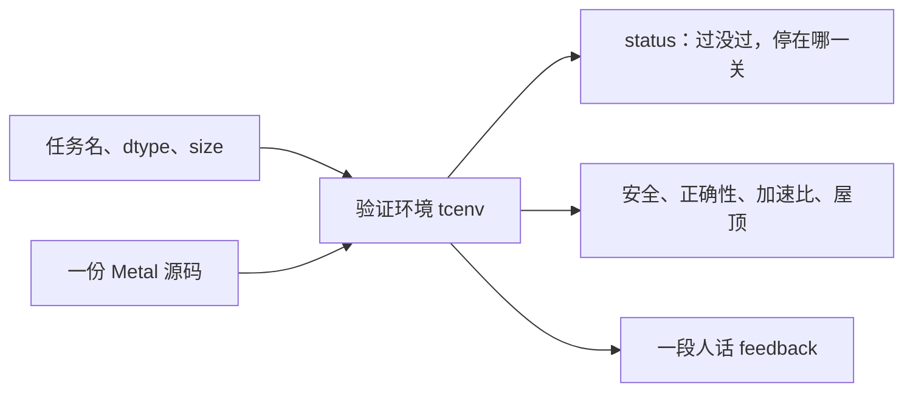
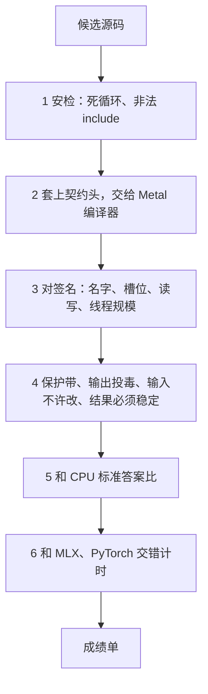
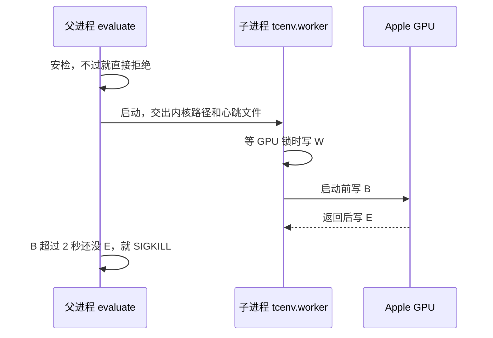
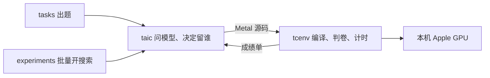
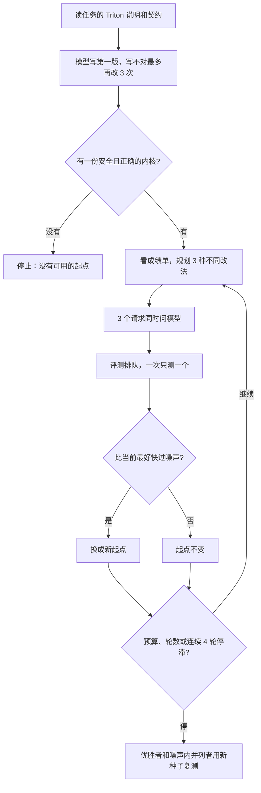

# 让对话程序给苹果图形芯片写计算小程序，只留下又对又快的

本文讲这个仓库怎么分工。不需要先懂机器学习。下面几段把后面会反复用的词说完，第 1 章再谈目标和验收。

## 先看懂这件事在干什么

这台 Mac 里有两块会算数的芯片。中央处理器（CPU）适合一步一步算。图形芯片（GPU）平时负责画面，也能同时对成千上万个数字做同样的运算，所以大批量计算更快。

要让图形芯片算东西，得给它一段专用小程序。这种小程序叫**内核**。在苹果电脑上，内核用 Metal 语言写，源码文件常常以 `.metal` 结尾。

人们描述「这道计算该怎么做」时，常用另一种文本，叫 Triton。Triton 本来是写给另一类显卡的。本仓库不执行这段 Triton，只把它当题目说明。

翻译交给**大模型**。它是一种对话程序：你给一段文字，它续写出下一段文字，类似现在常见的聊天机器人。这里给它的是 Triton 题目，它写出的是 Metal 源码。它不会自己打开图形芯片，也看不出自己写对了没有。每问它一次都按文字量计费，所以一次搜索有美元上限。

写出的源码交给**验证环境**（代码在 `tcenv/`）。它把源码真正编译、放到图形芯片上跑，和一份已知正确的答案比，再和这台机器上现成的数学库比谁更快。现成库主要是 MLX 和 PyTorch，当成「别人已经写好、可以直接调用的标准算法」即可。只有安全、算对、而且更快的版本会被留下。

后文用两个计算当例子就够了，不必先学模型是怎么训练的：

- **矩阵乘**（代码里叫 `gemm`）：把两个大表格按数学规则乘成第三个表格。规模可以到几百万个数。
- **softmax**：把一排数变成都大于 0、加起来等于 1 的一排数。分类时常用它表示「每个选项占多少比例」。

图形芯片上的小数常常故意用得粗一点，好换速度。**FP16** 和 **BF16** 就是两种粗小数。更粗的 FP8 这块芯片做不了，所以本仓库不做。

记住三件事：

1. 大模型只负责写出 Metal 这段文字。对不对、快不快，由验证环境在图形芯片上测。
2. 每次真的跑到图形芯片上，都关在单独的进程里。一次启动超时就杀掉；一次卡住，整次搜索停止。图形芯片同时画屏幕，死循环会把电脑冻住。
3. 只有安全、算对、并且快过测量误差的稿子，才能换成下一轮的起点。对外公布的倍数，是最后用新的随机数再测过的。

只想跑通一次的人，读完第 2 章就可以停。验证环境在第 3 章。大模型怎么一轮轮改稿，在第 4 章。

## 1. 读完这一页就能说清目标和验收

**要做成的事：** 拿一道计算题（例如矩阵乘或 softmax），让大模型按 Triton 题目写出 Metal 小程序。本机只收下三样都满足的那一版：不会把电脑跑死，算出来和标准答案一致，而且比 MLX 或 PyTorch 里现成的算法更快。

仓库交到手里的是这三样：

| 交付 | 打开哪里能看见 | 谁负责 |
| --- | --- | --- |
| 最终的小程序 | `runs/<本次目录>/best.metal` | 搜索程序 `taic`。它负责反复问大模型 |
| 成绩 | 同目录 `result.json`：快了几倍、花了多少美元、为什么停 | `taic` |
| 每份稿子为什么被刷掉 | 同目录 `candidates/` 里的 `feedback.txt` | 验证环境 `tcenv` |

谁来做、谁可以不管：

| 角色 | 需要做 | 不需要做 |
| --- | --- | --- |
| 想在这台 Mac 上试一次的人 | 装好依赖，执行第 2 章那一条命令，到 `runs/` 看结果 | 不写 Metal，不必懂模型怎么训练，不改验证环境 |
| 想加一道新计算题的人 | 在 `tasks/<名字>/` 放题目说明、标准答案、现成库怎么算、一份写得慢但算得对的 Metal | 不改「问模型、留哪一版」的循环，不自己写计时 |
| 想改仓库代码的人 | 改 `taic/`（怎么问模型）或 `tcenv/`（怎么判卷） | 不把付费用的密钥提交进仓库 |

后文反复用的五个词：

| 词 | 意思 |
| --- | --- |
| 任务 | 一道计算题，例如「把这两个大表格乘起来」 |
| 契约 | 小程序必须遵守的格式：函数叫什么、第几个参数是输入、同时开多少路一起算。写在题面上，模型改不了 |
| 候选 | 模型交上来的一份 Metal 源码，还没决定留不留 |
| 加速比 | 现成库里最快那份的耗时 ÷ 这份候选的耗时。大于 1 表示候选更快。2 就是快一倍 |
| 确认 | 搜索结束后用一组新的随机输入再测。对外报这个数，避免某一次碰巧测得特别快 |

**现在到哪了。** 验证环境、搜索循环、15 道计算题（12 道常用的，加 3 道后来加的）和批量实验脚本都在仓库里，接上这台 Mac 的图形芯片就能跑。另有一个可选对照：用别人写的程序 triton-msl 把 Triton 题目直接编译成 Metal，要额外安装，不装也不影响上面的主路径。把题目全部跑完会调用大模型，按文字量扣美元，并且会占住图形芯片。

**怎样算完成。** 执行第 2 章的自检命令，终端打印出验证环境对那份手写小程序的结论。执行搜索命令后，新出现的 `runs/` 目录里有 `result.json`；搜出合格小程序时，同目录还有 `best.metal`。

**明确不做。** 本仓库不是一个什么计算都能编译的通用工具，也不替换 Triton。这块图形芯片不做 FP8 那种更粗的小数。密钥从本机配置文件或环境变量读取，不进 git。

**风险。** 图形芯片同时负责画面，正在跑的 Metal 小程序无法被中途抢走。一个死循环曾把这台机器冻到要按电源键重启。框架会在进图形芯片之前拒绝明显的死循环；单次启动超过 2 秒（开着更严格的检查时是 4 秒）就杀掉那个进程；一次超时后，整次搜索停止。

## 2. 一条命令跑通，失败了看成绩单即可

本节给想亲手跑一次的人。不需要调用大模型，也不需要懂它怎么写代码。验证环境内部见第 3 章。

### 一分钟上手

先装好这个项目要用的程序库。然后用仓库里一份写好的矩阵乘小程序走一遍验证。这份小程序是人写的，算得对，但故意写得很直接、不追求快，所以叫「朴素」。这条命令不花钱。

```bash
uv sync
uv run python -m tcenv.cli naive gemm
```

这条命令只启动验证环境，不问大模型。终端会打印：这段小程序能不能编译、跑起来安不安全、算出来和标准答案一不一致。完整验证还会给出它相对 MLX / PyTorch 的快慢倍数。第 3 章说明这张成绩单是怎么来的。

要让大模型自己写一个 softmax，并且这次最多花 1 美元：

```bash
uv run python -m taic.cli run softmax --budget 1.0
```

问大模型需要一把钥匙（接口地址和密钥）。钥匙放在 `taic.toml` 所指的本机文件里（默认 `~/.pi/agent/models.json`），或者放在环境变量 `OPENAI_API_KEY` / `OPENAI_BASE_URL`。仓库里不保存钥匙。

跑完后打开终端最后一行给出的 `run_dir`，那是这次运行新建的文件夹。里面的 `result.json` 是成绩，`best.metal` 是被留下的小程序，`transcript.jsonl` 是和模型的对话记录（钥匙已打码）。

### 失败了去哪看

| 你看到的现象 | 去哪看 | 要不要从头再来 |
| --- | --- | --- |
| 自检命令结束时带有错误（退出码不是 0） | 终端里的成绩单：编译、函数格式、安全或算得对不对 | 不用重装。先看验证环境的结论，再改小程序 |
| 搜索结束但没有 `best.metal` | `result.json` 里的 `stop_reason`（为什么停） | 不用清缓存。多半是美元用完了，或开头几稿都没写对 |
| 日志里出现 timeout，搜索立刻停 | 同一次 `runs/` 目录 | 不用继续这一轮。一次卡住就会停整次搜索。换一道题，或改完小程序再开一次新的 |
| 快慢倍数和搜索过程中看到的不一样 | `result.json` 的 `confirmed_speedup`（确认后的倍数）和 `confirmations`（每一次复测） | 不用重跑搜索。对外以确认后的数为准 |

### 三种常见用法

| 你要做什么 | 系统做什么 | 结果 |
| --- | --- | --- |
| 检查验证环境本身是否正常 | 用题目里自带的、写得慢但算得对的 Metal，走完第 3 章的全部关卡 | 终端一份成绩单 |
| 让大模型把一道题写得更快 | 它反复写小程序，验证环境判卷，只留下更快的 | `runs/<本次>/best.metal` 和 `result.json` |
| 看它是不是真的在读计算步骤，而不是看名字 | `experiments.semantic_tests` 用故意起错名、写错注释的题。比如标题写着一种运算，代码其实在做另一种 | 该目录下的结果表 |

后两种会把题目文字发给大模型，按 `taic.toml` 里的单价记美元。

### 这些事不用做

- 不用自己规定「开多少路一起算」。这个写在契约里，验证环境会填进编译用的文件头。
- 不用自己和 MLX、PyTorch 比时间。验证环境用同一套秒表。
- 不用在主环境里安装 Triton。主路径只把 Triton 当题目文本，不运行它。
- 不用为了看懂搜索去改 `taic.toml`。默认的花费上限、每轮改几种、超时时间已经能跑；要改再看附录 A。

## 3. 验证环境收一份 Metal，交回一张成绩单

本节讲验证环境。它是判卷的，不是写代码的大模型。代码在 `tcenv/`。论文里把它叫 TCEnv，就是这一个东西。

你交给它两样东西：哪一道计算题，以及一份 Metal 源码。它交回一张成绩单：这段小程序能不能编译、跑起来会不会写坏内存、算出来和标准答案差多少、比现成数学库快几倍。只跑命令的人看完「你交给它什么」就可以回到第 2 章。改判卷逻辑的人继续往下看。

下面这张表是本章的目录。

| 本节 | 落实什么 | 作用 |
| --- | --- | --- |
| 你交给它什么 | 第 2 章那条自检命令 | 看输入和输出 |
| 它查哪些事 | 安全、算对、更快 | 看边界 |
| 从安检走到计时 | 一份源码的命运 | 看流水线 |
| 数值怎么算对 | 和 CPU 答案比 | 看容差和特殊值 |
| 哨兵和投毒 | 越界、漏写 | 看内存布局 |
| 子进程和心跳 | 死循环不能冻屏幕 | 看谁有权杀进程 |
| 计时锁 | 加速比可信 | 看为什么测量要独占 GPU |
| 成绩单状态 | 失败去哪看 | 看 `EvalReport` |
| 每个文件 | 改代码时找得到 | 看 `tcenv/` 分工 |

### 你交给它什么，它交回什么

验证环境是一个独立的判卷程序。搜索程序 `taic` 每次想知道「这份小程序行不行」，都是调用它。大模型的回复只是文字，真正打开图形芯片的是验证环境。你也可以不经过模型，直接叫它。

图里的 `dtype` 是小数格式，用 `fp16` 或 `bf16`。`size` 是数据有多大：`paper` 按论文里的规模，`small` 小很多，方便调试。`status` 是这张成绩单的结论，过了还是停在哪一关。反馈文字（feedback）是把结论写成一段话，方便人和模型阅读。屋顶是后面会讲的「这台机器理论上最快能有多快」。



人手入口是 `python -m tcenv.cli`。最常用的两条：

```bash
uv run python -m tcenv.cli naive gemm
uv run python -m tcenv.cli eval softmax my_kernel.metal
```

`naive` 用题目自带的、写得慢但算得对的小程序，用来确认验证环境自己没坏。`eval` 用你给的文件。加 `--quick` 就只查「能不能编译、安不安全、算得对不对」，不比快慢。`--json` 把成绩单整份打出来，而不是只打那段人话。

成绩单在代码里叫 `EvalReport`。终端上看到的段落由 `tcenv/report.py` 的 `format_feedback` 生成：先是结论，然后是编译错误、函数格式对不上、有没有写坏内存、每个测试输入差了多少、花了多少时间、离理论最快还有多远。搜索程序把这段文字截短后发回给大模型，让它改下一稿。

三种跑法对应函数 `evaluate()` 的参数 `mode`：

| 跑法 | 谁在用 | 做到哪 |
| --- | --- | --- |
| `quick` | 命令加了 `--quick`，以及模型写到一半时调用的自查 `quick_check` | 安检、编译、函数格式、内存安全、对答案。不做更严格的芯片自检，也不比快慢 |
| `full` | `naive`、`eval` 的默认，以及搜索里正式交上来的稿子 | 先单独起一个进程做芯片自检（着色器校验），通过后再做全部输入和计时 |
| 内部的 `validate` | 只有 `full` 的第一段，人不用直接选 | 内存两头不加哨兵，只跑一组输入，打开芯片自己的越界检查 |

`full` 的两段是两个进程。第一段失败就直接交卷，不再计时。着色器校验是苹果图形芯片自带的检查：它在小程序每次读内存、写内存、等待别的计算时插一脚，发现越界就报错。环境变量 `MTL_SHADER_VALIDATION` 用来打开它。

### 它查编译、安全、数值和快慢

验证环境认的是算出来的数和有没有写坏内存，不认函数名叫什么、注释怎么写。

| 它要确认的事 | 不过会怎样 |
| --- | --- |
| 源码能变成图形芯片能跑的程序，函数名和参数顺序与契约一致 | 结论是 `compile_error`（编译失败）或 `abi_error`（格式不对）。还没开始比快慢 |
| 不写到别人的内存、该写的结果都写了、不改输入、结果不依赖输出区里原先的垃圾，两次同样的运行逐位相同 | `unsafe` |
| 和 CPU 上用更精细小数算出的标准答案差在允许范围内。NaN（「不是一个数」，例如 0 除以 0）和无穷大要出现在和答案相同的位置，无穷大的正负号也要相同 | `incorrect` |
| 完整模式下，比本轮最快的 MLX 或 PyTorch 快多少 | 结论仍是 `ok`。快慢写在成绩单里，验证环境不因为「不够快」把稿子判死。留不留由第 4 章的搜索决定 |
| 死循环进不了图形芯片；真的卡住了，单次启动超过时限就杀掉进程 | `rejected`（根本不让跑）或 `timeout`（跑了但被杀掉） |

它明确不管这些事：

- 不管你的 Metal 和 Triton 是不是同一套写法。Triton 在主环境里只是题目文本，描述「要算出什么」，不是要执行的程序。
- 不给代码打风格分，也不检查注释写得漂不漂亮。
- 不在日常用的 Python 环境里安装并运行 Triton。可选的对照程序 triton-msl 住在另一个单独的 Python 环境里。
- 不决定「这份小程序能不能换成下一轮的起点」。那是第 4 章搜索调度的事。验证环境只负责测出快了几倍。

### 一份 Metal 源码从安检一直走到计时

总入口是 `tcenv/evaluate.py` 里的 `evaluate()`。可以把它想成一条安检传送带：任何一关失败，后面的关不再跑。成绩单的 `stage` 字段记下停在哪一关。

图里的「签名」就是契约要求的函数格式：名字、第几个参数、这个参数只许读还是可以写、同时开多少路计算。`#include` 是把别的源文件插进来；这里只允许苹果图形芯片自己的标准头文件。



各关对应的文件：

| 关 | 文件 | 它其实在查什么 |
| --- | --- | --- |
| 安检 | `screen.py` | 去掉注释后还有没有永远转下去的 `while (true)`、`for (;;)`，以及 `#include` 是不是 `<metal_...>` 这种苹果标准头 |
| 编译 | `contract.py` 拼上头，`metal_runtime.py` 交给苹果的编译器 | 源码能不能变成图形芯片能跑的程序。报错里的行号会减掉前面自动加的契约头，指回你自己的源码 |
| 函数格式 | `abi.py` | 参数槽、名字、读写是否和契约一致。一次读 4 个数（例如用 `half4*` 去读 `half` 数据）是允许的，这是合法的提速写法 |
| 内存安全 | `sanitize.py` | 有没有写到界外、该写的结果有没有漏、有没有改输入 |
| 对答案 | `testing.py`、`distributions.py` | 换各种刁钻的输入，结果是否还在允许误差内，特殊值是否对齐 |
| 计时 | `bench.py`、`baselines.py`、`profile.py` | 候选和现成库谁更快，以及离这台机器的理论最快还有多远 |

`metal_runtime.py` 是唯一直接跟图形芯片说话的一层（通过苹果的 Python 接口 PyObjC）。上面的关都调用它，不各自去碰驱动。契约头由验证环境生成，里面已经包含图形芯片需要的标准库，以及这道题的常数（比如表格有多高、多宽）。模型不要重写这段头，也不要自己再 `#include`。

### 数值对上 CPU 答案才算正确

标准答案是题目提供的、跑在 CPU 上的函数，用更精细的小数（float64 / float32）算。图形芯片用的是 FP16 或 BF16，本来就不可能每个数字都和精细答案逐位相同，所以允许一点误差。每个输入有一个随机种子，写进成绩单，同一份报告可以再算一遍。

普通小数要满足：差的绝对值不超过「答案绝对值的一小部分，再加尺度的一小部分」。写成式子是：

```text
|结果 - 答案|  <=  rtol * |答案|  +  atol_rel * 尺度
```

`rtol` 管相对误差，`atol_rel` 管和这组数整体大小有关的绝对误差。尺度默认是答案的均方根，可以理解成「这组答案大概有多大」。求和这类题里大数会正负抵消，尺度可以改成题目自己定的，例如所有输入绝对值之和。FP16 的两个系数是 `2e-3` 和 `1e-3`（大约千分之二和千分之一）。BF16 更粗，是 `1.6e-2` 和 `8e-3`。整数题没有误差，必须逐位相同。

现成库自己也不一定和精细答案完全一致。验证环境会看其中最准的那个离答案有多远。库已经在允许范围内时，候选仍按上面的公式判。库自己更差时，允许的误差放到库的误差的 2 倍，并且不超过 8 倍。这样不会因为一个本身就算歪的库，把测试放成「怎样都算对」。

测试输入按名字来造，每种专门找一种容易算错的情况。张量就是排成表格的一堆数。

| 用例 | 在压什么 |
| --- | --- |
| `normal` | 普通大小的随机数 |
| `wide_range` | 同一个表格里，有的数很小、有的数很大 |
| `large` | 接近这种小数能表示的最大范围，再大就会溢出 |
| `tiny` | 接近最小的能表示的数。FP16 可以小到「次正规数」（比正常格式还小的一档）。BF16 和 FP32 的这一档会被这颗图形芯片直接变成 0，所以用例停在正常格式的最小数之上 |
| `outlier` | 绝大多数是普通值，大约千分之一特别大 |
| `cancel` | 大数成对抵消，剩下一个小余数。求和题会用，稍有不慎结果就全错 |
| `const` | 全是同一个常数。softmax 会用 |
| `ieee` | 在输入里种下 NaN、正无穷、负无穷和负零 |

`ieee` 这一关要求特殊值对上答案：答案是 NaN 的位置，结果也必须是 NaN；答案是无穷大的位置，正负号也要相同。写成 `v > 0 ? v : 0`（大于 0 就保留，否则写成 0）会把 NaN 悄悄变成 0。这种稿子往往只有这一关失败，前面的普通数字仍然能过。

一组输入在数值对上之后，还会再跑两次。第二次把输出区先填成 0，而不是填成 NaN。结果必须和第一次逐位相同。如果不同，说明小程序没把每个结果都写上，还在读输出区里上次留下的旧值。第三次用和第一次相同的方式再跑，结果还必须相同。如果不同，说明有两路计算在抢同一块内存，先后顺序不定。

### 缓冲区两头有哨兵，输出事先填满 NaN

缓冲区就是放输入、输出数字的那一块内存。每个缓冲区放在更大的一块分配中间，两头各留 16KB 当哨兵。分配长度按 256 字节对齐，多出来的填充也盖着哨兵，避免写到填充区还被当成合法。

输入的两头填 `0xFF`。对浮点小数来说，这个字节图案就是 NaN。小程序如果读到了自己不该读的位置，会把 NaN 带进计算，结果对不上答案。

```text
输入:  | 16KB 的 0xFF | 真正的输入 | 16KB 的 0xFF |
```

输出的两头填 `0xCD`，用来发现写越界。输出区本身在启动前填满 `0xFF`。该写却没写的格子还是毒，核对时能数出来。

```text
输出:  | 16KB 的 0xCD | 事先填满 0xFF 的输出区 | 16KB 的 0xCD |
```

启动之后，输入区必须和写入前逐位一样。

着色器校验是另一条路，不靠这些哨兵。`full` 的第一段把缓冲区收紧成正好那么大，两头不再垫哨兵，这样芯片自己的检查才能看见真正的越界。它打开 `MTL_SHADER_VALIDATION`，报告非法的读写，以及该等待其他计算时没有等待。父进程读这个子进程打印出来的错误。哨兵和芯片自检都要过，才算内存安全这一关通过。

### 子进程加心跳，防止死循环冻住屏幕

安检只能抓住写明 `while (true)` 的那种死循环。一个条件永远为真的 `for` 仍然可能不返回。图形芯片上，这种小程序一旦启动，画面也会停，因为同一块芯片还在画屏幕，而且没法把正在跑的小程序挤下去。所以负责判卷的父进程自己不碰图形芯片，只派一个子进程去跑，并盯着它的心跳。

进程就是操作系统里单独跑起来的一份程序。子进程崩了或被杀掉，父进程还在。



心跳是工作进程写在一个小文件里的一个字母加时间戳。`B` 表示一次启动已经发出，`E` 表示这次启动结束，`W` 表示正在等机器级 GPU 锁。等锁的时间不计入总超时，否则别人占着 GPU 时，这份验证会被误杀。

| 情况 | 时限 |
| --- | --- |
| 单次 GPU 启动 | 2 秒 |
| 同一次启动、开了着色器校验 | 4 秒 |
| 着色器校验这一整段 | 120 秒 |
| 完整验证这一整段 | 420 秒 |
| 只做正确性的 quick | 240 秒 |
| 杀掉之后 | 再等 3 秒，让 GPU 缓过来 |

子进程没写出成绩单就退出，记成 `crash`。搜索程序看到第一次 `timeout`（默认只允许 1 次）会停掉整次搜索。真正往图形芯片上扔死循环的测试默认不跑，除非环境变量 `TCENV_ALLOW_GPU_HANG_TESTS=1`。监督逻辑用 `tests/fake_worker_*.py` 这些假进程测，不碰真的图形芯片。

### 计时独占 GPU，别的实验可以同时做别的事

两份程序同时用图形芯片，测出来的时间会虚高：芯片要分身，每一份都变慢。验证环境用一把全机器共用的文件锁挡住这件事。锁加在 `~/.cache/ai_lowerling/gpu.lock`（可用环境变量 `TCENV_GPU_LOCK_FILE` 换路径）。进程被杀掉时，操作系统会放开这把锁。

| 谁拿锁 | 方式 | 效果 |
| --- | --- | --- |
| 给候选计时、给现成库计时、triton-msl、测量这台机器的最快速度、用苹果 Instruments 录运行过程 | 独占 | 这段时间里，本仓库的其他图形芯片工作都要等 |
| 编译、对答案、芯片自检 | 共享 | 彼此可以重叠，但不能和上面的计时重叠 |

本仓库以外的程序不看这把锁。同一次搜索内部还有一把锁，保证对验证环境的调用一个接一个。

计时本身也防「这次机器刚好很忙」。同一轮里各次耗时如果散得太开（变异系数超过 5%，也就是波动相对平均值太大），就重测，最多 3 次，留下最安静的那次，并在成绩单里标 `benchmark.noisy`。候选的发射方式和 MLX 一样，允许多次调用排在一起跑；旁边另记一份严格一个接一个的时间，避免候选因为排队方式吃亏。`experiments/dispatch_ab.py` 用来检查这种比较公不公平。

「屋顶」在 `profile.py`：先测这台机器拷贝数据最快能到多少、做 FP16 矩阵乘最快能到多少，记在 `runs/calibration.json`。成绩单再用这道题声明的「要做多少次运算、要搬多少字节」，估计理论最快需要多久，然后看实际耗时更像被计算拖住，还是被搬数据拖住。图形芯片如果把「一个小组最多能开多少路」降下来，就把它当作小程序用了太多临时寄存器的间接信号。寄存器是芯片上最快的一小块临时存储，用太多就会挤掉能同时跑的路数。

### 成绩单上的状态各自表示什么

父进程用字段名直接还原 `EvalReport`。新增顶层字段会让旧的父进程接不住，新的统计放进已有的 `benchmark` 字典。

| `status` | 人话 |
| --- | --- |
| `ok` | 安全且算对。完整模式还附有加速比 |
| `rejected` | 安检没过，GPU 没被碰到 |
| `compile_error` | Metal 编译器拒绝 |
| `abi_error` | 编译过了，但签名或启动规模和契约不符 |
| `unsafe` | 越界、漏写、改了输入、结果不稳定，或着色器校验报错 |
| `incorrect` | 和标准答案差得超出容差 |
| `runtime_error` | GPU 在运行中报错 |
| `timeout` | 单次启动或整段验证超时，工作进程已被杀 |
| `crash` | 子进程没写出成绩单就退出了 |

`speedup` 大于 1 表示候选比本轮最快的现成库更快。可选字段 `compiler_baseline` 是相对 triton-msl 的估计比较：事先测过并缓存在 `runs/triton_baselines/` 才有。triton-msl 是别人写的「把 Triton 题目直接编译成 Metal」的程序，还不稳定。比它快，远不如论文里「比 NVIDIA 官方那套 Triton 编译器更快」那么硬。

### 验证环境里每个文件干什么

改判卷逻辑时按这张表找文件。题目本身放在 `tasks/`，见第 4 章。

| 文件 | 干什么 |
| --- | --- |
| `cli.py` | 人手入口：跑朴素版、跑你给的文件、只测现成库、测量机器最快速度、录运行过程、列出题目、打印题目 |
| `evaluate.py` | 总入口。安检、拉起子进程、看心跳、拼成绩单 |
| `worker.py` | 子进程入口。真正在这个进程里跑验证，并写心跳 |
| `screen.py` | 进图形芯片之前拒绝死循环和非法的 `#include` |
| `contract.py` | 契约：自动加在源码前面的头、函数该长什么样、把编译器行号映射回候选自己的行 |
| `metal_runtime.py` | 编译、把内存块绑到参数上、启动、读图形芯片自己记的时间 |
| `abi.py` | 编译之后对照契约查参数槽、名字、读写 |
| `sanitize.py` | 哨兵、把输出先填成 NaN、芯片自检要用的环境变量 |
| `testing.py` | 造测试输入、对 CPU 答案、查三次运行是否一致 |
| `distributions.py` | `normal`、`tiny`、`cancel` 这些输入是怎么造出来的 |
| `dtypes.py`、`tensors.py` | 小数和整数有几种，以及表格和原始字节怎么互转 |
| `bench.py` | 和现成库交替着计时，按目标时长决定里面重复几次，取中位数 |
| `baselines.py` | 用同一套秒表跑 MLX 和 PyTorch |
| `gpulock.py` | 全机器共用的那把文件锁 |
| `profile.py` | 理论最快能有多快，以及芯片汇报的一些管线数字 |
| `xctrace.py`、`xcworker.py` | 可选。用苹果的 Instruments 录一段已经通过验证的小程序，心跳照旧 |
| `report.py` | 把成绩单写成模型和人都能读的文字 |
| `triton_runner.py`、`triton_baseline.py` | 可选。在单独的环境里用 triton-msl 编译题目说明，并记下它相对 MLX 的时间 |

## 4. 搜索只负责问模型，判卷交给验证环境

本节讲大模型怎么一轮轮改稿。验证环境的关卡见第 3 章，这里不再重复。

搜索程序在 `taic/`。可以把它想成教练：它把题目发给大模型，把模型写的 Metal 交给验证环境，读成绩单，再决定下一轮让模型改什么。教练自己不在图形芯片上跑计算。

| 本节 | 落实什么 | 作用 |
| --- | --- | --- |
| 整仓怎么分工 | 模型写文字，验证环境判对错和快慢 | 看数据往哪流 |
| 搜索怎么转 | 只留下更快的 | 看一轮循环 |
| 四个目录 | 谁改哪 | 按文件夹找代码 |
| 一道题里有什么 | 加一道新计算题要交什么 | 看 `tasks/` |
| 何时换成新起点 | 快过测量误差才算赢 | 看调度规则 |
| 实验脚本 | 把同一次搜索重复打开 | 看 `experiments/` |

### 整仓分成四块，模型碰不到 GPU

题目、搜索、验证环境、实验各管一摊。模型的回复只是文本；真正碰到 GPU 的只有验证环境的子进程。



可以把它想成一场闭卷考试。`tasks` 出题，也附上标准答案和现成库的成绩。`taic` 负责问模型、看成绩单、决定下一轮练什么。`tcenv` 是验证环境：收卷、判分、掐表，不负责写小程序。

### 搜索转四步：写出来，评一遍，留下更快的，再写

一次搜索的主循环在 `taic/orchestrator.py`，调度的就是这个文件。默认最多 12 轮。每轮让模型同时想 3 种不同改法。连续 4 轮都没有更好的稿子就停。

图里的「噪声」就是测量误差：两次计时不可能完全一样。只有快过这个误差，才换成下一轮的起点。复测是用新的随机输入再跑一遍，避免某一次碰巧看起来特别快。



图里没画的停法也在代码里。开头如果一稿都写不对，会丢掉对话、从头再问一次，一共两次。任一次验证超时（默认只允许 1 次，配置名 `max_hangs`），或者工作进程连续崩溃 3 次，整次运行立刻停，不再问模型。规划这一步如果模型没答上来，就用三份写死的通用改法顶上，搜索不因此中断。这三份是：一次多读几个相邻的数、先在小组内部把结果归并、矩阵乘能用芯片的小块矩阵指令就用。某一个分支的模型请求失败，跳过该分支；三个分支全失败，整次停止。

问大模型的几次请求可以同时发出。对验证环境的调用在同一次搜索里排成队，一次只测一个，避免两份小程序抢同一块图形芯片。关卡和超时见第 3 章。

### 目录：题目、搜索、验证环境、实验、观测

```text
ai_lowerling/
├── tasks/          题目：Triton 说明、契约、标准答案、现成库、朴素 Metal
├── taic/           搜索：问模型、记账、决定留哪一版
│   └── skills/     给模型看的 Metal 参考和优化笔记
├── tcenv/          验证环境：编译、安全、对答案、计时、子进程
├── experiments/    按论文方式批量跑，并画图
├── observe/        本机网页：只读，看搜索、判卷、GPU 锁的现状和历史
├── tests/          用假的模型和假的工作进程测框架
└── runs/           每次搜索的产物，不进 git
```

### 网页只看，不跑

```bash
uv run python -m observe
```

浏览器打开 `http://127.0.0.1:8765`。搜索、验证环境和批量实验把现状写进各自目录的 `state.json`，评测关卡写进 `eval_progress.json`，GPU 锁的持有、等待和最近几次变化写在 `~/.cache/ai_lowerling/`。页面订着这些文件，一变就改数字，不用刷新。左边是过去的搜索；顶上五张卡是这一刻。它不编译、不启动内核、不拿 GPU 锁。

`tests/` 里的 `fake_worker_*.py` 专门模拟「正常退出、卡住不打心跳、等锁」这几种子进程，用来测监督逻辑。

### 一道题里有说明、标准答案和一份写得慢的小程序

取题只有一个入口：`tasks/__init__.py` 的 `get_task(名字, dtype, size)`。`dtype` 选小数有多粗，`fp16` 或 `bf16`。`size` 选数据有多大，`paper` 是论文里的规模，`small` 小很多，方便调试。

每道题一个目录，例如 `tasks/softmax/`：

| 文件 | 干什么 |
| --- | --- |
| `kernel_triton.py` | 给模型看的题目说明，用 Triton 写成。主环境只把它当文本，不执行 |
| `task.py` 里的 `build()` | 把这道题装成一份完整考卷：契约、标准答案、允许多大误差、现成库怎么算、一份朴素 Metal |
| 朴素 Metal 字符串 | 人写的、算得对但不必快的小程序，用来检查验证环境本身 |

加一道新题时，考卷上这几项要填：

| 字段 | 谁填 | 含义 |
| --- | --- | --- |
| `contract` | 出题的人 | 函数名、整张图分成几块、每块多少路一起算、参数列表、编译时就定死的常数 |
| `triton_source` | 出题的人 | 展示给模型的题目文本 |
| `reference` | 出题的人 | CPU 上的标准答案，用更精细的小数 |
| `baselines` | 出题的人 | 现成库 MLX、PyTorch 在苹果图形芯片上的算法。有的题还能把好几步合成一次算 |
| `gen_inputs` | 出题的人 | 按用例名和随机种子造输入 |
| `naive_msl` | 出题的人 | 自检用的朴素小程序 |
| `rtol` / `atol_rel` | 一般用现成的 `default_tolerances` | 允许的相对误差和绝对误差。FP16 比 BF16 更严 |
| `flops` / `min_bytes` | 出题的人 | 这道题大约要做多少次运算、至少要搬多少字节，用来估计理论最快 |

契约里每个参数是一条记录，代码里叫 `AbiArg`：

| 字段 | 含义 |
| --- | --- |
| `name` / `index` | 参数名，以及它占第几个内存槽。Metal 里写成 `[[buffer(n)]]` |
| `role` | `input` 只读，`output` 可写，`scalar` 是一个单独的常数 |
| `dtype` / `shape` | 小数还是整数，以及表格的形状。单独的常数用 `value`，没有形状 |
| `grid` / `threads` | 整道题开多少块、每块多少路。写在整张契约上，不写在单个参数上 |

`grid` 可以想成把一张大表切成很多块，每块交给一组工人。`threads` 是每一块里有多少工人同时算。这些数字由出题的人定死，模型不能改。

出题的人写好这些，验证环境会生成一段头文件拼在候选源码前面，里面有这些常数，以及图形芯片需要的标准库。模型不要重写这段头，也不要自己再 `#include`。

仓库里的题，按「在算什么」来记就行：

| 目录名 | 在算什么 |
| --- | --- |
| `sigmoid` | 把任意数压到 0 和 1 之间 |
| `relu` | 负数变成 0，正数保持不变 |
| `silu` | 和 relu 类似，但负数不是直接砍成 0，而是平滑地变小 |
| `swiglu` | 两路数相乘，用来做开关。语言模型里常见 |
| `rmsnorm` | 把一行数的大小拉回到一个标准尺度 |
| `softmax` | 变成加起来等于 1 的正数 |
| `reduction_sum` | 把很多数加总 |
| `rope` | 按位置把一组数转一个角度，用来表示「这是第几个词」 |
| `gemv` | 一个大表格乘以一列数 |
| `gemm` | 两个大表格相乘 |
| `gemm_silu` | 表格相乘之后再做一次 silu |
| `conv2d` | 在图像上滑动一个小窗口做乘加 |
| `flash_attention` | 长序列里「每个位置该看其他哪些位置」，并且省内存 |
| `lion` | 根据梯度更新一组参数的一步。梯度是「往哪边改能让误差变小」 |
| `bitdelta_gemm` | 权重先压成很少的比特，再做表格相乘 |

前四个逐个处理每个数的题，共用 `tasks/_elementwise.py`。后面三道是后加的。名字以 `sem_` 开头的题在 `tasks/semantic.py`，用来看模型是不是在读计算步骤。有一题标题和注释都写 GELU（另一种「负数不完全砍掉」的运算），函数也叫 `relu_kernel`，代码却是大于 0 就保留、否则写成 0。判卷对的是代码算出来的值。

### 只有快过测量误差，才换成下一轮的起点

调度代码在 `taic/`。编排器就是这个调度，文件是 `orchestrator.py`。

| 文件 | 干什么 |
| --- | --- |
| `cli.py` | 命令入口。读配置，跑一次搜索 |
| `orchestrator.py` | 让模型写、改、交给验证环境、决定留哪一版、最后再复测 |
| `llm.py` | 按常见的对话接口去问模型，失败就重试，按实际计费的文字量记美元，对话落盘并把钥匙打码 |
| `prompts.py` | 拼给模型看的说明：规则、第一稿、改错、下一轮计划。同一次搜索里，开头那段系统说明每次都相同，服务端可以少算重复的部分，少收费 |
| `parse.py` | 从模型的回复里抽出唯一一段 Metal 代码，或者抽出它提出的几种改法 |
| `tools.py` | 两个模型可以主动调用的工具：按关键词查 Metal 参考，以及做一次不比快慢的自查 |
| `skills/*.md` | 写给模型看的笔记：Metal 怎么写、苹果图形芯片上怎么提速、成绩单怎么读。开了工具就按主题摘几节；关掉工具就把笔记整份放进提示 |

默认模型在一次回复里，最多自查 3 次。完整的计时仍然只在调度认定「这是一份正式稿」时才做。

换成新起点的规则：新稿至少要比当前最好快 0.5%（配置 `min_improvement`，默认 1.005），并且快过两次测量误差的大约 2 倍（配置 `noise_z`，默认 2）。只比当前最好略快、但没超过这个门槛的，记成「误差范围内并列」，不换起点。

搜索停下之后，把当前最好的，以及最多再加 1 份落在误差里的并列稿（配置 `confirm_top` 默认是 2，所以是最好的再加 1 份），用新的随机输入、两倍的重复次数再测一遍。复测最快的那个写成结果。`result.json` 里的 `confirmations` 列出每一次复测。搜索过程中看到的最大倍数往往偏乐观，因为误差会让某一次碰巧看起来更快。对外看复测之后的倍数。

`taic.toml` 里和这条循环有关的默认值：

| 配置 | 默认 | 含义 |
| --- | --- | --- |
| `budget_usd` | 2.0 | 每道题最多花多少美元。发下一次请求之前就检查，到了就停 |
| `branches` | 3 | 每轮同时试几种改法 |
| `max_repair_tries` | 3 | 一稿写不对时，最多再改几次 |
| `max_rounds` | 12 | 最多多少轮 |
| `eval_reps` | 15 | 每次正式计时重复多少次。确认时加倍 |
| `max_hangs` | 1 | 几次超时后停掉整次搜索 |
| `profile_best` | false | 设成 true 时，搜索结束后用苹果的 Instruments 看优胜小程序。默认不做，因为慢 |

模型默认叫 `deepseek-flash`。接口只要和常见的 OpenAI 对话接口兼容就能用。单价写在 `taic/llm.py` 里。账本会把「服务端已经见过、可以少收费的前文」和「新出现的文字」分开算。成绩单上每个 `status` 的意思见第 3 章。

### 实验脚本只是把同一次搜索重复打开

`experiments/` 不另写一套验证。它们调用上面的调度，调度再调用验证环境，把多次运行收成表或图。

| 脚本 | 在回答什么 | 产出 |
| --- | --- | --- |
| `run_suite.py` | 每道题快了几倍，以及花了多少钱才到这个速度 | 每道题一次搜索。中断后可以接着跑 |
| `repeatability.py` | 同样的钱，多跑几次，结果晃不晃 | 一张重复性表 |
| `semantic_tests.py` | 模型是不是在读计算步骤，而不是看函数名和注释 | 这些故意写错名字的题对不对 |
| `plots.py` | 把上面的结果画出来 | 花费和加速的曲线，以及汇总条形图 |
| `common.py` | 上面几个脚本共用的读结果、算朴素小程序的参照 | 没有单独的命令 |

汇总表里除了模型写的小程序，还会放同一题那份手写朴素版相对同一现成库的倍数。Lion、BitDelta 这类题没有现成的、把步骤合在一起的库算法，对照本身就偏弱。朴素版已经超过对照时，成绩里有一部分是对照弱，不是模型写得特别好。

triton-msl 是可选对照：别人写的程序，试着把 Triton 题目直接编译成 Metal。它住在单独的环境 `.venvs/triton-msl`（Python 3.14）里。主环境通过 `tcenv/triton_runner.py` 去调用，自己不运行 Triton。安装脚本是 `scripts/install_triton_msl.sh`，还需要本机装过 Xcode 里的 Metal 工具链。测完的相对时间由 `tcenv/triton_baseline.py` 记下来，验证环境的成绩单里作为估计比较读出来。

## 附录 A. 命令和配置

验证环境入口 `python -m tcenv.cli`（关卡见第 3 章）：

| 子命令 | 做什么 |
| --- | --- |
| `tasks` | 列出每道题，以及它切成多少块、参数叫什么 |
| `show <任务>` | 打印这道题的说明、契约和 Triton 题目文本 |
| `naive <任务>` | 用自带的朴素小程序走验证环境，检查环境本身是否正常 |
| `eval <任务> <kernel.metal>` | 验证一份你自己的 Metal。加 `--quick` 则不比快慢，也不做芯片自检 |
| `baseline <任务>` | 只测 MLX / PyTorch 要花多久 |
| `calibrate` | 量这台机器搬数据和做运算最快能到多少 |
| `profile <任务> <kernel.metal>` | 对已经通过快速检查的小程序，用苹果 Instruments 录一段运行过程 |
| `triton-baseline <任务或 all>` | 用 triton-msl 编译题目说明，并记下它相对 MLX 的时间 |

搜索入口：

```bash
uv run python -m taic.cli run <任务> --budget 1.0
```

常用覆盖：`--dtype fp16|bf16`（粗小数的两种格式）、`--size paper|small`（论文规模或小规模）、`--model`、`--branches`、`--max-rounds`、`--no-tools`、`--profile-best`。其余默认值在 `taic.toml`。

批量实验：

```bash
uv run python -m experiments.run_suite --tasks all --dtypes fp16,bf16
uv run python -m experiments.repeatability --tasks conv2d,gemm,swiglu --trials 5
uv run python -m experiments.semantic_tests --n-random 10
```

框架测试（不会真的把图形芯片跑死）：

```bash
uv run pytest -q
```

失败后先读 `logs/pytest/triage/triage_summary.md`，再读里面指向的那份记录。记录中间的 JSON 块是这次失败的事实。文件开头的命令用来重跑这一条，保持单进程，不要加 `-n`。

## 附录 B. 词表

正文里第一次出现时已经解释过。这里方便回头查，不用背。

| 词 | 在本文里的意思 |
| --- | --- |
| GPU / 图形芯片 | 平时画屏幕的那块芯片。也能同时对很多数字做同样的运算 |
| CPU | 中央处理器。标准答案在这里用更精细的小数算 |
| 内核 | 跑在图形芯片上的一小段专用程序。本仓库里就是一份 Metal 源码 |
| 大模型 | 对话程序。给它题目文字，它续写出 Metal 源码。它自己不运行图形芯片 |
| Triton | 描述「这道计算该怎么做」的一种文本。这里只当题目，不执行 |
| Metal / MSL | 苹果图形芯片的编程语言。模型要交的就是它 |
| MLX / PyTorch | 这台机器上现成的数学库，用来当「快不快」的对照。PyTorch 走苹果图形芯片的那条路叫 MPS |
| FP16 / BF16 | 两种比较粗的小数，换速度。FP8 更粗，这块芯片做不了 |
| 任务 | 一道计算题 |
| 契约 | 函数名、参数顺序、同时开多少路。模型改不了 |
| 候选 | 模型交上来、还没决定留不留的一份 Metal |
| 加速比 | 现成库耗时 ÷ 候选耗时。大于 1 表示候选更快 |
| 确认 | 用新的随机输入再测一次。对外报这个倍数 |
| 验证环境 | 目录 `tcenv/`。编译、查安全、对答案、计时。论文里叫 TCEnv |
| 屋顶 | 用这台机器测到的最快搬数据速度和最快运算速度，估计一道题理论上最快要多久 |
| 变异系数 | 重复计时有多散。超过 5% 就认为这次测量时机器不安静 |
| 保护带 / 哨兵 | 缓冲区两头多出来的 16KB。输入两头是 `0xFF`，输出两头是 `0xCD` |
| NaN | 「不是一个数」。例如 0 除以 0。输出区事先填满它，用来发现漏写 |
| 着色器校验 | 图形芯片自己检查读写和等待是否合法 |
| triton-msl | 别人写的、把 Triton 题目编译成 Metal 的程序。可选对照，不在日常环境里 |
| 前缀缓存 | 每次发给模型的开头说明都一样，服务端可以少算这一段，账本按这个少收费 |
