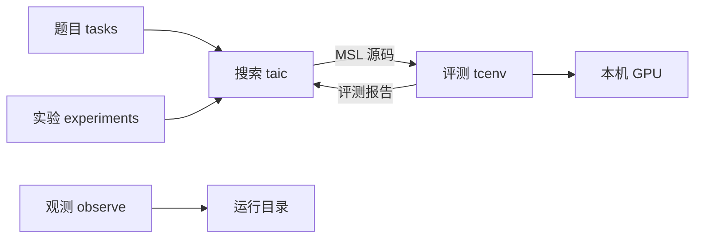
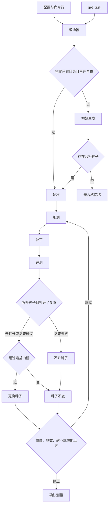

# 低层设计

Apple 图形处理器上，由语言模型生成金属着色语言内核，并由评测进程判定安全、数值与耗时的实现说明。

| 版本 | 说明 |
| --- | --- |
| 初始化版本 | 按低层设计七章记述当前实现。详细设计拆在 `docs/架构/` |

## 1. 概述

### 1.1 需求背景

本工程在本机 Apple 图形处理器（Graphics Processing Unit，GPU）上，把 Triton 规格文本写成金属着色语言（Metal Shading Language，MSL）内核，再由评测进程筛选。Triton 是一种 GPU 内核描述语言；主 Python 环境不执行它。数值对照来自中央处理器（Central Processing Unit，CPU）上的参考实现。

### 1.2 部署与职责

搜索进程、评测父进程与观测进程都在本机。GPU 与显示器共用，正在执行的 MSL 内核不能被抢占。杀死评测子进程不保证 GPU 上已提交的 dispatch 已经停止。

| 进程 | 代码 | 写入 | 读取 |
| --- | --- | --- | --- |
| 搜索进程 | `taic` | `runs/<一次搜索>/` | 题目、配置、模型接口 |
| 评测父进程 | `tcenv.evaluate` | 监督记录；收成评测报告 | 候选 MSL、题目 |
| 评测子进程 | `tcenv.worker` | 心跳、`report.json` | 候选 MSL；向 GPU 提交 |
| 观测进程 | `observe` | 加预算、重置预算、改下次两个委员会的模型、停止进程。写之前先做权限检查 | 状态、结果、账本、锁 |

一道题目包含一份编译契约，契约包含参数列表。每个缓冲区占三段：前端保护带 16384 字节、按 256 字节对齐的数据区、后端保护带 16384 字节。一次评测产生一份带版本号的评测报告。一次搜索把候选、结果和运行配置写入同一目录。

配置到达评测侧的路径：`taic.toml` 与命令行合成搜索配置和模型配置；编排器调用 `evaluate()`；父进程把源码路径交给子进程。

### 1.3 设计目标

1. 合格只表示本次安全检查与抽样差分通过。`status == ok` 与 `eligible` 同义。形式检查不参与该判定。
2. 计时只在本工程的机器级 GPU 锁下进行。第一次评测超时后不再启动 GPU 工作。
3. 搜索过程中的加速比不是对外结论。对外数值必须通过 [架构/搜索.md](架构/搜索.md) 的发布条件。
4. 续跑以转录中的计费记录和已完成候选为准，不重复已记账的请求。

### 1.4 范围与读者

本文覆盖 `tasks`、`taic`、`tcenv`、`experiments`、`observe` 的当前实现，详细设计按进程写在 `docs/架构/`。读者是实现者与测试对照人员。

本工程不是通用 MSL 编译器，也不替换 Triton。FP8 不在范围内。网格与每组线程数由题目固定，搜索不改它们。

### 1.5 实现状态

| 对象 | 状态 |
| --- | --- |
| 评测流水线、搜索循环、`tasks/__init__.py` 的 `TASK_NAMES`（12）与 `PHASE2_TASK_NAMES`（4）、实验脚本、观测页面 | 已实现 |
| `run_config.json` 版本 1、`run_seed`、评测种子派生 | 已实现。配置写失败则退出码 5，且不进入 `run()`、不发送模型请求 |
| 非空目录上的新搜索 | 已拒绝。须改用 `taic resume` 或新目录 |
| 确认值与源码 SHA-256 绑定后的发布 | 已实现。未绑定、确认失败或计时不安静时，汇总不展示确认加速比 |
| `taic run --from`、`taic resume` 与 `--dry-run` | 已实现。旧运行缺记录的设置只列出来源，不因此拒绝续跑 |
| 升种子前的第二次正确性抽查 `differential_recheck` | 已实现，默认关闭 |
| 选择规则纯函数 `taic/policy.py` | 已实现。续跑回放使用同一组函数 |
| 报告、请求、`result.json`、`state.json`、`ledger.json` 的版本边界 | 已实现。更高版本或本版本不认识的字段拒绝读取 |
| triton-msl 对照 | 可选。未安装时主路径不调用它 |
| `verify()` | 已调用，返回值恒为 `unsupported` |
| 一元 fp16 取值域扫描与 `publication_role` | 已实现。确认之后另写 `domain_report.json`。`primary` 还要求加速比不低于 1.005。真机扫描未跑 |
| `task_fingerprint` | 已写入 `run_config.json`。不替换 triton-msl 缓存用的 `spec_fingerprint` |
| 契约菜单 `experiments/contract_menu.py` | 已实现。默认搜索用题目自己的网格和线程数。gemm 与 flash_attention 可以在一次搜索之外另选一套。菜单在实验驱动里，每个子目录仍是一次搜索 |
| `gen_` 逐元素题 | 已实现。由 `tasks/generated/elementwise.toml` 的一个表达式生成，不进入默认题目列表 |
| `profile_poor`、`hw_feedback`、`plan_mix`、`diversity_archive`、`fast_bench` | 已实现，默认关闭。历史单次运行不是这些开关的效果结论 |
| `plan_ledger` | 已实现，默认开。下一轮看到每条尝试的测法结果。编译或 ABI 失败不算这条方向已经被否定。留不留种子仍由评测决定 |
| 跨次经验索引 | 已实现，默认关闭。`search.experience_index` 指向一份已经建好的 JSON 才注入规划提示。搜索不会自己扫描 `runs/`。重复性实验把该路径置空 |
| 搜索开关的对照实验结论、由代理在搜索过程中改网格 | 未实现 |

### 1.6 验收准则

`python -m tcenv.cli naive gemm` 打印该朴素内核的评测结论。`python -m taic.cli run <题目>` 结束后，新目录含有 `result.json` 与 `run_config.json`；存在合格内核时含有 `best.metal`。加速比大于 1 不是验收条件。汇总中的对外加速比只在 [架构/搜索.md](架构/搜索.md) 的发布条件成立时给出。

## 2. 总体设计

### 2.1 搜索进程与评测进程的衔接

搜索进程不向 GPU 提交内核。它把候选源码交给 `evaluate()`。评测父进程在静态筛查通过后启动子进程。子进程调用 Metal，并把评测报告写成 JSON。父进程读回该文件。搜索进程把报告渲染成文本，截断后放入下一次模型请求。

| 搜索侧 | 评测侧 | 传递物 |
| --- | --- | --- |
| `taic/orchestrator.py` 的 `_eval` | `tcenv/evaluate.py` 的 `evaluate` | MSL 原文、题目名、数据类型、规模、模式、派生种子 |
| `taic/prompts.py` | `tcenv/report.py` 的 `format_feedback` | 截断后的成绩文本 |
| `runs/<一次搜索>/` | 子进程临时目录中的 `report.json` | 完整评测报告 |

`tcenv` 与 `taic` 把进度发给 `tcenv/events.py`。没有订阅者时这次发送什么都不写。`observe` 在导入时订阅文件日志，并读取已经落盘的状态；评测和搜索不导入观测页面。观测故障不得改变评测结论：进度写入失败被忽略。

### 2.2 模块划分

下列树给出源码目录。

```text
ai_lowerling/
├── tasks/          题目
├── taic/           搜索
│   └── skills/     系统提示中的笔记
├── tcenv/          评测
├── experiments/    批量搜索
├── observe/        观测。读运行目录；写入口是预算、默认模型和下一次停止
├── tests/          假模型与假子进程
└── runs/           运行产物，不进入 git
```

下图是模块之间的数据方向。



### 2.3 数据流

一次新搜索的控制顺序如下。



## 3. 详细设计

详细设计按进程拆开。这一篇只保留分工和数据方向。

| 问题 | 文档 |
| --- | --- |
| 题目、编译契约、保护带是什么？ | [架构/题目.md](架构/题目.md) |
| 评测怎样判决，报告版本边界在哪里？ | [架构/评测.md](架构/评测.md) |
| 搜索怎样循环，什么数字可以发布，怎样续跑？ | [架构/搜索.md](架构/搜索.md) |
| 实验怎样分组，看板怎样读？ | [架构/可观测.md](架构/可观测.md) |

## 4. 验证


`tests/fake_worker_*.py` 模拟正常退出、心跳停在 `B`、以及等待锁。编排器测试使用脚本化模型与脚本化评测，不启动 GPU。`tests/test_eval_seed.py` 用 [架构/搜索.md](架构/搜索.md) 的固定向量独立复算种子，并检查分支完成次序不影响同一标签的种子。`tests/test_run_config.py` 检查版本 1 的哈希与写失败。`tests/test_publication.py` 与 `tests/test_differential_recheck.py` 检查未确认不得显示为确认值，以及复查关闭时选择轨迹不变。`tests/test_report_schema.py` 检查更高版本被拒绝。

`uv run pytest -q` 运行不要求 GPU 的测试。失败时先读 `logs/pytest/triage/triage_summary.md`。重跑单条时不加 `-n`。标为 `gpu` 的测试文件不能代替上述命令。`TCENV_ALLOW_GPU_HANG_TESTS=1` 不作为常规验收。取值域扫描、契约菜单、生成题和语义前置门的离线测试在 `tests/test_domain_sweep.py`、`tests/test_contract_menu.py`、`tests/test_generated_tasks.py`、`tests/test_elementwise_semantics.py`。

## 5. 未来演进

`verify()` 在出现可审计的 MSL 或 AIR 语义及证明范围之前保持 `unsupported`。一元 fp16 的取值域扫描已经是正确性关的一个 case，范围写在 `correctness.coverage.scope`。那不包括线程是否互相独立、下标和边界、并发，以及其他启动配置，所以不是整个内核的形式证明，也不改 `eligible`。bf16 和二元题本轮不扫。

默认搜索用题目自己的网格和线程数，搜索过程中不改它们。gemm 与 flash_attention 可以在一次搜索之外另选一套：题目名写成 `任务@变体`，或交给 `experiments/contract_menu.py`。菜单的每个子目录仍是一次普通搜索。`experiments/contract_sensitivity.py` 的 `static_screen_contracts` 可在进模型之前丢掉每组 SIMD 上 32 个及以上累加器片段、或线程组声明超过 32768 字节的契约。跨运行经验索引默认关闭，见 §1.5。`--from` 只在调用者给出目录时使用，不进入重复性实验的默认初稿。

`profile_poor`、`hw_feedback`、`plan_mix` 保持关闭，直到单独的对照实验给出确认加速比或单位美元收益，且安全与正确性不下降。历史目录的预算、模型、契约和是否续跑并不相同，不能当作该对照。

## 6. 依赖

| 依赖 | 用途 | 缺失时 |
| --- | --- | --- |
| Python 3.12 及以上，由 uv 安装 | 搜索与评测 | 主路径不可运行 |
| MLX、PyTorch、PyObjC Metal | 基线与 GPU | 评测不可运行 |
| OpenAI 兼容对话接口 | 模型请求 | 仅评测命令仍可运行 |
| Metal 工具链与 `.venvs/triton-msl` | 可选对照 | 主路径不调用 |
| `xctrace` | 可选录制 | 默认搜索不调用 |

## 7. 附件

### 7.1 术语

| 术语 | 展开或英文 | 解释 | 章节 |
| --- | --- | --- | --- |
| 图形处理器 | Graphics Processing Unit，GPU | 本机 Apple GPU，与显示器共用 | §1 |
| 中央处理器 | Central Processing Unit，CPU | 参考与差分所在的处理器 | §1 |
| 金属着色语言 | Metal Shading Language，MSL | 候选内核的源语言 | §1 |
| Triton | Triton | 规格文本。主环境不执行 | §1 |
| 评测报告 | `EvalReport` | 一次 `evaluate` 的判决 | [评测](架构/评测.md) |
| 编译契约 | `Contract` | 内核名、网格、线程数与参数 | [题目](架构/题目.md) |
| 运行种子 | `run_seed` | 一次搜索的 64 位种子。各次评测由此派生 | [评测](架构/评测.md) |
| 加速比 | speedup | 最快库基线耗时除以候选耗时 | [评测](架构/评测.md) |
| 确认测量 | confirmation | 结束后的复测。对外值还须满足发布条件 | [搜索](架构/搜索.md) |
| 性能上界 | roofline | 实测峰值与题目运算量、字节量给出的时间下界 | [评测](架构/评测.md) |
| 变异系数 | coefficient of variation | 重复计时的离散程度。超过 0.05 为不安静 | [评测](架构/评测.md) |
| 保护带 | guard band | 缓冲区两端各 16384 字节 | [题目](架构/题目.md) |
| 着色器校验 | `MTL_SHADER_VALIDATION` | Metal 对非法访问与同步的检查 | [评测](架构/评测.md) |
| triton-msl | triton-msl | 可选编译器，位于独立虚拟环境 | [评测](架构/评测.md) |
| 前缀缓存 | prompt cache | 相同系统提示按命中价计费 | [搜索](架构/搜索.md) |

### 7.2 常量

| 常量 | 值 |
| --- | --- |
| 保护带 | 16384 字节 |
| 输入哨兵与输出毒化 | 字节 `0xFF` |
| 输出边距 | 字节 `0xCD` |
| 单次启动时限 | 2 秒；着色器校验时 4 秒 |
| `validate` / `full` / `quick` | 120 / 420 / 240 秒 |
| 杀死子进程后的等待 | 3 秒 |
| 不安静变异系数 | 0.05 |
| 计时重测次数 | 3 |
| 反馈截断 | 约 6000 字符。数字头在 STATUS 之后，截断砍后面的散文 |
| 线程组静态内存上限 | 32768 字节 |
| 初始对话重开 | 2 |
| 基线明显快于下界 | 耗时 < 下界 × 0.95 |
| 评测种子 | SHA-256 前 6 字节，大端 |
| 评测请求版本 | 2。版本 1 的请求仍可读取 |
| 报告、结果、状态、账本版本 | 1 |
| 固定评测种子向量 | 见 [架构/搜索.md](架构/搜索.md) |

### 7.3 命令

`python -m tcenv.cli` 的子命令：`tasks`、`show`、`naive`、`eval`（`--quick` 为快速模式）、`baseline`、`calibrate`、`profile`、`triton-baseline`。

`python -m taic.cli run <题目>` 的常用参数：`--dtype`、`--size`、`--budget`、`--preset paper|base`、`--from <目录>`、`--seed`、`--model`、`--branches`、`--max-rounds`、`--no-tools`、`--profile-best`，以及 [架构/搜索.md](架构/搜索.md) 各开关的 `--开关` 与 `--no-开关`。启动失败的退出码为 5。搜索结束且没有合格内核时退出码为 2。

`python -m taic.cli resume <目录>` 支持 `--dry-run`、`--add-budget`、`--budget`、`--lift-count-limits`。退出码：不能续为 3，锁冲突为 4，设置或预算错误为 5。

```bash
uv run python -m experiments.run_suite --tasks all --dtypes fp16,bf16
uv run python -m experiments.repeatability --tasks conv2d,gemm,swiglu --trials 5
uv run python -m experiments.semantic_tests --n-random 10
uv run pytest -q
```

`run_suite`、`repeatability` 与 `p1_runs` 的默认单次预算为 15 美元。`repeatability` 中 SwiGLU 为 1 美元。三者接受 `--budget`、`--preset` 与可选的 `--max-total-usd`。`experiments/search_ab.py` 没有 `--max-total-usd`，也不会跳过已有目录。`run_suite` 在已有 `result.json` 时跳过该题。`repeatability` 不使用 `--from`。按默认预算全部花满时，`run_suite` 的 24 次为 360 美元，`repeatability` 为 155 美元（含 `flash_attention` 时为 230 美元），`p1_runs` 为 165 美元。`semantic_tests` 每次 0.15 美元。早于该预算的历史目录与现行结果不可直接比较。
