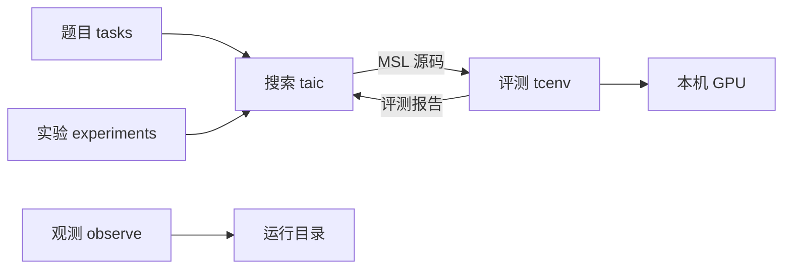
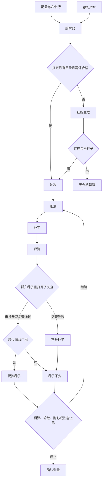
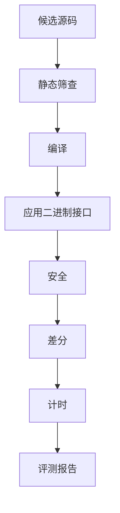
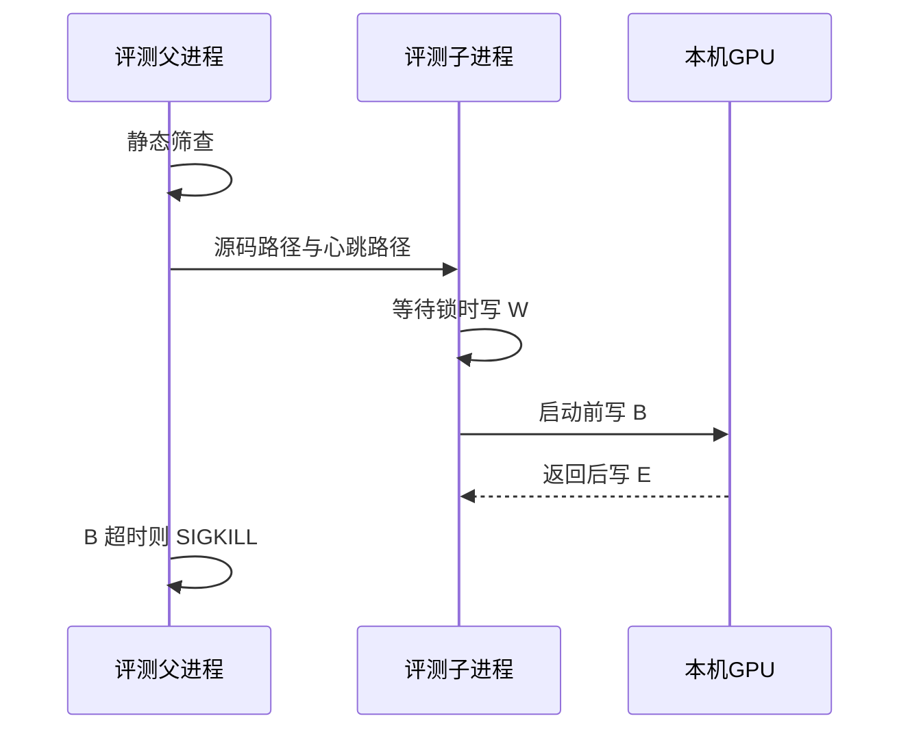
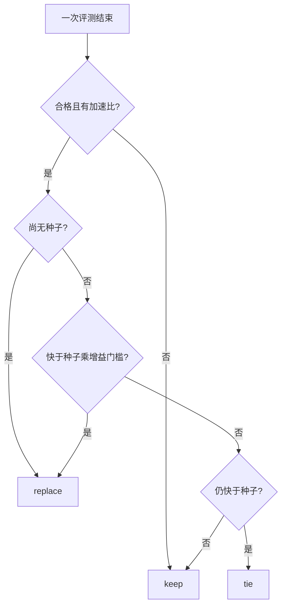
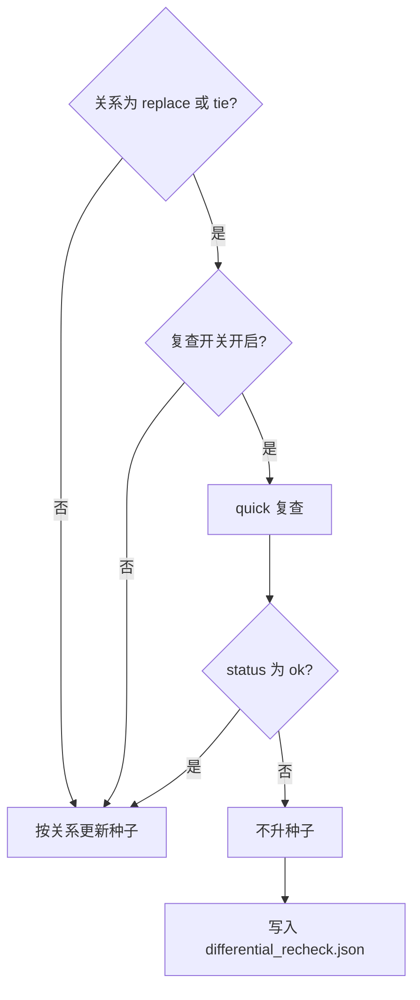
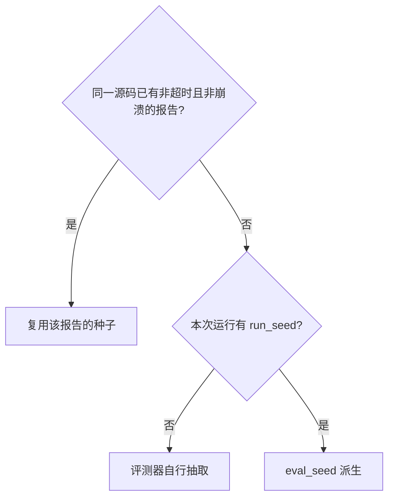

# 低层设计

Apple 图形处理器上，由语言模型生成金属着色语言内核，并由评测进程判定安全、数值与耗时的实现说明。

| 版本 | 说明 |
| --- | --- |
| 初始化版本 | 按低层设计七章记述当前实现 |

## 1. 概述

### 1.1 需求背景

本工程在本机 Apple 图形处理器（Graphics Processing Unit，GPU）上，把 Triton 规格文本写成金属着色语言（Metal Shading Language，MSL）内核，再由评测进程筛选。Triton 是一种 GPU 内核描述语言；主 Python 环境不执行它。数值对照来自中央处理器（Central Processing Unit，CPU）上的参考实现。

### 1.2 部署与职责

搜索进程、评测父进程与观测进程都在本机。GPU 与显示器共用，正在执行的 MSL 内核不能被抢占。杀死评测子进程不保证 GPU 上已提交的 dispatch 已经停止。

| 进程 | 代码 | 写入 | 读取 |
| --- | --- | --- | --- |
| 搜索进程 | `taic` | `runs/<一次搜索>/` | 题目、配置、模型接口 |
| 评测父进程 | `tcenv.evaluate` | 监督记录；收成评测报告 | 候选 MSL、题目 |
| 评测子进程 | `tcenv.worker` | 心跳、`report.json` | 候选 MSL；向 GPU 提交 |
| 观测进程 | `observe` | 加预算、重置预算、改下次默认模型、停止进程。写之前先做权限检查 | 状态、结果、账本、锁 |

一道题目包含一份编译契约，契约包含参数列表。每个缓冲区占三段：前端保护带 16384 字节、按 256 字节对齐的数据区、后端保护带 16384 字节。一次评测产生一份带版本号的评测报告。一次搜索把候选、结果和运行配置写入同一目录。

配置到达评测侧的路径：`taic.toml` 与命令行合成搜索配置和模型配置；编排器调用 `evaluate()`；父进程把源码路径交给子进程。

### 1.3 设计目标

1. 合格只表示本次安全检查与抽样差分通过。`status == ok` 与 `eligible` 同义。形式检查不参与该判定。
2. 计时只在本工程的机器级 GPU 锁下进行。第一次评测超时后不再启动 GPU 工作。
3. 搜索过程中的加速比不是对外结论。对外数值必须通过 §3.9 的发布条件。
4. 续跑以转录中的计费记录和已完成候选为准，不重复已记账的请求。

### 1.4 范围与读者

本文覆盖 `tasks`、`taic`、`tcenv`、`experiments`、`observe` 的当前实现。读者是实现者与测试对照人员。

本工程不是通用 MSL 编译器，也不替换 Triton。FP8 不在范围内。网格与每组线程数由题目固定，搜索不改它们。

### 1.5 实现状态

| 对象 | 状态 |
| --- | --- |
| 评测流水线、搜索循环、`tasks/__init__.py` 的 `TASK_NAMES`（12）与 `PHASE2_TASK_NAMES`（4）、实验脚本、观测页面 | 已实现 |
| `run_config.json` 版本 1、`run_seed`、评测种子派生 | 已实现。配置写失败则退出码 5，且不进入 `run()`、不发送模型请求 |
| 非空目录上的新搜索 | 已拒绝。须改用 `taic resume` 或新目录 |
| 确认值与源码 SHA-256 绑定后的发布 | 已实现。未绑定、确认失败或计时不安静时，汇总不展示确认加速比 |
| `taic run --from`、`taic resume` 与 `--dry-run` | 已实现。旧运行缺记录的设置只列出来源，不因此拒绝续跑 |
| 升种子前的第二次正确性抽查 `differential_recheck` | 已实现，默认关闭 |
| 选择规则纯函数 `taic/policy.py` | 已实现。续跑回放使用同一组函数 |
| 报告、请求、`result.json`、`state.json`、`ledger.json` 的版本边界 | 已实现。更高版本或本版本不认识的字段拒绝读取 |
| triton-msl 对照 | 可选。未安装时主路径不调用它 |
| `verify()` | 已调用，返回值恒为 `unsupported` |
| 一元 fp16 取值域扫描与 `publication_role` | 已实现。确认之后另写 `domain_report.json`。`primary` 还要求加速比不低于 1.005。真机扫描未跑 |
| `task_fingerprint` | 已写入 `run_config.json`。不替换 triton-msl 缓存用的 `spec_fingerprint` |
| 契约菜单 `experiments/contract_menu.py` | 已实现。默认搜索用题目自己的网格和线程数。gemm 与 flash_attention 可以在一次搜索之外另选一套。菜单在实验驱动里，每个子目录仍是一次搜索 |
| `gen_` 逐元素题 | 已实现。由 `tasks/generated/elementwise.toml` 的一个表达式生成，不进入默认题目列表 |
| `profile_poor`、`hw_feedback`、`plan_mix` | 已实现，默认关闭。历史单次运行不是这些开关的效果结论 |
| 搜索开关的对照实验结论、由代理改网格、跨次经验索引 | 未实现 |

### 1.6 验收准则

`python -m tcenv.cli naive gemm` 打印该朴素内核的评测结论。`python -m taic.cli run <题目>` 结束后，新目录含有 `result.json` 与 `run_config.json`；存在合格内核时含有 `best.metal`。加速比大于 1 不是验收条件。汇总中的对外加速比只在 §3.9 的发布条件成立时给出。

## 2. 总体设计

### 2.1 搜索进程与评测进程的衔接

搜索进程不向 GPU 提交内核。它把候选源码交给 `evaluate()`。评测父进程在静态筛查通过后启动子进程。子进程调用 Metal，并把评测报告写成 JSON。父进程读回该文件。搜索进程把报告渲染成文本，截断后放入下一次模型请求。

| 搜索侧 | 评测侧 | 传递物 |
| --- | --- | --- |
| `taic/orchestrator.py` 的 `_eval` | `tcenv/evaluate.py` 的 `evaluate` | MSL 原文、题目名、数据类型、规模、模式、派生种子 |
| `taic/prompts.py` | `tcenv/report.py` 的 `format_feedback` | 截断后的成绩文本 |
| `runs/<一次搜索>/` | 子进程临时目录中的 `report.json` | 完整评测报告 |

`tcenv` 与 `taic` 把进度发给 `tcenv/events.py`。没有订阅者时这次发送什么都不写。`observe` 在导入时订阅文件日志，并读取已经落盘的状态；评测和搜索不导入观测页面。观测故障不得改变评测结论：进度写入失败被忽略。

### 2.2 模块划分

下列树给出源码目录。

```text
ai_lowerling/
├── tasks/          题目
├── taic/           搜索
│   └── skills/     系统提示中的笔记
├── tcenv/          评测
├── experiments/    批量搜索
├── observe/        观测。读运行目录；写入口是预算、默认模型和下一次停止
├── tests/          假模型与假子进程
└── runs/           运行产物，不进入 git
```

下图是模块之间的数据方向。



### 2.3 数据流

一次新搜索的控制顺序如下。



## 3. 详细设计

### 3.1 题目

题目由 `tasks/<名称>/task.py` 的 `build(dtype, size)` 填入 `tcenv.task.Task`。搜索与评测通过 `tasks.get_task(name, dtype, size)` 取得它。`dtype` 为 `fp16` 或 `bf16`。`size` 为 `paper`、`small` 或 `plan`。`plan` 只在论文规模与实现所用规模不一致的题目上定义，当前为 `reduction_sum`。名称在 `@` 之后带有另一组 tile 与线程数时，走该题的 `build_variant`。

`Task` 的字段如下。

| 字段 | 写入者 | 约束 |
| --- | --- | --- |
| `contract` | 题目 | 见下文 `Contract` |
| `triton_source` | 题目 | 给模型的规格文本。主环境不执行。其 SHA-256 写入运行配置 |
| `reference` | 题目 | CPU 参考。不进入运行配置的哈希范围 |
| `baselines` | 题目 | MLX 与 PyTorch 的 Metal Performance Shaders 路径，以及可融合的编译版。不进入运行配置的哈希范围 |
| `gen_inputs` | 题目 | 按用例名与种子生成输入 |
| `naive_msl` | 题目 | 已知数值正确的慢内核 |
| `rtol` / `atol_rel` | 通常为 `default_tolerances` | FP16 为 2e-3 / 1e-3；BF16 为 1.6e-2 / 8e-3 |
| `flops` / `min_bytes` | 题目 | 性能上界使用。这是指定算法的估计，不是硬件极限 |
| `cases` | 题目 | 差分用例名 |
| `exact` | 题目 | 为真时整数结果逐位比较 |

编译契约 `Contract`（`tcenv/contract.py`）固定内核名、线程组网格、每组线程数和编译期常量。模型不得改写。`assemble` 把标准头与常量拼在候选源码之前。头已包含 `<metal_stdlib>`、`<metal_simdgroup>`、`<metal_simdgroup_matrix>`。`contract.describe()` 的 SHA-256 写入运行配置。

| 字段 | 约束 |
| --- | --- |
| `kernel_name` | 候选必须使用该名 |
| `grid` | 三元整数组。由评测程序发射 |
| `threads` | 每个线程组的线程数，三元整数组 |
| `args` | `AbiArg` 序列 |
| `constants` | `(名称, MSL 类型, 值)`，渲染为 `constant constexpr` |
| `gpu` | 目标说明。当前为 Apple M4 Max 所在的 Apple9 GPU 族 |

参数记录 `AbiArg` 不含网格与线程数。

| 字段 | 约束 |
| --- | --- |
| `name` | 须与编译反射一致 |
| `index` | `[[buffer(n)]]` 槽位 |
| `role` | `input` 为只读 `device const`；`output` 为可写 `device`；`scalar` 为 `constant` 引用 |
| `dtype` | `tcenv.dtypes` 的类型键 |
| `shape` | 缓冲区形状。标量无形状 |
| `value` | 仅标量 |

`tcenv/abi.py` 允许指针元素类型放宽，例如以 `half4*` 读取 `half` 缓冲区。槽位、名称和读写模式不得放宽。

题目与计算的对应如下。前四项共用 `tasks/_elementwise.py`。`sem_*` 定义在 `tasks/semantic.py`。`list_tasks()` 默认不含第二阶段。

| 目录 | 计算 |
| --- | --- |
| `sigmoid` | 映射到 (0, 1) |
| `relu` | 负数置 0 |
| `silu` | 负支平滑 |
| `swiglu` | 两路相乘 |
| `rmsnorm` | 按均方根缩放一行 |
| `softmax` | 归一化为和为 1 的正数 |
| `reduction_sum` | 求和 |
| `rope` | 按位置旋转 |
| `gemv` | 矩阵乘向量 |
| `gemm` | 矩阵乘矩阵 |
| `gemm_silu` | 矩阵乘后接 silu |
| `conv2d` | 滑动窗口乘加 |
| `flash_attention` | 第二阶段。注意力 |
| `lion` | 第二阶段。参数更新一步 |
| `bitdelta_gemm` | 第二阶段。比特权重上的矩阵乘 |
| `mamba2_chunk_scan` | 第二阶段。分块扫描。对照须包含该题最强的编译基线 |

`sem_relu_gelu_comment` 的标题与注释写 GELU，函数名为 `relu_kernel`，代码在 `x > 0` 时保留原值，否则写 0。NaN 不大于 0，所以写成 0。标准答案和朴素核都按这句比较。`torch.relu` 会留下 NaN，不是这道题的答案。

### 3.2 评测报告与文件版本

评测报告 `EvalReport` 是子进程交回父进程的判决。版本边界避免旧进程删掉不认识的字段后仍构造对象，从而把新报告读成另一份结论。`eligible` 等于 `status == ok`。写出的 JSON 含 `schema_version`。没有该键的历史文件按版本 0 读取。版本高于本进程，或出现本版本未列出的字段时，读入拒绝，并说明需要人工检查。禁止删掉未知字段后再构造对象。请求文档使用同一规则，当前请求版本与报告版本均为 1，定义在 `tcenv/schema.py`。`result.json`、`state.json`、`ledger.json` 的版本均为 1，由 `taic/artifacts.py` 读取。文件存在但损坏，或版本不可读时，抛出 `NeedsInspection`。缺失文件表示该产物尚未写出；损坏文件不得被批量脚本当成「尚未运行」而覆盖重跑。`transcript.jsonl` 是已记账请求的追加记录。检查点可以加速恢复，不得改写转录，否则续跑会把没记账的请求再发送一次，或丢掉已经花过的记录。

| 字段 | 约束 |
| --- | --- |
| `task` / `dtype` / `size` / `mode` | 与本次 `evaluate` 一致 |
| `status` | 下表之一 |
| `stage` | 最后到达的关卡 |
| `message` | 首条失败说明 |
| `seed` | 本次评测实际使用的输入种子 |
| `compile` / `abi` / `safety` / `correctness` | 各关明细 |
| `benchmark` | 计时与变异系数。逐次样本不在第一期报告中保存 |
| `roofline` / `pipeline` | 性能上界与管线反射 |
| `speedup` | 最快基线耗时除以候选耗时 |
| `speedups` / `candidate_us` / `baseline_us` | 各基线的倍数与微秒 |
| `compiler_baseline` | 可选。由缓存比值估算，不是与候选同一次头对头计时 |
| `verification` | `verify()` 的结果。当前恒为 `unsupported`，且没有 `counterexample` 装差分反例 |
| `correctness.coverage` | 证据范围。取值域扫描通过时 `kind` 为 `domain_sweep`，并带 `scope`、工具链和源码哈希。没有这份记录时按抽样读 |
| `elapsed_s` | 本段墙钟秒数 |

| `status` | 条件 |
| --- | --- |
| `ok` | 该模式要求的关卡均通过 |
| `rejected` | 静态筛查在编译前拒绝 |
| `compile_error` | Metal 编译器拒绝 |
| `abi_error` | 已编译，签名或启动规模不符 |
| `unsafe` | 保护带、输入不变性、确定性或着色器校验失败 |
| `incorrect` | 超出容差，或输出仍含未写入的毒化图案 |
| `runtime_error` | GPU 在正确性或计时阶段报错 |
| `timeout` | 父进程已发送 `SIGKILL` |
| `crash` | 子进程未留下报告 |

候选 `Candidate` 保存源码、评测前已经确定的标签、方案名和报告。标签示例为 `init`、`init.s2`、`prior`、`r2.p1.fix1`。`Candidate.idx` 在评测之后才分配，不参与种子派生。

运行结果写入 `result.json`。`confirmed_speedup` 是确认测量值。`best_speedup` 是搜索入选时的测量值。`confirmation_source_sha256` 是确认胜者源码的 SHA-256；确认未绑定源码时为 `null`。旧文件若没有该键，发布结论为「旧版未绑定源码」。`search_seed_label` 与 `confirm_winner_label` 可以不同：确认测量可以改选噪声范围内的另一候选。

一次搜索目录中的文件如下。

| 路径 | 写入者 | 内容 |
| --- | --- | --- |
| `best.metal` | 结束时 | 当时种子的源码 |
| `result.json` | 编排器 | 版本 1 的运行结果 |
| `candidates/<序号>_<标签>/` | 每次评测 | `kernel.metal`、`report.json`、`feedback.txt`；复查失败时另有 `differential_recheck.json` |
| `transcript.jsonl` | 模型客户端 | 已记账对话。密钥已打码 |
| `ledger.json` | 账本 | 版本 1。缓存命中与未命中分开 |
| `state.json` | 编排器 | 版本 1 的阶段。写失败不停止搜索 |
| `run_config.json` | 启动时 | 见下表 |
| `confirm_report.json` | 确认测量 | 胜者的完整评测报告 |
| `control.json` | 观测或操作者 | 只升不降的预算、`max_rounds`、`patience` |
| `budget_events.json` | 账本 | 预算变更。落盘失败的一行被丢弃，该文件不是完整账单 |
| `eval_progress.json` | 评测 | 当前关卡 |

`run_config.json` 版本 1 的字段如下。不含 API 密钥与端点。

| 字段 | 约束 |
| --- | --- |
| `schema_version` | 整数 1 |
| `run_seed` | 无符号 64 位。新运行由 `secrets.randbits(64)` 生成，或由 `--seed` 指定。`0 <= seed < 2**64` |
| `contract_description_sha256` | `sha256(contract.describe().encode("utf-8"))` |
| `triton_source_sha256` | `sha256(task.triton_source.encode("utf-8"))` |
| `hash_scope` | 声明上述两个哈希不含参考实现与基线实现 |
| `git_commit` / `git_dirty` | 启动时的 git 状态。采集失败时提交为 `unknown`，脏标记为空 |
| `llm` / `search` | 启动时已经叠好预设与命令行之后的值 |
| `committees` | 恰好 first 与 second。每名记录 provider 与 model，不含密钥与端点 |
| `system_prompt_sha1` | 本次系统提示的 SHA-1 |
| `cost_may_be_incomplete` | 恒为真。见字段旁的 `cost_note` |

新运行若指向已有非空目录，启动拒绝。续跑（`resuming=True`）才读取既有目录，且不重写 `run_config.json`、不重新抽取 `run_seed`。没有 `run_seed` 的旧运行，评测种子保持由评测器随机抽取，不得事后写成可重放。配置文件写入失败时抛出 `RunStartError`。命令行以此退出码 5 结束。此时尚未发送模型请求，也不写看似成功的 `state.json` 或 `result.json`。本次新建的空目录可以留下，不得删除已有运行目录。

### 3.3 评测流水线

关卡按编译、接口、安全、数值、计时排列，前一关失败则不再占用 GPU。这样一份不能编译或数值不合格的源码不会进入计时，也不会因为“更快”被留下。

`evaluate(task, dtype, size, kernel_source, mode, seed)` 按关卡顺序执行。传入的 `seed` 为整数时使用该种子；为空时由评测器抽取。`full` 先做着色器校验，是因为保护带发现不了页内松弛里的小越界；校验通过后才花费完整差分和计时。

| 模式 | 调用者 | 范围 |
| --- | --- | --- |
| `quick` | `eval --quick`、`quick_check`、复查 | 静态筛查、编译、应用二进制接口、安全、差分。无着色器校验，无计时 |
| `full` | `naive`、`eval` 默认、正式候选与确认 | 先运行 `validate` 子进程，通过后再运行完整子进程 |
| `validate` | 仅作为 `full` 的第一段 | 紧缓冲、一个用例、打开着色器校验 |

关卡顺序如下。



| 关卡 | 文件 | 失败条件 |
| --- | --- | --- |
| 静态筛查 | `screen.py` | 去掉注释后的 `while (true)`、无条件 `for (;;)`，或非 `<metal_...>` 的 `#include` |
| 编译 | `contract.py`、`metal_runtime.py` | `newLibraryWithSource` 失败。行号减去契约头 |
| 应用二进制接口 | `abi.py` | 槽位、名称、读写或线程规模不符 |
| 安全 | `sanitize.py` | 保护带、输入、确定性 |
| 差分 | `testing.py`、`distributions.py` | 缩放误差超过允许值 |
| 计时 | `bench.py`、`baselines.py`、`profile.py` | GPU 报错。慢本身不使 `status` 离开 `ok` |

差分判据把 GPU 上的粗精度结果和 CPU 参考分开：允许误差覆盖舍入，而不是要求逐位相同。库基线自己更差时把允许值放宽到其误差的 2 倍且不超过 8，避免一个算歪的库把测试放成怎样都算对。

```text
|out - ref| <= rtol * |ref| + atol_rel * scale
```

`scale` 默认是参考输出的均方根。最准库基线的缩放误差大于 1 时，允许值升到该误差的 2 倍，且不超过 8。

下表的用例各自压一种常见算错。只在一种用例上失败时，模型可以按该分布改，而不必重写整个内核。

| 用例 | 输入 |
| --- | --- |
| `normal` | 普通幅度 |
| `wide_range` | 跨数量级 |
| `large` | 接近溢出 |
| `tiny` | 接近下溢。FP16 含次正规数。BF16 与 FP32 停在最小正规数之上 |
| `outlier` | 约千分之一的尖峰 |
| `cancel` | 大数成对抵消 |
| `const` | 常数 |
| `ieee` | NaN、正无穷、负无穷、负零。位置与符号须与参考一致 |

数值通过后再启动两次，用来抓住“结果碰巧对上、但内核读了输出区旧值或有数据竞争”的情况。第二次输出区填 0，结果须与毒化初值那次逐位相同。第三次再启动一次，结果仍须逐位相同。

### 3.4 保护带缓冲区

保护带解决两类静默错误：写出界，以及该写的输出格子没写。只看返回值发现不了这两件事。

`GuardedBuffer` 把逻辑缓冲区放在更大分配的中部。保护带长度 16384 字节。数据区长度向上取整到 256 字节，填充字节同样写入哨兵。

```text
输入: | 16384B 0xFF | 输入数据 | 16384B 0xFF |
输出: | 16384B 0xCD | 启动前为 0xFF 的输出区 | 16384B 0xCD |
```

输入边距 `0xFF` 在浮点下为 NaN。输出边距 `0xCD` 用于发现越界写。输出数据区的 `0xFF` 用于发现漏写。启动后输入区必须逐位不变。`validate` 置 `tight=True`，无保护带，以便着色器校验看见真实越界。父进程读取该子进程的标准错误。两套检查都通过，安全关卡才通过。

### 3.5 评测子进程与心跳

GPU 上的内核不返回时，同一块芯片上的画面也会停，而且无法从核内抢占。子进程把单次启动关在可杀死的进程里；父进程按心跳限时，避免一次挂起拖住整次搜索。等待锁写成 `W` 且不计入总超时，避免别人占着 GPU 时把本次评测误判为挂起。

父进程先做静态筛查，然后启动 `python -m tcenv.worker`。子进程在 GPU 启动前写心跳 `B`，结束后写 `E`，等待机器锁时写 `W`。



| 条件 | 时限 |
| --- | --- |
| 单次启动且心跳为 `B` | 2 秒 |
| 着色器校验下的单次启动 | 4 秒 |
| `validate` / `full` / `quick` 整段 | 120 / 420 / 240 秒 |
| 发送 `SIGKILL` 之后 | 再等待 3 秒 |

`max_hangs` 默认为 1。真实挂死测试需要 `TCENV_ALLOW_GPU_HANG_TESTS=1`。监督由 `tests/fake_worker_*.py` 覆盖。

### 3.6 机器级图形处理器锁与计时

两份程序同时用 GPU 时，测得时间会偏慢，一次嘈杂测量还曾把更好的内核挤掉。独占锁让计时段不与本工程的其他 GPU 工作重叠；不计时的编译和差分用共享锁，因此不同实验仍可同时做这些工作。本工程以外的进程不受这把锁约束。

锁文件默认为 `~/.cache/ai_lowerling/gpu.lock`，可由 `TCENV_GPU_LOCK_FILE` 覆盖。实现为 `flock`。进程退出后由操作系统释放。同一次搜索内，评测、快速检查与 Instruments 还共用一把异步锁。

| 持有者 | 模式 |
| --- | --- |
| 候选计时、库基线、triton-msl、峰值标定、Instruments | 独占 |
| 编译、差分、着色器校验 | 共享 |

加速比使用墙钟中位数，不用 GPU 设备时间戳。三方必须用同一把钟：MLX 与 PyTorch 没有和候选相同的 `GPUStartTime` / `GPUEndTime`。只把候选改成设备时间，库基线仍用墙钟，候选会少掉排队和完成通知，比值偏大。设备时间戳仍写入 `RunTiming.gpu_s`，供对照，不进入 `speedup`。

一次样本是一批 `k` 次启动的墙钟除以 `k`。`k` 选得使这一批大约 15 毫秒，把单次提交和等待的固定开销摊开。预热的一批丢弃。正式重复默认 15 次，再丢弃最前 2 次，对其余取中位数。候选与各基线在每一轮里打乱顺序交错测量，升温和后台负载同时作用在两边。缓冲区轮换多组，避免小数据一直命中缓存。

下表是加速比所用墙钟的起点和终点。编码发射命令在候选的计时开始之前。

| 对象 | 起点 | 终点 | 窗口内 | 窗口外 |
| --- | --- | --- | --- | --- |
| 候选 MSL | `commit` 之前的 `perf_counter` | `waitUntilCompleted` 返回之后 | 提交、GPU 上这 `k` 次发射、等到命令缓冲完成 | 填写命令缓冲；管线创建在预热中丢弃 |
| MLX | `mx.eval` 之前 | `mx.eval` 返回 | 已建好的图的编码与 GPU 执行 | 建图 |
| PyTorch-MPS | `k` 次调用的 Python 循环之前 | `torch.mps.synchronize` 返回 | Python 循环、每次启动、同步 | 更早的输入搬运 |

候选的设备时间戳是同一份命令缓冲的 `GPUEndTime - GPUStartTime`，也是整批再除以 `k`。并发发射时这 `k` 次可以重叠，除以 `k` 是这一批跨度的平均，不是各次发射时长的加总。若每次发射单独一个命令缓冲，或在每次发射前后插计数器采样，调度就和现在这套、也和 MLX 的一批求值不同，加速比不再沿用本协议。

抖动仍然存在。安静时重复之间的变异系数约为 0.5% 到 1.5%；仓库外的程序占用 GPU 时可以到百分之十几，测得时间整体偏慢。交错、中位数、变异系数超过 0.05 时最多重测 3 次、以及换种子的噪声门槛，用来避免一次嘈杂样本直接换种子。三次都不安静时仍保留最安静的一次，并设 `benchmark.noisy`。确认值若被 `timing_is_uncertain` 判为不安静，发布标记为「不确定」。这样一次被打扰的计时不会直接成为换种子的依据。候选计时与 MLX 一样允许并发发射，避免候选因为发射方式比库基线慢一截；`candidate_serial` 另记串行时间，供核对这截差距。

性能上界给出“慢在搬数据还是慢在计算，以及离该算法的估计下界还有多远”，供下一轮改动对准短板。它不是物理最优：基线耗时小于下界的 0.95 倍时，只说明当前下界假设不成立。峰值缓存在 `runs/calibration.json`。`bound` 为 `memory` 或 `compute`，只取决于题目与标定，不随候选源码改变。

加速比的相对标准误把两次计时的变异系数合成一个门槛，使落在噪声里的略快不能换种子。公式在 `tcenv/bench.py` 的 `approximate_speedup_se`，搜索侧经 `speedup_se_of_report` 使用同一式。该数是近似，不是有保证的置信区间。`timing_is_uncertain` 在 `benchmark.noisy` 为真，或候选或最强基线的变异系数高于安静阈值时为真；为真时对外不把该次确认值标成确定结论。

`triton_runner.py` 在 `.venvs/triton-msl` 中编译规格文本。主环境不导入 Triton。`compiler_baseline` 用缓存比值乘以本次库时间，是估计值。

### 3.7 搜索循环

搜索把模型限制在“改一版、看成绩、再决定留不留”。模型看不到 GPU，成绩单是它的观察；多份方案并行是为了同一轮试不同改法，而不是把同一种微调重复交三次。评测串行是为了计时不被另一份候选干扰。分支完成的先后会改变搜索轨迹；最终比较以确认测量为准。

编排器调用 `taic/policy.py` 中的纯函数决定替换、并列、确认池和耐心计数。续跑回放使用同一组函数，避免恢复路径和在线路径各写一套取舍。模型请求可以并行。

每次搜索恰好两个委员会，名为 first 与 second，各有一名成员。一名成员是一个 provider 加一个 model。成员人数不是 1，或名字不属于这两个，在读取凭据和调用模型之前拒绝；较长的名单不会被收成第一名。不写 `--model` 时，名单还要正好各有一个 first 和一个 second，同名重复、多一个或少一个也在调用模型之前拒绝。默认两名都是 deepseek 的 deepseek-flash。`--model` 在人数和名字这两项检查通过后，把该模型设到两个委员会上。配置里没有 `committees` 键时，两个委员会都复制当时的模型配置。两个不同的模型是 `taic.toml` 里两行 `model`。初始稿与第 1 轮绑定 first。第 r 轮（r 从 1 计）绑定下标 `(r - 1) % 2`（0 为 first，1 为 second）。两个委员会共用一份账本、一份 `transcript.jsonl` 和一份预算。连接失败在 `taic/llm.py` 内重试，不因此换委员会。

初始生成先得到一份能当种子的内核。一颗候选的修补把编译和数值错误喂回开出它的那条对话，委员会保持为开出它的那一个，这条修补不写交接句。`init_samples` 默认为 1。修补最多 `max_repair_tries` 次，默认 3。初始对话最多重开 2 次。仍无合格内核时，`stop_reason` 为 `no_valid_initial_kernel`。

每轮 `_plan` 产生 `branches` 份方案，默认 3。规划失败或 JSON 无法解析时使用三份固定方案，使这一轮补丁仍能发出：16 字节向量访问、单遍全局内存配合 SIMD 归约、矩阵乘使用 `simdgroup_matrix`。一个分支的模型错误只跳过该分支，避免一次接口失败废掉其余改法。历史保留最近 24 条。每一轮的规划和每一路补丁都是新的用户消息：当前核与评测反馈。规划另含这 24 条，用来避开已经失败的假设。补丁另含这一份方案，不含这 24 条。两条消息都不含上一轮的助手回复。第 2 轮起，两条消息开头都有交接句，两名成员的模型相同时也写。交接句点明委员会，并写明上一轮对话不在这次请求里。初始稿和第 1 轮没有交接句。第 1 轮也不含初始稿的助手回复。

停止条件把钱和轮数花在仍可能改进的搜索上：超时次数达到 `max_hangs`；子进程连续崩溃 3 次；连续 `patience` 轮没有新种子；达到 `max_rounds`；下一次请求将超过预算。`stop_at_roofline` 默认开启：种子相对下界的倍数已不大于增益门槛，计时不属不安静，且没有基线快于该下界时，同一算法上再改也过不了噪声门，`stop_reason` 为 `at_roofline`。可用 `--no-stop-at-roofline` 关闭。

### 3.8 系统提示与工具

记在运行里的系统提示整次搜索不变，初始、修补和补丁请求都用它，供前缀缓存。规划请求在种子报告的 `roofline.bound` 为 `memory` 或 `compute` 时拿掉这两节优化章节，只在用户消息里附上对应的一节；没有该字段时规划请求也用原文。笔记把“这台机器上怎样写才快”和“成绩单字段表示什么”放进系统提示，模型不必凭空解释计时。

笔记进入提示的条件如下。

| 文件 | 条件 |
| --- | --- |
| `skills/apple_gpu_optimization.md` | 始终写入系统提示；规划且 `roofline.bound` 已知时只留对应的一节 |
| `skills/metal_profiling.md` | 始终 |
| `skills/msl_reference.md` | `use_tools` 为真时只给目录；为假时全文进入 |
| `skills/profiler_evidence.md` | `profile_poor` 为真 |
| `skills/hardware_feedback.md` | `hw_feedback` 为真 |

`lookup_msl` 按关键词返回章节，避免把整本参考塞进每一次请求。`quick_check` 让模型在交正式稿之前先看编译和数值，且不返回计时，因此不能靠某一次碰巧很快的自查换种子。它使用 `quick` 模式，每次请求最多 3 次。该工具没有稳定的调用编号，种子不从 `run_seed` 派生，仍由评测器抽取并写入报告。反馈截断到约 6000 字符，控制单次请求的长度。`truncation_retry` 默认开启：长度封顶且回复中没有内核时，去掉回传的思考后再请求一次，不计入修补次数，避免思考占满长度后这一稿直接作废。

### 3.9 候选替换、复查、确认与发布

替换规则把“测得略快”和“快过噪声”分开。否则多次嘈杂测量里的最大值会把较差的内核留成种子。

`relation_to_best` 把一次评测收成三种关系。增益门槛取 `min_improvement`（默认 1.005）与 `1 + noise_z * hypot(se_a, se_b)` 中的较大者，`noise_z` 默认为 2。



`differential_recheck` 默认关闭。打开后，搜索阶段一次合格不能单独决定升种子：换一颗输入种子后数值失败的候选停在原处。已有运行里出现过“搜索时合格、确认时 incorrect”。下图只在关系已经是 `replace` 或 `tie` 时进入。复查用阶段 `recheck` 的种子做一次 `quick` 评测。通过仍只是另一次抽样。记录不是 `VerifyResult`，没有 `counterexample`。



复查记录里的 `counts_as_kernel_error` 按下表填写。`timeout` 与 `crash` 同时计入现有挂起计数。

| 复查 `status` | `counts_as_kernel_error` | 种子 |
| --- | --- | --- |
| `ok` | 不写记录 | 按原关系更新 |
| `incorrect`、`unsafe`、`compile_error`、`abi_error`、`rejected` | 真 | 不升 |
| `timeout`、`crash` | 假 | 不升 |

确认测量去掉“在若干次噪声测量里取最大”的偏差。池中取当前种子，以及至多 `confirm_top - 1` 个噪声内合格候选；`confirm_top` 默认为 2。对外采用复测最快且状态为 `ok` 的那一次，不采用搜索过程中的最大值。

| 项 | 取值 |
| --- | --- |
| 阶段 | `confirm` |
| 重复次数 | `eval_reps` 的 2 倍 |
| 写入 `confirmed_speedup` 的候选 | 池中状态为 `ok` 且最快者 |
| `confirmation_source_sha256` | 该候选源码的 SHA-256 |

`published_conclusion` 避免把未复测、复测失败或源码对不上的数字写成确认加速比。返回确认加速比时，下表每一行都要成立。任一不成立则不回退到 `best_speedup`。

| 条件 | 不成立时的发布标记 |
| --- | --- |
| 结果中存在键 `confirmation_source_sha256` | 旧版未绑定源码 |
| `confirmed_status` 为 `ok` | 未确认 |
| `confirm_report.json` 的状态为 `ok` | 未确认 |
| `best.metal` 与胜者 `kernel.metal` 的哈希都等于该字段 | 未确认 |
| `confirm_winner_label` 指向该候选 | 未确认 |
| `timing_is_uncertain` 为假 | 不确定 |

「不确定」只在上表前五行都成立、而计时被判为不安静时使用。前五行有一行不成立时，标记仍取该行，不改成「不确定」。

`publication_role` 在 `experiments/common.py` 现算，不写入 `result.json`。运行中是空。`primary` 要上表给出确认加速比，加速比不低于 `SearchConfig.min_improvement`（默认 1.005），并且 `domain_report.json` 的 `coverage.kind` 为 `domain_sweep`、`passed` 为真，其源码哈希等于确认源码，题目指纹等于这次运行的 `task_fingerprint`。其余已结束的运行是 `fallback`。

一元 fp16 的取值域扫描不进入 `task.cases`。搜索和确认仍用原来的六个 case。确认选出胜者之后，编排器用阶段 `domain`、`mode=quick`、`cases=("domain",)` 再评一次，只看正确性，写入 `domain_report.json`。扫描失败不改 `confirmed_status`。输入是全部 65536 个 fp16 位型，按种子打乱位置；paper 尺寸每个位型出现 256 次。容差不含 RMS 项，也不因基线自己的误差而放宽。

派生种子使同一次运行里，同一标签、同一源码、同一阶段的输入可以复算；搜索、确认和复查使用不同种子，确认不会重复搜索时那一组随机数。有 `run_seed` 时按下列顺序取得。`source` 是拼接契约头之前的原文。`phase` 取 `search`、`confirm`、`recheck`、`domain`。后加的 `domain` 不改变前三个阶段的载荷。`source_sha256` 是该原文 UTF-8 的 SHA-256 小写十六进制。载荷是 JSON 数组的 UTF-8 字节，分隔符为逗号与冒号，不含空格：`["ai_lowerling/eval_seed/v1", run_seed, phase, label, source_sha256]`。评测种子是该载荷 SHA-256 的前 6 字节，按大端解释。相同 `run_seed` 不控制模型服务端采样，也不控制 GPU 温度。



缓存复用在轨迹中标记 `eval_seed_from` 为 `cached report`，不表示用新种子重测过。固定向量如下。

| 输入或输出 | 值 |
| --- | --- |
| `run_seed` | 1 |
| `phase` | `search` |
| `label` | `init` |
| 源码 | `kernel void k() {}\n` |
| `source_sha256` | `ae97b4b6b017756328f7bbf1c39c8a871cf9f4857b583abcc236fce00e90d6e9` |
| 评测种子 | `96049487906312` |

新搜索未写 `--preset` 时，预设名是 `taic.llm.DEFAULT_PRESET`。`load_raw_config` 先读 `taic.toml`，再叠 `taic.<预设>.toml`。`--preset base` 或环境变量 `TAIC_PRESET=base` 只读 `taic.toml`。`--config` 不叠预设。没有记下预设的旧运行，续跑用 `base`，以免把后来的预设盖到已经跑过的搜索上。预算、轮数和耐心的数字以这两个 toml 和 `SearchConfig` 的字段默认值为准，不在这里另抄一份。

| 开关 | 默认 | 行为 |
| --- | --- | --- |
| `plan_mix` | 关 | 每轮最后一份为局部改动 |
| `profile_poor` | 关 | 种子慢于最强基线时录制，每次搜索至多 4 次 |
| `hw_feedback` | 关 | 静态硬件特性分析附在反馈后。接近上界时不再列缺项 |
| `truncation_retry` | 开 | 见 §3.8 |
| `stop_at_roofline` | 开 | 见 §3.7。下界被基线明显超越时不触发 |
| `abi_guard` | 开 | 同一分支连续两次相同接口错误则停该分支，并写明 32768 字节线程组内存上限 |
| `target_note` | 开 | 基线耗时小于下界的 0.95 倍时，目标改为该基线时间，并说明下界假设不成立 |
| `rich_history` | 开 | 失败记录含种类与一句原因 |
| `status_lines` | 开 | 提示中含增益门槛、轮次、耐心与已花费 |

当值成员写在 `taic.toml` 的两个 `[[committees]]` 里。默认两行都是 deepseek 的 deepseek-flash。`--model` 把该模型设到两个委员会上。两个不同的模型是这两行里不同的 `model`。网页上的模型入口把选中的供应商和模型写进 `[llm]`，并写进每一个委员会成员，下一次读配置的搜索因此两个委员会都用它。已经在跑的搜索保持启动时的成员。接口为 OpenAI 兼容的对话补全。两个委员会共用一本账，缓存命中与未命中分开计价。服务端若不报告权重版本，运行配置中的模型名不能被当成权重版本已锁定。

### 3.10 已有目录的再次搜索与续跑

`--from` 把预算花在改一份已经合格的内核上，而不是再付一次第一稿的模型费用。再评一次是因为考场或机器可能已经变化，旧稿不能未测就当种子。

`taic run --from <目录>` 读取 `best.metal`，按本次题目、数据类型和规模做一次 `full` 评测。合格则标签为 `prior`，跳过初始生成，加速比用这次测量。没有 `best.metal`、题目标识与本次不一致，或再评不合格时，改为初始生成并写日志。没有 `result.json` 时仍按本次题目再评。`result.json` 在但损坏，或版本比这份代码新，则拒绝启动并说明需要人工检查，不把它当成还没跑过。重复性实验不使用该参数，以免各次试验不再独立。

续跑接着没做完的轮次，已完成的分支和已记账的请求不再花一次。`--dry-run` 用来在花钱之前看见将恢复的状态。

`taic resume <目录>` 不新建搜索。允许继续的情况：进程已退出且已有合格种子；或 `stop_reason` 为 `budget_exhausted` 且已有合格种子。`--lift-count-limits` 额外允许因轮数或耐心停止的运行。GPU 超时熔断与模型错误不在允许之列，避免在挂起或接口失败之后自动再占 GPU。`--dry-run` 只重建内存中的状态并打印，不拿锁、不写盘、不调用模型。不能续跑时退出码为 3。锁被占用时为 4，防止两个进程改同一目录。设置或预算不合法时为 5。续跑取得 `resume.lock`；锁内进程号已不存在则锁过期。原 `result.json` 保留为 `result.before_topup_<n>.json`，续跑前的结论仍可核对。已花费从转录还原。旧运行没有记下的设置，用预设或默认值补上，并在 dry-run 与正式续跑中列出来源，文本含 `not recorded by this run`。这种补值不拒绝续跑。续跑沿用转录中的系统提示；提示文件若已改动，仍用转录原文，避免同一次实验的前后轮次对着不同契约。

### 3.11 观测服务

观测把花费、阶段和评测关卡显示在本机页面上，便于发现超预算和挂起，而不必打开每个运行目录。写入口只做加预算、重置预算、改下次默认模型和停止本仓库的搜索进程；页面本身不提交内核。

`python -m observe` 监听 `http://127.0.0.1:8765`。它读取状态、结果、账本、评测进度和锁文件。它不编译、不持有 GPU 锁。页面文件在启动时读入。

| 级别 | 条件 |
| --- | --- |
| `OVER BUDGET` | 已花费大于预算 |
| `BUDGET EXHAUSTED` | `stop_reason` 为 `budget_exhausted` |
| `NEAR BUDGET` | 仍在运行，且已花费达到预算的 80% |

这些写入口的检查在 `observe/actions.py` 与 `observe/settings.py`：回环地址、页面令牌、同源，加预算还有金额上限和路径必须落在 `runs/`。`OBSERVE_CONTROL_DRYRUN=1` 只记录命令。进程仍在且 `control_supported` 为真时，原子写入 `control.json`。账本在预算门前检查该文件的修改时间。进程不读取控制文件时不写入。停止只向本仓库里仍活着的搜索进程组发信号，不向观测进程自己发。改模型只接受凭据文件里已经列出的名字，不返回密钥。`/api/budget` 返回同一汇总。

### 3.12 模块文件

| 文件 | 职责 |
| --- | --- |
| `tcenv/events.py` | 无网页依赖的事件；无订阅者时为空操作；文件日志供观测读取 |
| `tcenv/evaluate.py` | `evaluate`、监督、`EvalReport` |
| `tcenv/schema.py` | 请求与报告的版本 |
| `tcenv/worker.py` | 子进程与心跳 |
| `tcenv/screen.py` | 编译前拒绝 |
| `tcenv/contract.py` | 契约头与行号 |
| `tcenv/metal_runtime.py` | Metal 调用 |
| `tcenv/abi.py` | 签名检查 |
| `tcenv/sanitize.py` | 保护带与校验环境 |
| `tcenv/testing.py` | 差分与三次启动 |
| `tcenv/bench.py` | 计时与标准误近似 |
| `tcenv/verify.py` | 形式等价插槽 |
| `taic/orchestrator.py` | 搜索循环 |
| `taic/committees.py` | 两个委员会的名单、人数检查和交接句 |
| `taic/policy.py` | 替换、并列、确认池、耐心的纯函数 |
| `taic/artifacts.py` | 结果、状态、账本的版本读取 |
| `taic/llm.py` | 客户端、账本、`SearchConfig` |
| `taic/resume.py` | 从目录重建；回放使用 `policy` |
| `taic/control.py` | 控制文件、运行锁、预算事件 |
| `taic/feedback_extra.py` | 上界停止、目标句、接口重复、状态行 |
| `experiments/common.py` | `published_conclusion`、`publication_role`、`summarize` |
| `experiments/contract_menu.py` | 同一算子多套启动契约的外层搜索 |
| `tasks/generated/elementwise.py` | 由一个表达式生成 `gen_` 逐元素题 |
| `tcenv/domain.py` | 取值域扫描的输入与 `coverage` |

## 4. 验证

`tests/fake_worker_*.py` 模拟正常退出、心跳停在 `B`、以及等待锁。编排器测试使用脚本化模型与脚本化评测，不启动 GPU。`tests/test_eval_seed.py` 用 §3.9 的固定向量独立复算种子，并检查分支完成次序不影响同一标签的种子。`tests/test_run_config.py` 检查版本 1 的哈希与写失败。`tests/test_publication.py` 与 `tests/test_differential_recheck.py` 检查未确认不得显示为确认值，以及复查关闭时选择轨迹不变。`tests/test_report_schema.py` 检查更高版本被拒绝。

`uv run pytest -q` 运行不要求 GPU 的测试。失败时先读 `logs/pytest/triage/triage_summary.md`。重跑单条时不加 `-n`。标为 `gpu` 的测试文件不能代替上述命令。`TCENV_ALLOW_GPU_HANG_TESTS=1` 不作为常规验收。取值域扫描、契约菜单、生成题和语义前置门的离线测试在 `tests/test_domain_sweep.py`、`tests/test_contract_menu.py`、`tests/test_generated_tasks.py`、`tests/test_elementwise_semantics.py`。

## 5. 未来演进

`verify()` 在出现可审计的 MSL 或 AIR 语义及证明范围之前保持 `unsupported`。一元 fp16 的取值域扫描已经是正确性关的一个 case，范围写在 `correctness.coverage.scope`。那不包括线程是否互相独立、下标和边界、并发，以及其他启动配置，所以不是整个内核的形式证明，也不改 `eligible`。bf16 和二元题本轮不扫。

默认搜索用题目自己的网格和线程数，搜索过程中不改它们。gemm 与 flash_attention 可以在一次搜索之外另选一套：题目名写成 `任务@变体`，或交给 `experiments/contract_menu.py`。菜单的每个子目录仍是一次普通搜索。跨运行的经验索引未实现。`--from` 只在调用者给出目录时使用，不进入重复性实验的默认初稿。

`profile_poor`、`hw_feedback`、`plan_mix` 保持关闭，直到单独的对照实验给出确认加速比或单位美元收益，且安全与正确性不下降。历史目录的预算、模型、契约和是否续跑并不相同，不能当作该对照。

## 6. 依赖

| 依赖 | 用途 | 缺失时 |
| --- | --- | --- |
| Python 3.12 及以上，由 uv 安装 | 搜索与评测 | 主路径不可运行 |
| MLX、PyTorch、PyObjC Metal | 基线与 GPU | 评测不可运行 |
| OpenAI 兼容对话接口 | 模型请求 | 仅评测命令仍可运行 |
| Metal 工具链与 `.venvs/triton-msl` | 可选对照 | 主路径不调用 |
| `xctrace` | 可选录制 | 默认搜索不调用 |

## 7. 附件

### 7.1 术语

| 术语 | 展开或英文 | 解释 | 章节 |
| --- | --- | --- | --- |
| 图形处理器 | Graphics Processing Unit，GPU | 本机 Apple GPU，与显示器共用 | §1 |
| 中央处理器 | Central Processing Unit，CPU | 参考与差分所在的处理器 | §1 |
| 金属着色语言 | Metal Shading Language，MSL | 候选内核的源语言 | §1 |
| Triton | Triton | 规格文本。主环境不执行 | §1 |
| 评测报告 | `EvalReport` | 一次 `evaluate` 的判决 | §3.2 |
| 编译契约 | `Contract` | 内核名、网格、线程数与参数 | §3.1 |
| 运行种子 | `run_seed` | 一次搜索的 64 位种子。各次评测由此派生 | §3.2 |
| 加速比 | speedup | 最快库基线耗时除以候选耗时 | §3.2 |
| 确认测量 | confirmation | 结束后的复测。对外值还须满足发布条件 | §3.9 |
| 性能上界 | roofline | 实测峰值与题目运算量、字节量给出的时间下界 | §3.6 |
| 变异系数 | coefficient of variation | 重复计时的离散程度。超过 0.05 为不安静 | §3.6 |
| 保护带 | guard band | 缓冲区两端各 16384 字节 | §3.4 |
| 着色器校验 | `MTL_SHADER_VALIDATION` | Metal 对非法访问与同步的检查 | §3.3 |
| triton-msl | triton-msl | 可选编译器，位于独立虚拟环境 | §3.6 |
| 前缀缓存 | prompt cache | 相同系统提示按命中价计费 | §3.9 |

### 7.2 常量

| 常量 | 值 |
| --- | --- |
| 保护带 | 16384 字节 |
| 输入哨兵与输出毒化 | 字节 `0xFF` |
| 输出边距 | 字节 `0xCD` |
| 单次启动时限 | 2 秒；着色器校验时 4 秒 |
| `validate` / `full` / `quick` | 120 / 420 / 240 秒 |
| 杀死子进程后的等待 | 3 秒 |
| 不安静变异系数 | 0.05 |
| 计时重测次数 | 3 |
| 反馈截断 | 约 6000 字符 |
| 线程组静态内存上限 | 32768 字节 |
| 初始对话重开 | 2 |
| 基线明显快于下界 | 耗时 < 下界 × 0.95 |
| 评测种子 | SHA-256 前 6 字节，大端 |
| 报告、请求、结果、状态、账本版本 | 1 |
| 固定评测种子向量 | 见 §3.9 |

### 7.3 命令

`python -m tcenv.cli` 的子命令：`tasks`、`show`、`naive`、`eval`（`--quick` 为快速模式）、`baseline`、`calibrate`、`profile`、`triton-baseline`。

`python -m taic.cli run <题目>` 的常用参数：`--dtype`、`--size`、`--budget`、`--preset paper|base`、`--from <目录>`、`--seed`、`--model`、`--branches`、`--max-rounds`、`--no-tools`、`--profile-best`，以及 §3.9 各开关的 `--开关` 与 `--no-开关`。启动失败的退出码为 5。搜索结束且没有合格内核时退出码为 2。

`python -m taic.cli resume <目录>` 支持 `--dry-run`、`--add-budget`、`--budget`、`--lift-count-limits`。退出码：不能续为 3，锁冲突为 4，设置或预算错误为 5。

```bash
uv run python -m experiments.run_suite --tasks all --dtypes fp16,bf16
uv run python -m experiments.repeatability --tasks conv2d,gemm,swiglu --trials 5
uv run python -m experiments.semantic_tests --n-random 10
uv run pytest -q
```

`run_suite`、`repeatability` 与 `p1_runs` 的默认单次预算为 15 美元。`repeatability` 中 SwiGLU 为 1 美元。三者接受 `--budget`、`--preset` 与可选的 `--max-total-usd`。`experiments/search_ab.py` 没有 `--max-total-usd`，也不会跳过已有目录。`run_suite` 在已有 `result.json` 时跳过该题。`repeatability` 不使用 `--from`。按默认预算全部花满时，`run_suite` 的 24 次为 360 美元，`repeatability` 为 155 美元（含 `flash_attention` 时为 230 美元），`p1_runs` 为 165 美元。`semantic_tests` 每次 0.15 美元。早于该预算的历史目录与现行结果不可直接比较。
