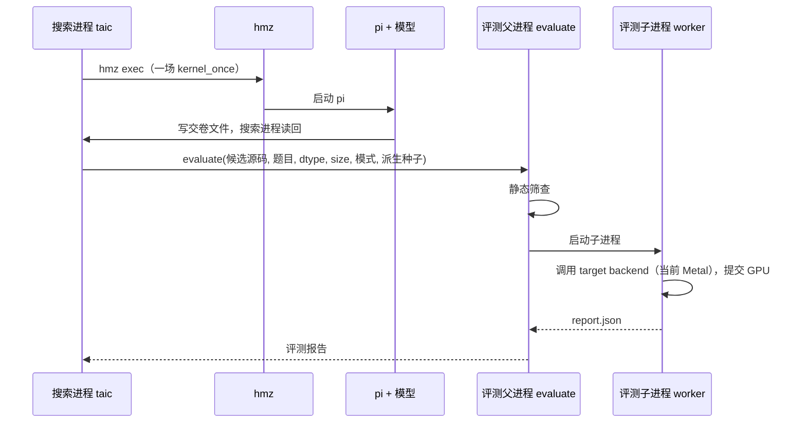
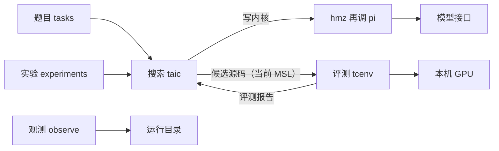
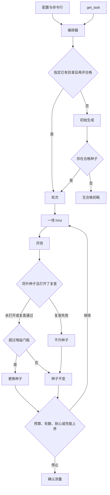

# 架构总览（低层设计索引）

这一篇是总览和索引。逐题、逐进程的现行细节在 `docs/架构/`；两者冲突时，以 `docs/架构/` 和代码为准。搜索写内核只走 `hmz` → `pi`；`taic/llm.py` 的直调只给实验脚本，见 [直调与hmz取舍.md](直调与hmz取舍.md)。

先读这一屏。后面是给改代码的人对照实现用的，可以跳着查字段。

这件事是：让模型把仓库里的 Triton 题目写成目标后端的内核程序，再由评测程序决定留不留。当前 active target 是苹果显卡上的 Metal 小程序；协议不把目标语言固定为 MSL。模型只写文字，看不见显卡。抽查通过只说明这次没抓到错，不说明所有输入都对。

默认一次搜索大约 15 美元。初始稿和第 1 轮由 DeepSeek 的 `deepseek-flash` 写，第 2 轮起轮到月之暗面的 `kimi-k3`，之后按 `(r - 1) % 2` 轮流。每一轮是一场新的 `hmz` 会话。不合格的反馈写进下一场任务书。看起来更快的那一次不能对外说；要等搜索结束、换一批输入再测、源码对得上、计时也没有噪声干扰。

`uv run python -m taic.cli brief` 只读。`taic run` 和 `taic resume` 会花钱，也会把程序交给这台同时驱动显示器的显卡。

在目标设备上，由语言模型生成该后端的内核，并由评测进程判定安全、数值与耗时。当前 target 是 `apple-m4-max`，backend 是 `metal`。

## 这篇讲什么

| 想知道什么 | 看哪一节 |
| --- | --- |
| 这个工程解决什么问题，当前支持哪个 target 和 backend | §1.1、§1.4 |
| 有哪几个进程，各自写什么、读什么 | §1.2 |
| 合格按什么判定，哪些约束是不许动的 | §1.3 |
| 哪些功能已经实现，哪些只剩记录字段 | §1.5 |
| 搜索进程和评测进程怎样交接 | §2.1 |
| 一次搜索的数据流 | §2.3 |
| 每道题、每次评测、每次搜索的细节在哪 | §3 |
| 这些约定被什么测试覆盖 | §4 |
| 现在不做什么，哪些开关等证据 | §5 |
| 依赖哪些外部程序 | §6 |
| 术语、常量、命令行参数 | §7 |

### 文档版本

| 版本 | 说明 |
| --- | --- |
| 总览 | 这一篇是入口和索引，写进程分工、总体数据流、常量和命令。逐题、逐进程细节在 `docs/架构/`，那里与代码同步 |

## 1. 概述

### 1.1 需求背景

本工程把 Triton 规格文本写成 `target.backend` 对应的内核，再由评测进程筛选。目标设备由 `targets/<id>/target.toml` 描述；评测层用 `target.backend` 经 `tcenv.backends.registry.load_backend()` 取实现。当前唯一启用（active）的 target 是 `apple-m4-max`，backend 为 `metal`，所以当前产物是 Metal Shading Language（MSL）内核。

Triton 是一种 GPU 内核描述语言；主 Python 环境不执行它。数值对照来自中央处理器（Central Processing Unit，CPU）上的参考实现。搜索、反馈、信任和运行数据记录 `target_id` 与 `backend`，不把 MSL 当成唯一格式；新增 kernel 级 backend 的边界见 [架构/执行运行时与设备扩展.md](架构/执行运行时与设备扩展.md) §8（含仍未通用化的 Metal 部分），backend 协议的阶段分工见 [架构/评测.md](架构/评测.md)。本轮不实现 NPU、CUDA 或 ROCm，也不新增第二个 target。

### 1.2 部署与职责

搜索进程、评测父进程与观测进程都在本机。当前 Metal target 下，GPU 与显示器共用，正在执行的内核不能被抢占。杀死评测子进程不保证 GPU 上已提交的 dispatch 已经停止。

| 进程 | 代码 | 写入 | 读取 |
| --- | --- | --- | --- |
| 搜索进程 | `taic` | `runs/<一次搜索>/` | 题目、配置。写内核只调本机的 `hmz`，由 `hmz` 调用 `pi`。缺 `hmz` 时这次搜索不能启动 |
| 评测父进程 | `tcenv.evaluate` | 监督记录；收成评测报告 | 候选源码（当前为 MSL）、题目 |
| 评测子进程 | `tcenv.worker` | 心跳、`report.json` | 候选源码（当前为 MSL）；调用 target backend（当前为 Metal）并提交到 GPU |
| 观测进程 | `observe` | 加预算、重置预算、改下次两个委员会的模型、停止进程、带理由删除已结束的记录。写之前先做权限检查 | 状态、结果、账本、锁 |

一道题目包含一份编译契约，契约包含参数列表。每个缓冲区占三段：前端保护带 16384 字节、按 256 字节对齐的数据区、后端保护带 16384 字节。一次评测产生一份带版本号的评测报告。一次搜索把候选、结果和运行配置写入同一目录。

配置到达评测侧的路径：`taic.toml` 与命令行合成搜索配置和模型配置；编排器调用 `evaluate()`；父进程把源码路径交给子进程。

### 1.3 设计目标

1. 合格只表示本次安全检查与抽样差分通过。`status == ok` 与 `eligible` 同义。形式检查不参与该判定。
2. 计时只在本工程的机器级 GPU 锁下进行。第一次评测超时后不再启动 GPU 工作。
3. 搜索过程中的加速比不是对外结论。对外数值必须通过 [架构/搜索.md](架构/搜索.md) 的发布条件。
4. 续跑以转录中的计费记录和已完成候选为准，不重复已记账的请求。

### 1.4 范围与读者

本文覆盖 `tasks`、`taic`、`tcenv`、`experiments`、`observe` 的当前实现，详细设计按进程写在 `docs/架构/`。读者是实现者与测试对照人员。

本工程的范围：

* 不是通用内核编译器，也不替换 Triton。
* 当前只实现 Metal；评测协议和运行记录以 `backend`/`target_id` 区分，MSL 专属逻辑留在 Metal backend（仍有少量未通用化，见 [架构/执行运行时与设备扩展.md](架构/执行运行时与设备扩展.md) §8）。
* FP8 不在范围内。
* 没有 `/* taic-launch */` 时，网格与每组线程数用题目契约。有这段时，同一次搜索里每一段可以自选网格和线程。`gemm@` 与 `flash_attention@` 改的是契约里的 tile 常量。

### 1.5 实现状态

| 对象 | 状态 |
| --- | --- |
| 评测流水线、搜索循环、`tasks/__init__.py` 的 `TASK_NAMES`（12）与 `PHASE2_TASK_NAMES`（4）、实验脚本、观测页面 | 已实现 |
| `run_config.json` 版本 2、`run_seed`、评测种子派生 | 已实现。配置写失败则退出码 5，且不进入 `run()`、不发送模型请求 |
| 非空目录上的新搜索 | 已拒绝。须改用 `taic resume` 或新目录 |
| 确认值与源码 SHA-256 绑定后的发布 | 已实现。未绑定、确认失败、计时不安静、确认报告来自评测缓存或各批不一致时，汇总不展示确认加速比 |
| `taic run --from`、`taic resume` 与 `--dry-run` | 已实现。旧运行缺记录的设置只列出来源，不因此拒绝续跑 |
| 升种子前的第二次正确性抽查 `differential_recheck` | 已实现，默认关闭 |
| 选择规则纯函数 `taic/policy.py` | 已实现。续跑回放使用同一组函数 |
| 报告与子进程请求的版本边界 | 已实现。评测报告和子进程请求：更高版本，或不认识的字段，拒绝读取 |
| `result.json`、`state.json`、`ledger.json` 的版本边界 | 已实现。损坏，或 `schema_version` 比本进程新，拒绝读取。多出来的键留在字典里 |
| triton-msl 对照 | 可选。未安装时主路径不调用它 |
| `verify()` | 已调用，返回值恒为 `unsupported` |
| 一元 fp16 取值域扫描与 `publication_role` | 已实现。确认之后另写 `domain_report.json`。`primary` 还要求加速比不低于 1.005。真机扫描已在 relu 上跑过（`runs/apple-m4-max/relu-pi-*-20261019`）；这些运行的确认加速比低于 1.005，所以仍是 `fallback`，还没有 `primary` 实例 |
| `task_fingerprint` | 已写入 `run_config.json`。不替换 triton-msl 缓存用的 `spec_fingerprint` |
| 契约菜单 `experiments/contract_menu.py` | 已实现。默认搜索用题目自己的网格和线程数。gemm 与 flash_attention 可以在一次搜索之外另选一套。菜单在实验驱动里，每个子目录仍是一次搜索 |
| `gen_` 逐元素题 | 已实现。由 `tasks/generated/elementwise.toml` 的一个表达式生成，不进入默认题目列表 |
| `profile_poor`、`hw_feedback`、`fast_bench` | 已实现，默认关闭。历史单次运行不是这些开关的效果结论 |
| `plan_mix`、`diversity_archive` | 只剩记录字段和纯函数：当前循环不读 `plan_mix`，也不调用 `diversity_archive` |
| `plan_ledger` | 开关默认开，看板可按它重算计划结局。当前任务书只附最近 5 行普通历史，进 `TASK.md` 前再按 400 字节裁剪。仓库里没有读取这个账本的规划路径 |
| 实验脚本直调 `taic/llm.py` | 仍在，只给实验脚本。搜索写内核不走这里。传输细则见 [直调与hmz取舍.md](直调与hmz取舍.md) |
| 与当前种子源码相同的提交 | 已实现。状态 `unchanged`，不评测、不升种子、不进入修补。提示要求失败的内核留在文件里。见 [架构/搜索.md](架构/搜索.md) |
| `hmz` + `pi` | 搜索写内核的唯一路径。一轮一场新会话。两个委员会轮流。接连两场 `agent_failed`（起不来、进程失败，或超时且没有交回与种子不同的核）以 `agent_failure` 停止；超时但交回了新核时，这一场也计入 `max_hangs`，默认 `max_hangs=1` 会先按挂起（hang）熔断停下。交了核但不合格，或文件和种子相同，都不算这场失败 |
| 跨次经验索引 | 已实现，默认关闭。`search.experience_index` 指向一份已经建好的 JSON 才写进这一场任务书的证据段。搜索不会自己扫描 `runs/`。重复性实验把该路径置空 |
| 搜索开关的对照实验结论 | 未实现。对照脚本在，结论不是开工批准 |
| `/* taic-launch */` | 已实现。没有这段时用题目契约的网格和线程。有这段时，同一次搜索里每一段自选。契约菜单的子搜索会拒绝这段 |

### 1.6 验收准则

`uv run python -m tcenv.cli naive gemm` 打印该朴素内核的评测结论。`uv run python -m taic.cli run <题目>` 结束后，新目录含有 `result.json` 与 `run_config.json`；存在合格内核时含有 `best.metal`。加速比大于 1 不是验收条件。汇总中的对外加速比只在 [架构/搜索.md](架构/搜索.md) 的发布条件成立时给出。

## 2. 总体设计

### 2.1 搜索进程与评测进程的衔接

搜索进程不向 GPU 提交内核。它把候选源码交给 `evaluate()`。有两条链路。

**写内核（走 `hmz`）：**

* 搜索进程不直接调用模型：它调用 `hmz exec`，`hmz` 启动 `pi`，模型在 `pi` 里；
* 搜索进程读回本场的交卷文件（`{题目}-{dtype}-{规模}-{场次}<file_ext>`；当前 Metal 是 `.metal`）；
* 成绩单、失败反馈和证据写进这一场的 `TASK.md`。外层成绩和失败反馈各截到约 1000 字节；
* `--kernel-agent off` 拒绝启动。

**评测（走 `tcenv`）：**

* 评测父进程在静态筛查通过后启动子进程；
* 子进程调用 target backend（当前为 Metal），并把评测报告写成 JSON；
* 父进程读回该文件。

当前 Metal 的种子名是 `kernel.metal`。



| 搜索侧 | 评测侧 | 传递物 |
| --- | --- | --- |
| `taic/orchestrator.py` 的 `_eval` | `tcenv/evaluate.py` 的 `evaluate` | 候选源码（当前为 MSL）、题目名、数据类型、规模、模式、派生种子 |
| `taic/kernel_agent.py` 的 `render_contract` | `tcenv/report.py` 的 `format_feedback` | 写进 `TASK.md` 的成绩，至多约 1000 字节 |
| `runs/<一次搜索>/` | 子进程临时目录中的 `report.json` | 完整评测报告 |

`emit` 在没有监听者时直接返回。进度怎么写、谁会看到，分三层：

* 搜索和评测写进度时走 `publish`、`update_progress`、`note_gpu`，这三个函数会先在**自己这个进程**里装上写文件的监听者；
* 看板（dashboard）是另一个进程，读已经落在磁盘上的文件，收不到搜索进程里的内存事件；
* 搜索和评测不导入 `observe`。进度写入失败被忽略，不改变评测结论。

### 2.2 模块划分

下列树给出源码目录。

```text
ai_lowerling/
├── tasks/          题目
├── taic/           搜索
├── tcenv/          评测
├── experiments/    批量搜索
├── observe/        观测。读运行目录；写入口是预算、默认模型、停止和删除已结束的记录
├── backends/       语言/工具链共用的 skill 与 wiki
├── targets/        设备档案、本机 calibration、trust.toml（按 target 的模型信任）
├── kernels/        确认内核目录（按 target/task/dtype/size）
├── data/           observe.sqlite、deleted/、books.sqlite（不进入 git）
├── tests/          shared/ 与 backends/<id>/ 的分层测试，helper 与 golden 在 support/
└── runs/           运行产物，不进入 git
```
数据怎么存、怎么索引、怎么查、哪些数字可以信，见 [架构/数据层.md](架构/数据层.md)。

下图是模块之间的数据方向。



### 2.3 数据流

一次新搜索的控制顺序如下。



## 3. 详细设计

详细设计按进程拆开。这一篇只保留分工和数据方向。

| 问题 | 文档 |
| --- | --- |
| 题目、编译契约、保护带是什么？ | [架构/题目.md](架构/题目.md) |
| 评测怎样判决，报告版本边界在哪里？ | [架构/评测.md](架构/评测.md) |
| RSI 外层循环、两条流水线、权限梯度、信任与双来源是什么？ | [架构/可信harness.md](架构/可信harness.md) |
| 搜索怎样循环，什么数字可以发布，怎样续跑？ | [架构/搜索.md](架构/搜索.md) |
| 实验脚本直调怎样收超时、空回复和截断？（不是搜索） | [直调与hmz取舍.md](直调与hmz取舍.md) |
| 直调和 hmz 怎么取舍，算不算 loop engineering？ | [直调与hmz取舍.md](直调与hmz取舍.md) |
| `hmz` 是什么，本工程调用了它的哪一层？ | [架构/hmz.md](架构/hmz.md) |
| 实验怎样分组，看板怎样读？ | [架构/可观测.md](架构/可观测.md) |

## 4. 验证

几个关键约定由专门的测试盯着：

| 测试 | 检查什么 |
| --- | --- |
| `tests/support/fake_worker_*.py` | 模拟正常退出、心跳停在 `B`、以及等待锁 |
| 编排器测试 | 使用脚本化模型与脚本化评测，不启动 GPU |
| `tests/shared/test_eval_seed.py` | 用 [架构/搜索.md](架构/搜索.md) 的固定向量独立复算种子，并检查分支完成次序不影响同一标签的种子 |
| `tests/shared/test_run_config.py` | 检查版本 2 的哈希与写失败 |
| `tests/shared/test_publication.py`、`tests/shared/test_differential_recheck.py` | 检查未确认不得显示为确认值，以及复查关闭时选择轨迹不变 |
| `tests/shared/test_report_schema.py` | 检查更高版本被拒绝 |

怎么跑：

* 不占 GPU、不花钱的快速套件是 `uv run pytest -q -m 'not gpu and not llm and not slow'`；
* `uv run pytest -q` 默认并行（`-n auto --dist loadgroup`），也会跑 `gpu` 用例，只在明确允许时运行；`gpu` 用例不能代替 CPU 套件；
* 失败时先读 `logs/pytest/triage/triage_summary.md`。重跑单条时用 `-n 0` 回到单进程；
* `TCENV_ALLOW_GPU_HANG_TESTS=1` 不作为常规验收。

分层、放置规则、golden 和并行日志的权威说明在 [tests/README.md](../tests/README.md)；取值域扫描、契约菜单、生成题和语义前置门的离线测试在 `tests/backends/metal/test_domain_sweep.py`、`tests/shared/test_contract_menu.py`、`tests/backends/metal/test_generated_tasks.py`、`tests/backends/metal/test_elementwise_semantics.py`。

## 5. 未来演进

**形式证明。** `verify()` 在出现可审计的 MSL 或 AIR 语义及证明范围之前保持 `unsupported`。一元 fp16 的取值域扫描已经是正确性关的一个 case，范围写在 `correctness.coverage.scope`。那不包括线程是否互相独立、下标和边界、并发，以及其他启动配置，所以不是整个内核的形式证明，也不改 `eligible`。bf16 和二元题本轮不扫。

**启动契约。** 没有 `/* taic-launch */` 时，默认搜索用题目自己的网格和线程数。有这段时，同一次搜索里每一段可以自选网格和线程。`gemm@` 与 `flash_attention@` 改契约里的 tile 常量，也可以交给 `experiments/contract_menu.py`。菜单的每个子目录仍是一次普通搜索，并且会拒绝 `taic-launch`。`experiments/contract_sensitivity.py` 的 `static_screen_contracts` 可在进模型之前丢掉每组 SIMD 上 32 个及以上累加器片段、或线程组声明超过 32768 字节的契约。

**重新利用旧运行。** 跨运行经验索引默认关闭，见 §1.5。`--from` 接受旧运行目录；`--from @catalog` 的取核函数在，但当前 `_search` 只对 `from_run` 非空时先评测，按当前代码先用旧运行目录（见 [架构/搜索.md](架构/搜索.md) 的「已有目录的再次搜索与续跑」）。`--from` 不进入重复性实验的默认初稿。

**还关闭的实验开关。** `profile_poor`、`hw_feedback` 保持关闭，直到单独的对照实验给出确认加速比或单位美元收益，且安全与正确性不下降。`plan_mix` 的字段还在，当前一轮一场不读它。历史目录的预算、模型、契约和是否续跑并不相同，不能当作该对照。

## 6. 依赖

| 依赖 | 用途 | 缺失时 |
| --- | --- | --- |
| Python 3.12 及以上，由 uv 安装 | 搜索与评测 | 主路径不可运行 |
| MLX、PyTorch、PyObjC Metal | 基线与 GPU | 评测不可运行 |
| OpenAI 兼容对话接口 | 实验脚本里的直调。搜索写内核不走这里 | 只跑评测、不跑那些脚本时仍可运行 |
| 本机命令 `hmz` 与 `pi` | 搜索写内核。`hmz exec` 跑一场 `kernel_once`。本机安装 `hmz` 0.2.2 | 这次搜索不能启动 |
| Metal 工具链与 `.venvs/triton-msl` | 可选对照 | 主路径不调用 |
| `xctrace` | 可选录制 | 默认搜索不调用 |

## 7. 附件

### 7.1 术语

| 术语 | 展开或英文 | 解释 | 章节 |
| --- | --- | --- | --- |
| 图形处理器 | Graphics Processing Unit，GPU | 本机 Apple GPU，与显示器共用 | §1 |
| 中央处理器 | Central Processing Unit，CPU | 参考与差分所在的处理器 | §1 |
| 金属着色语言 | Metal Shading Language，MSL | 当前 Metal backend 的候选内核源语言 | §1 |
| Triton | Triton | 规格文本。主环境不执行 | §1 |
| 评测报告 | `EvalReport` | 一次 `evaluate` 的判决 | [评测](架构/评测.md) |
| 编译契约 | `Contract` | 内核名、网格、线程数与参数 | [题目](架构/题目.md) |
| 运行种子 | `run_seed` | 一次搜索的 64 位种子。各次评测由此派生 | [评测](架构/评测.md) |
| 加速比 | speedup | 最快库基线耗时除以候选耗时 | [评测](架构/评测.md) |
| 确认测量 | confirmation | 结束后的复测。对外值还须满足发布条件 | [搜索](架构/搜索.md) |
| 性能上界 | roofline | 实测峰值与题目运算量、字节量给出的时间下界 | [评测](架构/评测.md) |
| 变异系数 | coefficient of variation | 重复计时的离散程度。超过 0.05 为不安静 | [评测](架构/评测.md) |
| 保护带 | guard band | 缓冲区两端各 16384 字节 | [题目](架构/题目.md) |
| 着色器校验 | `MTL_SHADER_VALIDATION` | Metal 对非法访问与同步的检查 | [评测](架构/评测.md) |
| triton-msl | triton-msl | 可选编译器，位于独立虚拟环境 | [评测](架构/评测.md) |
| 前缀缓存 | prompt cache | 相同系统提示按命中价计费 | [搜索](架构/搜索.md) |

### 7.2 常量

| 常量 | 值 |
| --- | --- |
| 保护带 | 16384 字节 |
| 输入哨兵与输出毒化 | 字节 `0xFF` |
| 输出边距 | 字节 `0xCD` |
| 单次启动时限 | 单核 2 秒。流水线一条 command buffer 按段数乘 2 秒，封顶 8 秒。着色器校验是这个数的 2 倍。超过仍 SIGKILL，并计入 `max_hangs` |
| `taic-launch` 段数 | 最多 32。编码在计时窗内，段数不是隐藏编排的手段，只给解析和 ABI 检查一个有限输入。Winograd 这类是个位数段 |
| 单段线程组总数 | 不超过 2^24。65536 组仍允许。2^32−1 不算上限 |
| buffer 槽位 | 0 到 30 |
| `validate` / `full` / `quick` | 120 / 420 / 240 秒。`timed` 走 full 子进程，整段 420 秒。`mode=full` 是先校验最多 120 秒，通过后再最多 420 秒 |
| 杀死子进程后的等待 | 3 秒 |
| Metal 编译时限 | 90 秒（心跳 `C` 超时后发送 `SIGKILL`） |
| 不安静变异系数 | 0.05 |
| 计时重测次数 | 3（首次加至多两次重测，共 3 次） |
| 反馈截断 | 写进任务书的外层成绩和失败反馈各至多约 1000 字节。`FEEDBACK_CHARS = 6000` 是没有调用者的残留常量 |
| 线程组静态内存上限 | 32768 字节 |
| 初始生成尝试次数 | 2。两次都没有合格种子才停 |
| 基线明显快于下界 | 耗时 < 下界 × 0.95 |
| 评测种子 | SHA-256 前 6 字节，大端 |
| 评测请求版本 | 4。要求 `target_id`，并增加可选 `measure_serial`。缺 `target_id` 的旧请求会被拒绝 |
| 报告、结果、状态、账本版本 | 报告 3；结果、状态、账本 1 |
| 固定评测种子向量 | 见 [架构/搜索.md](架构/搜索.md) |

### 7.3 命令

`uv run python -m tcenv.cli` 的子命令：`tasks`、`show`、`naive`、`eval`（`--quick` 为快速模式）、`baseline`、`calibrate`、`profile`、`triton-baseline`。

`uv run python -m taic.cli run <题目>` 的常用参数：

* 规模与预算：`--dtype`、`--size`、`--budget`、`--preset paper|base`；
* 起点与模型：`--from <目录>`（`@catalog` 的当前行为见 [架构/搜索.md](架构/搜索.md) 的「已有目录的再次搜索与续跑」）、`--seed`、`--model`、`--branches`；
* 循环与工具：`--max-rounds`、`--no-tools`、`--profile-best`；
* [架构/搜索.md](架构/搜索.md) 里的各开关，可写成 `--开关` 或 `--no-开关`（`profile_poor`、`hw_feedback`、`plan_mix`、`profile_best` 只有开启形式）。

`uv run python -m taic.cli resume <目录>` 支持 `--dry-run`、`--add-budget`、`--budget`、`--lift-count-limits`、`--accept-cost-gap`。

退出码：

| 命令 | 退出码 | 含义 |
| --- | ---: | --- |
| `taic run` | 5 | 启动失败 |
| `taic run` | 2 | 搜索结束且没有合格内核 |
| `taic run` | 6 | 搜索有合格内核、但确认阶段失败（`stop_reason` 以 `confirm_error` 开头）。`result.json`、`best.metal`、`ledger.json` 仍会写出，但没有可公布的数字，脚本不应只看 0 就当成完整成功 |
| `taic resume` | 3 | 不能续 |
| `taic resume` | 4 | 锁冲突 |
| `taic resume` | 5 | 设置或预算错误 |
| `taic resume` | 6 | 跑完但确认阶段失败 |

```bash
uv run python -m experiments.run_suite --tasks all --dtypes fp16,bf16
uv run python -m experiments.repeatability --tasks conv2d,gemm,swiglu --trials 5
uv run python -m experiments.semantic_tests --n-random 10
uv run pytest -q -m 'not gpu and not llm and not slow'
```

批量实验脚本的预算与跳过规则：

* `run_suite`、`repeatability` 与 `p1_runs` 的默认单次预算为 15 美元。`repeatability` 中 SwiGLU 为 1 美元。三者接受 `--budget`、`--preset` 与可选的 `--max-total-usd`；
* `experiments/search_ab.py` 也有 `--max-total-usd`，并且跳过已经有文件的目录；它的预设是 `base`，默认每次 3 美元；
* `run_suite` 在同一个输出目录里已有 `result.json` 时跳过该题；不传目录时每次新建带时间戳的目录，不会跳过旧的 `runs/apple-m4-max/suite_full`；
* `repeatability` 不使用 `--from`；
* 按论文预算全部花满时：`run_suite --dtypes fp16,bf16` 的 24 次为 360 美元（默认只跑 fp16，是 12 次、180 美元），`repeatability` 为 155 美元（含 `flash_attention` 时为 230 美元），`p1_runs` 字典里 12 条为 180 美元；
* `semantic_tests` 每次 0.15 美元。早于该预算的历史目录与现行结果不可直接比较。
