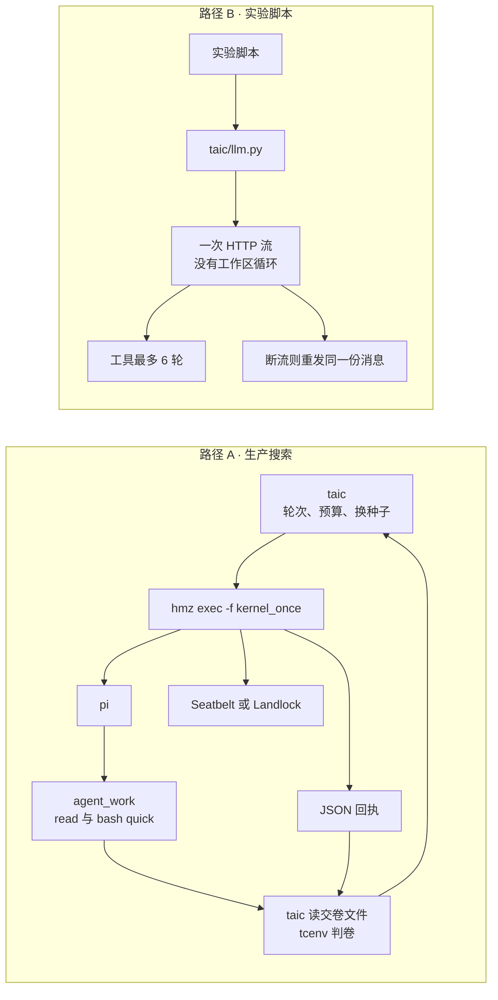

# 写内核只走 hmz

这篇给要看代码的人。先说结论：搜索不再自己调模型来写内核。每一轮是一场新的 `hmz` 会话，`pi` 把核写进本场的交卷文件，并用 `tcenv eval --timed` 看时间（v2 标准题里同一条命令是 `tcenv eval-v2 --timed`，以 `TASK.md` 给出的为准）。`kernel.metal` 是种子。搜索怎么停、留谁、对外报哪个倍数，仍在 `taic`。论文预设只表示预算、轮数和耐心，不再表示直调。

## 这篇讲什么

- 两条路径不要混：**搜索**只走 `hmz` → `pi`；**直调**（`taic/llm.py` 的 `chat`/`chat_with_tools`）只服务实验脚本。并排图和对照表见 [两条路径并排](#两条路径并排)。
- 直调保住了什么：考场、提示、预算、停止条件都在仓库代码里，模型看不见 GPU 计时，也决定不了留不留种子。
- 交给 `hmz` 换来了什么：一个现成的编程代理，能翻仓库、改文件、跑命令；代价是内层循环不在本仓库。
- 最后回答「这算不算 loop engineering」。

先解释文里反复出现的词：

| 词 | 是什么 |
| --- | --- |
| `hmz` | 别人写的启动器，用来驱动已经登录的编程代理；给一场套上会话、权限围栏和运行记录 |
| `pi` | `hmz` 启动的编程代理（Node 程序），自带读、写、跑终端的循环 |
| 直调 | 调用进程自己发一次 HTTP，拿回正文；对应 `taic/llm.py`。搜索写内核不走这里 |
| `kernel_once` | 本仓库交给 `hmz` 的流程：一个角色，写完一颗核就退出。下一颗核再开一场 |
| `agent_work/` | 这一场的隔离目录。`pi` 在这里改文件。仓库对这场只读 |
| 围栏 | `hmz` 套上的操作系统限制。Linux 是 Landlock，macOS 是 Seatbelt。围栏立不起来就拒绝启动 |
| 回执 | `hmz exec --json` 打出的一行行 JSON：花了多少、会话怎么结束、工具调用了几次。搜索用它记账。它不是模型的逐字聊天 |

loop engineering 在这里指：人先规定什么时候开始、什么叫成功、谁来验收、什么时候停。外层那一圈是本仓库写的。内层如果交给 `pi`，用的是它自己的读、改、看终端。

搜索只有一条写内核的路。两个委员会、预算、从文件里读出 Metal、`tcenv` 判卷、换种子、确认，都在 `taic`。`taic/llm.py` 仍留给实验脚本。

## 两条路径并排

路径 A 是生产搜索：`taic` 准备一场隔离目录，调用 `hmz exec -f kernel_once`，由 `hmz` 拉起 `pi`。路径 B 是实验脚本：进程自己调 `taic/llm.py`，一次 HTTP 流结束就回到脚本。搜索写内核不经过路径 B。

| | 路径 A：生产搜索 | 路径 B：实验脚本直调 |
| --- | --- | --- |
| 调用链 | `taic` → `hmz exec -f kernel_once` → `pi` | 脚本 → `taic/llm.py` 的 `chat` / `chat_with_tools` → 一次 HTTP |
| 谁写内核 | 本机 `hmz` 启动 `pi`，模型在 `pi` 里 | 调用 `taic/llm.py` 的脚本 |
| 工作区 | 每场一个 `agent_work/`。`pi` 只在这里改文件，仓库对这场只读。开跑时另把 `device.md`、`experience.md`、`msl_reference.md` 冻进 `agent_guidance/` | 没有会话目录，也没有「改一版、再跑、再改」的循环 |
| 模型能用的工具 | `pi` 自带 `read`、`write`、`bash`。快速自查是 `TASK.md` 里的 `--quick`，经 `bash` 执行。搜索不注册 `quick_check`，`max_quick_checks` 默认是 0 | 若脚本注册了 `lookup_msl`、`quick_check`，工具回合上限是 `MAX_TOOL_TURNS = 6`。用完必须交正文 |
| 围栏 | `hmz` 提供。Linux 是 Landlock，macOS 是 Seatbelt。围栏立不起来就拒绝启动。新写核会话的声明是 `online=NONE` | 工具在调用进程里执行。没有这道操作系统围栏，也没有 `hmz` 的 epic |
| 搜索拿回什么 | 交卷文件，加上 `--json` 回执里的花费、结束原因和工具次数。`pi` 的完整对话留在 `hmz` 的 epic，不抄进 `runs/`。`transcript.jsonl` 记的是记账事件。没交卷时，最多另留 240 字脱敏预览 | 正文回到脚本。更早的直调运行会把聊天写进 `transcript.jsonl`；那是旧路径 |
| 内层循环 | `pi` 自己的读、改、看终端，它决定何时停 | 同一条对话里最多 6 轮。工具结果回到这一条对话 |
| 一次任务的边界 | `kernel_once`：新开一场，跑完一句任务，退出。下一颗内核再开一场 | 一轮聊天 |
| 异常谁收 | `hmz` 和 `pi`。搜索只看退出后的交卷文件，不看种子 `kernel.metal` | 那一次 HTTP。流上两块数据之间空闲超过 900 秒、连接断开、5xx、限流、空回复：重发同一份消息，默认最多 6 次。超窗只削一次 |
| 依赖 | 本机还要有 `hmz` 和 `pi` | OpenAI 兼容接口 |
| 验收 | 循环外的 `tcenv`。代理自查不算成绩 | 脚本自己决定 |

围栏一行是 `hmz` 的合同：立不起来就不开场。[security.md](security.md) 写明本仓库断言了这条声明，还没有一份本仓库自己做的操作系统级围栏证明，生产环境的 `online=NONE` 也还在未证明清单里。表里因此只把它写成路径差，不写成已经核验过的沙箱成绩。

`kernel_agent` 固定为 `pi`。`--kernel-agent off` 在启动时拒绝。`branches` 和 `init_samples` 不是 1 也拒绝。

每一次尝试都重新 `hmz exec`。上一轮的失败反馈贴进下一场 `TASK.md`。搜索不再做同对话修补，也不再发规划请求。

## 直调守住了什么

考场在自己手里。提示、两个工具（`lookup_msl`、`quick_check`）的定义、抽核、修补对话、预算和停止条件都是仓库里的代码。模型看不见 GPU 计时，也决定不了留不留种子。

异常处理是按这次搜索的实际情况改过的。kimi-k3 会在第一块数据出现之前想很久，所以 900 秒不再卡住整段回复，只计算流上两块数据之间的空闲。断流、5xx、限流、空回复会重发同一份消息，半截不写进下一次。余额不足和鉴权失败不重试。上下文超窗只削一次。输出顶到上限还带着工具调用时不执行。这些规则写在下面的「实验脚本直调（不是搜索）」。

少一个运行时。没有 Node 上的 `pi`，没有 `hmz` 的围栏和 epic，看板直接读 `transcript.jsonl` 的末尾。

## 实验脚本直调（不是搜索）

搜索写内核不经过这一节。`search.kernel_agent` 是 `pi`；`--kernel-agent off` 拒绝启动；论文预设只改预算、轮数和耐心。下面这些规则只包住实验脚本里的 `llm.chat`。

2026-10-20 以前，同一次补全要等整段正文回来，`request_timeout_s`（900 秒）盖住整段等待。kimi-k3 的思考经常在第一块数据之前就超过这 900 秒，请求被当成超时。从这一天起，直调按流接收。900 秒改成两块数据之间允许的空闲：思考还在往下流，整段可以长过 900 秒；流静默超过 900 秒，才按超时重试。连接失败、服务端 5xx、限流同样重试，次数是 `max_retries`（默认 6），`Retry-After` 作为这一次等待的下限。

| 发生了什么 | 接着做什么 |
| --- | --- |
| 流静默超过 900 秒、连接断开、5xx、限流 | 同一份消息再发，最多 6 次。半截不写进下一次请求 |
| 正常结束，正文和工具调用都空 | 同一份消息再发。次数用尽时，思考里已经有 `kernel void` 的，把思考交给调用方；否则把空正文交出去 |
| 流干净结束，却没有结束原因 | 丢掉半截，同一份消息再发。次数用尽后这次请求失败，半截不返回 |
| 429 的正文是余额不足，或其它不能靠重发修好的 4xx | 停止这一次请求，不重试。拒绝 `stream_options` 的 400 会去掉该字段再发，不计入 `max_retries`。拒绝回传思考的 400 与超窗一样只削一次 |
| 上下文超窗 | 去掉回传的思考，缩短过长的工具结果，再发一次。仍然超窗就停 |
| 输出顶到长度上限，并且带了工具调用 | 不执行这些调用。这一条在 `chat_with_tools` 里。`llm.chat` 对顶满长度只留下正文并记一条警告 |
| 输出顶到长度上限，正文里没有内核 | `truncation_retry` 只剩记录字段，仓库里没有实现再问一次的代码；当前搜索走 `hmz`，也不会经过这里。`truncation_retry_effort` 默认仍是 `low` |

这些规则只包住实验脚本里直调的这一次 HTTP。搜索写内核走 `hmz` 和 `pi`，搜索不改那条路径。没有搬进直调的，是自动换模型、把整段历史做成摘要，以及编程代理的权限和子代理。

## 交给 hmz 时多出来的能力

`pi` 是现成的编程代理。它能翻仓库、改 `kernel.metal`、自己跑命令，再根据终端输出继续改，直到它自己停。直调做不到：它没有工作目录，打不开 `opspec.json` 或 `reference.py`（v1 时代的文件名是已退役的 `task.py`），也不能在磁盘上改一版再改一版。`MAX_TOOL_TURNS = 6` 用完就必须交正文。

`pi` 的会话会在上下文太长时做摘要，流写到一半断了可以让模型接着写。直调只重发同一次请求，或在超窗时缩短工具结果，不把整段历史压成摘要。

那场还有权限围栏和 epic。直调的工具就在搜索进程里执行。看板能看到发出和收回的文字，看不到一场代理自己改过哪些文件。

这些能力的代价是：内层循环不在本仓库里。`pi` 可以做完方案又把旧内核写回去。搜索在评测前比对源码，和当前种子逐字相同则记为 `unchanged`，这一支不合格，不复用上一份成绩，也不再修补。直调和这条检查用的是同一条规则。提示要求失败的内核留在文件里。细则在 [架构/搜索.md](架构/搜索.md)。

## 为什么这样取舍

写内核要的是「按契约交一颗 Metal」，验收是本机编译、ABI、数值和计时。这条验收已经是外层循环的验证步，不需要编程代理再判一次。

写内核的路径是 `hmz`。`taic/llm.py` 只管实验脚本里的直调，不管这次搜索。kimi 这类模型在直调上的麻烦集中在传输（想得久、空回复、截断），那些规则不覆盖 `hmz` 拉起的 `pi`。

搜索依赖本机的 `hmz` 和 `pi`。缺了就不能启动。两个委员会仍轮流，但当前 `TASK.md` 不写交接句：`orchestrator._handoff` 还在，没有调用者。计划账本的开关默认开，任务书目前只附最近 5 行普通历史，进 `TASK.md` 前再按 400 字节裁剪。

没有把 `hmz` 的 `flame_chase` 接进来排整次搜索。那是两个编程代理轮流改同一份工作区，每轮新开会话，预算花完就停，里面没有抽核和判卷。本仓库的外层循环已经做了轮换和验收。

2026-10-24 复核最新源码：`taic/kernel_agent.py` 的 `-f` 仍指向 `taic/flows/kernel_once`，`taic/` 没有调用 `flame_chase`。`run_config.json` 里的 `loop_protocol: flame_chase_1` 只是本工程的续跑协议标签，不是采用了对方的 flow。源码核对记录见 [KDA框架与本工程对比.md](KDA框架与本工程对比.md)。

## 这算不算 loop engineering

2026 年中说的 loop engineering，指的是人设计一份循环规格交给现成的编程代理：触发、目标、验证、停止、记忆，代理自己去做，人不再每一步写提示。Macedo 的预印本 [2607.00038](https://arxiv.org/html/2607.00038) 把这件事和两样东西分开：普通的程序循环，以及 harness 里已经有的感知—行动—观察循环。后一个是管道，前一个才是要设计的规格。

按这个分法，本仓库有两层：

| 层 | 实验脚本里的直调 | 搜索 |
| --- | --- | --- |
| 外层：一轮搜索 | 脚本自己的调用，不是这次搜索 | 是我们写的循环规格。触发是新的一场，目标是一颗又对又更快的核，验证是 `tcenv`，停止是预算、轮数、耐心、上界、`max_hangs` 熔断和接连两场 `agent_failed`，记忆是种子、成绩和下一场任务书 |
| 内层：写这一颗核 | `chat_with_tools` 仍在，最多 6 轮。搜索不走它 | `pi` 现成的感知—行动循环。`kernel_once` 只 spawn 一次、跑一句任务、新开会话就结束。我们没有再写一份「没绿就继续催 `pi`」的内层规格 |

所以：调用 `hmz` 用的是现成编程代理的内层循环，外层搜索才是我们的 loop engineering。它不是把整次搜索做成一份交给 `hmz` 的循环规格，也不是 `flame_chase` 那种由 harness 排两个角色直到预算耗尽。内层验收若交给 `pi` 自己看终端，就会和考场脱节；验收留在 `tcenv`，是这份外层规格里故意不交出去的那一步。
