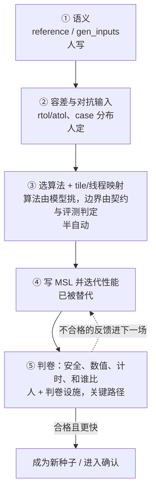

# 算子工程师边界：这条路替掉了哪些人手

这篇回答：新芯片出来以后，还要不要专门雇人把每种计算写成显卡小程序。

模型可以写出 Metal 文字。编译、查错、计时由程序做。人还要准备题目、标准答案、允许的误差，以及最后这个数字能不能对外说。

省掉的是「从 Python 描述写成显卡程序」的那个人。苹果自己的 Metal 编译器还在，寄存器怎么分配仍由它做。

判据：每多一种计算、一种大小、一种小数，人还要花几小时？如果只剩看一眼再批准，目标才算到了。

本文不批准花钱，也不批准占用这台同时画屏幕的显卡。数字都写了 `runs/` 里的路径，引用前先打开那个文件复算。

系统怎么分工见 [架构说明.md](架构说明.md)。哪些话不能说见 [诚实说明.md](诚实说明.md)。两份和本文冲突时，以 `runs/` 里的文件为准，并回头改文档。

## 这篇讲什么

- 人的工作其实是五块：定语义、定容差、选算法、写实现、判卷。这条路只替掉第四块（写实现）。
- 「节约」只在**库没覆盖、算法没被换掉**的区间成立。库已覆盖的饱和算子是打平，库换了算法的算子还打不过。
- 剩下四个角色（验证、判卷口径、契约、成本）跨算子复用，不随算子数线性增长。
- 成本上还有两笔管理问题（推理截断、饱和题空转），不是模型能力问题。
- 顺序是：先正确，再达到可接受性能，最后比较每个合格 kernel 的总成本；不是简单地在性能和省人之间二选一。
- DSL 仍然需要人，但人的工作从逐条写指令，转向 DSL/编译器、契约、验证、样例和发布责任。



## 1. 人的工作其实是五块

用 `tasks/<op>/opspec.json` 与 `reference.py` 里的实物对照（v1 时代在已退役的 `tasks/<op>/task.py`），每一样是一块：

| 工作块 | 今天谁做 | 这条路替代了吗 | 证据 |
| --- | --- | --- | --- |
| ① 这个算子算什么（语义） | 工程师写 `reference` | **没有**，仍由人手写 | `tasks/*/reference.py` 的 `reference` / `gen_inputs` 都是人工代码（v1 时代在 `task.py`） |
| ② 允许多大误差、用哪些对抗输入 | 工程师定 `rtol/atol`、case 分布 | **没有** | 同上；这是"错内核能不能混过去"的关口 |
| ③ 选算法 + 定 tile/线程映射 | 工程师 | **半自动**：算法由模型挑；没有 `/* taic-launch */` 时 `grid/threads` 由契约冻结，有这段时每段自选，但边界仍由评测程序判定——这块是被"约束"而不是被"解决" | `tcenv/contract.py` 的 `Contract`；`tcenv/backends/metal/launch.py` 的 `/* taic-launch */` 解析与上限 |
| ④ 写 MSL 并迭代性能 | 工程师 | **是，被替代了** | `runs/apple-m4-max/p1/mamba2` 1.459x、`runs/apple-m4-max/p1/gemm_paper` 1.003x、单算子花费 $0.13–7.61 |
| ⑤ 判卷：安全、数值、计时、和谁比 | 工程师 + 判卷设施 | **没有，反而成为关键路径** | `tcenv/verify.py` 目前恒答 `unsupported`；论文把"ISA 语义与形式化验证的缺口"称为 new central challenge |

**所以：节约的是 ④ 的写作人力；① ② ⑤ 的人还在；③ 是半自动。**

## 2. "节约"这件事的成色

按"这条路在什么情况下真的顶用"分三个区间，每个区间用已确认（`confirmed_speedup`）的数据说话：

| 区间 | 代表证据 | 结论 |
| --- | --- | --- |
| **库没覆盖的算子**：已经有效 | `mamba2_chunk_scan` fp16：确认 1.459x（搜索 1.473x），花费 $3.09，9 轮 31 次评测；候选 125.53us vs 基线 `mlx_half_compile` 183.19us（`mlx` 498.92 / `mlx_compile` 311.27 / `torch_mps` 1375.08）→ 对原版 MLX 约 3.97x | 这是厂商真正缺人的地方（新算子 bring-up），这条路在这里有不可替代的价值 |
| **库已覆盖的饱和算子**：打平，不值得再花钱 | `runs/apple-m4-max/suite_full`：relu 0.971x、silu 0.968x、sigmoid 0.951x、swiglu 0.989x、rmsnorm 0.995x、softmax 0.974x、reduction_sum 0.974x、gemv 1.006x、gemm 0.986x、rope 1.025x（单题 $0.13–0.86）；`runs/apple-m4-max/p1/fa_paper` 搜索 1.004x → 确认 0.987x，$7.61 | 这些算子本来也不需要算子工程师（库已经写了）；把预算继续投在这里是纯浪费 |
| **库换了算法的算子**：还不行 | `runs/apple-m4-max/p1/conv2d_paper`（未跑完，没有确认值）：搜索内最好的一稿 0.814x（951.9us vs `torch_mps` 775.35us，`mlx` 985.3us），而它自身的 roofline 下界是 931.84us——基线比这个下界还快约 17%。2026-10-20 的 Metal System Trace 确认 paper 尺寸的 torch-mps 跑的是 `ndArrayConvWinogradBatched`，不是推断。同题另做三次独立搜索（`runs/apple-m4-max/repeat_20261007-015329/conv2d/`）：两次跑完，确认 0.779x（998.5us，$2.97）与 0.783x（992.8us，$4.26）；第三次未跑完，搜索内最好 0.820x（943.1us）。四个数字都低于 1。约束对照见 [conv2d约束排查.md](conv2d约束排查.md)。多段启动、自选网格、工作区和换算法的反馈限制已经从评测里拿掉；上表这些倍数是拿掉之前测的 | 同一个算法内的微调打不过换算法的对手。模型试过 Winograd，数值或速度没留下 |

2026-10-21 补记（conv2d）：上面这行说的是搜索还没赢，不是这道题赢不了。一颗手写核用全程 fp32 的 Winograd 达到确认口径之外的三次计时 1.011–1.014×（`runs/manual-muse-20261021/`，不算搜索成绩；搜索已确认最好仍是 0.831×）。当时卡住搜索的不是算法上限，而是一句被四轮笔记继承、从没实测过的断言「矩阵单元只能吃 fp16 操作数」：实测 fp32 操作数乘加 15.09 TFLOP/s，与 fp16 的 15.42 几乎同速。所以这条边界应读作「模型在未验证的前提上停了下来」，不是「换算法的对手打不过」。细节和改法见 [conv2d约束排查.md](conv2d约束排查.md) 的同日补记。

成本侧还有两笔**管理问题**，不是模型能力问题：

- **推理截断**：159/1440 个模型回合被 token 上限截断，花掉 $9.33（占 LLM 总花费 $28.73 的 32.5%）；其中 147 次一个字都没写出来。杠杆是思考预算/`max_tokens`/模型，与 plan 类型无关。（报告里另有一个 37%，那是**矩阵题改写请求的触顶率** 29/79，不是花费占比；`诚实说明.md` 旧版把它误记成花费，已改正。）
- **饱和题空转**：14 个跑完的 run 中 11 个在首个内核就达到实测 roofline 的 ≥90%；此后还花掉 $6.54（占这些 run 总花费 $13.96 的 46.8%）。饱和 run 整体占总花费 48.8%。杠杆是"到 roofline 就停"，不是换 plan 类型。

（来源：`runs/plan_type_analysis/REPORT.md` 第 1、3 节。）

**结论**："节约从 Python 到 MSL 的工程师"**成立，但只在"库没覆盖 + 算法没被换掉"的区间成立**。

## 3. 性能和人工成本，首选哪一个

先给一个可执行的顺序：

1. **先正确**：语义、数值、安全和接口不合格，谈性能与省人都没有意义。
2. **再达到可接受性能**：至少要过当前任务约定的 baseline 或业务门槛，否则省下来的实现工时没有产出。
3. **最后比较每个合格 kernel 的总成本**：多个候选都正确且性能合格时，选总成本更低、维护更容易的那个，而不是盲目追求最高倍数。

所以，**正确性是门槛，性能是价值目标，人工成本是约束。** 在性能没过门槛时先补性能；过了门槛以后，人工成本和维护成本才是主要选择依据。

### 3.1 为什么不能只说“性能优先”或“省人优先”

两个极端都不成立：

- **只说省人**：如果生成的 kernel 慢于库、结果不稳定或不能发布，省掉写作工时也没有交付价值。
- **只说性能**：如果在饱和算子上为了 1% 继续烧模型和 GPU，收益可能远小于搜索、评审和维护成本。

应按场景决定：

| 场景 | 首选判断 | 原因 |
| --- | --- | --- |
| 库未覆盖的新算子、算法基本不变 | 先做到正确并达到可接受性能，再压总成本 | 这里有真实 bring-up 需求，性能和缩短上线时间都可能有价值 |
| 库已经饱和的基础算子 | **成本优先，直接停止** | 没有性能空间，也不需要再雇一个“写实现”的角色 |
| 基线换了更强算法 | 先由人判断算法与前提，不能只靠生成更多候选 | 这是算法研究和未验证前提问题，不是单纯写作人力问题 |
| 一次性、低频使用的小算子 | 人工写或改现成实现可能更便宜 | harness、验证和学习成本无法摊薄 |
| 大量相似算子、可复用评测的系列任务 | DSL + Agent 更容易摊薄成本 | 契约、测试、技能、编译和确认设施可以复用 |
| 线上调用量很大的热 kernel | 性能权重提高 | 每次调用节省的时间会重复累积，可能超过一次性工程成本 |
| 高风险发布、缺验证设施 | 先补验证与 owner | 错误发布的代价可能高于全部搜索费 |

### 3.2 现有数字能证明什么，不能证明什么

- `mamba2_chunk_scan` 的确认 1.459×、$3.09 说明：在这个任务上，模型确实产出了更快候选，而且本次 LLM 花费不高。**它没有记录工程师写规格、评审和维护用了多少小时，所以不能单独推出“比人便宜”。**
- 饱和题 0.951–1.025×、饱和 run 后续仍花 $6.54 说明：没有性能空间时，首要动作是停止，不是继续追求“自动化率”。
- conv2d 的手写 Winograd 与搜索结果差异说明：人可以提供算法选择和前提纠错；模型在错误前提上停下来时，增加预算不等于增加正确方向。
- 截断与空转说明：LLM 成本不是只有“每次写 kernel 的报价”，还包括失败、无输出、重试和无效搜索。

因此，当前数据能支持“**某些区间有性能收益、某些区间在浪费钱**”，还不能支持“整条路线已经证明了人工总成本更低”。

### 3.3 应该记哪本账

不要只记 `spent_usd`。至少分三本账：

```text
直接生成成本 = LLM/API + GPU/NPU 时间 + 存储与执行环境
工程人力成本 = 规格 + DSL/编译器 + 样例 + 评审 + 修复 + 维护
风险与迁移成本 = 错误发布 + 回归 + 新芯片/新版本重写与复验
```

真正需要比较的是：

```text
每个合格 kernel 的总成本
  =（直接生成成本 + 工程人力成本 + 风险与迁移成本）/ 合格 kernel 数

运行期性能收益
  =（baseline 时间 - 候选时间）× 实际调用次数 × 时间价值
```

这不是要求把每个风险都硬折成美元，而是提醒：**一次 $3 的搜索和一次 3 小时的专家评审，不能只用其中一项来宣称省钱。**

最小记录表可以是：

| 指标 | 用来回答什么 |
| --- | --- |
| `time_to_first_valid` | 从任务开始到首个正确候选要多久 |
| `time_to_confirmed` | 到绑定源码、通过确认的可发布候选要多久 |
| `human_minutes_spec/review/maintenance` | 人实际还花了多少时间，而不是“人已不在流程里” |
| `llm_cost`、`gpu_hours`、失败 run 数 | 自动化本身的直接成本与失败损耗 |
| `accepted_count` | 成本被多少个真正合格的 kernel 摊薄 |
| 基线与候选的实际调用量、延迟差 | 性能收益能否覆盖一次性工程成本 |

当多个候选都过正确性与性能门槛时，**人工成本和维护成本成为首选比较项**；当性能收益本身很大且会长期重复发生时，才值得为更高性能继续投入。

## 4. DSL 还是需要人：从“写指令”变成“维护生成与验收系统”

你原来的理解有一半是对的：直接从 Python 走到 C 或汇编，确实可能同时追求**更少的手工实现工作**和**更高的性能**。但这两件事并不天然同时发生，而且 DSL 的出现也不是为了消灭人。

### 4.1 几条路线到底在换什么

| 路线 | 可能得到什么 | 人仍然要做什么 | 主要风险 |
| --- | --- | --- | --- |
| 人手写 C / 汇编 | 最强的底层控制，理论上有机会拿到极限性能 | 算法、tiling、寄存器/内存、同步、验证、迁移全都靠专家 | 人力贵、学习慢、目标绑定强、错误难定位 |
| 人手写 DSL | 用较少代码表达性能意图，让编译器处理 lowering 和部分机械细节 | 设计算法与调度、理解存储与流水、写测试和验证 | 抽象泄漏、性能不如预期、仍需硬件知识 |
| LLM 直接写 C / 汇编 | 初期设施少，看似最省人 | 人仍要提供题目、文档、判卷、修复和发布判断 | 幻觉、伪造成功、低层错误难修，难以稳定复现 |
| LLM + DSL + harness | 把实现与搜索自动化，把编译、数值、计时和反馈做成闭环 | 人维护 DSL/编译器、契约、样例、验证器、成本与发布规则 | harness 本身成为新工程与新风险，不能自动证明总成本更低 |

所以，DSL 的价值不只是“少写几行代码”：

- 它可以把硬件承诺写成可检查的对象；
- 让编译器处理机械 lowering，减少重复工作；
- 让性能优化更局部、更可组合；
- 让同一意图更容易迁移到新芯片或新版本；
- 让 Agent 能在受约束的空间里生成，而不是随意拼低层文本。

### 4.2 人并没有消失，只是工作发生了变化

DSL 与 Agent 仍需要这些人：

- **DSL / 编译器工程师**：决定哪些细节隐藏、哪些性能承诺必须显式表达，做类型检查、lowering 和诊断。
- **算子与算法专家**：定义语义、选算法、判断 tile/流水/布局是否真的合理，处理新算法和特殊边界。
- **验证与判卷 owner**：准备 golden reference、容差、对抗输入、性能基线、计时协议和发布门槛。
- **技能与样例维护者**：提供当前 target 的 API、优秀样例、已验证反例和修复路径，防止旧知识污染。
- **发布与成本 owner**：决定预算、是否停止、是否接受候选，以及错误发布后的回归责任。

这些人的产出从“每个算子各写一份”变成“让一批算子都能被正确生成和验证”。这才是省人的真实来源：**复用，而不是无人。**

### 4.3 那到底什么时候选哪条路

- **目标是学习硬件、追求极限性能、任务少且专家已在场**：手写 C/汇编或手写 DSL 都可能更合适，不必为了自动化而自动化。
- **目标是大量新算子 bring-up、评测可复用、希望缩短实现时间**：优先考虑 DSL + Agent + 完整验证闭环。
- **目标是成熟库里的饱和算子**：不要生成，直接使用库；这是成本最低的选择。
- **目标是生产发布**：先保证验证、契约和责任人存在，再谈生成速度与性能。

更具体地说，DSL 与 Agent 不是替代“性能”，而是试图**用更低的工程成本获得可接受的性能**。如果性能不达标，省人无意义；如果性能已达标，继续拼极限倍数也未必比降低总成本更值。

关于“为什么现成 DSL 能被 Agent 选中、专门为 LLM 设计的 DSL 如何缩小搜索空间并保留验证能力”，见 [LLM 与 NPU DSL：为什么被选中，又如何为 LLM 设计](paper/LLM与NPU-DSL：为什么被选中、如何为LLM设计.md)。

## 5. 剩下的人是什么角色（关键：不随算子数线性增长）

从"N 个算子作者"变成"1 套验证与判卷设施 + 少量 owner"：

| 角色 | 负责什么 | 规模随算子数增长吗 |
| --- | --- | --- |
| 验证 / checker 维护 | 把 `tcenv/verify.py` 从空位变成证据阶梯（域穷举 → 固定启动配置下的有界证明 → 带 scope 的结论）。现在恒答 `unsupported` 的原因写在文件里：没有面向 Metal/AIR 的形式工具时，不能把"没证明"写成 `refuted`。**这是论文亲自标为 new central challenge 的那块，也是"能不能可信出货"的必要关口；性能是否值得、成本是否可接受，仍须分别过门槛。** | 否 |
| 判卷口径维护 | 容差策略、对抗输入分布、baseline 选择与版本、计时协议、噪声判定与二次确认。仓库这块已经建了大半（roofline、naive 对照、fresh-seed 确认、`confirmed_speedup` 门槛），但**必须有人负责**，因为它决定"错东西能不能出货"。 | 否 |
| 契约 / 规格 owner | 接口签名、ABI、形状档枚举、dtype 组合、启动配置的边界。 | 否 |
| harness / 成本 owner | 预算闸门、GPU 配额、回归与冻结流程。 | 否 |
| （被替代的）算子作者 | 把每种计算写成显卡程序 | 是 |

这四个角色**跨算子复用**，规模与算子数无关；替代掉的算子作者是**按算子数增长**的。这就是"不要算子工程师"在经济上的正确形态。

## 6. 三件的现状

1. **验证阶梯**。`verify()` 仍恒答 `unsupported`。一元 fp16（relu、sigmoid、silu，以及清单里声明的一元题）在确认之后可以另跑一次取值域扫描，写在 `domain_report.json` 的 `correctness.coverage` 里（`taic/orchestrator.py` 的 `_domain_sweep` 对 v2 任务直接返回，所以现行主线不跑这条）。能说的是：在设备 Y、这一套启动契约、这次编译选项下，对这一档形状做了取值域扫描。`publication_role`（`experiments/common.py`）要发布门槛成立、加速比不低于 1.005、并且扫描通过且源码哈希和题目指纹都对上，才是 `primary`。现有逐元素确认值都低于 1，而且是旧版未绑定源码，所以现在能标 `primary` 的内核仍是 0。真机扫描还没跑。
2. **契约菜单**。单次搜索仍然冻住一套 `grid/threads`。`experiments/contract_menu.py` 在外面按菜单跑，每次预算固定，只比较发布数字。`runs/apple-m4-max/p1/fa_32x16t128` 的 0.970 和 `runs/apple-m4-max/p1/fa_64x32t256` 的 0.610 是两次 n=1 的独立搜索，在现行门槛下都是旧版未绑定源码，不能写成「契约值 1.59 倍」。对照跑在 `runs/menu/fa-20261007-210204`：默认契约 `32x32t128`、`32x16t128`、`64x32t256` 各 3 次，每次 $3，总帽 $27，预设 `base`。这份目录写完 `summary.md` 之前，没有契约结论。
3. **规格派生**。历史上 `tasks/generated/elementwise.toml` 里的一个表达式生成 `gen_relu`、`gen_sigmoid`、`gen_silu`、`gen_swiglu` 的 reference、Triton 题面、朴素 Metal 和基线。**现状**：那份 TOML 已随 A6 退役删除（`tests/shared/test_a6_retirement.py` 显式断言它不存在），`gen_*` 已是普通 OpSpec v2 目录（`tasks/gen_relu/` 等）；旧接受域由 `tests/support/frozen_tasks.py` 从 R0 登记提交的冻结快照里读，不在现行树里。它们和手写题对拍契约与参考输出，不替换手写题。算子表和清单仍由人审批。GEMM、注意力、卷积、mamba 不在这张表里。这一步还不是「新算子零人力」。

## 7. 一句话

**先正确，再达到可接受性能，最后比较每个合格 kernel 的总成本。** DSL 与 Agent 不是不要人，而是把人从逐条写实现，转到 DSL/编译器、规格、验证和判卷；这些人的产出必须能跨算子复用，才真正省人。取值域扫描是正确性关的一个 case，带书面范围；面向 Metal/AIR 的形式证明仍然是空位。它决定这些内核能不能真的出货，而不只是"跑得挺快、抽样没出错"。

## 附录 A：证据索引

| 数字 | 路径 |
| --- | --- |
| mamba2 1.459x / 125.53us / $3.09 / 基线表 | `runs/apple-m4-max/p1/mamba2/result.json`、`runs/apple-m4-max/p1/mamba2/confirm_report.json` |
| fa_paper 1.004x→0.987x / $7.61 / 18 轮（另：次优候选搜索 1.005x 复测 `incorrect`） | `runs/apple-m4-max/p1/fa_paper/result.json` |
| gemm 1.003x / gemm_silu 1.026x | `runs/apple-m4-max/p1/gemm_paper/result.json`、`runs/apple-m4-max/suite_full/gemm_silu_fp16/result.json` |
| 逐元素族 0.951–1.025x | `runs/apple-m4-max/suite_full/*_fp16/result.json` |
| conv2d 0.814x（搜索）/ 0.779x 与 0.783x（确认）、roofline 下界 931.84us | `runs/apple-m4-max/p1/conv2d_paper/candidates/005_r2.p2/report.json`（`lower_bound_us`）、`.../feedback.txt`；`runs/apple-m4-max/repeat_20261007-015329/conv2d/trial_1\|trial_2/result.json` |
| FA 两次独立搜索 0.970x 与 0.610x（n=1，旧版未绑定源码，不是契约结论） | `runs/apple-m4-max/p1/fa_32x16t128/result.json`、`runs/apple-m4-max/p1/fa_64x32t256/result.json` |
| 截断 32.5%（$9.33/$28.73）、饱和题 46.8%/48.8% | `runs/plan_type_analysis/REPORT.md` 第 1、3 节 |
| `verify.py` 恒答 unsupported 及其理由 | `tcenv/verify.py` 文件头注释 |
| 启动边界：默认用契约，`/* taic-launch */` 可覆盖 | `tcenv/contract.py` 的 `Contract`；`tcenv/backends/metal/launch.py` 的 `parse_launch_spec` 与 `MAX_STAGES` / `MAX_THREADGROUPS` |

## 附录 B：引用注意

- `runs/apple-m4-max/p1/summary.md` 是**较早的快照**，与同一 run 的 `result.json` 可能不一致（例：`fa_32x16t128` 快照记 5 轮 / $1.041 / 0.988x，`result.json` 为 9 轮 / $2.536 / 确认 0.970x——快照生成后该 run 又续跑过）。**引用一律以 `result.json` 为准。**
- `runs/plan_cover/*` 的 `spent_usd` 为 $0.00（复用已有内核、没有再调模型），引用花费时不要与含 LLM 花费的 run 混在一起平均。
- 花费数字都是**当时的价目**，不是当前价格；跨时间比较请重新对账。
