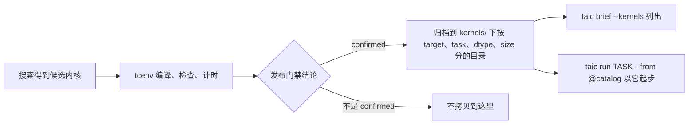

# Kernels

## 这篇讲什么

- 这里只放通过发布门禁（publication gate）、结论为 `confirmed` 的内核（kernel）。
- 一个内核按 target、task（任务）、dtype（数据类型）、size（规模）四层归档，每层一个目录。
- 门禁没确认的内核不会进来；进了这里的内核既能被列出，也能当作下一次搜索的起点。

## 目录布局

确认过的内核，每个 target、task、dtype、size 组合一个目录：

```text
kernels/<target_id>/<task>/<dtype>/<size>/best.metal
kernels/<target_id>/<task>/<dtype>/<size>/meta.json
kernels/<target_id>/<task>/<dtype>/<size>/history.jsonl
```

| 文件 | 内容 |
| --- | --- |
| `best.metal` | 确认过的内核源码；之后出现更高的确认加速比时会替换它 |
| `meta.json` | 这次确认的元数据（来源 run、胜出标签、确认后的加速比等） |
| `history.jsonl` | 每次确认追加一条记录 |

## 什么情况下会写进来

只有发布门禁说 `confirmed` 时，内核才会被拷贝到这里：



`taic brief --kernels` 列出这里的内核。`taic run TASK --from @catalog` 会用同一
target 的 `best.metal` 作为起点。
