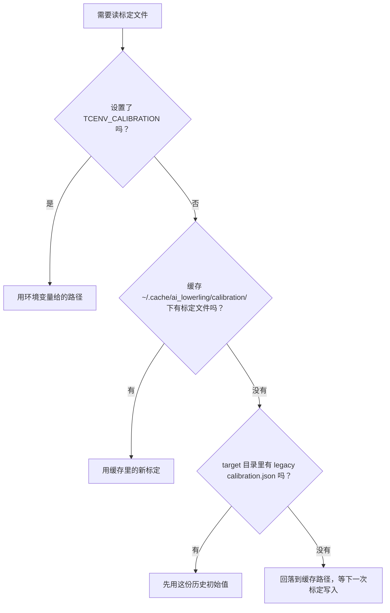

# Targets

## 这篇讲什么

- 一个 target（目标设备）对应一块芯片：它绑定一个 backend（后端），并保存“在这块芯片上测到了什么”。
- target 目录里放设备说明、经验和硬件上限；新的标定（calibration）结果写进用户缓存，不写回仓库。
- 只有 `status = "active"` 的 target 才能启动 `taic run` 或 `tcenv eval`；`_template` 是 `reserved`，不能运行。
- `trust.toml` 是授权登记：谁给哪个模型、哪个 task（任务）、哪个 scope（范围）开的口子，以及这次授权何时作废。

## 一个 target 里有什么

一个 target 就是一块芯片。它指定用哪个 backend，并保存在这块芯片上测量到的结果：`device.md`、`experience.md`，以及 `target.toml` 里的上限。

| 文件 | 作用 |
| --- | --- |
| `target.toml` | 目标档案：`backend`、`status`、设备匹配条件，以及 `[limits]` 里的硬件上限 |
| `device.md` | 这块芯片的设备说明 |
| `experience.md` | 在这块芯片上积累的经验 |
| `calibration.json` | 历史遗留的标定初始值（legacy seed），不是新测量的落盘位置 |
| `trust.toml` | 模型信任登记（model-trust registry），见下文 |
| `trust_audit.jsonl` | 授权审计：每一次授权（grant）、暂停（suspend）、撤销（revoke）都记一条（示例见 `apple-m4-max/`） |

`calibration.json` 只是历史遗留的初始值；新的标定结果会缓存在
`~/.cache/ai_lowerling/calibration/<target_id>.json`（`TCENV_CALIBRATION`
可以覆盖这个路径），不会写回本目录。

读取标定文件时的优先级（实现在 `tcenv/target.py`）：

## 哪些 target 能跑

`apple-m4-max` 是这个仓库实际运行所在的机器。`taic run` 或 `tcenv eval`
启动前，target 必须是 `status = "active"`。`_template` 是 `reserved`（保留），
不能运行。

再加一块 Apple GPU（例如 M3）时，在 `targets/` 下新建一个目录，写
`backend = "metal"`：它复用 `backends/metal`，但测量数据要自己带一份。

## 模型信任登记 trust.toml

`trust.toml` 是这个 target 的模型信任登记表。`_template/trust.toml` 是空的；
`apple-m4-max/trust.toml` 可以保存人给的授权。

- 一次授权（grant）由人发出：某个模型，在某个 task（任务）上，某个 scope（范围）内被信任。
- `trust_audit.jsonl` 记录每一次授权、暂停和撤销。
- prompt 或测量协议（measurement protocol）一改，旧授权就过期（stale）。

细则见 `docs/代理反馈.md`。
