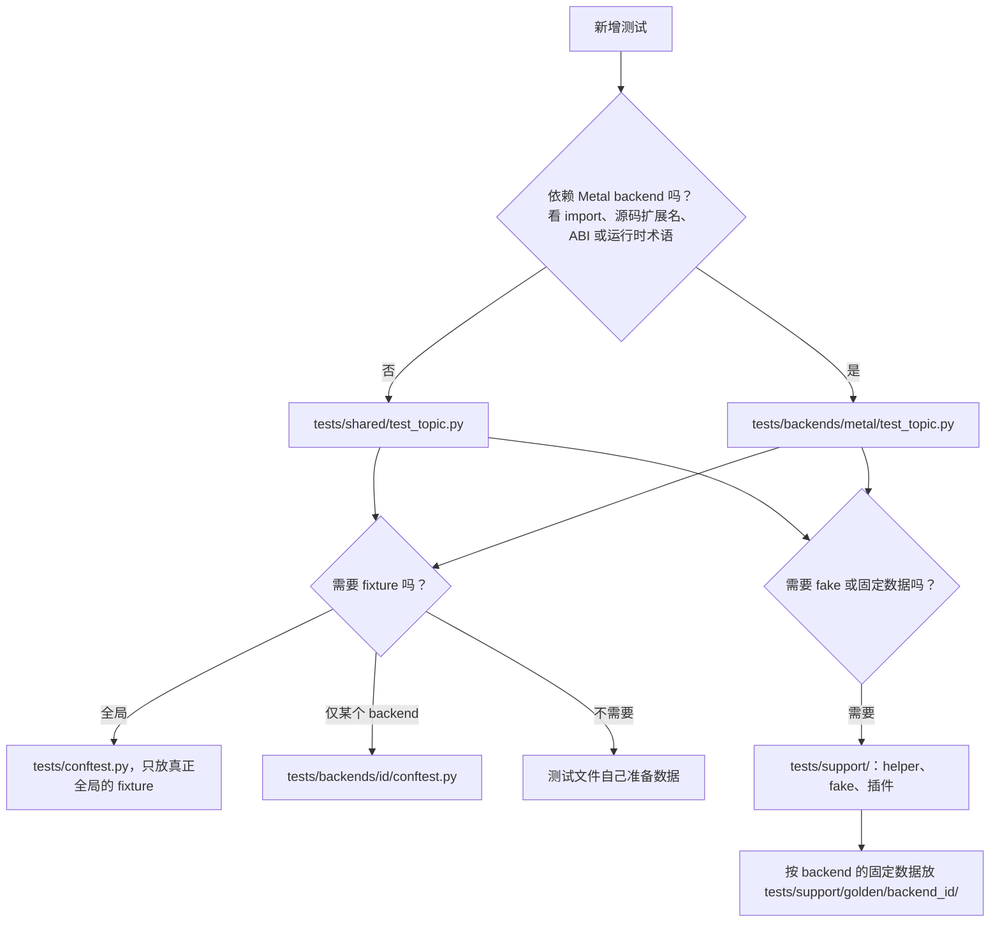

# Tests 目录约定

这份文档说明测试应该放在哪一层。根目录已经没有 `test_*.py`；新测试按这里
的规则放到 `shared/` 或 `backends/<id>/`。

## 这篇讲什么

- 测试按“是否依赖 backend（后端）”分两层：`tests/shared/` 放与 backend 无关的测试，
  `tests/backends/<id>/` 放某个 backend 专属的测试。
- 测试基础设施（fake、pytest 插件、helper、golden 数据）统一放 `tests/support/`，
  这里不放业务测试。
- 根目录只留 `conftest.py`、`README.md` 和 `__init__.py`，不再放测试文件。
- 默认并行跑。不占 GPU、不花钱的安全命令是
  `uv run pytest -q -m 'not gpu and not llm and not slow'`。
- 测试失败时先读 `logs/pytest/triage/triage_summary.md`（分类摘要），再按失败交接
  （handoff）里的单进程命令复现，而不是先翻完整日志。

## 给 AI 的阅读顺序

1. **本文件**：目录分层、放置规则、导入、golden、并行、失败日志。子目录
   README 只补充该层特有规则，不重复这里。
2. `tests/shared/README.md`、`tests/backends/README.md`、
   `tests/backends/metal/README.md`：这一层放什么、不放什么。
3. `tests/support/README.md`、`tests/support/golden/README.md`：有哪些
   helper、pytest 插件和 golden，新增时放哪。
4. `tests/shared/test_structure.py`：上面规则的**可执行版本**（根目录无测试、
   每个 Python 目录是包、`shared/` 不 import backend、`support/` 无业务测试、
   GPU 用例在 xdist 同一组）。
5. 要理解断言本身：`docs/架构/评测.md`（编译、安检、容差、计时协议）和
   `docs/架构/搜索.md`（选择、确认、发布门禁）；observe/index 的测试对应
   `docs/架构/数据层.md`。
6. 失败时：先读 `logs/pytest/triage/triage_summary.md`，再读它指向的
   Markdown；不要先翻完整 stdout/transcript（见本文「日志与 AI handoff」）。

安全命令是 `uv run pytest -q -m 'not gpu and not llm and not slow'`：不占 GPU、
不花钱，也不跑长时间的 `slow` 检查。`uv run pytest -q` 会跑 `gpu` 用例（GPU
也是显示器），只在明确允许时运行；`-m gpu` / `-m llm` 同样要显式许可。

## 目录结构

```text
tests/
├── conftest.py                 # 全局 fixture、GPU lock、observe/kernel 隔离
├── README.md                   # 本文件
├── support/                    # 测试基础设施，不放业务测试
│   ├── fakes.py                # 脚本化 LLM/响应
│   ├── handoff.py              # 失败 AI handoff 插件
│   ├── run_logs.py             # xdist-safe 日志插件
│   ├── orchestrator.py         # 脚本化 LLM/evaluator helper
│   ├── resume.py               # resume/CLI helper
│   ├── triton_specs.py         # Triton spec helper
│   ├── dashboard.py            # dashboard fixture 插件
│   ├── llm.py                  # LLM 错误 helper
│   ├── hw_golden.py            # golden 读取/重录工具
│   ├── fake_worker_*.py        # 子进程 worker 替身
│   └── golden/
│       ├── metal/              # 按 backend 分目录的 golden 数据
│       ├── shared/             # v1 标本与 native host fixture
│       └── remote/             # 远程合同向量，不是真机测量
├── shared/                     # backend 无关测试
│   ├── test_*.py
│   └── __init__.py
├── backends/
│   ├── README.md
│   └── metal/                  # Metal 特有测试
│       ├── test_*.py
│       └── __init__.py
└── __init__.py
```

每个 Python 目录都要有 `__init__.py`；pytest 会递归收集。

## 放哪一层

| 测试内容 | 位置 |
| --- | --- |
| 不依赖 backend 的搜索、审查、observe、预算、信任、任务接口 | `tests/shared/` |
| 只对 Metal 有意义的语法、ABI、启动、运行、xctrace、Metal baseline | `tests/backends/metal/` |
| 未来其他 backend 的同类测试 | `tests/backends/<backend_id>/` |
| 测试专用 helper、fake、pytest 插件 | `tests/support/` |
| backend 专属 golden/fixture | `tests/support/golden/<backend_id>/` |

后端特有测试不得放进 `tests/shared/`，不得在 `shared` 里 import
`tcenv.backends.metal.*`。需要跨层复用的内容先抽到 `tests/support/` 或业务模块，
不要在测试之间互相 import `tests.test_*`；backend 测试应只依赖
`tests.support.*`。

## 新测试的放置步骤

1. 判断它是否依赖 backend：看 import、源码扩展名、Metal/ABI/运行时专用术语。
2. backend 无关 → `tests/shared/test_<topic>.py`。
3. Metal 专属 → `tests/backends/metal/test_<topic>.py`。
4. 需要 fake/固定数据 → 放到 `tests/support/`；数据按 backend 放
   `tests/support/golden/<backend_id>/`。
5. 根 `conftest.py` 只放真正全局的 fixture。某个 backend 的 fixture 放
   `tests/backends/<id>/conftest.py`，不要污染全局。
6. 新测试不要再放到 `tests/` 根目录；根目录只有 `conftest.py`、`README.md`
   和 `__init__.py`。

对应的判断流程：



## Import 规则

`tests/` 是一个包（每个目录都有 `__init__.py`）。实际约定是**包内相对导入**：

```python
from ..support.fakes import FakeClient       # tests/shared/... and tests/backends/metal/...
from .fakes import FakeClient                # inside tests/support/
```

绝对导入（`from tests.support.fakes import ...`）也能工作，但同一个目标只
选一种写法，不要混用。不要 `import tests.test_*`。

测试数据路径从 helper 或 `Path(__file__)` 推导，不要写死当前工作目录；需要
golden 时通过 `tests.support.hw_golden.GOLDEN` / `FIXTURES`，不要自己拼
`tests/support/golden/...`。

## Golden 数据

按 backend 分桶：

```text
tests/support/golden/
├── metal/
│   ├── backend_phase0_kernel.metal
│   ├── hw_off.json
│   └── fixtures/
└── <future-backend>/
```

规则：

- backend 专属的源码、report、prompt hash、fixture 都放在
  `golden/<backend_id>/`；
- 不要把新的 Metal 文件直接放在 `golden/` 根下；
- 重录必须走对应 helper/命令，例如
  `uv run python -m tests.support.hw_golden --record --reason "..."`；
- golden 改动要和生成它的代码改动放在同一提交，并写明原因。

## 并行与隔离

默认命令就是并行：

```bash
uv run pytest -q                         # -n auto --dist loadgroup
uv run pytest -q -n 0                    # 串行复现
uv run pytest -q --no-test-file-log      # 不写 per-test 日志
uv run pytest -q -m 'not gpu and not llm and not slow'   # 快速 CPU 套件（AI 默认）
uv run pytest -q -m 'not gpu and not llm'                # 完整 CPU 套件（含 slow）
uv run pytest -q -m gpu -n 0                             # GPU 套件串行
```

三个 marker（标记）的含义，以及安全命令是否排除它们：

| marker | 含义 | `-m 'not gpu and not llm and not slow'` |
| --- | --- | --- |
| `gpu` | 需要 Metal 设备；GPU 同时驱动显示器 | 排除 |
| `llm` | 调用模型端点，会花钱 | 排除 |
| `slow` | 长时间的检查 | 排除 |

`tests/conftest.py` 给所有 `gpu` 用例加 `xdist_group("gpu")`，配合
`--dist loadgroup` 把它们固定在同一个 worker 上：GPU 测量本来就要独占锁，
并行只会让 worker 互等（最长 `DEFAULT_MAX_WAIT_S`，30 分钟）。CPU 用例仍按
负载分到其他 worker。

并行工作者的规则：

- 不依赖测试执行顺序，不修改其他测试的全局状态；
- 文件写 `tmp_path`，环境变量用 `monkeypatch`；
- GPU 测试必须带 `@pytest.mark.gpu`；全局 GPU lock 会串行化真实测量；
- LLM 测试必须带 `@pytest.mark.llm`；默认命令没有排除它，会照常收集，所以会花钱的用例只在明确许可下运行，AI 默认用上面的安全命令；
- 需要独占资源时用锁或 `xdist_group`，不要假设“只有一个 worker”；
- 少数测试只读仓库里的 `runs/`（例如 `shared/test_observe_turns.py`），
  目录不在时 skip；全新 checkout 的 skip 不是失败。

## 外部环境与副作用

- Docker/VM/远程服务集成测试必须 import-safe：模块顶层不得创建 Docker client、连接
  socket、启动 VM、读取宿主机凭据或执行其他外部副作用；这些动作只能放在 lazy fixture
  或测试函数内。
- 缺授权或缺环境时，skip 必须先于任何外部 fixture/安装/连接动作执行，不能先产生副作用
  再补一个 skip。专用授权开关只用于对应集成测试，不改变上面的默认安全命令。
- 纯 fake 测试默认进入 CPU 安全套件；真实外部服务使用独立、显式的 opt-in，失败不得
  静默退回 local 或真实设备。测试需要清理时，清理本身也要有验证，不能以未清理的残留
  换取通过。

## 日志与 AI handoff

xdist 下每个 worker 独立写：

```text
logs/pytest/session-<worker>.log
logs/pytest/tests/<worker>/<nodeid>.log
logs/pytest/triage/<worker>/<nodeid>.md
logs/pytest/triage/<worker>/manifest.jsonl
logs/pytest/triage/triage_summary.md        # controller 汇总
```

失败用例的 Markdown 中有：

```text
---BEGIN_AI_FAILURE_HANDOFF---
{ ... worker, nodeid, source, error_kind, feedback,
     per_test_log.path, per_test_log.tail, minimal_repro_cmd ... }
---END_AI_FAILURE_HANDOFF---
```

AI/人应先读 `triage_summary.md`，再读对应 Markdown 的 JSON 块，最后用块里的
单进程命令复现；不要先翻完整 stdout/transcript。

不想要 failure handoff 时加 `--no-failure-handoff`；不想要 per-test 日志时加
`--no-test-file-log`（两者都只影响日志，不改变测试结果）。

## 迁移状态

| 阶段 | 内容 |
| --- | --- |
| 阶段 1/2 | `shared/`、`backends/`、`support/` 目录和 helper/golden 已建立。 |
| 阶段 3 | 已把第一批明确的 Metal 测试移入 `tests/backends/metal/`（backend adapter/registry/phase 0、launch/ABI、tcenv、baselines、bench limit、pressure、skills/symptom、xctrace、orchestrator GPU）。 |
| 阶段 3 第二批 | 任务/契约层的 Metal 测试（contracts、generated tasks、mamba2、domain sweep、elementwise semantics）也已移入 `tests/backends/metal/`。 |
| 阶段 3 收尾 | dispatch、IEEE 特殊值、硬件特征检测和 hwfeedback 也已移入 `tests/backends/metal/`；通用文件里混着的 Metal 测试也已拆出到 `test_abi.py`、`test_triton_baseline.py`、`test_orchestrator_profiling.py`。根目录剩下的是通用搜索/审查/observe/预算/锁/target/schema 测试，不再直接 import `tcenv.backends.metal.*`。 |
| 阶段 4 | 已完成，根目录不再有 `test_*.py`；所有 backend 无关测试在 `tests/shared/`，所有 Metal 测试在 `tests/backends/metal/`。测试模块之间不再互相 import fixture/helper；共享 dashboard fixture 由 `tests/support/dashboard.py` 提供。 |
| 迁移后校正 | `test_distributions.py` 没有 Metal import，已移回 `tests/shared/`；`test_dispatch.py` 的 CPU 半（batch probe / interleaved）并入 `tests/shared/test_bench.py`，`tests/backends/metal/test_dispatch.py` 只留 GPU 用例；`test_abi.py` 的单个用例并入 `test_launch.py`；两个自指的 `test_layout.py` 换成 `tests/shared/test_structure.py`（根目录无测试、每个目录是包、`shared/` 不 import backend、`support/` 无业务测试）。 |

迁移时一次只移动一组，先跑目标测试，再跑全量；不要把目录移动和业务改动混在一起。
